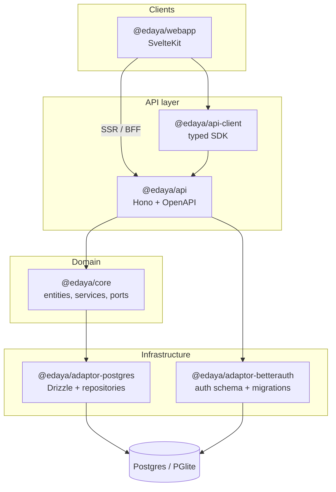

# Edaya Core

Monorepo for the Edaya platform: a **Hono API** (`apps/api`), a **SvelteKit webapp** (`apps/webapp`), shared **domain core** (`packages/core`), persistence/auth adaptors, and a generated **API client**.

Built with [Bun](https://bun.sh) workspaces and [Turborepo](https://turbo.build).

## Solution architecture

The codebase follows a **ports-and-adapters** layout: business rules live in `@edaya/core`; infrastructure (Postgres, Better Auth) lives in adaptor packages; the API is a thin HTTP layer; the webapp consumes the API through `@edaya/api-client`.



### Request flow

1. **Webapp** — Server code calls the API via `API_URL` (`@edaya/api-client`). In dev, Vite proxies `/api`, `/doc`, and `/reference` to the API.
2. **API** — Hono middleware resolves env, session, and a cached runtime (`getApiRuntime`).
3. **Runtime** — Opens the database, runs auth migrations, wires Better Auth, and builds `SchoolApplication` with Postgres repositories.
4. **Core** — `SchoolApplication.forActor(actor)` returns `SchoolService` for commands, queries, and entity CRUD with authorization.

### API runtimes

| Runtime | Entry | Env source | Local command |
|---------|-------|------------|---------------|
| **Node** | `apps/api/src/entries/node.ts` | `.env` (dotenv) | `cd apps/api && bun dev` |
| **Worker** | `apps/api/src/entries/worker.ts` | `wrangler.toml` + `.dev.vars` | `cd apps/api && bun run dev:worker` |

Node supports in-memory Postgres (`DATABASE_URL=pglite`). Workers require a real Postgres URL.

### API layout

- `apps/api/src/routes/` — OpenAPI route modules (thin HTTP surface)
- `apps/api/src/lib/school-api/` — registry, schemas, dispatch, entity handlers
- `apps/api/src/lib/runtime/` — database, auth, runtime registry
- `packages/core/src/` — domains, entities, authorization, services, ports

More detail: [docs/done/api-folder-structure.md](./docs/done/api-folder-structure.md), [docs/done/api-runtimes.md](./docs/done/api-runtimes.md).

## Packages

| Package | Path | Role |
|---------|------|------|
| `@edaya/api` | `apps/api` | Hono HTTP API (Node + Cloudflare Workers), OpenAPI, dev seed |
| `@edaya/webapp` | `apps/webapp` | SvelteKit UI (Cloudflare Pages adapter) |
| `@edaya/core` | `packages/core` | Domain model, business services, authorization, repository ports |
| `@edaya/adaptor-postgres` | `packages/adaptor-postgres` | Drizzle schema, migrations, Postgres repository implementations |
| `@edaya/adaptor-betterauth` | `packages/adaptor-betterauth` | Better Auth Drizzle schema and SQL migrations |
| `@edaya/api-client` | `packages/api-client` | Type-safe client for entities, commands, queries (generated bindings) |
| `@edaya/integration-tests` | `testing/integration-tests` | Cross-package integration tests (auth, Postgres, core services) |

## Prerequisites

- [Bun](https://bun.sh) 1.2+ (see `packageManager` in root `package.json`)

## First-time setup

```sh
bun install

cp apps/api/.env.example apps/api/.env
cp apps/webapp/.env.example apps/webapp/.env
```

## Local development

```sh
bun dev
```

| Service | URL |
|---------|-----|
| Webapp | http://localhost:5173 |
| API | http://localhost:9999 |
| OpenAPI reference | http://localhost:9999/reference |

Or run apps separately:

```sh
cd apps/api && bun dev          # Node API
cd apps/webapp && bun dev       # SvelteKit
```

**Worker runtime** (API on Cloudflare):

```sh
cp apps/api/.dev.vars.example apps/api/.dev.vars
cd apps/api && bun run dev:worker
```

See [docs/done/local-dev.md](./docs/done/local-dev.md) for database options, dev seed, troubleshooting, and how the webapp connects to the API.

## Commands

All root scripts run across the monorepo via Turborepo unless noted.

### Development

| Command | Description |
|---------|-------------|
| `bun dev` | Start API + webapp in watch mode |
| `bun seed` | Run dev database seed (API) |
| `cd apps/api && bun dev` | API only (Node, port 9999) |
| `cd apps/api && bun run dev:worker` | API only (Cloudflare Worker) |
| `cd apps/webapp && bun dev` | Webapp only (port 5173) |
| `cd apps/webapp && bun run preview` | Preview production build |
| `cd apps/webapp && bun run preview:cloudflare` | Preview on Cloudflare Pages locally |
| `cd apps/webapp && bun run deploy` | Build and deploy webapp to Cloudflare Pages |
| `cd apps/api && bun start` | Run compiled API (`dist/`) |

### Database

| Command | Description |
|---------|-------------|
| `bun run db:generate` | Generate school schema SQL migrations (`@edaya/adaptor-postgres`) |
| `bun run db:migrate` | Apply school schema migrations |
| `bun run db:generate:auth` | Generate auth schema SQL migrations (`@edaya/adaptor-betterauth`) |
| `bun run db:migrate:auth` | Apply auth schema migrations |
| `bun run auth:generate-schema` | Regenerate Better Auth Drizzle schema from CLI config |

Package-level extras (run from adaptor package or with `bun --filter`):

| Command | Description |
|---------|-------------|
| `bun --filter @edaya/adaptor-postgres db:push` | Push schema to database (drizzle-kit) |
| `bun --filter @edaya/adaptor-postgres db:studio` | Open Drizzle Studio |
| `bun --filter @edaya/adaptor-betterauth db:push` | Push auth schema |
| `bun --filter @edaya/adaptor-betterauth db:studio` | Drizzle Studio for auth schema |

### OpenAPI & API client

| Command | Description |
|---------|-------------|
| `bun run openapi:generate` | Export OpenAPI from API → regenerate webapp types + API client bindings |
| `cd apps/api && bun run export-openapi` | Export OpenAPI JSON only |
| `cd apps/api && bun run generate-api-client` | Regenerate `@edaya/api-client` bindings only |
| `cd apps/webapp && bun run openapi:generate` | Regenerate `schema.d.ts` from local OpenAPI JSON |

### Quality & CI

| Command | Description |
|---------|-------------|
| `bun run lint` | ESLint all packages |
| `bun run lint:fix` | ESLint with auto-fix |
| `bun run check` | TypeScript / Svelte type checks |
| `bun run quality` | `lint` + `check` per package |
| `bun run test` | Unit and integration tests |
| `bun run test:coverage` | Tests with coverage (where supported) |
| `bun run build` | Build all packages |
| `bun run fullcheck` | `lint:fix` → `quality` → `build` → `test` (full gate) |

### Per-package shortcuts

```sh
bun --filter @edaya/core test
bun --filter @edaya/api test
bun --filter @edaya/integration-tests test
bun --filter @edaya/webapp check
bun --filter @edaya/api-client check
```

## Environment

**API** (`apps/api/.env`):

| Variable | Purpose |
|----------|---------|
| `DATABASE_URL` | `pglite` (in-memory dev) or `postgres://…` |
| `BETTER_AUTH_SECRET` | Auth signing secret |
| `BETTER_AUTH_URL` | Public API URL for auth callbacks |
| `TRUSTED_ORIGINS` | CORS / auth origins (e.g. webapp URL) |
| `SEED_ON_START` | Auto-seed on startup (`true` / `false`; default on with `pglite` in dev) |

**Webapp** (`apps/webapp/.env`):

| Variable | Purpose |
|----------|---------|
| `API_URL` | Server-side API base URL (SSR, remote handlers) |
| `PUBLIC_API_URL` | Browser-facing API URL |
