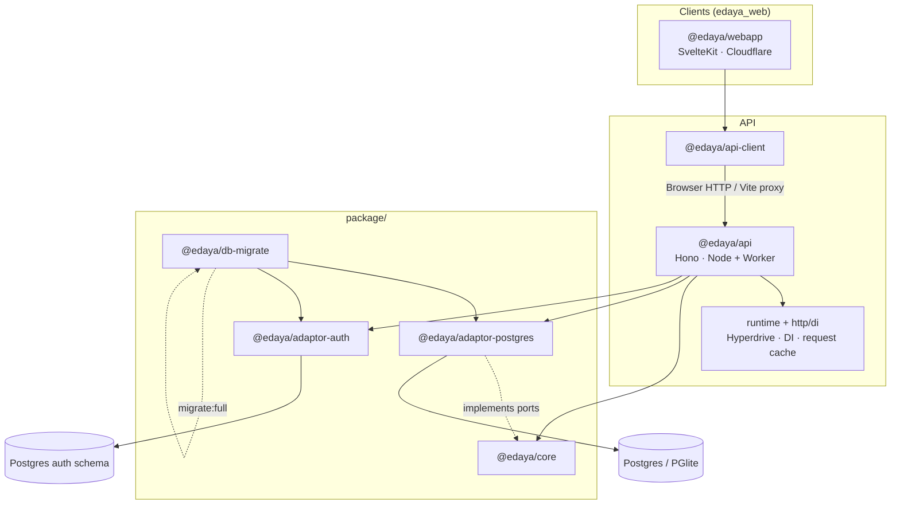

# Edaya Core

Monorepo for the Edaya platform backend: a **Hono API** (`apps/api`) with scheduled cron jobs, shared libraries under **`package/`** (domain core, adaptors, integrations, generated API client), and **`tooling/`** harnesses.

Web frontends live in the separate **[edaya_web](../edaya_web)** repo (`@edaya/webapp`, `@edaya/saas-admin`).

Built with [Bun](https://bun.sh) workspaces and [Turborepo](https://turbo.build).

## Monorepo layout

```text
edaya_backend/
├── apps/
│   └── api/                              @edaya/api — Hono API + scheduled cron (Node + Worker)
├── package/
│   ├── domain-core/                      @edaya/core — domain, services, ports
│   ├── adaptor-postgres/                 @edaya/adaptor-postgres — school schema, repos, SQL
│   ├── adaptor-novu/                     @edaya/adaptor-novu — Novu notification gateway
│   ├── adaptor-r2/                       @edaya/adaptor-r2 — R2 file storage adapter
│   ├── adaptor-local-fs/                 @edaya/adaptor-local-fs — local dev file storage adapter
│   ├── adaptor-auth/                     @edaya/adaptor-auth — Better Auth schema + runtime migrations
│   └── generated-api-client/             @edaya/api-client — typed API SDK
└── tooling/
    ├── repo/                             @edaya/repo — CI, OpenAPI codegen, dev tools
    ├── fixtures/                         @edaya/fixtures
    ├── seeding/                          @edaya/seeding
    ├── db-migrate/                       @edaya/db-migrate — school + auth migration CLI
    ├── novu-ops/                         @edaya/novu-ops — Novu bootstrap + subscriber cleanup
    └── integration-tests/                @edaya/integration-tests (+ smoke/)
```

**Boundary rule:** `package/domain-core`, `package/adaptor-postgres`, `package/generated-api-client`, and `package/adaptor-novu` stay vendor-agnostic; `package/adaptor-auth` owns Better Auth persistence; `tooling/db-migrate` owns migration CLI scripts; `tooling/novu-ops` owns Novu bootstrap/cleanup CLI; Worker host wiring (Hyperdrive, DI, request runtime cache) lives in `apps/api`.

## Solution architecture

The codebase follows a **ports-and-adapters** layout: business rules live in `@edaya/core`; portable Postgres persistence lives in `@edaya/adaptor-postgres`; Better Auth persistence lives in `@edaya/adaptor-auth`; migration CLI lives in `@edaya/db-migrate`; the API wires runtime and HTTP. Web clients consume the API through `@edaya/api-client` in **edaya_web**.



### Request flow

1. **Web clients** — Static browser SPAs in **edaya_web** call the API through `@edaya/api-client`. In local development, Vite proxies same-origin `/core`, `/auth`, `/doc`, `/reference`, `/graphql`, and `/graphiql` requests to `API_URL`. Production builds use `PUBLIC_API_URL` when the API is not same-origin.
2. **API** — Hono middleware resolves env, session, and a cached runtime (`getApiRuntime`).
3. **Runtime** — Opens the school Postgres DB and auth store (same Neon/PGlite, `auth` schema), runs migrations, wires Better Auth, and builds `SchoolApplication` with Postgres repositories.
4. **Core** — `SchoolApplication.forActor(actor)` returns `SchoolService` for commands, queries, and entity CRUD with authorization.

### API runtimes

| Profile | Entry | Env source | Local command |
|---------|-------|------------|---------------|
| **local** | `apps/api/src/entries/local.ts` | `apps/api/.env` | `bun repo dev` (API + local-files) |
| **in-memory** | tests / harness | programmatic env | `bun test` in `apps/api` |
| **worker** | `apps/api/src/entries/worker.ts` | `wrangler.jsonc` + `.dev.vars` | `bun --filter @edaya/api dev:worker` (optional smoke) |

`local` uses persisted PGlite by default (`DATABASE_URL=pglite:.data/school`). `in-memory` uses ephemeral PGlite for fast tests. Workers require a real Postgres URL via Hyperdrive.

### API layout

- `apps/api/src/routes/` — OpenAPI route modules (thin HTTP surface)
- `apps/api/src/lib/school-api/` — registry, schemas, dispatch, entity handlers
- `apps/api/src/runtime/` — database, auth, Worker bindings, Hyperdrive, runtime registry
- `apps/api/src/http/` — Hono app, dependency injection middleware
- `package/domain-core/src/` — domains, entities, authorization, services, ports

More detail: [docs/reference/runtime-boundaries.md](./docs/reference/runtime-boundaries.md), [docs/reference/api-runtimes.md](./docs/reference/api-runtimes.md), [docs/reference/cross-repo-workflow.md](./docs/reference/cross-repo-workflow.md).

## Workspace packages

### Apps

| Package | Path | Role |
|---------|------|------|
| `@edaya/api` | `apps/api` | Hono HTTP API (Node + Cloudflare Workers), OpenAPI, scheduled cron, dev seed, Worker host wiring |

### Package workspace

| Package | Path | Role |
|---------|------|------|
| `@edaya/core` | `package/domain-core` | Domain model, business services, authorization, repository ports |
| `@edaya/adaptor-postgres` | `package/adaptor-postgres` | School Drizzle schema, SQL migrations, Postgres repository implementations |
| `@edaya/adaptor-novu` | `package/adaptor-novu` | Novu Cloud `NotificationGatewayPort` adapter |
| `@edaya/adaptor-auth` | `package/adaptor-auth` | Better Auth Drizzle schema, SQL migrations, runtime `runMigrations()` |
| `@edaya/api-client` | `package/generated-api-client` | Type-safe client for entities, commands, queries (generated bindings) |

### Tooling

| Package | Path | Role |
|---------|------|------|
| `@edaya/repo` | `tooling/repo` | Repo CLI (`bun repo`), CI checks, OpenAPI tooling |
| `@edaya/fixtures` | `tooling/fixtures` | Shared dev seed IDs, fixture records, and minimal seed helpers |
| `@edaya/seeding` | `tooling/seeding` | HTTP seed orchestration (via `bun repo seed`) |
| `@edaya/db-migrate` | `tooling/db-migrate` | School + auth migration CLI (Neon / Hyperdrive) |
| `@edaya/novu-ops` | `tooling/novu-ops` | Novu workflow bootstrap + subscriber cleanup CLI |
| `@edaya/integration-tests` | `tooling/integration-tests` | Integration tests, staging smoke, Novu smoke |

## Prerequisites

- [Bun](https://bun.sh) 1.3+ (see `packageManager` in root `package.json`)

## First-time setup

```sh
bun install

cp apps/api/.env.example apps/api/.env
cp .env.example .env   # optional — seeding, migrations, smoke-test staging
```

Web frontends: see **[edaya_web](../edaya_web/README.MD)** (`cp apps/webapp/.env.example apps/webapp/.env` there).

## Local development

```sh
bun repo dev
```

| Service | URL |
|---------|-----|
| API | http://localhost:9999 |
| OpenAPI reference | http://localhost:9999/reference |

Webapp (port 5173) runs from **edaya_web** — see [edaya_web README](../edaya_web/README.MD).

`bun repo dev` starts the API **and** `@edaya/local-files-server` (required for uploads). Running `cd apps/api && bun repo dev` alone starts the API without the file server.

**worker smoke** (Miniflare — optional, hits remote Neon/R2):

```sh
cp apps/api/.dev.vars.example apps/api/.dev.vars
bun --filter @edaya/api dev:worker
```

See [docs/reference/local-dev.md](./docs/reference/local-dev.md) for database options, dev seed, and troubleshooting.

## Commands

**Development and ops:** [`bun repo`](./docs/reference/repo-cli.md) — `bun repo dev`, `bun repo seed`, `bun repo db …`, etc. **No Turbo in `bun repo`** — use root scripts below.

**Turbo quality** (root `package.json`):

| Command | Description |
|---------|-------------|
| `bun run verify` | Pre-PR gate: `bun repo verify` + quality + build + test |
| `bun repo verify --full` | Local PR CI: `bun run verify` + `test:integration` |
| `bun run lint` | ESLint across workspaces |
| `bun run lint:fix` | ESLint with auto-fix |
| `bun run check` | TypeScript checks |
| `bun run test` | Unit tests (Turbo; excludes integration-tests) |
| `bun run build` | Build deployable bundles |
| `bun run quality` | `lint` + `check` per package |
| `bun run test:coverage` | Unit coverage (informational) |
| `bun run test:integration` | Integration api + http slices |
| `bun run test:integration:seed` | Integration seed slice (slow, opt-in) |

### Pre-PR verification

```sh
bun repo verify --full       # PR blocking CI locally (verify + integration)
bun run verify               # CI verify job only (no integration)
bun repo verify              # repo hygiene only (doctor + repo check *)
bun run test:integration     # integration slices alone
```

Full command tree: **[docs/reference/repo-cli.md](./docs/reference/repo-cli.md)**. CI workflow details: **[docs/reference/ci-setup.md](./docs/reference/ci-setup.md)**.

### Per-package iteration

```sh
bun --filter @edaya/core test
bun --filter @edaya/api lint
```

Then `bun run verify` before opening a PR. Webapp tests run from **edaya_web**.

## Testing

Tests are split by layer. **`bun run test`** runs Turbo unit tests only. **`bun run test:integration`** runs in-memory integration slices (see [test-pyramid-plan.md](./docs/sprints/test-pyramid-plan.md)).

| Layer | Package / path | What to test here |
|-------|----------------|-------------------|
| Domain | `package/domain-core/tests/` | Entities, authorization, service workflows |
| API unit | `apps/api/tests/` | HTTP helpers, runtime, route builders, thin route tests |
| API harness | `apps/api/tests/support/core-route-harness.ts` | Shared PGlite app + auth helpers (also used by integration-tests) |
| Cross-package | `tooling/integration-tests/src/` | Seeds, auth flows, PGlite persistence, full route scenarios |

**Conventions**

- Put pure domain tests in `@edaya/core`.
- Put API transport/runtime tests in `apps/api/tests/`, mirroring `src/` layout (`http/`, `runtime/`, `routes/`, `lib/`).
- Put scenarios that span seeding, auth, and Postgres in `@edaya/integration-tests`.
- Integration-tests import the canonical route harness from `@api-tests/support/core-route-harness` (resolved to `apps/api/tests/support/`).

## Environment

**API** (`apps/api/.env`):

| Variable | Purpose |
|----------|---------|
| `DATABASE_URL` | `pglite:.data/school` (local), `pglite` (in-memory tests); Postgres via Hyperdrive on `worker` |
| `BETTER_AUTH_SECRET` | Auth signing secret |
| `BETTER_AUTH_URL` | Public API URL for auth callbacks |
| `TRUSTED_ORIGINS` | CORS / auth origins (e.g. webapp URL) |

Seeding uses per-school `seedingApiKey` values from `@edaya/fixtures` — no API env key required.

Webapp env vars live in **edaya_web** (`apps/webapp/.env`).
