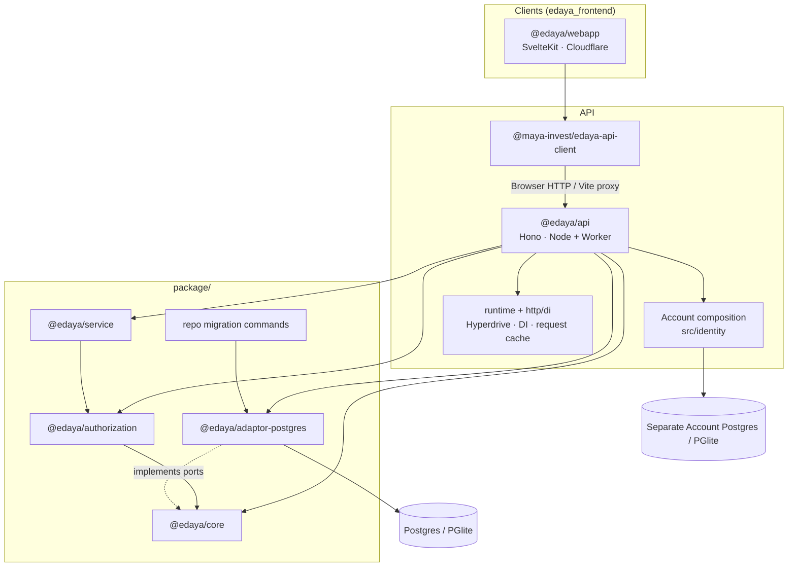

# Edaya Core

See [API configuration and secrets](docs/reference/api-configuration.md) for JSONC settings, secrets-only files, and the `bun run repo maintenance vars` commands.

Monorepo for the Edaya platform backend: a **Hono API** (`apps/api`) with scheduled cron jobs, shared libraries under **`package/`** (domain, authorization, school service, adaptors, generated API clients), and **`tooling/`** harnesses.

Web frontends live in the separate **[edaya_frontend](../edaya_frontend)** repo (`@edaya/webapp`, `@edaya/webadmin`).

Built with [Bun](https://bun.sh) workspaces and [Turborepo](https://turbo.build).

## Monorepo layout

```text
edaya_backend/
├── apps/
│   └── api/                              @edaya/api — Hono API + scheduled cron (Node + Worker)
├── package/
│   ├── domain-account/                   @edaya/account — durable Account/security policy and auth ports
│   ├── adaptor-account/                  @edaya/adaptor-account — Account persistence and cryptography
│   ├── adaptor-auth-better-auth/         @edaya/adaptor-auth-better-auth — replaceable OTP provider
│   ├── adaptor-auth/                     @edaya/adaptor-auth — disposable provider schema/migrations
│   ├── domain-core/                      @edaya/core — entities, ports, registry
│   ├── domain-authorization/             @edaya/authorization — grants, policy, operations
│   ├── domain-service/                   @edaya/service — workflows, entity configs, notifications, cron
│   ├── adaptor-postgres/                 @edaya/adaptor-postgres — school schema, repos, SQL
│   ├── adaptor-notify/                   @edaya/adaptor-notify — in-process email/push adapters
│   ├── adaptor-docs/                     @edaya/adaptor-docs — in-process PDF rendering
│   ├── adaptor-r2/                       @edaya/adaptor-r2 — R2 file storage adapter
│   ├── adaptor-local-fs/                 @edaya/adaptor-local-fs — local dev file storage adapter
│   └── api-client/                       @maya-invest/edaya-api-client — typed authentication and school API SDK
└── tooling/
    ├── repo/                             @edaya/repo — CLI, CI, client generation, migrations, dev services
    │   ├── codegen/                      OpenAPI client generator and runtime templates
    │   ├── db/school/                    school migration and guarded reset commands
    │   ├── db/identity/                  Account/provider migration and guarded wipe commands
    │   └── dev/local-files.ts            local upload HTTP service
    ├── fixtures/                         @edaya/fixtures — shared seed data and test helpers
    ├── seeding/                          @edaya/seeding — seed workflows and HTTP orchestration
    ├── integration-tests/                @edaya/integration-tests — integration and smoke suites
    └── test-support/                     shared Bun preload (no package.json)
```

**Boundary rule:** `package/domain-core`, `package/domain-authorization`, `package/domain-service`, and adaptor packages never depend on `apps/` or `tooling/`. Account authentication and its replaceable Better Auth adapter live in this workspace. Flutter apps live in `edaya_mobile`; the former identity repository is no longer a build dependency. `tooling/repo/db/school` owns school migration CLI scripts; Worker host wiring (Hyperdrive, DI, request runtime cache) lives in `apps/api`.

## Solution architecture

The codebase follows a **ports-and-adapters** layout: entity types and ports live in `@edaya/core`; authorization in `@edaya/authorization`; school orchestration (`SchoolService`) in `@edaya/service`; portable Postgres persistence in `@edaya/adaptor-postgres`; migration CLI in `tooling/repo/db/school`; the API verifies access JWTs and resolves the Account directory in process. Web clients consume the API through `@maya-invest/edaya-api-client`.



### Request flow

1. **Web clients** — Browser SPAs call `/auth/edaya/*` on the API, then call school routes on that same origin with the issued Bearer JWT through `@maya-invest/edaya-api-client`.
2. **API** — Hono middleware resolves env, session, and a cached runtime (`getApiRuntime`).
3. **Runtime** — Lazily opens the separate Account or school database as needed. Auth dispatch precedes school dependencies; typed in-process JWT/directory ports serve school requests. Worker handles close after required work.
4. **Service** — `SchoolApplication.forActor(actor)` returns `SchoolService` for commands, queries, and entity CRUD with authorization.

### API runtimes

| Profile | Entry | Env source | Local command |
|---------|-------|------------|---------------|
| **local** | `apps/api/src/entries/local.ts` | `config.local.jsonc` + `.env` secrets | `bun run repo dev` (API + local-files) |
| **in-memory** | tests / harness | programmatic env | `bun test` in `apps/api` |
| **worker** | `apps/api/src/entries/worker.ts` | `config.staging.jsonc` + `.dev.vars` secrets | `bun --filter @edaya/api dev:worker` (optional smoke) |

`local` uses persisted PGlite by default (`DATABASE_URL=pglite:.data/school`). `in-memory` uses ephemeral PGlite for fast tests. Workers require a real Postgres URL via Hyperdrive.

### API layout

- `apps/api/src/routes/` — OpenAPI route modules (thin HTTP surface)
- `apps/api/src/lib/school-api/` — registry, schemas, dispatch, entity handlers
- `apps/api/src/routes/onboarding.routes.ts` — thin HTTP for school registration; orchestration lives in `@edaya/service` (`capabilities/onboarding`)
- `apps/api/src/cron/` — scheduled cron + queue consumer
- `apps/api/src/runtime/` — database, auth, Worker bindings, Hyperdrive, runtime registry
- `apps/api/src/http/` — Hono app, dependency injection middleware
- `package/domain-core/src/` — entities, ports, registry
- `package/domain-authorization/src/` — grants, policy, operations
- `package/domain-service/src/` — `SchoolService`, workflows, entity configs

More detail: [docs/reference/runtime-boundaries.md](./docs/reference/runtime-boundaries.md), [docs/reference/api-runtimes.md](./docs/reference/api-runtimes.md), [docs/reference/cross-repo-workflow.md](./docs/reference/cross-repo-workflow.md).

## Workspace packages

### Apps

| Package | Path | Role |
|---------|------|------|
| `@edaya/api` | `apps/api` | Hono HTTP API (Node + Cloudflare Workers), OpenAPI, scheduled cron, dev seed, Worker host wiring |

### Package workspace

| Package | Path | Role |
|---------|------|------|
| `@edaya/core` | `package/domain-core` | Domain entities, Zod schemas, repository/gateway ports |
| `@edaya/authorization` | `package/domain-authorization` | Grants, policy, operations, `AuthorizationRepositories` |
| `@edaya/service` | `package/domain-service` | `SchoolService`, workflows, entity configs, notifications, cron |
| `@edaya/adaptor-postgres` | `package/adaptor-postgres` | School Drizzle schema, SQL migrations, Postgres repository implementations |
| `@edaya/adaptor-notify` | `package/adaptor-notify` | In-process email/push adapters |
| `@edaya/adaptor-docs` | `package/adaptor-docs` | In-process PDF rendering |
| `@edaya/adaptor-r2` | `package/adaptor-r2` | Worker `FileStoragePort` adapter |
| `@edaya/adaptor-local-fs` | `package/adaptor-local-fs` | Local-dev `FileStoragePort` adapter |
| `@maya-invest/edaya-api-client` | `package/api-client` | Type-safe client for entities, commands, queries (generated bindings) |

### Tooling

| Package | Path | Role |
|---------|------|------|
| `@edaya/repo` | `tooling/repo` | Repo CLI, CI checks, OpenAPI client generator, school and identity migration commands, local file server |
| `@edaya/fixtures` | `tooling/fixtures` | Shared seed IDs, fixture records, assets, and minimal test helpers |
| `@edaya/seeding` | `tooling/seeding` | Seed workflows and HTTP orchestration (`bun run repo maintenance seed`) |
| `@edaya/integration-tests` | `tooling/integration-tests` | Integration tests, staging smoke, and notification smoke |

The generator's shared contract lives in `package/api-client/src/contract`, exposed as `@maya-invest/edaya-api-client/contract`. The API imports this dependency-free contract; generation code remains in tooling. Tooling uses the root TypeScript and Bun/Node type dependencies.

See [backend tooling audit](docs/reference/backend-tooling-audit.md) for the consolidation decisions and validation.

Run `bun run repo dev` to start the API and local file server directly with Bun. Use `bun run repo maintenance seed` to populate the local development data.

## Prerequisites

- [Bun](https://bun.sh) 1.3+ (see `packageManager` in root `package.json`)

## First-time setup

```sh
bun install

cp apps/api/.env.example apps/api/.env
cp .env.example .env   # optional — seeding, migrations, smoke-test staging
```

Web frontends: see **[edaya_frontend](../edaya_frontend/README.md)** (`cp apps/webapp/.env.example apps/webapp/.env` in that repo).

## Local development

```sh
bun run repo dev
```

| Service | URL |
|---------|-----|
| API | http://localhost:9999 |
| OpenAPI reference | http://localhost:9999/reference |

Webapp (port 5173) runs from **edaya_frontend** — see [edaya_frontend README](../edaya_frontend/README.md).

`bun run repo dev` starts identity, the school API, and the local file server (required for uploads). Run `bun --filter @edaya/api dev` to start only the API.

**worker smoke** (Miniflare — optional, hits remote Neon/R2):

```sh
cp apps/api/.dev.vars.example apps/api/.dev.vars
bun --filter @edaya/api dev:worker
```

See [docs/reference/local-dev.md](./docs/reference/local-dev.md) for database options, dev seed, and troubleshooting.

## Commands

**Development and ops:** [`bun repo`](./docs/reference/repo-cli.md) — `bun run repo dev`, `bun run repo maintenance seed`, `bun run repo maintenance db …`, etc. **No Turbo in `bun repo`** — use root scripts below.

**Turbo quality** (root `package.json`):

| Command | Description |
|---------|-------------|
| `bun run verify` | Pre-PR gate: `bun run repo check` + quality + build + test |
| `bun run repo ci qualify staging` | Local PR CI: `bun run verify` + `test:integration` |
| `bun run lint` | ESLint across workspaces |
| `bun run lint:fix` | ESLint with auto-fix |
| `bun run check` | TypeScript checks |
| `bun run test` | Unit tests (Turbo; excludes integration-tests) |
| `bun run build` | Build generated API-client JavaScript and declarations |
| `bun run quality` | `lint` + `check` per package |
| `bun run test:coverage` | Unit coverage (informational) |
| `bun run test:integration` | Integration api + http slices |
| `bun run test:integration:seed` | Integration seed slice (slow, opt-in) |

### Pre-PR verification

```sh
bun run repo ci qualify staging       # PR blocking CI locally (verify + integration)
bun run verify               # CI verify job only (no integration)
bun run repo check              # repo hygiene only (doctor + repo check *)
bun run test:integration     # integration slices alone
```

Full command tree: **[docs/reference/repo-cli.md](./docs/reference/repo-cli.md)**. CI workflow details: **[docs/reference/ci-setup.md](./docs/reference/ci-setup.md)**.

### Per-package iteration

```sh
bun --filter @edaya/core test
bun --filter @edaya/api lint
```

Then `bun run verify` before opening a PR. Webapp tests run from **edaya_frontend**.

## Testing

Tests are split by layer. **`bun run test`** runs Turbo unit tests only. **`bun run test:integration`** runs in-memory integration slices (see [test-pyramid-plan.md](./docs/sprints/test-pyramid-plan.md)).

| Layer | Package / path | What to test here |
|-------|----------------|-------------------|
| Domain | `package/domain-core/tests/` | Entities, schemas, ports |
| Authorization | `package/domain-authorization/tests/` | Grants, policy, operations |
| Service | `package/domain-service/tests/` | Workflows, entity configs, notifications, cron |
| API unit | `apps/api/tests/` | HTTP helpers, runtime, route builders, thin route tests |
| API harness | `apps/api/tests/support/core-route-harness.ts` | Shared PGlite app + auth helpers (also used by integration-tests) |
| Cross-package | `tooling/integration-tests/src/` | Seeds, auth flows, PGlite persistence, full route scenarios |

**Conventions**

- Put entity/schema tests in `@edaya/core`; authorization tests in `@edaya/authorization`; workflow tests in `@edaya/service`.
- Put API transport/runtime tests in `apps/api/tests/`, mirroring `src/` layout (`http/`, `runtime/`, `routes/`, `lib/`).
- Put scenarios that span seeding, auth, and Postgres in `@edaya/integration-tests`.
- Integration-tests import the canonical route harness from `@api-tests/support/core-route-harness` (resolved to `apps/api/tests/support/`).

## Environment

**API settings** (`apps/api/config.local.jsonc`; credentials in `.env`):

| Variable | Purpose |
|----------|---------|
| `DATABASE_URL` | `pglite:.data/school` (local), `pglite` (in-memory tests); Postgres via Hyperdrive on `worker` |
| `API_ORIGIN` | JWT audience and public school API origin |
| `TRUSTED_ORIGINS` | School API CORS origins |

Seeding uses per-school `seedingApiKey` values from `@edaya/fixtures` — no API env key required.

Webapp env vars live in the **edaya_frontend** repo (`apps/webapp/.env` there).

SMS routing is provided by `@edaya/messaging` with provider implementations in `@edaya/adaptor-sms`. OTP and school notifications share environment-specific `sms_routes`; see [phone verification operations](docs/reference/phone-verification.md).
