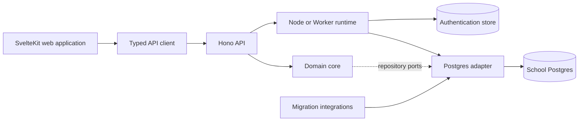

# Let Product Constraints Design Your Software Boundaries

## Building a cloud-native TypeScript SaaS without premature distribution

It is tempting to begin a TypeScript SaaS by selecting a framework and copying a starter repository. That can be correct for a simple product. But frameworks cannot decide which failures matter to the business.

For a school-management platform, several product constraints have direct architectural consequences:

- Multiple schools require tenant isolation throughout the system.
- Staff, guardians, and students have different identities and access relationships.
- Enrollment, attendance, assessments, and finance contain operations that cannot always be reduced safely to record editing.
- Sensitive data requires authorization in the business layer, not only in the user interface.
- A small team needs one coherent codebase rather than a fleet of independently operated services.
- Local development must remain simple while production uses managed cloud infrastructure.

Architecture begins by making those consequences visible.

## The smallest useful set of boundaries

The resulting system is a modular monolith in a TypeScript monorepo. It contains a SvelteKit web application, a Hono API, a shared domain core, a Postgres adapter, a generated API client, platform-specific integrations, and dedicated testing tools.

The important point is not the folder names. It is the direction of dependency.

The domain core owns business rules. It does not know whether an HTTP request came through Node or a Cloudflare Worker. Repository ports describe the persistence capabilities the domain needs. The Postgres adapter implements those ports. The API translates HTTP requests into domain operations. The web application consumes an explicit API contract.

Infrastructure can change without asking the meaning of enrollment, payment, or authorization to change with it.

## The monorepo as an ownership map

The repository is divided into four categories:

- `apps` contains deployable entry points.
- `packages` contains the domain, persistence adapter, and typed client.
- `integrations` contains provider-specific migration and deployment orchestration.
- `testing` contains fixtures, seeding, integration tests, and staging smoke tests.

This structure mirrors responsibility. Applications compose the system. Domain packages define behavior. Integrations know about platforms. Testing tools prove that the assembled service works.

The boundary is valuable only while it remains understandable and enforceable. Too many packages can slow a small team. Too few boundaries allow business logic, infrastructure code, and transport concerns to become inseparable. The right structure is the smallest one that makes important ownership visible.

## Cloud native without defaulting to microservices

Cloud-native architecture is often treated as a synonym for containers, Kubernetes, or microservices. Those choices can give a small team more operational surface than product value.

Here, cloud native means something more practical:

- Runtime configuration is explicit and validated.
- The API runs locally on Node with PGlite and SQLite.
- The same application runs on Cloudflare Workers with Postgres through Hyperdrive and authentication data in D1.
- Database migrations are automated separately from request handling.
- Generated contracts and boundary checks detect drift before deployment.
- Staging, seeding, and smoke tests make an environment verifiable rather than merely available.

This is not infrastructure independence at any cost. The production system intentionally uses managed cloud capabilities. Portability exists where it protects the business core and developer workflow, not as an abstract goal.

## A progression, not a starting mandate

An early prototype does not need every boundary described here. The useful progression is:

1. Start with one deployable application and a relational database.
2. Separate business operations when meaningful invariants appear.
3. Introduce domain and persistence boundaries when changes begin crossing modules.
4. Strengthen tenant authorization before adding more customer roles.
5. Add generated contracts and boundary-focused tests as the API grows.
6. Automate environments when manual differences begin to damage confidence.

The objective is not to predict every future requirement. It is to recognize when a product constraint has become important enough to deserve an explicit boundary.

The next article examines one of the first signals: the point where a growing SaaS stops being a collection of CRUD screens and starts requiring explicit business workflows.

