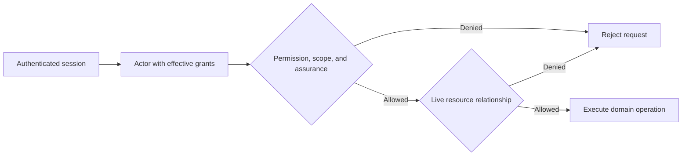

# Authorization Beyond Roles

## Tenant isolation, scoped capabilities, and real business relationships

Authentication tells us who is making a request. It does not tell us whether that person may record attendance for a particular class, view a specific student, change a fee, or publish a report card.

Many SaaS products begin with three roles: owner, administrator, and member. That model works when access is mostly organization-wide. A school platform has a different shape. A teacher may read students from assigned classes but not every student in the school. A guardian may see information for linked children. A student may read a published result but not a draft. A finance officer and a teacher can belong to the same tenant while requiring almost entirely different access.

Adding more role names does not solve this cleanly. The missing concept is scope.

## First boundary: the tenant

Every interactive actor belongs to a school. Every authorization request identifies the school in which an operation occurs. The first check is always that these schools match.

Tenant filtering in SQL remains necessary, but it is not a complete authorization strategy. A missing filter in one query can become a data leak. The domain therefore treats school identity as part of actor metadata and validates it before capability or resource access.

This is defense in depth. The API resolves an authenticated identity. Repositories constrain persisted data. Domain services reject actors operating outside their tenant. Tests attempt cross-tenant operations directly.

A multi-tenant boundary should survive more than one developer remembering to add `schoolId` to a query.

## Capability and scope

The first authorization layer answers a coarse question: does this actor hold the required business capability within the requested scope?

Permissions describe actions such as reading students, recording attendance, or reading payments. Scope grants describe where those permissions apply. Supported scopes include the school, academic year, class group, subject, course assignment, session, student, and student group.

A grant can therefore express ideas such as:

> This staff member may record attendance for these assigned sessions.

or:

> This teacher may read students within this class group.

Effective grants are resolved from roles, assignments, and portal relationships when the session actor is assembled. They are cached because authorization should not rebuild a large relationship graph during every capability check. Assignment expiry also bounds the cache lifetime so temporary access does not silently become permanent.

This layer is synchronous and predictable. It rejects requests that lack the permission, tenant, scope, or required assurance level.

## Resource policies

A valid capability still may not be enough. The system must sometimes inspect the resource and its relationships.

Suppose a teacher has student-read permission for an assigned class. To authorize access to one student, the application may need to verify that the student has an active enrollment connecting them to that class. A guardian request requires a live guardian-student link. Access to financial or health information may follow a different relationship graph even when the actor has general read capabilities.

The second layer uses authorization policies backed by repositories. These policies run after the relevant entities are known and check relationships such as:

- actor to student
- guardian to linked student
- staff assignment to class or session
- assessment to class subject
- student fee to student and school
- publication state of a report-card result

Separating the two layers avoids two extremes. The permission engine does not query the database for every check, and the application does not pretend that static roles can represent dynamic business relationships.



The two checks remain visible in workflow code. Holding the enrollment capability is necessary, but the actor must also have access to both resources involved:

```ts
await permissionAction(Permission.ENROLLMENT_CREATE)(actor)

await authorizationPolicy.checkStudentAccess(
  actor,
  [student.id],
)
await authorizationPolicy.checkClassGroupAccess(
  actor,
  [classGroup.id],
)
```

## Assurance is different from permission

Some actions deserve stronger proof of identity even when the actor has the correct permission. The authorization model therefore supports assurance levels such as standard, verified, and strong.

This distinction matters for sensitive operations. “May this role perform the action?” and “has this session been authenticated strongly enough?” are different questions. Encoding both in the authorization request makes that difference visible instead of scattering special checks across routes.

## System actors and background operations

Not every operation originates from a person with a browser session. Migrations, seeding tools, and controlled background operations may use a system actor. System actors bypass interactive grants, but they still carry a school identity, a system identifier, and a reason.

Bypasses should be explicit and auditable. A hidden “admin mode” is difficult to reason about; a separate actor kind makes privileged execution visible in code and tests.

## What this model costs

Scoped authorization is more expensive than ordinary RBAC. Permission definitions must remain consistent. Role assignments and domain assignments interact. Grant caches require invalidation. Resource policies need integration tests. The user interface also needs an effective-grants representation so it can hide or disable unavailable actions without becoming the security boundary.

This model is justified when the product contains real relationship-based access. It would be excessive for a SaaS where every organization member sees the same records.

A practical evolution path is:

1. Begin with tenant isolation and a small permission set.
2. Add role templates for common job functions.
3. Introduce scopes only where organization-wide access is too broad.
4. Add resource policies when access depends on live relationships.
5. Add assurance requirements for particularly sensitive operations.
6. Test denials and cross-tenant access as carefully as successful requests.

Authorization is part of the domain because the meaning of access comes from the business. The API still has an important role: it must assemble the actor correctly, expose a consistent contract, and ensure every path reaches the same policy enforcement.

That complete path, from HTTP request to tested domain operation, is the subject of the next article.
