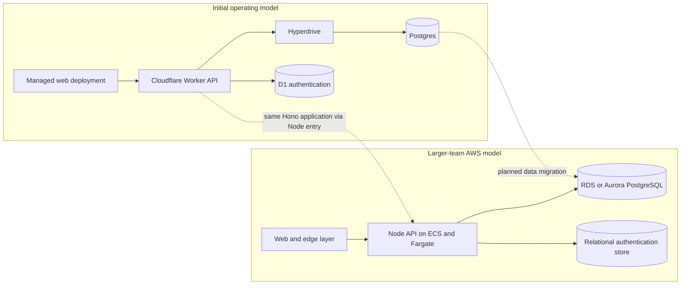

# What If the Team Grows and the SaaS Moves to AWS?

## Returning to the original target without rewriting the product

When the startup first contacted me, AWS was the expected deployment target. That was a reasonable starting point: AWS offered every capability the future platform might need. But architecture is not only about what a provider can support. It is also about what a team should own at its current stage.

For a new SaaS and a small engineering team, I recommended a Cloudflare-centered production runtime instead: Workers for the API, a managed web deployment, Postgres through Hyperdrive, and D1 for the authentication store. It reduced the initial infrastructure surface while preserving the business architecture described in this series.

The recommendation was not “never AWS.” The API was deliberately kept portable, with both Worker and Node entry points. Cloudflare was the first operating environment; Node was the conventional runtime path that could later be containerized for AWS or another platform.

Now imagine that the product succeeds. Several domain teams work on it, enterprise customers require stronger controls, and workloads no longer scale uniformly. The conditions that previously favored the smaller runtime have changed, and the company returns to AWS as its target.

What happens next?

The wrong answer is to translate every Cloudflare service into an AWS service and split every package into a microservice. Cloud migration and organizational redesign are separate changes. Combining them into one rewrite multiplies risk.

The better question is: which boundaries already express the business, and which components exist only because of the current runtime?

## What should survive

The domain core, commands, repository ports, authorization policies, API contract, generated client, integration tests, and even the monorepo should remain. They describe what the product does, not where it runs.

The Node entry point is particularly valuable: it can be containerized without forcing the domain through an AWS-specific programming model.

## The first AWS landing should remain boring

The lowest-risk first target is likely the Node API in a container on Amazon ECS with AWS Fargate, behind an Application Load Balancer. This preserves the request model, Hono application, and Postgres adapter while avoiding EC2 host management.

Lambda with API Gateway is valid for bursty workloads, but requires an event adapter and deliberate connection management. RDS Proxy can reuse database connections, but Lambda should be chosen for workload characteristics, not because “serverless” sounds closer to Workers.

The web application has several destinations, depending on its server-rendering needs. It need not move with the API, and Cloudflare can remain the public edge while AWS hosts the origin. Migration should follow ownership and risk, not vendor symmetry.

## Data migration is its own program

PostgreSQL creates a credible path to Amazon RDS or Aurora PostgreSQL-Compatible. The move still requires compatibility and performance testing, data validation, cutover planning, and rollback. Native PostgreSQL tools may suit a maintenance window; AWS Database Migration Service can support lower-downtime migration with change data capture.

Authentication deserves separate treatment. D1 is not interchangeable with Cognito or an RDS schema. An identity migration can invalidate sessions and affect every authorization entry point. The safer first step may be to preserve Better Auth on a supported relational store. Adopt Cognito only if its identity model is itself a goal.

## A larger team needs a platform foundation

The largest change is organizational. AWS exposes more account, IAM, networking, and cost decisions. A larger team should not ask each product squad to solve them independently.

A platform team can provide the multi-account foundation, identity federation, Terraform modules, deployment pipelines, audit controls, telemetry, and golden paths used by product teams.

This is the cloud-native continuation of service management: standardize the common controls so product teams can change services without rebuilding operational governance each time.

## Team boundaries may become deployment boundaries

A growing team does not automatically require microservices. A modular monolith can support many engineers when modules have clear ownership and release discipline.

Extract a module only when there is evidence that it needs an independent boundary:

- A team requires an independent release cadence.
- A workload has materially different scaling characteristics.
- Fault isolation has measurable business value.
- The module can own its data and contract without accidental distributed transactions.

Asynchronous work such as report generation or notifications may become an early extraction candidate, using SQS, EventBridge, or Step Functions where durable coordination is required.

Enrollment or finance workflows are more dangerous candidates when they depend on database transactions. Splitting them replaces local atomicity with distributed consistency, idempotency, retries, and reconciliation. That is a different operating model.

A strangler approach lets the existing API remain stable while selected capabilities move behind adapters or routing rules.

## A staged migration

A credible sequence would be:

1. Define why AWS is needed and which measurable constraints it solves.
2. Establish accounts, IAM, networking, audit logging, observability, and infrastructure modules.
3. Deploy the unchanged Node API to ECS/Fargate with a stable public contract.
4. Validate performance, connection behavior, rollback, and operational ownership.
5. Migrate PostgreSQL, the web application, and identity through separate rehearsed plans.
6. Extract workloads only when scaling, team ownership, and data ownership justify it.

Contract checks, realistic seeds, tenant-boundary tests, and staging smoke tests become migration assets. They compare behavior across runtimes instead of relying on infrastructure diagrams.

## The real test of portability

Moving to AWS would change deployment descriptors, runtime adapters, secrets, networking, observability, and data operations. It should not change what it means to enroll a student, record a payment, or authorize a guardian.

That is the real value of the earlier architecture. It does not make migration automatic. It makes the change legible.

A mature cloud-native system is not one that runs identically everywhere. It knows which parts are business truth, which parts belong to the platform, and how to replace the latter without rediscovering the former.

Choosing Cloudflare first was therefore a sequencing decision, not a verdict against AWS. The most suitable initial platform is the one that matches the team's operating capacity while preserving clear paths for the constraints it may face next.

## Further reading

- [AWS Prescriptive Guidance: Strangler fig pattern](https://docs.aws.amazon.com/prescriptive-guidance/latest/cloud-design-patterns/strangler-fig.html)
- [AWS guidance for organizing a multi-account environment](https://docs.aws.amazon.com/whitepapers/latest/organizing-your-aws-environment/implementation.html)
- [Choosing an AWS container service](https://docs.aws.amazon.com/decision-guides/latest/containers-on-aws-how-to-choose/choosing-aws-container-service.html)
- [Migrating PostgreSQL to Aurora PostgreSQL](https://docs.aws.amazon.com/prescriptive-guidance/latest/patterns/migrate-an-on-premises-postgresql-database-to-aurora-postgresql.html)
- [Cloudflare Hyperdrive overview](https://developers.cloudflare.com/hyperdrive/)
