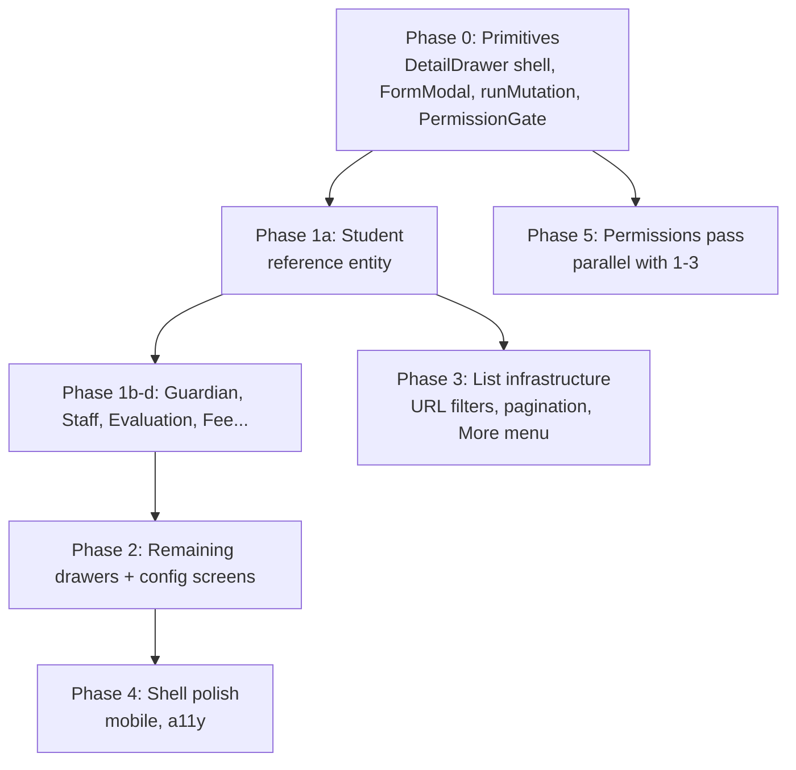

# App Shell Gap Closure Plan

Living plan to align `apps/webapp` with [`specs/app-shell-spec.md`](../specs/app-shell-spec.md).

**Related docs**

- [App Shell Architecture Spec](../specs/app-shell-spec.md) — target UX rules
- [Webapp mock → API migration plan](./done/webapp-mock-migration-plan.md) — read/write API wiring (coupled with mutation work below)
- Cursor rule: `.cursor/rules/app-shell.mdc`

**Last updated:** 2026-06-11

---

## 1. Executive summary

The **infrastructure layer is largely spec-aligned**; the **interaction layer is mid-migration**. Shell framing, URL-backed drawers, and list-page scaffolding exist. The main drift is that most detail drawers still mount `*Form.svelte` bodies with a global Save footer — the opposite of the spec's read-only drawer + modal mutation model.

| Spec area | Maturity | Blocker |
|-----------|----------|---------|
| Shell layout | ~75% | Mobile/responsive, user dropdown |
| URL-backed detail routes | ~90% | Filter params not in URL |
| List page template | ~60% | Pagination, More menu, URL filters |
| Detail drawer | ~25% | Forms in drawer, Save footer |
| Mutation modals | ~30% | No `*FormModal` pattern; inert CTAs |
| Sub-collection tabs | ~50% | Student tabs closest; many `+ Add` unwired |
| Toasts | ~40% | `runMutation` errors only; success inconsistent |
| Permissions | ~10% | `permissions.ts` exists; almost no UI gating |

---

## 2. What's already aligned

Keep and extend these patterns — they are the foundation every migration should copy.

### Shell (§1)

- `(app)/+layout.svelte` — sidebar, header selectors (school, year/period, language), body, lazy `DetailDrawer`, `ToastHost`
- `AppSidebar.svelte` — module groups, contextual class picker, count badges
- Global academic context drives data across views

### URL-backed drawers (§2.4, §3.2)

- 20 routes use `[[id]]` / `[[role]]` / `[[level]]` optional segments
- `detail-routes.ts`, `detail-hrefs.ts`, layout URL sync
- Row click → navigate → drawer open; close → list URL

### List data states (§6.2)

- `PageQuery` + `DataState` on most `[[id]]` routes
- `SchoolStudentsView` — good reference for search + filter + selection highlight

### Spec-aligned exemplars

| Pattern | Reference file |
|---------|----------------|
| Action → modal → mutation | `ChangeClassButton.svelte` |
| Sub-collection `+ Add` → picker modal | `ActivityDetail.svelte` |
| Read-only drawer + publish action | `ReportCardDefinitionDetail.svelte`, `BillingDetail.svelte` |
| Complex tabbed entity (structure) | `StudentTabs.svelte` |
| Matrix layout variant | `RolesMatrixView.svelte` |
| Calendar layout variant | `SchoolCalendarView.svelte` |

---

## 3. Gap map by spec section

### §1 Shell layout

| Gap | Current | Target |
|-----|---------|--------|
| User menu | Avatar + logout only | Dropdown: profile, preferences, sign out |
| Mobile sidebar | Fixed `w-64` always | Hamburger + overlay on small screens |
| Mobile drawer | Fixed `w-1/2` in `DetailDrawer.svelte` | Full-screen sheet below breakpoint |
| Reduced motion | `animate-slide-in-right` always | Respect `prefers-reduced-motion` |
| Config routes without data shell | `academic`, `classes`, `grade-scales` mount views directly | Wrap in `PageQuery` / `DataState` |

### §2 List page template

| Gap | Current | Target |
|-----|---------|--------|
| Primary CTAs | "Add student/guardian/…" often inert | Wire to create modals |
| More menu | `MoreHorizontal` icons decorative | Export, bulk, view toggle, column settings |
| Pagination | None | Pagination or infinite scroll on large lists |
| Bulk selection | None | Checkbox column + floating action bar |
| URL filter persistence | Local `$state` only | `?class=6a&status=active` in query params |
| Sort | None on tables | Column header or sort dropdown |
| Double loading | `PageQuery` then `DataState` | Single loading surface per route |

### §3 Detail drawer (highest priority)

**Critical violations in `DetailDrawer.svelte`:**

- Global **Save** button (no handler) + **Cancel** instead of spec's **Close**
- 10 of 15 drawer kinds mount `*Form.svelte` bodies
- `nonSaveKinds` exempts only: `role`, `level`, `activity`, `reportCardDefinition`, `reportCardResult`

**Entity conformance snapshot:**

| Entity | Drawer body today | Spec status | Priority |
|--------|-------------------|-------------|----------|
| Student | `StudentTabs` | Partial — profile tab has inputs | P0 |
| Guardian | `GuardianForm` | Violates — full form | P0 |
| Staff | `StaffForm` | Violates — inputs + permissions | P0 |
| Evaluation | `EvaluationForm` | Violates — grade grid inline | P0 |
| Fee | `FeeForm` | Violates | P1 |
| Planning | `PlanningForm` | Violates | P1 |
| Subject | `SubjectForm` | Partial — chapters mostly read-only | P1 |
| School year event | `SchoolYearEventForm` | Violates | P1 |
| Incident | `IncidentDetail` | Violates — textarea/inputs | P1 |
| Deadline | `DeadlineDetail` | Partial — read-only list + inline edit | P2 |
| Billing | `BillingDetail` | Mostly OK — payment needs modal | P2 |
| Activity | `ActivityDetail` | Good — enrollment modal | Done |
| Role | `RoleDetail` | Partial — inline toggles, no persist | P2 |
| Level | `LevelDetail` | Good | Done |
| Report card def/result | `*Detail` | Good | Done |

### §4 Sub-collection tabs

| Gap | Location |
|-----|----------|
| Profile tab editable | `StudentTabs.svelte` — name, email, birthdate, guardian inputs |
| Inert `+ Add` buttons | Student: link guardian, add note; no modals wired |
| Staff permissions inline | `StaffForm` / `StaffPermissionsBlock` — multi-field in drawer |
| Evaluation gradebook | Per-student inputs in drawer — must be modal |
| Empty tab CTAs | Some tabs show empty state without `+ Add` when user can create |

### §5 Mutation modals

| Gap | Current | Target |
|-----|---------|--------|
| Naming | `*Form.svelte` reused in drawer | `*FormModal.svelte` for create/edit |
| Create from list | Inline forms on `ClassGroupsView`, `GradeScalesView`, `AcademicAdminView` | Centered form modals |
| Delete | Mostly absent | Confirm modals |
| Post-save refresh | Inconsistent | Modal closes → list + drawer tab refetch → toast |
| `runMutation` | Error toast only | Optional `successMessage`; callers stop forgetting |

### §6 Cross-cutting

| Concern | Gap |
|---------|-----|
| **Toasts** | Drawer saves silent; many toggles local-only; success toast per-caller |
| **Permissions** | `hasPermission` / `canEditGrades` rarely used; no disabled + tooltip |
| **Global context** | Academic context wired; drawer data sometimes stale after mutation |
| **Accessibility** | Escape on drawer unclear; focus trap only in some dialogs |
| **Responsive** | Desktop-only drawer/sidebar |

---

## 4. Phased closure plan

### Phase 0 — Shared foundations (1 sprint)

Establish patterns once; every entity migration reuses them.

1. **`DetailDrawer` shell refactor**
   - Remove global Save/Cancel footer
   - Footer: entity-specific action buttons (passed from detail body) + Close only
   - Add responsive width: `w-full md:w-1/2`, full-screen on mobile
   - Escape closes drawer; `prefers-reduced-motion` guard

2. **Shared modal primitives**
   - `DrawerActionBar` — footer slot for `[Edit profile] [Change class] [Close]`
   - `FormModal.svelte` — title, body slot, Cancel/Save, focus trap, Escape
   - `ConfirmModal.svelte` — destructive confirm
   - `PickerModal.svelte` — link/assign (pattern from `ActivityDetail`)

3. **`runMutation` enhancement** (`apps/webapp/src/lib/api/mutations/run-mutation.ts`)
   - Add `successMessage?: string` → auto success toast
   - Add `onSuccess?: () => void` for drawer/tab invalidation without full shell reset
   - Document when to use `refresh: false` + targeted query invalidation

4. **`PermissionGate` component**
   - `permission` + `tooltip` props → hide or disable with title
   - Apply to all action buttons going forward

5. **List toolbar primitive**
   - `ListPageHeader.svelte`: title, description, primary CTA slot, search, filter, more menu
   - Reference implementation on `SchoolStudentsView`

**Exit criteria:** One entity (Student) fully migrated end-to-end using only new primitives.

---

### Phase 1 — Drawer migration: high-traffic entities (2–3 sprints)

Migrate in traffic order. Per entity, follow spec §7 checklist:

```
read-only Detail/Tabs → footer actions → modals → remove Form from drawer
```

| Sprint | Entities | Work |
|--------|----------|------|
| 1a | **Student** | Profile tab → read-only `DrawerField` rows; `StudentEditModal`; wire guardian link + note modals; keep `ChangeClassButton` |
| 1b | **Guardian**, **Staff** | `GuardianDetail` + `GuardianFormModal`; `StaffTabs` (profile read-only + permissions tab as sub-collection with toggles only where boolean) + `StaffEditModal` |
| 1c | **Evaluation** | Read-only header; gradebook as read-only sub-list; `GradeEntryModal` per student or batch modal |
| 1d | **Fee**, **Planning**, **Subject** | `*Detail` + `*FormModal`; subject chapters tab stays read-only sub-list |

**Per-entity checklist (apply to each):**

- [ ] Drawer body is `*Detail` or `*Tabs` — no inputs on load
- [ ] Footer has entity actions + Close — no Save
- [ ] Create modal from list primary CTA
- [ ] Edit modal from drawer action button
- [ ] Delete confirm modal where applicable
- [ ] Sub-collection `+ Add` / row Edit → modals
- [ ] Toast on every mutation
- [ ] Permission gates on all write actions
- [ ] Drawer refreshes after modal success

---

### Phase 2 — Remaining drawer entities + config screens (1–2 sprints)

| Entity / screen | Work |
|-----------------|------|
| School year event | `SchoolYearEventDetail` + modal |
| Incident | `IncidentDetail` read-only + edit modal |
| Deadline | Read-only fields; attach file → modal |
| Billing | "Record payment" → form modal |
| Role | Read-only matrix display; boolean toggles with API + toast (Pattern B) |
| `AcademicAdminView`, `ClassGroupsView`, `GradeScalesView` | Move inline create forms to modals; add `PageQuery`/`DataState` on routes |

---

### Phase 3 — List infrastructure (1 sprint)

Target `SchoolStudentsView` as the gold-standard list, then roll out.

1. **URL filter sync** — `class`, `status`, `q` in search params; preserve on drawer open/close via `listRouteCacheKey` extension
2. **Pagination** — cursor or page-based on school students first
3. **More menu** — export stub, view toggle (cards/table), column visibility
4. **Bulk selection** — defer real bulk mutations until API supports them; UI shell only if needed
5. **Eliminate double loading** — `PageQuery` owns loading; `DataState` only for empty/error/ready

Roll out to: guardians, staff, fees, evaluations, subjects.

---

### Phase 4 — Shell polish + accessibility (1 sprint)

1. Mobile hamburger sidebar
2. User menu dropdown (profile stub, sign out)
3. Focus trap audit on all modals
4. `aria-live` on drawer tab loading
5. Keyboard: Escape closes drawer; tab strip navigation

---

### Phase 5 — Permissions pass (parallel with Phases 1–3)

Map each write action to a grant in `permissions.ts`:

| Action | Suggested gate |
|--------|----------------|
| Add/edit student | `students:write` |
| Transfer class | `enrollments:write` |
| Edit grades | `canEditGrades()` |
| Finance mutations | finance grants |
| Staff/role edits | director-level |
| School life (incidents, events) | `canEditSchoolLife()` |

Apply `PermissionGate` to every CTA identified in Phases 1–2. Denied actions: disabled + tooltip (e.g. "Requires director role").

---

## 5. API write path dependency

UI conformance and API migration are coupled. From [webapp-mock-migration-plan.md](./done/webapp-mock-migration-plan.md):

- Read paths are largely wired; **write flows are still mock/local**
- Only 4 mutation modules exist today: `student`, `academic`, `report-cards`, `run-mutation`
- Drawer forms currently have no real save path anyway

**Recommendation:** Run Phase 0 + Phase 1a (Student) UI refactor **in parallel** with API command endpoints. For entities without API writes yet:

- Modal + toast + optimistic local update is acceptable for demo
- Mark modals with `// TODO: wire to commands/*` and gate behind `hasSession`
- Do not block drawer read-only migration on API — that is pure UI

**Mutation module backlog** (add alongside each entity phase):

```
guardian.mutations.ts
staff.mutations.ts
evaluation.mutations.ts
fee.mutations.ts
planning.mutations.ts
incident.mutations.ts
```

---

## 6. Entity inventory

Tracking board. Status reflects **current** state as of 2026-06-11.

| Entity | List CTA | Drawer read-only | Edit modal | Sub-collection modals | Toasts | Permissions |
|--------|----------|------------------|------------|----------------------|--------|-------------|
| Student | ❌ | ⚠️ | ⚠️ (`ChangeClass` only) | ❌ | ⚠️ | ❌ |
| Guardian | ❌ | ❌ | ❌ | — | ❌ | ❌ |
| Staff | ❌ | ❌ | ❌ | ❌ | ❌ | ❌ |
| Evaluation | ❌ | ❌ | ❌ | ❌ | ❌ | ❌ |
| Subject | ❌ | ⚠️ | ❌ | — | ❌ | ❌ |
| Planning | ❌ | ❌ | ❌ | — | ❌ | ❌ |
| Fee | ❌ | ❌ | ❌ | — | ⚠️ | ❌ |
| Billing | — | ✅ | ❌ | — | ❌ | ❌ |
| School year event | ❌ | ❌ | ❌ | — | ❌ | ❌ |
| Incident | ❌ | ❌ | ❌ | — | ❌ | ❌ |
| Deadline | — | ⚠️ | ❌ | — | ❌ | ❌ |
| Activity | ❌ | ✅ | ✅ (enrollment) | ✅ | ❌ | ❌ |
| Role | — | ⚠️ | ❌ | — | ❌ | ❌ |
| Level | — | ✅ | — | — | — | — |
| Report card def/result | ❌ | ✅ | ✅ (publish) | — | ✅ | ❌ |
| Class groups | ⚠️ inline | — | ❌ | — | ✅ | ❌ |
| Grade scales | ⚠️ inline | — | ❌ | — | ✅ | ❌ |
| Academic years | ⚠️ inline | — | ❌ | — | ✅ | ❌ |

Legend: ✅ done · ⚠️ partial · ❌ missing · — N/A

---

## 7. Execution order



**Fastest visible win:** Phase 0 + Student — removes the misleading Save button, makes the most-used drawer read-only, and establishes patterns every other entity copies.

**Highest risk if skipped:** Leaving `DetailDrawer` Save footer in place while migrating individual entities — users will see mixed patterns (spec UX risk #1).

---

## 8. Success metrics

The gap is closed when:

1. Zero `*Form.svelte` imports in `DetailDrawer.svelte`
2. No global Save/Cancel on drawer shell
3. Every list primary CTA opens a create modal
4. Every sub-collection `+ Add` / Edit opens a modal
5. `runMutation` (or equivalent) backs every write with success + error toast
6. Every write action has a permission gate
7. `SchoolStudentsView` has URL-persisted filters + pagination
8. Drawer + sidebar are responsive per spec §6.5

---

## 9. File quick-reference

| Role | Good examples | Violation examples |
|------|---------------|-------------------|
| Layout / shell | `(app)/+layout.svelte`, `AppSidebar.svelte` | Fixed desktop-only drawer width |
| Routing | `detail-routes.ts`, `detail-hrefs.ts`, `school/students/[[id]]/+page.svelte` | `configuration/report-cards/[[id]]/+page.svelte` |
| List + states | `PageQuery.svelte`, `DataState.svelte`, `SchoolStudentsView.svelte` | `ClassGroupsView.svelte` inline form |
| Drawer shell | Header/backdrop/URL sync | `DetailDrawer.svelte` Save footer + Form bodies |
| Modal mutations | `ChangeClassButton.svelte`, `ActivityDetail.svelte` (add) | `GuardianForm.svelte`, `FeeForm.svelte` |
| Complex tabs | `StudentTabs.svelte` (structure), `StudentReportCardPanel.svelte` | Profile inputs, inert `+ Add` buttons |
| Permissions | `permissions.ts`, `EducatorDashboardView.svelte` | Nearly all action buttons ungated |
