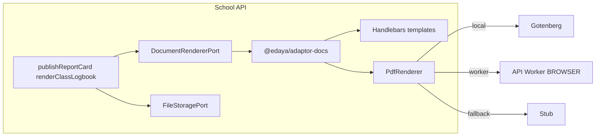

# In-process document renderer

| Field | Value |
|-------|-------|
| Status | Implemented |
| Date | 7 September 2026 |
| Repo | `edaya_backend` (`package/adaptor-docs`) |
| Owner | Documents |

## Summary

`@edaya/adaptor-docs` implements `DocumentRendererPort` **in process** on the school API. Handlebars templates (`report-card.v1`, `logbook.v1`) compile to HTML; an inner `PdfRenderer` turns HTML into PDF (Cloudflare Browser Run on the API Worker, Gotenberg locally, stub otherwise). Artifacts go to school `FileStoragePort`. There is no docs Worker, JWT, or HTTP client.

Payload assembly and attachment registration stay in the school API. Action-bound document policies in `@edaya/authorization` supply the authorized data.

## Architecture



## Authorization

Report-card generation binds `REPORT_CARD_PUBLISH` to the result and its attachments. It checks current authority even for a cached PDF and requires the result and period to be published. Class statistics include only published results from the same class, period and definition. Rendering and attachment changes run in the command transaction, with authority checked again before upload and save. Rendering failures roll back attachment changes. Object storage is external to the database transaction; a failure after upload can leave an unreferenced private object.

Logbook generation binds `CLASS_LOGBOOK_READ` to every included subject and session. Native query scopes constrain content and counts. Authority is checked again before upload and before issuing the download URL. Family profiles use their current relationships; teacher profiles use current subject assignments. Homeroom-only authority does not grant subject logbook access.

Both documents display teachers from active, valid teacher assignments in the document's academic year. A staff assignment or class coordinator never substitutes for a teacher.

## Resolver

1. `RUNTIME=in-memory` or silent tests → not configured (no-op)
2. `RUNTIME=worker` + `BROWSER` binding → Browser Run `quickAction('pdf')`
3. `GOTENBERG_URL` → Gotenberg (local or wrangler `.dev.vars`)
4. `RUNTIME=local` else → stub PDF + log (tiny file; existing skip/replace still applies)
5. Worker without `BROWSER` or Gotenberg → not configured (`renderClassLogbook` throws `DOCS_NOT_CONFIGURED`; publish-on-render is skipped)

Stub PDFs are **local-only**. Do not persist them on `RUNTIME=worker`.

## Local real PDFs

`bun repo dev` does not start Gotenberg. To render real PDFs locally:

```sh
docker run --rm -p 3000:3000 gotenberg/gotenberg:8
```

Then set `GOTENBERG_URL=http://localhost:3000` in `apps/api/.env`.

`wrangler dev` Miniflare does not implement `quickAction`. Use `GOTENBERG_URL` in `.dev.vars` or `"remote": true` on the browser binding.

## Non-goals

- Starting Gotenberg from `bun repo dev`
- Cryptographic PDF signing, XLSX, per-school HTML admin
- Enabling Browser Run in the Cloudflare dashboard (ops after merge)
