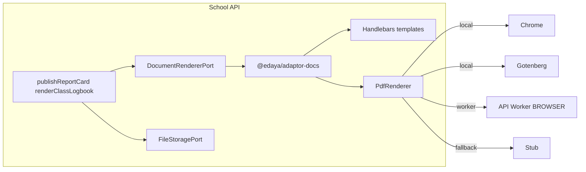

# In-process document renderer

| Field | Value |
|-------|-------|
| Status | Implemented |
| Date | 7 September 2026 |
| Repo | `edaya_backend` (`package/adaptor-docs`) |
| Owner | Documents |

## Summary

`@edaya/adaptor-docs` implements `DocumentRendererPort` **in process** on the school API. Handlebars templates (`report-card.v1`, `logbook.v1`) compile to HTML; an inner `PdfRenderer` turns HTML into PDF (Cloudflare Browser Run on the API Worker, Gotenberg locally, stub otherwise). Artifacts go to school `FileStoragePort`. There is no docs Worker, JWT, or HTTP client.

Report-card payload assembly and attachment registration live in the `@edaya/service` document capability; the API re-exports it for existing transport callers. Logbook export orchestration remains in the API. Action-bound document policies in `@edaya/authorization` supply the authorized data.

## Architecture



## Authorization

Report-card generation binds `REPORT_CARD_PUBLISH` to the result and its attachments. It checks current authority even for a cached PDF and requires the result and period to be published. Class statistics include only published results from the same class, period and definition. Short database transactions load the current source and serialize attachment publication using a school/result advisory lock. Renderer and object-storage calls run outside those transactions. Before upload and again before publication, the service reloads current authority, publication status and the render payload. A changed source rejects with `REPORT_DOCUMENT_SOURCE_CHANGED`; a new request can render the updated data. Concurrent successful renderers return the winning attachment. Legacy tiny-PDF status changes commit only with the replacement attachment; render, storage and final-transaction failures preserve the previous record. Provider diagnostics are replaced with `REPORT_DOCUMENT_RENDER_UNAVAILABLE` or `REPORT_DOCUMENT_STORAGE_UNAVAILABLE`.

This protects the in-flight render window. The existing cache still lacks a durable source/locale version, and the legacy tiny-PDF heuristic remains; Plan 04 owns official document versioning. A failure or competing winner after upload can leave a temporarily unreferenced private object. The shared inventory reserves the key before I/O and makes that object eligible for reference-safe cleanup after its write window. Call report rendering outside an enclosing business transaction. Native PostgreSQL tests use independent one-connection pools and verify external calls can borrow those connections, competing publication returns one attachment, and failed final writes roll back together.

Logbook generation binds `CLASS_LOGBOOK_READ` to every included subject and session. Native query scopes constrain content and counts. Authority is checked again before upload and around issuing the download URL. Logbook storage keys are inventoried before I/O and protected through the signed-download window before becoming cleanup candidates. Family profiles use their current relationships; teacher profiles use current subject assignments. Homeroom-only authority does not grant subject logbook access.

Both documents display teachers from active, valid teacher assignments in the document's academic year. A staff assignment or class coordinator never substitutes for a teacher.

## Resolver

1. `RUNTIME=in-memory` or silent tests → not configured (no-op)
2. `RUNTIME=worker` + `BROWSER` binding → Browser Run `quickAction('pdf')`
3. `GOTENBERG_URL` → Gotenberg (local or wrangler `.dev.vars`)
4. `RUNTIME=local` → Chrome/Chromium `--print-to-pdf` when a binary is found (`CHROME_PATH` or well-known paths); otherwise stub PDF + log
5. Worker without `BROWSER` or Gotenberg → not configured (`renderClassLogbook` throws `DOCS_NOT_CONFIGURED`; publish-on-render is skipped)

Stub PDFs are **local-only**. Do not persist them on `RUNTIME=worker`.

## Local real PDFs

`bun repo dev` does not start Gotenberg. Local Generate/Download uses **Google Chrome or Chromium** when installed. To force Gotenberg instead:

```sh
docker run --rm -p 3000:3000 gotenberg/gotenberg:8
```

Then set `GOTENBERG_URL=http://localhost:3000` in `apps/api/.env`. Set `CHROME_PATH=` (empty) to keep the stub when neither Gotenberg nor Chrome should run.

`wrangler dev` Miniflare does not implement `quickAction`. Use `GOTENBERG_URL` in `.dev.vars` or `"remote": true` on the browser binding.

## Non-goals

- Starting Gotenberg from `bun repo dev`
- Cryptographic PDF signing, XLSX, per-school HTML admin
- Enabling Browser Run in the Cloudflare dashboard (ops after merge)

## Teacher signatures

The teacher signature is an optional school-scoped `teachers.signature_attachment_id`. Only the authenticated teacher can manage it through `createTeacherSignatureUpload`, `completeTeacherSignatureUpload` and `clearTeacherSignature`; ordinary teacher and attachment mutations cannot select the `teacher.signature` purpose. The private upload accepts a CRC-validated PNG bounded to 1024 pixels per side and 1 MiB. Completion changes the teacher slot only after upload validation, under a teacher lock and replay-safe command receipt. Each replacement uses a new attachment.

Periodic and annual payloads carry subject `teachers` and council `homeroomTeachers`, each identified by `teacherId`, with existing name strings as compatibility fallbacks. Incident `reporterTeachers` resolves the recorded author in the same school; staff and unresolved authors receive no teacher signature. Rendering embeds private images alongside their names, retaining the school signature. Standalone image download remains self-only.

Requests capture `snapshot.teacherSignatures` (including an explicit empty list) and retain every referenced attachment. Durable rendering and retries use those captured references, regardless of later replacement or removal. A missing or unreadable teacher asset fails with recoverable `TEACHER_SIGNATURE_ASSET_UNAVAILABLE`. Existing snapshots without this field preserve their legacy annual payload fingerprint. The synchronous report-card renderer also hydrates teacher images before rendering and preserves already cached PDFs.

Rollout: deploy migration `0038_teacher_signatures.sql` and the additive backend API first. Verify the pinned OpenAPI/TypeScript/Dart release contract and backend checks, then publish the teacher mobile update. There is no account-wide sharing or staff management screen.
