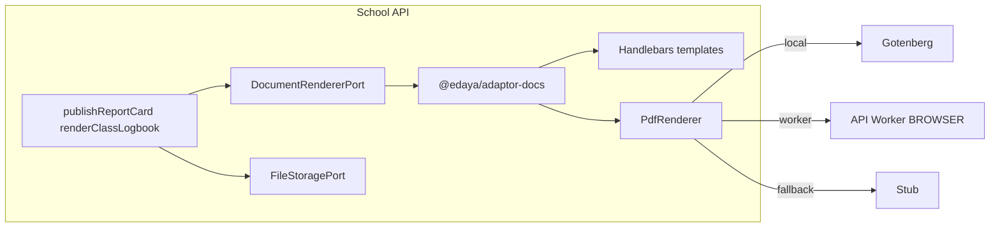

# In-process document renderer

| Field | Value |
|-------|-------|
| Status | Implemented |
| Date | 7 September 2026 |
| Repo | `edaya_backend` (`package/adaptor-docs`) |
| Owner | Documents |

## Summary

`@edaya/adaptor-docs` implements `DocumentRendererPort` **in process** on the school API. Handlebars templates (`report-card.v1`, `logbook.v1`) compile to HTML; an inner `PdfRenderer` turns HTML into PDF (Cloudflare Browser Run on the API Worker, Gotenberg locally, stub otherwise). Artifacts go to school `FileStoragePort`. There is no docs Worker, JWT, or HTTP client.

Payload assembly, permissions, and attachment registration stay in the school API.

## Architecture



## Resolver

1. `RUNTIME=in-memory` or silent tests → not configured (no-op)
2. `RUNTIME=worker` + `BROWSER` binding → Browser Run `quickAction('pdf')`
3. `GOTENBERG_URL` → Gotenberg (local or wrangler `.dev.vars`)
4. `RUNTIME=local` else → stub PDF + log (tiny file; existing skip/replace still applies)
5. Worker without `BROWSER` or Gotenberg → not configured (`renderClassLogbook` throws `DOCS_NOT_CONFIGURED`; publish-on-render is skipped)

Stub PDFs are **local-only**. Do not persist them on `RUNTIME=worker`.

## Local real PDFs

`bun repo dev` does not start Gotenberg. To render real PDFs locally:

```sh
docker run --rm -p 3000:3000 gotenberg/gotenberg:8
```

Then set `GOTENBERG_URL=http://localhost:3000` in `apps/api/.env`.

`wrangler dev` Miniflare does not implement `quickAction`. Use `GOTENBERG_URL` in `.dev.vars` or `"remote": true` on the browser binding.

## Non-goals

- Starting Gotenberg from `bun repo dev`
- Cryptographic PDF signing, XLSX, per-school HTML admin
- Enabling Browser Run in the Cloudflare dashboard (ops after merge)
