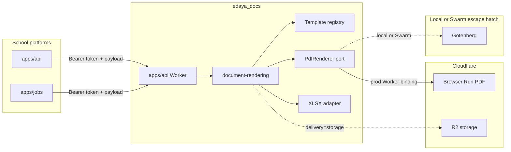
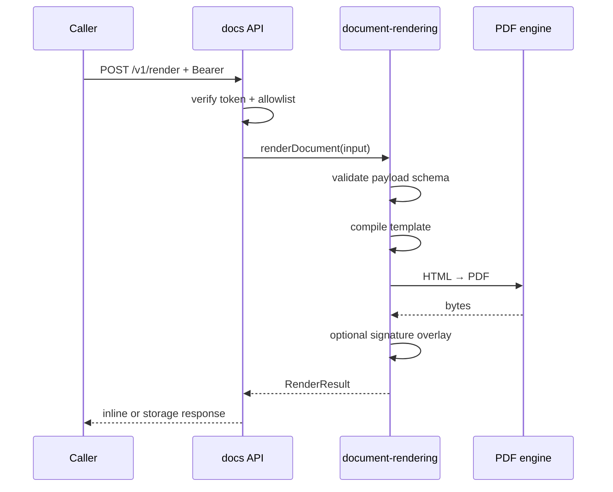
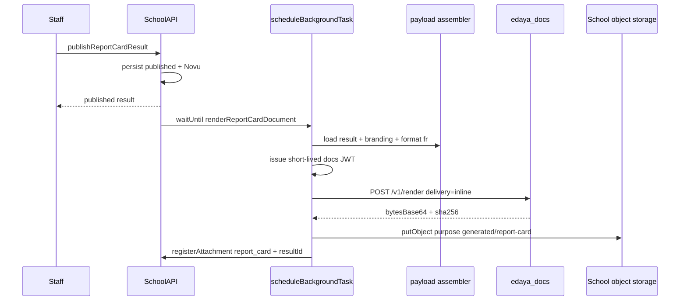

# Document rendering service

| Field | Value |
|-------|-------|
| Status | RFC (P0–P5 scaffold done; school wiring W1–W3 next) |
| Date | 23 July 2026 |
| Repo | `edaya_backend` (`apps/docs` + `package/document-*`); separate HTTP process / Worker |
| Owner | Document rendering |

## Summary

`apps/docs` (`@edaya/docs-api`) is a **stateless HTTP service** that renders versioned document templates into PDF or XLSX from caller-supplied JSON payloads. The school API (`apps/api`) remains authoritative for business data, permissions, and artifact registration.

The service is designed for reuse: any school-facing platform with a valid service token and allowed template key may request a render.

## Problem

Edaya already models report cards, exports, and signatures in the school domain, but has no document engine:

- Report card **generation** aggregates grades into structured records; it does not produce PDFs.
- Web list export is stubbed; guardian mobile expects **official downloadable PDFs**.
- Permissions `REPORT_CARD_EXPORT` and `REPORT_CARD_SIGN` exist without render workflows.
- PDF generation is CPU-heavy and should not run inside the school API worker.

## Goals

1. Render official documents (starting with `report-card.v1` PDF).
2. Expose a stable HTTP contract for school API and jobs workers.
3. Authenticate callers with **service tokens** and per-token template allowlists.
4. Stay stateless: no school database, no tenant tables.
5. Support image signature overlay at render time (phase P4).
6. Remain extractable as a dedicated repo or mergeable into the backend monorepo.

## Non-goals (v1)

- Cryptographic PDF signing (PKI/HSM).
- Per-school custom HTML upload administration UI.
- User session authentication (staff/guardian browsers call the school API, not docs directly).
- Fetching business entities from the school API during render.
- Bulk zip export (later async phase).

## Architecture



### Boundary rules

| Responsibility | Owner |
|----------------|-------|
| Grade aggregation, publish workflow | School backend |
| Permission checks (`REPORT_CARD_EXPORT`) | School backend |
| Payload assembly (student, marks, branding) | School backend / jobs |
| Template layout and render | `edaya_docs` |
| Service token issuance | School backend |
| Attachment entity registration | School backend |
| Guardian download authorization | School backend (presigned URL) |

## HTTP API (v1)

Base path: `/v1`

### `POST /v1/render`

Synchronous render. Returns when bytes are ready or rejects.

**Request**

```json
{
  "templateKey": "report-card.v1",
  "format": "pdf",
  "locale": "fr",
  "schoolId": "sch_...",
  "payload": {},
  "options": {
    "paper": "A4",
    "orientation": "portrait",
    "signatures": [
      {
        "slot": "principal",
        "imageUrl": "https://presigned.example/signature.png",
        "position": { "page": "last", "x": 400, "y": 680, "width": 120 }
      }
    ]
  },
  "delivery": "inline",
  "idempotencyKey": "sch_.../report-card/result-123/v1"
}
```

**Response (`delivery: inline`)**

```json
{
  "renderId": "rnd_01...",
  "contentType": "application/pdf",
  "sha256": "...",
  "bytesBase64": "..."
}
```

**Response (`delivery: storage`)** — phase P3

```json
{
  "renderId": "rnd_01...",
  "contentType": "application/pdf",
  "sha256": "...",
  "artifact": {
    "objectId": "obj_...",
    "downloadUrl": "https://...",
    "expiresAt": "2026-07-20T14:00:00.000Z"
  }
}
```

### `GET /v1/templates`

Returns catalog entries visible to the caller's token allowlist.

```json
{
  "templates": [
    {
      "key": "report-card.v1",
      "formats": ["pdf"],
      "locales": ["fr", "en"],
      "version": "1.0.0"
    }
  ]
}
```

### `POST /v1/render-jobs` / `GET /v1/render-jobs/{id}`

Async bulk render (phase P3). Same request body as sync render; poll for completion.

## Authentication

### Service token (JWT, HS256)

Issued by the school API for the `document-renderer` principal.

**Claims**

```json
{
  "iss": "edaya-school-api",
  "sub": "service:document-renderer",
  "schoolId": "sch_...",
  "allowedTemplates": ["report-card.v1"],
  "allowedFormats": ["pdf"],
  "exp": 1730000000
}
```

**Validation (`edaya_docs`)**

1. Verify signature with `DOCS_JWT_SECRET` (or JWKS in production).
2. Reject expired tokens.
3. Ensure `templateKey` ∈ `allowedTemplates`.
4. Ensure `format` ∈ `allowedFormats`.
5. Ensure request `schoolId` matches token `schoolId` when present.

### Development

`DOCS_DEV_TOKEN` accepts a static bearer for local curl without JWT machinery.

## Template model

Templates are versioned by key (`report-card.v1`). A breaking layout change creates `report-card.v2`.

Each template defines:

- `manifest.json` — key, supported formats/locales, version
- `schema.json` — JSON Schema for `payload`
- `template.hbs` + `styles.css` — HTML for PDF (via Chromium)
- `sheet.xlsx` — optional binary template; `report-card.v1` Excel is generated programmatically from the payload (P4)

Templates ship with the service. Per-school branding is passed in the payload (logo URL, school name, colors), not stored in docs.

### First template: `report-card.v1`

CI-style semester bulletin. Caller supplies fully prepared strings (averages, ranks, bilans). Branding (`republicLabel`, `ministryLabel`, crest/logo URLs) is payload-driven.

```json
{
  "republicLabel": "REPUBLIQUE DE COTE D'IVOIRE",
  "ministryLabel": "MINISTERE DE L'EDUCATION NATIONALE …",
  "schoolYear": "2020-2021",
  "periodLabel": "1er SEMESTRE",
  "schoolName": "LYCEE MAMIE ADJOUA",
  "studentName": "YAO Curie Marie Christelle Ahou",
  "classLabel": "Tle A",
  "subjects": [
    {
      "name": "Français",
      "kind": "subject",
      "average": "11,50",
      "coefficient": "4",
      "total": "46,00",
      "rank": "28è",
      "appreciation": "Passable",
      "teacherName": "TRAORE M."
    },
    {
      "name": "BILAN LETTRES",
      "kind": "bilan",
      "average": "10,60",
      "coefficient": "12",
      "total": "127,50",
      "rank": "36è/58"
    }
  ],
  "semesterAverage": "10,75 / 20",
  "semesterRank": "41è / 58 élèves"
}
```

Required: `studentName`, `periodLabel`, `schoolName`, `subjects[]` (see template `schema.json`).
## Render pipeline



### PDF engine

**Decision: Worker-first.** Production HTML→PDF uses Cloudflare [Browser Run](https://developers.cloudflare.com/browser-run/) (Workers browser binding + `/pdf` Quick Action). The `PdfRenderer` port stays engine-agnostic so adapters can swap without touching templates or HTTP contracts.

| Environment | Adapter | Notes |
|-------------|---------|-------|
| **Production (Worker)** | Cloudflare Browser Run | `env.BROWSER.quickAction("pdf", { html, … })`; no Chromium process in the isolate |
| **Local Bun host** | Gotenberg via `GOTENBERG_URL` | `podman compose up -d gotenberg`; optional HTML→PDF parity |
| **Fallback** | Stub PDF | Minimal valid PDF when no engine is configured |
| **Later escape hatch** | Gotenberg on Docker Swarm / k8s | Same adapter already used locally; migrate if Browser Run limits, cost, or layout fidelity force a container fleet |

Gotenberg remains a **local and migration option**, not the production default. Prefer **R2 delivery** over large inline `bytesBase64` on the Worker path once P3 lands.

### Signature overlay (phase P4)

Image URLs must be presigned and fetched at render time (PNG/JPEG). The school API authorizes signature asset access before calling docs. Overlays are applied with `pdf-lib` after HTML→PDF using `options.signatures[]` positions (PDF user space, origin bottom-left).

### Excel (`report-card.v1`)

`format: xlsx` builds a workbook from the same payload (Meta + Grades sheets, optional Class results). Binary named-range `.xlsx` templates can be added later without changing the HTTP contract.

## School platform integration

School platforms remain authoritative for business data, permissions, and guardian downloads. `edaya_docs` only renders caller-supplied payloads.

### Wiring invariants

1. **Publish stays authoritative and fast** — `publishReportCardResult` commits the published result and notifications; it never waits on PDF generation.
2. **Docs stays dumb** — the school backend owns payload assembly (locale-formatted strings); docs validates schema and renders only.
3. **School owns guardian access** — the PDF is stored in **school** object storage as an `Attachment` with `ownerKind: report_card` and `ownerId: <ReportCardResult.id>`. Guardians use existing `/core/files/{attachmentId}/download-url` (portal attachment policy already allows linked guardians).
4. **Docs R2 is not the guardian CDN** — for the publish path prefer `delivery: "inline"`, then school `putObject` + `registerAttachment`. Docs `delivery: "storage"` remains available for other callers / caching, not as the primary guardian download source.

### Target sequence (W1+)



### Placement of pieces (`edaya_backend`)

| Concern | Placement |
|---------|-----------|
| Trigger | After successful `publishReportCardResult`, API layer schedules work via existing `scheduleBackgroundTask` (`waitUntil` on Worker / fire-and-forget locally) — same pattern as deferred announcement notifications |
| Payload assembly | Domain helper (e.g. `package/domain-service` report-card document mapper): `ReportCardResult` + school/student/period/branding → `report-card.v1` payload |
| HTTP client | `@maya-invest/edaya-docs-client` (`file:../edaya_docs/packages/docs-client` or published package) |
| Token issuance | School API signs HS256 JWT with shared `DOCS_JWT_SECRET`: `iss=edaya-school-api`, `sub=service:document-renderer`, `schoolId`, `allowedTemplates=["report-card.v1"]`, `allowedFormats=["pdf"]`, short TTL (≈5–15 min) |
| Config | `EDAYA_DOCS_URL`, `DOCS_JWT_SECRET` (shared with docs), feature flag `DOCS_RENDER_ON_PUBLISH` |
| Idempotency | `idempotencyKey = {schoolId}/report-card/{resultId}/v1`; skip or replace if a ready attachment already exists for that result |
| Storage key | `buildStorageKey({ purpose: 'generated/report-card', ownerKind: ReportCard, ownerId: result.id, … })` |
| Signatures (later) | School resolves principal stamp URL → `options.signatures[]` and/or `council.principalStampUrl` in payload |

### Why not sync-in-publish?

Browser Run / Gotenberg can exceed Worker request budgets; a docs outage must not block publish; Novu already notifies without a PDF. Background render matches existing API patterns and keeps the publish transaction free of external I/O.

### Phased school wiring

| Phase | Scope | Notes |
|-------|-------|-------|
| **W1 — MVP** | Feature-flagged background render after publish; inline PDF → school `putObject` + `registerAttachment`; failures logged only (publish still succeeds) | Unit: payload mapper; integration: mock docs client |
| **W2 — Reliability** | Document lifecycle (`pending` / `ready` / `failed`) via outbox or attachment status; retry via cron or explicit `renderReportCardDocument` command; staff-visible status | Stronger than best-effort `waitUntil` |
| **W3 — Product surface** | Guardian list/download (mobile F3); optional signature overlay from stored stamps; XLSX only if required | Depends on W1 attachment existing |

**Out of W1:** sync render inside publish, docs R2 as download source, docs `/v1/render-jobs`, JWKS.

### Config contract (both repos)

| Env | Owner |
|-----|--------|
| `DOCS_JWT_SECRET` | Shared (school issues, docs verifies) |
| `EDAYA_DOCS_URL` | School → docs base URL (staging Worker or local Bun) |
| `DOCS_DEV_TOKEN` | Docs local only (optional static bearer) |
| `DOCS_RENDER_ON_PUBLISH` | School feature flag for W1 |

## Deployment

| Component | Runtime |
|-----------|---------|
| `apps/api` | **Prod:** Cloudflare Worker (+ Browser Run binding, R2). **Local:** Bun host |
| PDF engine (prod) | Cloudflare Browser Run Quick Action `/pdf` (`createBrowserRunPdfRenderer`) |
| Rate limits | Workers `ratelimits` binding (`DOCS_RATE_LIMITER`, keyed by `schoolId`) |
| Observability | Structured `docs.render` JSON logs + wrangler log push |
| PDF engine (local / Swarm) | Gotenberg container (`podman compose` locally; Swarm/k8s later) |
| Artifacts | R2 (S3-compatible), school-prefixed keys (phase P3); **school publish path uses school storage** (see W1) |
| Excel renderer | Same Worker/Bun process (phase P4) |

Scale docs independently from school API / Neon connection pools. Novu stays on the school platform; docs never sends notifications.

## Cross-repo workflow

Mirror `@maya-invest/edaya-api-client` (docs-only client; school wiring is `edaya_backend` W1–W3):

1. Export OpenAPI from `edaya_docs` (`bun run openapi:export`).
2. Generate `@maya-invest/edaya-docs-client` (`bun run openapi:generate`).
3. School backend depends via `file:../edaya_docs/packages/docs-client` or GitHub Packages.

Details: [docs/reference/cross-repo-workflow.md](../reference/cross-repo-workflow.md).

## Repository packages

| Package | Role |
|---------|------|
| `@edaya/document-contracts` | HTTP DTOs, stable errors |
| `@edaya/document-rendering` | Template registry, render service, ports |
| `@edaya/docs-api` | HTTP host and auth wiring |
| `@maya-invest/edaya-docs-client` | Generated OpenAPI client for school backends |

## Cross-repo client

See [docs/reference/cross-repo-workflow.md](../reference/cross-repo-workflow.md).

## Phased delivery

| Phase | Scope |
|-------|-------|
| **P0** | Repo scaffold, contract packet, stub `/v1/render`, dev token — done |
| **P1** | `report-card.v1` assets (`manifest`/`schema`/`hbs`/`css`) + Gotenberg local adapter — done |
| **P2** | Generated TS client (`@maya-invest/edaya-docs-client`) — done |
| **P3** | `delivery: storage` → R2 (sync) — done; async render jobs deferred |
| **P4** | Signature image overlay + Excel (`report-card.v1` xlsx) — done |
| **P5** | Worker deploy + Browser Run PDF adapter + observability + rate limits — done (scaffold) |
| **W1** | School backend: background render on publish → school attachment — **next** |
| **W2** | School backend: document lifecycle + retry — planned |
| **W3** | Guardian download UX + optional signatures — planned |

## Merge criteria (into `edaya_backend_new`)

Fold into `apps/docs` if any become true:

- Docs service needs PostgreSQL or school entity reads.
- More than half of feature PRs touch both repos.
- Full `ObjectStorageGateway` and attachment commands are required inside docs.
- Live authorization engine callbacks are needed per request.

## Open questions

1. Should `delivery: storage` write to a shared R2 bucket with school-prefixed keys, or always return inline bytes for backend upload?
   - **Decided (docs capability):** shared R2 with school-prefixed keys `{schoolId}/docs/{templateKey}/{renderId}/{fileName}`; response returns `artifact` (presigned URL, 900s TTL), not `bytesBase64`.
   - **Decided (school publish wiring):** W1 uses **`delivery: inline`** then school `putObject` + `registerAttachment` so guardian downloads stay on school file routes. Docs R2 is not the guardian CDN.
2. Is JWKS rotation required at P1, or is shared `DOCS_JWT_SECRET` sufficient for first environments?
   - Shared secret is enough until multi-issuer / rotation is required; JWKS can wait.
3. Which report-card fields are mandatory in `report-card.v1` payload for guardian-facing PDFs?
   - **P1+:** Required `studentName`, `periodLabel`, `schoolName`, `subjects[]`; branding/school/student extras, attendance, semester summary, class results, and council are optional (see template `schema.json`). Caller supplies locale-formatted numbers.
4. When should we leave Browser Run for Gotenberg-on-Swarm?
   - Only if Browser Run concurrency/cost/fidelity becomes a blocker; keep the Gotenberg adapter green so the cutover is an adapter swap + deploy topology change.

## References

- School report card domain: `edaya_backend` `generateReportCardResult` / `publishReportCardResult`
- Background tasks: `edaya_backend` `apps/api/src/lib/school-api/schedule-background-task.ts`
- Attachment owner kind: `edaya_backend` `AttachmentOwnerKind.ReportCard` + `buildStorageKey` purpose `generated/report-card`
- Guardian document download proposal: `edaya_mobile/docs/proposals/guardian-app-improvement-proposal.md` §F3
- Service accounts: `edaya_backend` `/core/service-accounts` (orthogonal to docs JWT issuance)
- Jobs runtime pattern (future stronger than `waitUntil`): `edaya_backend_new/docs/jobs/jobs-runtime.md`
