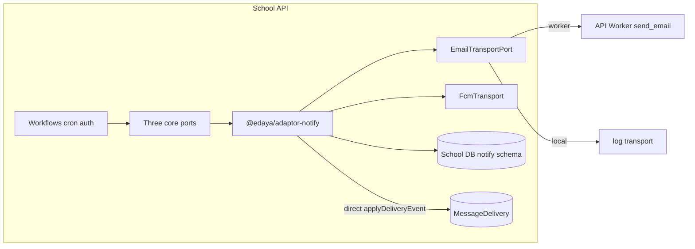

# In-process notification adapters

| Field | Value |
|-------|-------|
| Status | Implemented (Novu remains env fallback until staging smoke) |
| Date | 6 September 2026 |
| Repo | `edaya_backend` (`package/adaptor-notify`, school `notify` schema) |
| Owner | Notifications |

## Summary

`@edaya/adaptor-notify` implements the three school-API notification ports **in process**. Email and FCM are inner adapters (`EmailTransportPort`, FCM HTTP v1). Recipients, devices, and jobs live on the **school** database (`notify` schema). Delivery status calls `communicationsWorkflow.applyDeliveryEvent` directly — there is no notify Worker, JWT, or HMAC webhook.

The school API stays authoritative for inbox (`MessageDelivery`), templates, recipient resolution, and workflow triggers.

## Problem

A dedicated notify Worker (JWT, extra Neon, extra domain, second deploy) is extract cost. Today the school API is the only caller, and email/FCM are bindings + HTTP, not a second product.

## Goals

1. Drop-in replacement behind existing ports (`NotificationGatewayPort`, `InvitationDeliveryPort`, `AuthEmailDeliveryPort`).
2. Swappable `EmailTransportPort` (log locally; Cloudflare Email on the API Worker).
3. FCM HTTP v1 with the existing Guardian/Teacher payload keys.
4. In-process delivery status (no HMAC webhook).
5. Keep Novu as env fallback until staging smoke passes.

## Non-goals (v1)

- Extracting a second Worker until a second platform caller exists.
- SMS / WhatsApp.
- Workflow engine / delay steps (`deliverAfter` stays cron-owned in the school API).
- `notification.sent` plan metering.
- Importing device tokens from Novu (apps re-register on next login).

## Architecture

## Resolver order

1. `RUNTIME=in-memory` → no-op
2. `NOVU_SECRET_KEY` → Novu (legacy fallback until smoke)
3. `RUNTIME=local` or `worker` → in-process `@edaya/adaptor-notify`
4. else log / no-op

`REQUIRE_EMAIL_VERIFICATION` defaults true when notify or Novu is configured.

## Runtimes

| Profile | Store | Send | Email |
|---------|-------|------|-------|
| local | school PGlite `notify` schema | inline (await, enqueue swallows errors) | `EMAIL_TRANSPORT=log` |
| worker | school Postgres `notify` schema | inline on the API isolate | Cloudflare `send_email` |
| in-memory | n/a | no-op | n/a |

Auth OTP, verification, and invitations **await** send and throw on failure. School `enqueue` swallows send errors so business commands do not roll back.

## Cutover

Keep `@edaya/adaptor-novu` and `tooling/novu-ops` until staging smoke (OTP, invitation, announcement, Guardian push, `reconcilePendingDeliveries`) passes. No dual-write. Recipients backfill on session; push tokens refill on next app open.

### Code and CLI (done)

- In-process adapters in `@edaya/adaptor-notify`
- `bun repo smoke-test notify` (local school API; requires `bun repo dev` and `bun repo seed`)
- `bun repo db migrate` applies the `notify` schema on the school database

### Staging ops (after unsetting Novu)

1. Apply school migrations including `notify` schema: `bun repo db migrate staging`.
2. Onboard Cloudflare Email Sending on the **API** Worker: `wrangler email sending enable edayaplus.com` (SPF/DKIM). `send_email` is declared in `apps/api/wrangler.jsonc`.
3. Optional: `bun wrangler secret put FCM_SERVICE_ACCOUNT_JSON --env staging` from `apps/api`.
4. Unset `NOVU_SECRET_KEY` on the API Worker so in-process notify is selected.
5. Smoke OTP, invitation, announcement email, Guardian push, reconcile.
6. Repeat production. Only then remove `@edaya/adaptor-novu`, `tooling/novu-ops`, and `bun repo novu` / `smoke-test novu`.
