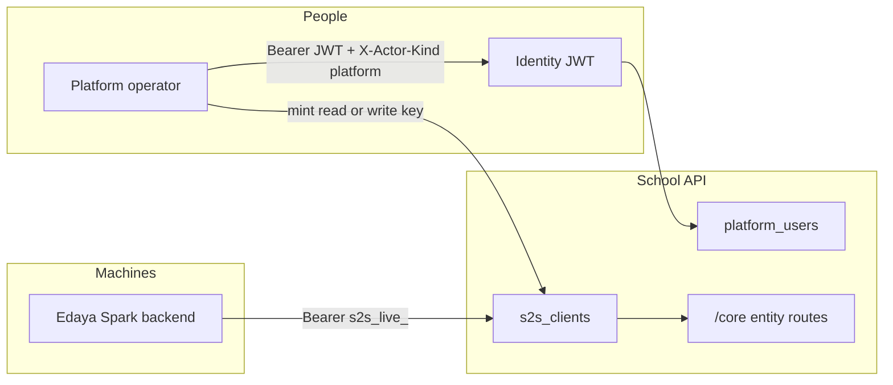

# Platform actors and S2S keys

| Field | Value |
|-------|-------|
| Status | Implemented (school API v1) |
| Date | 12 September 2026 |
| Repo | `edaya_backend` |
| Owner | Authorization |

## Summary

The school API has two extra actor kinds besides staff, portal humans, and `sk_live_` service accounts:

- **`platform`** — a human operator authenticated with an identity JWT. No `schoolId`. Permissions use the canonical `Permission` identifiers. Platform actions are explicitly excluded from school-owner and staff grants.
- **`s2s`** — a machine client authenticated with a `s2s_live_` key minted for one school. `read` and `write` access classes are evaluated by the school action policies, with administrative and human-only actions denied.

Identity schema and JWT claims are unchanged. Staff `sk_live_` keys stay on `StaffMember` service accounts.

Actor metadata contains identity and authentication assurance only. Each platform policy reads the current active operator and that action's permission from `platform_users`. Each S2S policy reads the current key status, school and access class from `s2s_clients`. Neither fact is copied into actor metadata or a shared decision cache. Platform and S2S administration writes authorize and persist within the same transaction.

## Credentials (XOR)

One `Authorization: Bearer` value per request:

1. Identity JWT
2. `sk_live_…` staff service account
3. `s2s_live_…` school S2S client

JWT plus any API-key prefix is unauthenticated. `parseBearerApiKey` does not accept `s2s_live_`.

## Platform operators

Rows live in `platform_users` (no `schoolId`). `X-Actor-Kind: platform` is required when the same identity `sub` is also staff, guardian, student, or teacher.

Bootstrap the first operators with `PLATFORM_BOOTSTRAP_EMAILS` (comma-separated, case-insensitive). On platform resolve, if no row exists for `sub` and the JWT email is listed, the API inserts an active user with every platform action (`createdBySubjectId = bootstrap`). Inactive rows are not resurrected. An empty env does not mean first-login-wins.

Further operators: `POST /core/platform-users` `{ email, permissions? }` looks up the identity directory by email. The identity user must already exist. Default permissions are a subset of the caller’s.

`GET /core/platform/me` returns platform permissions. `GET /core/authorization/effective-grants` stays school-actor shaped.

## S2S keys

`POST /core/s2s-clients` takes `schoolId`, `clientId` (stable name such as `edaya-spark`), and `accessClass` (`read` | `write`). The plaintext key is returned once on create and rotate.

- **read** — school `*_READ` and `QUERY_*` actions
- **write** — school actions except `HUMAN_ONLY`, `SERVICE_ACCOUNT_*`, `ACCESS_CONTROL_*`, and `PLATFORM_REGISTER_SCHOOL`
- S2S actors cannot create platform users or mint keys

Tenant checks use `actor.schoolId` from the key row. Platform-wide keys (one key, any school) are out of scope.

## Local bootstrap

1. Create the operator in identity (`ensureUser` / sign-up). Subject ids change if identity is wiped.
2. Set `PLATFORM_BOOTSTRAP_EMAILS` in `apps/api/.env` (and wrangler vars in staging/prod).
3. Call school API with the operator JWT and `X-Actor-Kind: platform`.

## HTTP

| Method | Path |
|---|---|
| GET | `/core/platform/me` |
| GET/POST | `/core/platform-users` |
| POST | `/core/platform-users/{id}/deactivate` |
| GET/POST | `/core/s2s-clients` |
| POST | `/core/s2s-clients/{id}/revoke` |
| POST | `/core/s2s-clients/{id}/rotate-key` |
