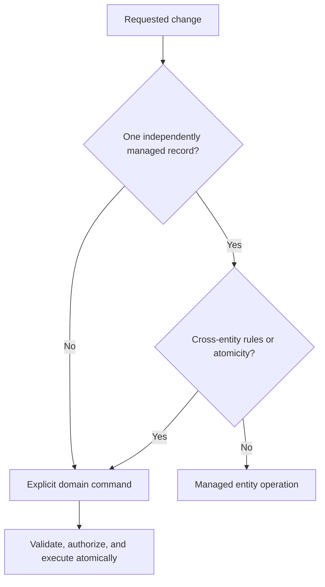

# Beyond CRUD: Modeling a Real SaaS Domain

## When records become business workflows

CRUD is one of the most productive abstractions in software. Many SaaS features genuinely are create, read, update, and delete operations over a well-designed record. Problems begin when we use the same abstraction for actions whose business meaning extends beyond a single record.

Consider student enrollment. It may connect a student to a class, validate an academic year, prevent overlapping enrollment, update related status, and create an audit trail. A payment may need to validate an outstanding obligation, enforce currency and amount rules, and update financial state atomically. Generating report cards combines definitions, assessment results, publication rules, and permissions.

Calling all of these operations `save()` hides the reason they exist and the conditions that make them valid.

The service-management equivalent would be treating every production change as an unclassified database update. Some changes are routine and low risk. Others require a controlled procedure because several conditions must remain true before and after execution. A SaaS domain benefits from the same distinction.

## Start with business capabilities

The school platform is organized into domain areas such as:

- school configuration
- students and guardians
- academics and assessments
- scheduling and attendance
- finance
- messaging
- school life and discipline

These are not independent microservices. They are modules inside a single domain core. The objective is to make business capabilities and vocabulary visible without introducing distributed-system overhead.

Each managed entity follows a shared pattern. A Zod schema defines its validated shape. TypeScript types are inferred from that schema. An entity constructor protects creation. A configuration connects the entity to tenancy, authorization, lifecycle hooks, and its repository.

The consistency is intentional. When many entities share the same lifecycle, the team should not rewrite list, count, validation, authorization, and persistence behavior for every resource.

But shared machinery has a limit. A generic entity service should remove repetition, not erase differences between business concepts. When an operation coordinates several entities or enforces a meaningful invariant, it moves into an explicit workflow.

## Entities for regular operations, commands for consequential ones

The API exposes standardized entity operations for records that can be managed directly. It also marks some entities as unavailable for direct save. Students, enrollments, payments, assessment results, and report-card results are changed through commands instead.

A command uses business language:

- `registerStudent`
- `enrollStudent`
- `recordPayment`
- `recordAssessmentResult`
- `generateReportCardResult`

This naming is not cosmetic. It makes the caller state an intention. It gives the domain one place to validate the complete operation, authorize it, run it atomically, and return a result that reflects the business outcome.

Commands also create a more stable public contract. Database tables and entity representations can evolve while the meaning of “enroll this student” remains recognizable to users and developers.



The enrollment workflow makes the distinction concrete. This abridged excerpt loads the related resources and enforces business and access rules. The workflow then checks existing enrollment and capacity before it persists anything:

```ts
const [student, classGroup] = await Promise.all([
  this.requireStudent(input.studentId),
  this.requireClassGroup(input.classGroupId),
])

if (student.status !== StudentStatus.Active) {
  throw new BusinessRuleViolationError(
    'STUDENT_NOT_ACTIVE',
    `Student ${input.studentId} is not active and cannot be enrolled`,
  )
}

if (student.schoolId !== classGroup.schoolId)
  denyResourceAccess()

this.checkActorSchool(classGroup.schoolId)
await operationModule(EnrollmentOperations.create)(this.baseService.actor)
await this.baseService.authorizationPolicy.checkStudentAccess(
  this.baseService.actor,
  [student.id],
)
await this.baseService.authorizationPolicy.checkClassGroupAccess(
  this.baseService.actor,
  [classGroup.id],
)
```

## Atomicity belongs to the workflow

Critical operations often cross repositories. If step three fails after steps one and two have persisted, retrying the request may make the situation worse.

The domain therefore depends on an atomic execution port. A workflow can request a transaction without depending directly on a Postgres driver. The adapter decides how that transaction is implemented.

This is a practical example of ports and adapters. The abstraction is not introduced because every dependency deserves an interface. It exists because atomicity is a business requirement and transaction implementation is infrastructure-specific.

The same reasoning applies to authorization policies and repository interfaces: extract a boundary when the domain needs a capability but should not own the mechanism.

## The cost of consistency

Regular structures can become repetitive structures. In the current codebase, entity metadata appears across domain services, repository collections, API registration, schemas, persistence wiring, and generated client bindings. The architecture is coherent, but adding an entity can require changes in several places.

This is an important warning for anyone adopting the pattern. Do not build a large metadata framework before the repetition is visible. First make two or three domains work explicitly. Observe which properties remain stable. Then introduce a typed registry or generator where it removes demonstrated drift.

Abstraction should follow evidence.

The same restraint applies to repository interfaces. A single large repository collection is easy to wire but allows workflows to access more dependencies than they need. Smaller constructor dependencies improve clarity, but splitting every interface prematurely creates noise. High-risk workflows should receive narrow dependencies first; ordinary managed entities can continue using shared infrastructure.

## A decision rule for small teams

Before adding a dedicated command, ask:

1. Does the operation express a recognizable business action?
2. Does it modify more than one entity or aggregate?
3. Must several validations succeed together?
4. Could partial completion leave the tenant in an invalid state?
5. Does authorization depend on the complete operation rather than one record?
6. Would an audit entry need to describe why the change occurred?

If several answers are yes, the operation probably deserves a command. If the action is a straightforward update to an independently managed record, generic entity handling may be enough.

This balance matters. A system made entirely of generic CRUD tends to hide business rules in route handlers and user interfaces. A system made entirely of specialized commands can become ceremonial and slow to extend. The objective is not maximum domain modeling. It is to make consequential behavior explicit.

Once business operations become explicit, another question follows: who is allowed to perform them, and over which data? In the next article, I will show why ordinary roles were insufficient for this multi-tenant domain.
