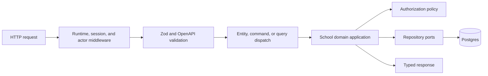

# From Domain Operation to Tested API Contract

## Exposing and proving a cloud-native SaaS architecture

An architecture diagram can show clean boundaries while the running application quietly bypasses them. Route handlers may implement business rules, client types may drift from server validation, or integration tests may exercise a different database behavior from production.

The final test of an architecture is the path taken by a real operation.

In this platform, a request enters a Hono API running either on Node or Cloudflare Workers. Middleware validates runtime configuration, resolves the appropriate application runtime, identifies the authenticated subject, and constructs an identity-only actor for the selected profile. Business policies load current manual grants and relationships when authorizing the requested action. The route validates the request body, dispatches a domain command or query, and serializes the result.

The HTTP layer does not decide how enrollment works or whether a teacher may access a student. It supplies validated input and request context to the domain layer that owns those decisions.



## Thin does not mean trivial

A thin API still has important responsibilities:

- HTTP routing and status semantics
- input and output validation
- session and actor resolution
- dependency lifecycle management
- error translation
- OpenAPI documentation
- request logging and completion hooks

These concerns belong at the edge because they depend on the transport or runtime. Business invariants do not.

The distinction also makes multiple runtimes manageable. On Node, the application can reuse a runtime containing PGlite or Postgres repositories. On Cloudflare Workers, each request resolves Postgres through Hyperdrive and closes request-scoped resources on completion. Both runtimes use the central identity service; authorization facts remain local to each policy evaluation.

The domain application remains the same. The runtime composition changes.

## A registry for the regular API surface

The platform contains many entities, commands, and queries. Hand-writing every structurally identical route would add boilerplate and create inconsistent behavior.

An API registry describes public route names, domain methods, schemas, entity constructors, and whether direct save is allowed.

Route builders use this registry to expose standard entity, command, and query endpoints. Handwritten routes remain available for operations such as onboarding, service accounts, and effective-grant resolution that do not fit the regular model.

This is deliberate automation rather than a fully generic framework. The registry standardizes repeated mechanics while special operations remain explicit.

The registry entry is intentionally small. It connects the public route, domain method, and schema without moving the workflow into the API:

```ts
export const coreCommands = [
  command(
    "register-student",
    "registerStudent",
    commandSchemas.registerStudentCommandSchema,
  ),
  command(
    "enroll-student",
    "enrollStudent",
    commandSchemas.enrollStudentCommandSchema,
  ),
]
```

Metadata can still be repeated between domain services, repositories, API registration, persistence, and client generation. A registry is valuable only when it reduces sources of truth. Further consolidation should follow proven repetition rather than a desire to generate everything.

## One contract from validation to client

The API exports an OpenAPI document from its registered routes and Zod schemas. Generation then produces the TypeScript schema representation used by the web application and bindings used by a small handwritten API client.

The client remains domain-shaped: `client.entities.students.list(...)`, `client.commands.enrollStudent(...)`, and `client.authorization.effectiveGrants()`.

Generated code does not replace testing. It reduces a particular class of transcription errors. A drift check regenerates the contract and fails when committed artifacts no longer match the API definition.

One current limitation is instructive: the runtime client can still expose save methods for entities that the API marks as command-only. The server rejects those calls, but better generated resource types could make the invalid operation impossible at compile time. Type safety should describe policy where metadata already knows the policy.

## Test the boundaries, not only the functions

Unit tests are useful for schemas, entities, and isolated authorization rules. They cannot prove that independently correct components are wired together correctly.

The highest-risk behaviors require integration tests:

- Tenant-boundary tests attempt to read or modify another school’s data.
- Authorization tests exercise session identity, grant resolution, scopes, and resource policies together.
- Atomic-workflow tests force failures and verify that partial writes are rolled back.
- Persistence tests validate JSON and database behavior against Postgres-compatible storage.
- API tests verify validation, authentication, status codes, and dispatch.
- Contract checks detect OpenAPI and generated-client drift.

This testing strategy follows business risk. A formatting helper needs a small test. A payment workflow or tenant boundary deserves the real repository, authorization policy, and transaction mechanism.

## Realistic data is part of the platform

Fixtures and seeding are operational tools. Stable datasets are separated from HTTP seed orchestration, allowing local and remote environments to be populated through public application paths. A validation harness checks coherence; staging smoke tests sign in and verify critical behavior such as effective-grant resolution.

This provides more confidence than confirming that a deployment returned HTTP 200. It proves that relationships, authentication, and authorization can be exercised.

## Architecture becomes real through verification

My service-management background makes this the most important part of the series. A service boundary that cannot be tested is only an intention. A deployment that cannot be validated is only an event. A generated contract that can silently drift is only documentation.

The complete delivery path should reinforce the same model:

1. Product language defines the command.
2. Domain schemas validate its meaning.
3. Authorization evaluates the actor and resource relationships.
4. Repository ports preserve infrastructure independence where it matters.
5. The API translates the operation into HTTP.
6. OpenAPI and client bindings distribute the contract.
7. Integration and smoke tests prove the assembled service.

None of the individual techniques is new. The value comes from combining them into an operating model that a small team can understand and evolve.

That is the blueprint I would take from this project: not a fixed TypeScript stack, but a progression from product constraints to explicit boundaries, from business actions to safe workflows, and from architecture diagrams to evidence that the service behaves as intended.

There is one final question worth testing against that blueprint: what happens if the company and engineering team become much larger and decide to move the platform to AWS? The next article separates the parts that should move from the architecture that should remain intact.
