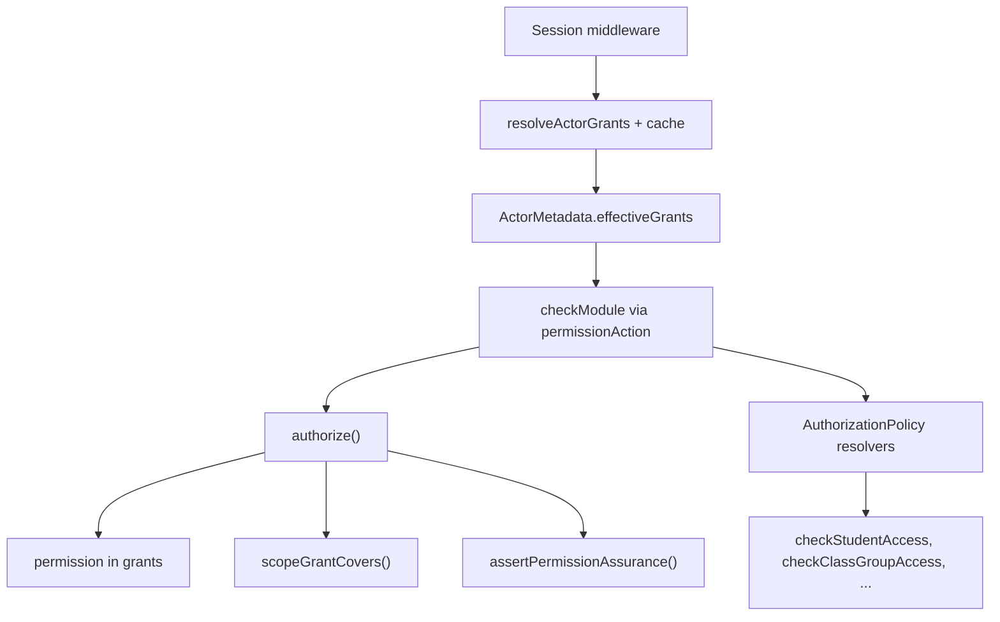

# Authorization Cleanup Plan

Assessment of the authorization model in `packages/core/src/authorization/` and related ports. This document tracks phased cleanup work.

## Current Architecture

Two layers enforce access:

1. **Capability layer** (`authorize()`) — permission + scope grants on preloaded `actor.effectiveGrants`, plus assurance checks.
2. **Resource layer** (`AuthorizationPolicy` resolvers) — relationship-based checks after entities are resolved (enrollment, class group, session, etc.).

Grants are resolved at session time (`resolveActorGrants`) and cached in the API (`authorization-grants-cache.ts`).



## Findings Summary

| Area | Issue | Severity |
|------|-------|----------|
| Dead code | Empty `default-authorization-repository.ts`, unused `Role`/`RoleAssignment`, compat wrappers | Low |
| Duplication | Portal grants built in 3 places; teaching permissions hardcoded in resolvers | Medium (drift risk) |
| Performance | N+1 enrollment lookups in guardian grants + `checkStudentAccess` | High |
| Performance | Sequential `findById` in report card / session / note resolvers | Medium |
| Unwired API | `checkModuleAccess` not used by entity configs | Low (Phase 3) |
| Request shape | `AuthorizationRequest.actorId` / `context` never read | Low |
| `count()` | Loads all entities to authorize count | Medium (Phase 3) |

## Phase 1 — Cleanup (no behavior change)

**Status: complete**

- [x] Delete empty `default-authorization-repository.ts`
- [x] Remove unused `Role` / `RoleAssignment` from `role-types.ts` (keep `ScopeGrant`)
- [x] Remove `staffHasAnyPermission` / `staffGrantCoversAny` compat wrappers
- [x] Collapse redundant `assertActorSchool` branches
- [x] Remove dead `isElevated = false` ternary in `resolveEffectiveGrants`
- [x] Add `ASSIGNMENT_SCOPED_PERMISSION_SET` for O(1) membership checks
- [x] Centralize portal scope grant building (`portal-grants.ts`)
- [x] Centralize resolver permission groups (`resolver-permissions.ts`)
- [x] Trim `AuthorizationRequest` (remove unused `actorId`, `context`)

**Deferred from Phase 1**

- `assertPortalPermission` — kept; used by unit tests to verify portal policy
- `AuthorizationErrorCode` variants — kept; reserved for API-layer mapping (Phase 3)

## Phase 2 — Performance

**Status: complete**

- [x] Batch enrollment lookups (`enrollment-scope.ts`) in `resolveGuardianGrants`
- [x] Batch enrollment lookups in `checkStudentAccess`
- [x] Batch `findByIds` in `checkReportCardResultAccess`, `checkStudentNoteAccess`, `checkSessionAccess`
- [x] Deduplicate student IDs before enrollment fetch in `checkStudentAccess`

**Deferred from Phase 2**

- Indexed grant structure on `EffectiveGrants` — marginal gain until grant sets grow large
- `ManagedEntityService.count()` fix — needs design decision (Phase 3)

## Phase 3 — Structural (brainstorm)

Topics to decide before implementing:

1. **`checkModuleAccess`** — Wire into workflow/query entry points for portal module gating, or remove from `AuthorizationPolicy`.
2. **`ManagedEntityService.count()`** — Repository-level scoped count vs. document that count is only for small tenant lists.
3. **`checkStudentHealthAccess`** — Align with student scope model (currently permission-only).
4. **`permissionAction` sync** — Drop unnecessary `async` wrapper.
5. **`hasFullStudentRecordAccess`** in `student-note.ts` — Require preloaded grants; remove DB fallback.
6. **`authorizeAnnouncementLinked`** — Implement or replace with explicit `noopSaveAccess`.
7. **Error code usage** — Map API middleware errors to specific `AuthorizationErrorCode` values.
8. **`academicYearId` on requests** — Enforce in `authorize()` or remove from request type.

## File Map (after Phase 1–2)

| File | Role |
|------|------|
| `authorize.ts` | Capability entry point |
| `portal-permissions.ts` | Portal permission sets |
| `portal-grants.ts` | Shared portal scope grant builder |
| `resolver-permissions.ts` | Permission groups used by access resolvers |
| `enrollment-scope.ts` | Batch active-enrollment lookups |
| `system-role-permissions.ts` | Role templates + assignment-scoped permissions |
| `access-resolvers/*.ts` | Resource-level checks |
| `ports/authorization-repository.ts` | Grant resolution |

## Test Plan

```bash
cd packages/core && bun test tests/unit/auth
cd packages/integration-tests && bun test src/auth
```
