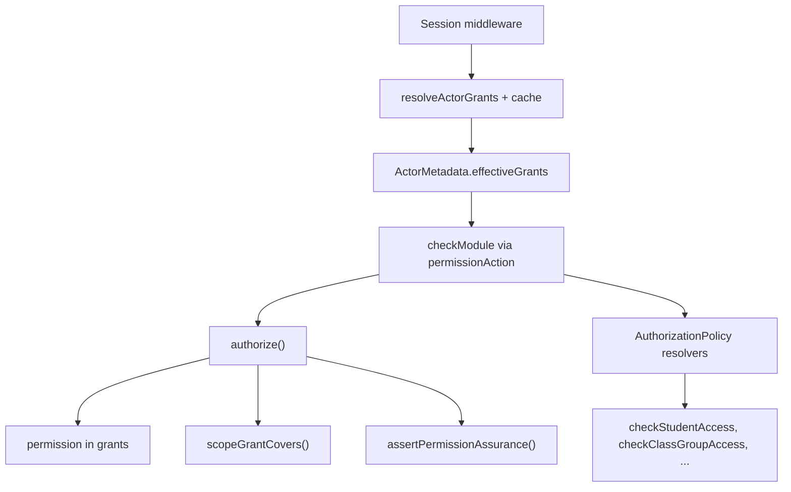

# Authorization Cleanup Plan

Assessment of the authorization model in `packages/core/src/authorization/` and related ports. This document tracks phased cleanup work.

## Current Architecture

Two layers enforce access:

1. **Capability layer** (`authorize()`) — permission + scope grants on preloaded `actor.effectiveGrants`, plus assurance checks.
2. **Resource layer** (`AuthorizationPolicy` resolvers) — relationship-based checks after entities are resolved (enrollment, class group, session, etc.).

Grants are resolved at session time (`resolveActorGrants`) and cached in the API (`authorization-grants-cache.ts`).



## Findings Summary

| Area | Issue | Severity |
|------|-------|----------|
| Dead code | Empty `default-authorization-repository.ts`, unused `Role`/`RoleAssignment`, compat wrappers | Low |
| Duplication | Portal grants built in 3 places; teaching permissions hardcoded in resolvers | Medium (drift risk) |
| Performance | N+1 enrollment lookups in guardian grants + `checkStudentAccess` | High |
| Performance | Sequential `findById` in report card / session / note resolvers | Medium |
| Unwired API | `checkModuleAccess` not used by entity configs | Low (Phase 3) |
| Request shape | `AuthorizationRequest.actorId` / `context` never read | Low |
| `count()` | Loads all entities to authorize count | Medium (Phase 3) |

## Phase 1 — Cleanup (no behavior change)

**Status: complete**

- [x] Delete empty `default-authorization-repository.ts`
- [x] Remove unused `Role` / `RoleAssignment` from `role-types.ts` (keep `ScopeGrant`)
- [x] Remove `staffHasAnyPermission` / `staffGrantCoversAny` compat wrappers
- [x] Collapse redundant `assertActorSchool` branches
- [x] Remove dead `isElevated = false` ternary in `resolveEffectiveGrants`
- [x] Add `ASSIGNMENT_SCOPED_PERMISSION_SET` for O(1) membership checks
- [x] Centralize portal scope grant building (`portal-grants.ts`)
- [x] Centralize resolver permission groups (`resolver-permissions.ts`)
- [x] Trim `AuthorizationRequest` (remove unused `actorId`, `context`)

**Deferred from Phase 1**

- `assertPortalPermission` — kept; used by unit tests to verify portal policy
- `AuthorizationErrorCode` variants — kept; reserved for API-layer mapping (Phase 3)

## Phase 2 — Performance

**Status: complete**

- [x] Batch enrollment lookups (`enrollment-scope.ts`) in `resolveGuardianGrants`
- [x] Batch enrollment lookups in `checkStudentAccess`
- [x] Batch `findByIds` in `checkReportCardResultAccess`, `checkStudentNoteAccess`, `checkSessionAccess`
- [x] Deduplicate student IDs before enrollment fetch in `checkStudentAccess`

**Deferred from Phase 2**

- Indexed grant structure on `EffectiveGrants` — marginal gain until grant sets grow large
- `ManagedEntityService.count()` fix — needs design decision (Phase 3)

## Phase 3 — Structural simplification

**Status: complete**

- [x] Unified permission groups in `permissions/groups.ts` (assignment-scoped, resolver, finance)
- [x] `createRepositoryAuthorizationPolicy` factory; `RepositoryAuthorizationPolicy` class removed
- [x] `checkModuleAccess` removed from `AuthorizationPolicy`; kept as standalone resolver in `policy/resolvers/module.ts`
- [x] `permissionAction` / `anyPermissionAction` are synchronous and no longer take a `policy` argument
- [x] `hasFullStudentRecordAccess` in `student-note.ts` uses preloaded grants via `actorGrantCoversAny`
- [x] `authorizeAnnouncementLinked` removed; messaging entities use `noopSaveAccess` / `noopDeleteAccess`
- [x] `academicYearId` removed from `AuthorizationRequest` (year scoping stays in grant resolution)
- [x] `AuthorizationErrorCode` trimmed to `Forbidden` only (API-specific codes deferred)

- [x] Wire `checkModuleAccess` into workflow/query entry points for portal module gating

**Deferred from Phase 3**
- `ManagedEntityService.count()` — repository-level scoped count vs. document small-tenant-only usage
- `checkStudentHealthAccess` — align with student scope model (currently permission-only)
- Map API middleware errors to richer `AuthorizationErrorCode` values when HTTP layer is refactored

## Module Layout (reorganized)

```
authorization/
  index.ts                 # Public barrel (permissions/model first — avoids circular init)
  model/                   # Actor context, errors, requests, ScopeGrant
  engine/                  # authorize() — synchronous capability checks
  grants/                  # Grant templates, portal policy, actor grant helpers
  permissions/             # Permission enum, catalog, assurance rules
  policy/                  # Resource-level AuthorizationPolicy
    resolvers/             # student, academic, finance, scheduling, module
  ports/authorization-repository.ts   # Grant resolution (stays in ports)
```

| Folder | Responsibility |
|--------|----------------|
| `model/` | Who is acting (`ActorMetadata`), errors, `AuthorizationRequest`, `ScopeGrant` |
| `engine/` | `authorize()` — permission + scope + assurance |
| `grants/` | Portal permission sets, role templates, scope grant builders, `actorGrantCoversAny` |
| `permissions/` | `Permission` enum, definitions, assurance map |
| `policy/` | Resource resolvers + `createRepositoryAuthorizationPolicy` |
| `ports/` | DB-backed `resolveEffectiveGrants` / `resolveActorGrants` |

## Test Plan

```bash
cd packages/core && bun test tests/unit/auth
cd packages/integration-tests && bun test src/auth
```
