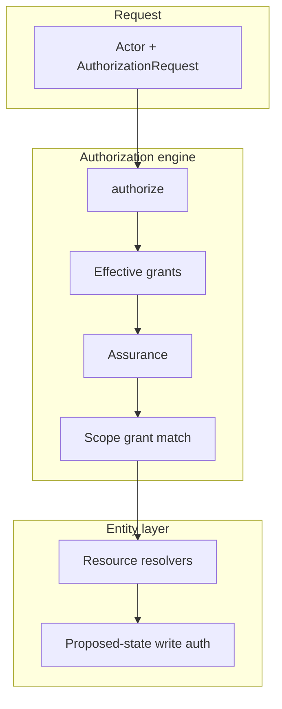

# Authorization migration plan

Migration from `StaffRole` + `AuthorizationAction` strings to the permission model (`Permission`, `Role`, `ScopeGrant`, `RoleAssignment`, `authorize()`).

**Target architecture:** `authorize()` → effective grants + assurance → scope match → resource resolvers (entity state).

---

## Progress checklist

### Phase 0 — Foundation
- [x] `Permission` enum and `ScopeType`
- [x] `PermissionDefinition` + `permissionDefinitions` (`Record<Permission, …>`)
- [x] Initial legacy action map bridge (removed in Phase 6)
- [x] `Role`, `ScopeGrant`, `RoleAssignment` types (TS only)
- [x] Initial `authorize()` skeleton (legacy delegation removed in Phase 6)
- [x] Unit tests for catalog and skeleton `authorize()`
- [x] Split remaining coarse legacy permissions (`finance.manage`, `students.manage_health`, `setup.manage_lifecycle`)
- [x] Document scope semantics (`scopeEntityIds` empty vs school-wide)

### Phase 1 — Permission engine (no DB)
- [x] System role seeds (`StaffRole` → permission templates)
- [x] `EffectiveGrants` + `resolveEffectiveGrants()` from persisted role assignments + live staff assignments
- [x] Assurance rules on permissions
- [x] API session assurance bridge (`standard` default, explicit `verified` / `strong` pass-through)
- [x] Portal permission sets (guardian / student)
- [x] `authorize()` grants path
- [x] System role permission tests
- [x] Optional `effectiveGrants` on `StaffActorMetadata` (preload to skip DB in `authorize`)
- [x] Load `effectiveGrants` at API boundary on every request
- [x] Add session cache / invalidation for preloaded `effectiveGrants`

### Phase 2 — Persistence
- [x] Postgres schema: `access_roles`, `staff_role_assignments` (scope grants as JSONB)
- [x] Core entities: `AccessRole`, `StaffRoleAssignment`
- [x] Repositories on `SchoolRepositories` + Postgres adaptor
- [x] `ensureSystemAccessRolesForSchool`, `syncStaffSystemRoleAssignment`, `backfillSchoolAccessControlFromLegacy`
- [x] `resolveEffectiveGrants` prefers persisted assignments when present
- [x] `resolveEffectiveGrants` enforces assignment `startsAt` / `endsAt`
- [x] Effective grants expose earliest expiry so API session caches cannot outlive grant windows
- [x] Run backfill in production / on school setup hook

### Phase 3 — Access control API
- [x] Commands/queries for roles and assignments
- [x] Access role commands create custom roles only; system-role flags are not accepted from clients
- [x] Access control gates split `ACCESS_CONTROL_READ`, `ACCESS_CONTROL_CONFIGURE`, and `ACCESS_CONTROL_ASSIGN`
- [x] Student health profile access split into `STUDENT_HEALTH_READ` and `STUDENT_HEALTH_UPDATE`

### Phase 4 — Call site migration
- [x] Wave A: finance + scheduling workflows (audit gaps)
- [x] Wave B: entity configs by domain
- [x] Wave C: query services / `QUERY_*` permissions
- [x] Wave D: API actor construction without `StaffRole[]`
- [x] Wave E: remaining core service workflows (`academics`, `assessments`, `behavior`, `communications`, `setup`, `student`)
- [x] Wave F: API facade setup/lifecycle gates

### Phase 5 — Resource resolvers
- [x] Remove `StaffRole` from `access-resolvers/*`
- [x] Scope-aware helpers (`assertScopeCoversEntity`)

### Phase 6 — Remove legacy
- [x] Migrate remaining production `checkGlobalAction` callers (`apps/api/src/lib/school-service-facade.ts`)
- [x] Remove `AuthorizationAction`, `checkGlobalAction`, `global-resolver` matrix
- [x] Remove legacy action map
- [x] Remove `StaffMember.roles` column

### Phase 7 — Portal actors
- [x] Dedicated portal permission policy (guardian / student)

### Phase 8 — Tooling
- [x] Entity config linter: require `permissionAction` not raw strings
- [x] Permission coverage / security regression suite

---

## PR sequence

| PR | Status | Scope |
|----|--------|--------|
| 1 | **Done** | Catalog, initial legacy bridge, `authorize()` skeleton, types |
| 2 | **Done** | System roles, `resolveEffectiveGrants`, grants engine, parity tests |
| 3 | **Done** | DB tables, entities, repos, backfill, persisted grant resolution |
| 4 | **Done** | Access control API |
| 5 | **Done** | Finance + scheduling workflows |
| 6–7 | **Done** | Entity config waves |
| 8 | **Done** | Resolver refactor |
| 9 | **Done** | Queries + API actor + remaining workflow/API facade call sites |
| 10 | **Done** | Portal hardening |
| 11 | **Done** | Legacy removal |
| Stabilization | **Done** | Platform permission boundary, access-control permission split, time-bound grant/cache enforcement |

---

## Target end state

---

## Phase 1 details (PR 2)

### `resolveEffectiveGrants`

| Source | Maps to |
|--------|---------|
| `StaffRoleAssignment.roleIds` | Permission set from persisted `AccessRole` rows |
| `StaffRoleAssignment.scopeGrants` | Persisted assignment grants |
| `StaffAssignment` | Live teaching scope grants for non-elevated staff |

`StaffMember.roles` is no longer part of the core entity or Postgres staff member schema. API registration still accepts role keys as command input for compatibility, but those keys are immediately written to `StaffRoleAssignment` records via `syncStaffSystemRoleAssignment`.

### `authorize()`

1. Actor school boundary
2. Scope type allowed by `permissionDefinitions`
3. Resolve / use `EffectiveGrants`
4. Assurance check
5. Permission in effective set
6. Scope grant match when `scopeType` / `scopeEntityId` present

### Scope semantics

| Request / grant shape | Meaning |
|-----------------------|---------|
| `AuthorizationRequest.scopeType` omitted | Permission-only check; no `ScopeGrant` is required once the actor has the permission. |
| `AuthorizationRequest.scopeEntityId` set without `scopeType` | Invalid request; rejected by `authorize()`. |
| `scopeType` not in `permissionDefinitions[permission].allowedScopes` | Invalid for that permission; rejected by `authorize()`. |
| Non-elevated staff + scoped request | Requires a matching `ScopeGrant` for the same permission and scope type. |
| Non-school scope grant (`class_group`, `course_assignment`, `session`, etc.) | `scopeEntityIds` must include the requested `scopeEntityId`. Empty `scopeEntityIds` does not mean wildcard. |
| School scope grant with empty `scopeEntityIds` | School-wide for the actor's `schoolId`. |
| School scope grant with `scopeEntityIds` containing the school id | School-wide for that school. |
| Elevated staff (`EffectiveGrants.isElevated`) | Bypasses per-entity `ScopeGrant` matching after permission and assurance checks pass. |

Current system-role sync writes explicit school-id grants for elevated system roles. The empty `scopeEntityIds` school-wide form remains supported by `scopeGrantCovers()` for compatibility with persisted/custom role assignments.

### Stabilized invariants

- `PLATFORM_REGISTER_SCHOOL` is platform/system authority only. School-level Admin/Principal grants must not include it, regardless of actor assurance.
- Access-control permissions are intentionally split:
  - `ACCESS_CONTROL_READ` reads access roles and staff role assignments.
  - `ACCESS_CONTROL_CONFIGURE` creates/updates access role definitions.
  - `ACCESS_CONTROL_ASSIGN` creates/updates staff role assignments and staff assignment links.
- Public access-role commands may create custom roles only. `isSystemRole` and `systemRoleKey` are system-managed fields.
- `StaffRoleAssignment.startsAt` / `endsAt` are enforced during effective-grant resolution. Active status alone is insufficient.
- API effective-grant caches expire at the earlier of the fixed TTL or the earliest grant `endsAt`.
- API actor construction defaults assurance to `standard`; only explicit trusted session values may produce `verified` or `strong`.
- Student health profile access is no longer implied by general student detail/update permissions; `STUDENT_HEALTH_UPDATE` keeps the same Verified assurance bar previously inherited from `STUDENT_UPDATE`.
- Guardian and student portal actors use dedicated portal permission policies instead of inline staff-grant shortcuts in `authorize()`.
- Authorization migration coverage tests prevent legacy action strings, raw permission strings in entity authorization calls, removed engine entry points, and `StaffMember.roles` storage references from returning.

## Migration inventory

| Area | ~Scale |
|------|--------|
| Entity configs `action(policy, …)` | done; direct entity gates no longer read `StaffRole` / `staffMember.roles` |
| Workflow `checkGlobalAction` | done in core workflows |
| API facade `checkGlobalAction` | done |
| Access resolvers | done; grant-backed |
| Legacy `AuthorizationAction` | removed |
| `StaffMember.roles` storage | removed from entity, Postgres schema, repository mapping, and API response schema |

---

## Remaining Compatibility Surfaces

- `StaffRole` remains as a role-key enum for system access role templates, `StaffAssignment.role`, actor metadata compatibility, and registration command input.
- Historical data migration for existing deployed databases still needs an environment-specific migration/backfill step if production rows already contain `staff_members.roles`; this repository currently updates the Postgres schema but does not include a standalone migration file.

---

## Risks

| Risk | Mitigation |
|------|------------|
| Grant lookup performance | Cache on actor/session; invalidate on assignment change |
| Cached grants outlive time-bound assignments | Bound cache expiry by effective grant `expiresAt`; covered by API middleware tests |
| School admins accidentally gain platform authority | Exclude `PLATFORM_REGISTER_SCHOOL` from school system roles; covered by parity/integration tests |
| Access-control delegation becomes role administration | Keep read/configure/assign split and reject system-role fields from public commands |
| Production sessions cannot satisfy elevated assurance gates | Auth provider must populate trusted `session.assuranceLevel`; middleware falls back to `standard` |
| Student profile access leaks health data | Split health read/update permissions from general student permissions; covered by resolver and managed-service tests |
| Guardian regressions | Portal permission suite (PR 2 parity + PR 7) |

---

## Definition of done

- [x] All staff auth via `authorize(AuthorizationRequest)`
- [x] Roles + assignments persisted per school
- [x] Per-permission scope grants enforced
- [x] Resolvers use grants, not `StaffRole`
- [x] No `checkGlobalAction` / `AuthorizationAction` in production
- [x] No `StaffMember.roles` storage in core/Postgres/API responses
- [x] Access control admin API live
