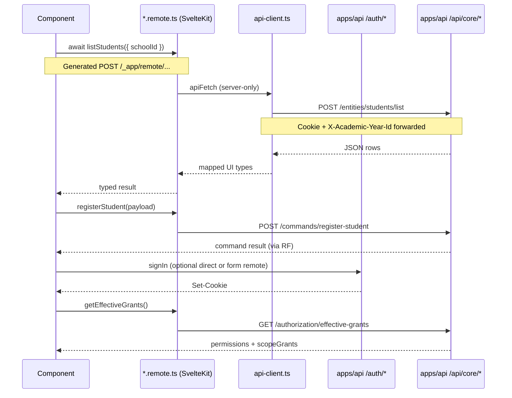

# Webapp ↔ API Integration Plan

This document crosschecks `apps/webapp` (SvelteKit UI) against the current monorepo — especially `apps/api` and `@edaya/core` — and outlines how to wire them together using **SvelteKit remote functions** as the client–server boundary.

**Related docs:** [API folder structure](./api-folder-structure.md), [API improvement plan](./api-improvement-plan.md), [Authorization README](../packages/core/src/authorization/README.md), [SvelteKit remote functions](https://svelte.dev/docs/kit/remote-functions).

---

## 1. Executive summary

`apps/webapp` is a **UI prototype** with deliberate seams for API wiring, but **no live integration** today:

- All data comes from local mocks (`school.ts`, `report-cards.ts`, `teachingLog.ts`).
- Auth is a demo picker backed by `sessionStorage`, not Better Auth.
- Permissions are a client-side `StaffRole` enum, not `effective-grants` from the API.
- There are **zero** HTTP calls, env vars, or workspace dependencies on `@edaya/*`.

**Chosen integration pattern:** [SvelteKit remote functions](https://svelte.dev/docs/kit/remote-functions) (experimental, SvelteKit ≥ 2.27). Components call typed `.remote.ts` exports; SvelteKit runs them on the server and auto-generates fetch wrappers for the browser. Remote functions call `apps/api` from server-only code — acting as a **BFF (backend-for-frontend)** — so cookies, secrets, and `X-Academic-Year-Id` stay off the client.

The webapp is in the Bun workspace as `@edaya/webapp` (Turbo build fixed); integration work has not started.

---

## 2. Current architecture

```
┌─────────────────────────────────────────────────────────────┐
│ apps/webapp (SvelteKit + Cloudflare, port 5173)               │
│                                                             │
│  Components / +page.svelte                                  │
│       │ await query / command / form                        │
│       ▼                                                     │
│  *.remote.ts  (SvelteKit server — BFF)                      │
│       │ server-only api-client → fetch apps/api             │
│       ▼                                                     │
│  loaders.ts (today) → school.ts mocks                       │
│  authSession / permissions / academicContext (mock)         │
└───────────────────────────┬─────────────────────────────────┘
                            │  server-side HTTP (target)
                            ▼
┌─────────────────────────────────────────────────────────────┐
│ apps/api (Hono, port 9999)                                  │
│                                                             │
│  /auth/*                         → Better Auth          │
│  /api/core/entities/{name}/*         → entity CRUD          │
│  /api/core/commands/{name}           → domain commands       │
│  /api/core/queries/{name}            → aggregate queries    │
│  /api/core/authorization/effective-grants → introspection   │
│  /doc, /reference                    → OpenAPI              │
└───────────────────────────┬─────────────────────────────────┘
                            │
                            ▼
                    @edaya/core + @edaya/adaptor-postgres
```

### Intended integration seams (already in the webapp)

| File | Role today | Role when integrated |
|------|------------|----------------------|
| `src/lib/data/loaders.ts` | Page loaders reading mock arrays | Thin wrappers over remote `query` calls (or replaced by `await` in pages) |
| `src/lib/data/load-state.ts` | Demo loading/empty/error states (`?demo=`) | Real async / error boundaries around remote calls |
| `src/lib/auth/session.svelte.ts` | Demo login via `sessionStorage` | Hydrate from Better Auth + remote `query` for actor context |
| `src/lib/permissions.ts` | Client RBAC from `StaffRole` enum | UI gates from remote `getEffectiveGrants` query |
| `src/lib/academic/context.svelte.ts` | Year/period/class selection | Passes `academicYearId` into remote calls (server adds header) |
| **`src/lib/remote/*.remote.ts`** (new) | — | Typed BFF: validate input, call API, map DTOs |
| **`src/lib/server/api-client.ts`** (new) | — | Server-only fetch to `API_URL` with cookie + header forwarding |

Comments in `load-state.ts` and `school.ts` explicitly note intent: *"prêt pour brancher l'API plus tard"* / *"aligné futur API"*.

---

## 3. Monorepo membership gaps

| Issue | Detail | Status |
|-------|--------|--------|
| Package name | `@edaya/webapp` | Done |
| Workspace / lockfile | In root `bun.lock` | Done |
| Turbo outputs | `.svelte-kit/**` in `turbo.json` | Done |
| Workspace deps | No `@edaya/core`, no `better-auth` | Open |
| CI / fullcheck | Webapp `check` runs in Turbo; no `lint`/`test` yet | Partial |
| Env config | No `.env` / `.env.example`; no `API_URL` | Open |
| Remote functions | Not enabled in `svelte.config.js` | Open |
| README | Still the default `sv create` template | Open |

---

## 4. API surface the webapp should consume

Default dev API: `http://localhost:9999` (`PORT` in `apps/api` env schema).

| Category | Pattern | Methods |
|----------|---------|---------|
| Auth | `/auth/*` | GET, POST (Better Auth proxy) |
| Entities | `/api/core/entities/{publicName}/list\|one\|count\|get\|save\|delete\|batch-*` | Mostly POST; `get` is GET |
| Commands | `/api/core/commands/{publicName}` | POST |
| Queries | `/api/core/queries/{publicName}` | POST |
| Authorization | `/api/core/authorization/effective-grants` | GET |
| System | `/api/core/system/commands/{commandName}` | POST (+ `X-System-Actor-Secret`) |
| OpenAPI | `/doc`, `/reference` | GET |

Entity and command names are defined in `apps/api/src/lib/school-api/registry/index.ts`.

### Headers the API expects (forwarded by the BFF)

| Header | When |
|--------|------|
| `Cookie` | Session auth (Better Auth) — forward from `getRequestEvent().request` |
| `X-Academic-Year-Id` | Year-scoped grant resolution — set in remote function from academic context |
| `Content-Type: application/json` | POST bodies |

The browser **does not** call `apps/api` directly for core data; the SvelteKit server forwards these headers.

---

## 5. Remote functions strategy

SvelteKit remote functions ([docs](https://svelte.dev/docs/kit/remote-functions)) replace hand-written `+server.ts` routes and client-side `fetch` wrappers for **internal** app ↔ API traffic. Each export in a `.remote.ts` file is compiled to a type-safe client stub that POSTs to a generated `/_app/remote/...` endpoint; the handler runs on the SvelteKit server (Cloudflare Worker in production).

> **Experimental:** enable explicitly; pin `@sveltejs/kit` and read changelogs before upgrades. Requires SvelteKit ≥ 2.27 (webapp currently `^2.57.0`).

### Enable in `svelte.config.js`

```js
/** @type {import('@sveltejs/kit').Config} */
const config = {
  kit: {
    experimental: {
      remoteFunctions: true,
    },
    adapter: adapter(/* ... */),
  },
  compilerOptions: {
    experimental: {
      async: true, // optional: `await` in components / `{#each await query()}`
    },
  },
};
```

### Four flavours → Edaya API mapping

| Remote flavour | Use in Edaya webapp | Maps to `apps/api` |
|----------------|---------------------|---------------------|
| **`query`** | Read data in pages/components; replace loader mocks | `POST .../entities/{name}/list\|one\|count`, `GET .../effective-grants`, `POST .../queries/{name}` |
| **`command`** | JS-driven mutations (drawers, dialogs, optimistic UI) | `POST .../commands/{name}`; entity `save` where allowed |
| **`form`** | Progressive-enhancement forms (login, simple CRUD) | Better Auth POST via proxy; optional entity `save` |
| **`prerender`** | Rare — static reference data at build time | Only if data is deployment-static (e.g. i18n keys); **not** for tenant/school data |

Prefer **`query`** for reads and **`command`** for domain writes. Use **`form`** when the UX is a native `<form>` with progressive enhancement.

### Proposed file layout

```
apps/webapp/src/
├── lib/
│   ├── server/
│   │   ├── api-client.ts          # fetch(API_URL, { headers from getRequestEvent })
│   │   ├── api-errors.ts          # map 400/403/409 → typed errors
│   │   └── mappers/               # API DTO → UI types (per domain)
│   └── remote/
│       ├── auth.remote.ts         # session probe (form for login if proxied)
│       ├── authorization.remote.ts
│       ├── shell.remote.ts        # app shell: schools, years, periods
│       ├── people.remote.ts       # students, guardians, staff
│       ├── classes.remote.ts
│       ├── finance.remote.ts
│       ├── academics.remote.ts    # assessments, report cards
│       └── commands.remote.ts     # or split by domain
```

Remote files live under `src/lib/remote/` (not `src/lib/server/` — server-only helpers stay in `src/lib/server/`).

### Server-only API client (BFF)

```ts
// src/lib/server/api-client.ts (sketch)
import { getRequestEvent } from '$app/server';
import { API_URL } from '$env/static/private';

export async function apiFetch(path: string, init: RequestInit = {}) {
  const { request } = getRequestEvent();
  const headers = new Headers(init.headers);
  headers.set('Content-Type', 'application/json');
  headers.set('Cookie', request.headers.get('cookie') ?? '');
  // academicYearId from cookie, header, or remote arg:
  const yearId = request.headers.get('x-academic-year-id');
  if (yearId) headers.set('X-Academic-Year-Id', yearId);

  const res = await fetch(`${API_URL}${path}`, { ...init, headers });
  if (!res.ok) throw await toApiError(res);
  return res.json();
}
```

Env: `API_URL=http://localhost:9999` (private — never `PUBLIC_`). Same-origin browser requests hit SvelteKit only; **CORS on `apps/api` is optional** for core UI flows (still needed if Better Auth client talks to API origin directly).

### Example remote modules

**Read — entity list**

```ts
// src/lib/remote/people.remote.ts
import { query } from '$app/server';
import { z } from 'zod';
import { apiFetch } from '$lib/server/api-client';
import { toStudentRow } from '$lib/server/mappers/students';

export const listStudents = query(
  z.object({ schoolId: z.string(), classId: z.string().optional() }),
  async ({ schoolId, classId }) => {
    const rows = await apiFetch('/api/core/entities/students/list', {
      method: 'POST',
      body: JSON.stringify({ schoolId, ...(classId ? { classId } : {}) }),
    });
    return rows.map(toStudentRow);
  },
);
```

**Write — domain command**

```ts
// src/lib/remote/commands.remote.ts
import { command } from '$app/server';
import { z } from 'zod';
import { apiFetch } from '$lib/server/api-client';

export const registerStudent = command(
  z.object({ /* core command payload */ }),
  async (payload) => {
    return apiFetch('/api/core/commands/register-student', {
      method: 'POST',
      body: JSON.stringify(payload),
    });
  },
);
```

**Authorization**

```ts
// src/lib/remote/authorization.remote.ts
import { query } from '$app/server';
import { apiFetch } from '$lib/server/api-client';

export const getEffectiveGrants = query(async () => {
  return apiFetch('/api/core/authorization/effective-grants');
});
```

### Component usage

```svelte
<script lang="ts">
  import { listStudents } from '$lib/remote/people.remote';
  let { schoolId, classId } = $props();
  const students = $derived(await listStudents({ schoolId, classId }));
</script>

<ul>
  {#each students as s (s.id)}
    <li>{s.name}</li>
  {/each}
</ul>
```

For mutations, call `registerStudent(payload)` from event handlers; use `.refresh()` / query invalidation patterns from the remote-functions docs after successful commands.

### Validation & security

- Every remote `query` / `command` / `form` **must** validate inputs (Zod — align with OpenAPI schemas in `apps/api` or import from `@edaya/core` when shared).
- Remote endpoints are **public HTTP routes** once generated; never trust client-only checks.
- Do not expose `SYSTEM_ACTOR_SECRET` or DB credentials in remote files — only call `apps/api`.
- Pin SvelteKit; review [remote-functions changelog](https://svelte.dev/docs/kit/remote-functions) on upgrade (breaking changes landed in 2.50+).

### Migration from current loaders

| Today | Target |
|-------|--------|
| `loadAppShell()` in `loaders.ts` | `shell.remote.ts` queries; `+layout.ts` or `await` in `(app)/+layout.svelte` |
| `+page.ts` → loader fn | `await listX()` in page or keep thin `+page.ts` that calls remote query |
| Mock mutations in `context.svelte.ts` | `command` remotes + refetch / optimistic update |
| `permissions.ts` enum | `getEffectiveGrants` query + helper `can(permission)` |

Migrate **incrementally**: one remote module per domain; keep mocks behind a feature flag until parity.

### What stays outside remote functions

| Concern | Approach |
|---------|----------|
| Better Auth browser SDK | Direct to `/auth/*` **or** SvelteKit `form` remote proxying to API |
| OpenAPI / external clients | Keep `apps/api` as the public HTTP surface |
| System actor automation | `POST /api/core/system/commands/*` — not exposed via webapp remotes |
| Webhooks / third parties | Hono routes only |

---

## 6. Domain mapping: mock ↔ API

| Webapp mock | Mock location | API entity / concept | Notes |
|-------------|---------------|----------------------|-------|
| `schools` | `school.ts` | `schools` | Aligned |
| `students` | `school.ts` | `students` | **Command-only save** |
| `guardians` | `school.ts` | `guardians`, `guardian-links` | Links are separate entity |
| `staff` | `school.ts` | `staff-members`, `staff-assignments` | Different public names |
| `classes` | `school.ts` | `class-groups` | |
| `gradeLevels` | `school.ts` | `grade-levels` | |
| `periodDefinitions` | `school.ts` | `period-definitions` | |
| `evaluations` | `school.ts` | `assessments`, `assessment-results` | Split model; results are command-only |
| `planning` | `school.ts` | `schedules`, `sessions` | Split model |
| `fees` / `billing` | `school.ts` | `fees`, `student-fees`, `payments` | Fees vs student-fees vs payments; latter two command-only |
| `incidents` | `school.ts` | `incidents`, `student-incident-involvements` | |
| `schoolYearEvents` | `school.ts` | `calendar-events` | Name mismatch |
| `subjects` | `school.ts` | `subjects`, `class-subjects`, `subject-matters` | API is more granular |
| `activities` | `school.ts` | **none** | Prototype-only — no API backing |
| Report card defs | `report-cards.ts` | `definitions`, `sections` | Name mismatch |
| Report card results | `report-cards.ts` | `results` | **Command-only save** |
| Grade scales | `report-cards.ts` | `grade-scales` | Aligned |
| Roles matrix | `permissions.ts` | `access-roles`, `staff-role-assignments` | Different auth model |
| Enrollments (implicit) | class views | `enrollments` | **Command-only save** |

### Entities with `allowDirectSave: false`

Direct `POST .../save` returns **405**. Writes must go through domain commands:

- `students`
- `enrollments`
- `student-fees`
- `payments`
- `assessment-results`
- `results`

The webapp UI implies direct CRUD in several places; those flows must be routed to commands (e.g. register student, record payment).

---

## 7. Auth & authorization gaps

### Webapp today

- `src/lib/auth/session.svelte.ts` — picks demo staff, stores `edaya:userId` / `edaya:schoolId` in `sessionStorage`.
- `src/routes/login/+page.svelte` — no password, no API call.
- `src/lib/permissions.ts` — hard-coded rules per `StaffRole` (`directeur`, `prof_principal`, `professeur`, `educateur`).

### API today

- Better Auth at `/auth/*` (`apps/api/src/lib/authentication/auth.config.ts`).
- Session → actor resolution in `session-actor.ts` middleware (staff / guardian / student).
- `GET /api/core/authorization/effective-grants` for permission introspection.

### CORS note (BFF vs direct browser)

With remote functions, the browser calls **same-origin** SvelteKit (`/_app/remote/...`). The Worker forwards to `apps/api` server-side, so **strict CORS on `apps/api` is not required for core UI reads/writes**.

CORS on `apps/api` is still needed if:

- Better Auth client runs in the browser against `API_URL` directly
- You debug by calling `apps/api` from the browser console
- A future mobile or external client hits the API origin

Current API config (`origin: "*"`, no credentials) remains insufficient for direct browser + cookie auth; prefer BFF remotes or fix CORS explicitly if going direct.

---

## 8. Shared packages

| Package | Used by webapp? | Could provide |
|---------|-----------------|---------------|
| `@edaya/core` | No | Entity types, `Permission`, actor metadata |
| `@edaya/adaptor-postgres` | No | Server-only |
| `@edaya/integration-tests` | No | Test-only |

No shared API client package exists in `packages/` today. Webapp duplicates domain shapes locally (~750 lines in `school.ts`).

---

## 9. Integration phases

### Phase 0 — Foundation & remote functions

- [x] Rename package to `@edaya/webapp`; adopt root `bun.lock`
- [x] Fix Turbo outputs for SvelteKit (`.svelte-kit/**`)
- [ ] Enable `kit.experimental.remoteFunctions` (+ optional `compilerOptions.experimental.async`)
- [ ] Add `.env.example`: `API_URL=http://localhost:9999` (private, server-only)
- [ ] Create `src/lib/server/api-client.ts` — forward cookies + `X-Academic-Year-Id`
- [ ] Create `src/lib/server/api-errors.ts` — map API status codes to UI errors
- [ ] Add first smoke remote: `authorization.remote.ts` → `getEffectiveGrants`
- [ ] Document dev setup: API `:9999`, webapp `:5173`

### Phase 1 — Auth & authorization

- [ ] Better Auth: browser SDK **or** `form` remote proxy to `{API_URL}/auth`
- [ ] Replace `authSession` mock; hydrate actor from session + API
- [ ] Wire `getEffectiveGrants` remote into layout; replace `permissions.ts` enum gates
- [ ] Pass `academicYearId` into remotes (header forwarding in `api-client`)

### Phase 2 — Data layer (read paths via `query`)

- [ ] Add `src/lib/server/mappers/` — API DTO ↔ UI types
- [ ] Remote modules: `shell.remote.ts`, `people.remote.ts`, … (see §5 layout)
- [ ] Replace loader mocks incrementally; keep `load-state.ts` for empty/error UX
- [ ] Use `query.batch` where pages need multiple lists (avoid n+1 remote round-trips)

Suggested order:

1. App shell — schools, academic years, periods (`shell.remote.ts`)
2. People — students, guardians, staff-members (`people.remote.ts`)
3. Classes — class-groups, enrollments read (`classes.remote.ts`)
4. Finance — fees, student-fees, payments read (`finance.remote.ts`)
5. Academics — assessments, grade-scales, definitions, results read (`academics.remote.ts`)

### Phase 3 — Writes (`command` / `form`)

- [ ] Domain mutations via `command` remotes → `POST /api/core/commands/{name}`
- [ ] Direct entity `save` only where `allowDirectSave: true`
- [ ] After success: refresh affected queries (`query.refresh` / invalidation)
- [ ] Surface 400/403/409 from `api-errors` via toast / inline errors
- [ ] Progressive forms (`form` remote) for login and simple create flows

### Phase 4 — Shared contracts & pipeline

- [ ] Add `@edaya/core` workspace dependency for shared types / Zod schemas
- [ ] Align remote input schemas with OpenAPI (`/doc`) or core command schemas
- [ ] Consider `packages/api-client` for reuse between webapp BFF and tests
- [ ] Add webapp `lint` stub; Cloudflare `API_URL` binding in `wrangler.jsonc`
- [ ] Pin `@sveltejs/kit`; document remote-functions upgrade checklist

---

## 10. Target client flow



---

## 11. Dev setup (target)

```sh
# Terminal 1 — API
cd apps/api && bun dev          # http://localhost:9999

# Terminal 2 — Webapp
cd apps/webapp && bun dev       # http://localhost:5173
                               # API_URL=http://localhost:9999 (in .env)
```

OpenAPI reference: `http://localhost:9999/reference`

Remote function calls appear under `/_app/remote/` in dev tools (SvelteKit-generated).

---

## 12. Out of scope (for now)

- **Activities** — webapp feature with no API entity; defer or design domain first
- **System actor routes** — automation only (`X-System-Actor-Secret`); not for webapp
- **Guardian / student portals** — webapp is staff-focused today; portal actors need separate UX
- **Real-time / subscriptions** — not in current API surface

---

## 13. Checklist summary

| Area | Status |
|------|--------|
| Remote functions enabled | Not started |
| Server `api-client` (BFF) | Not started |
| Env `API_URL` | Not started |
| Better Auth | Not started |
| `getEffectiveGrants` remote | Not started |
| Entity `query` remotes | Not started |
| `command` remotes | Not started |
| `@edaya/core` types | Not started |
| Monorepo / Turbo / CI | Partial (`@edaya/webapp`, build, check) |
| Domain name mapping | Documented §6 |
| CORS (direct browser) | Deferred — BFF pattern preferred |
