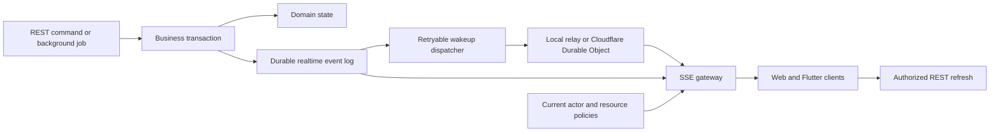

# REST and SSE implementation plan

Status: in progress. Prepared 11 October 2026. GraphQL removal and local verification are complete; the production consumer check remains a rollout prerequisite below. SSE implementation has not started.

Remove the GraphQL contract and retain REST for all queries and commands. Add an authenticated Server-Sent Events endpoint for changes that should refresh connected clients, delivered first for document completion, then conversations, then notifications. Web and Flutter share the event contract and recovery behavior; each uses its own streaming transport.

This is a cross-repository implementation plan for `edaya_backend`, `edaya_frontend`, and `edaya_mobile`. It does not authorize deployment or claim production GraphQL usage has been checked. Existing REST behavior, domain authorization, document download grants, push delivery, and mobile offline commands remain the foundation.

## 1. Decisions and scope

| Decision | Planned behavior |
| --- | --- |
| Queries and commands | REST and the existing generated OpenAPI clients remain authoritative. |
| Realtime transport | `GET /core/realtime/events`, with an SSE response. No application commands over this connection. |
| Connection scope | One stream per active school/profile/context in each running client instance. Several feature consumers share it. |
| Event purpose | Small, authorized change notifications that cause REST refreshes. No full resource replication. |
| Durability | Write an event in the same database transaction as the state change. Stream only committed events. |
| Delivery guarantee | Retained events may be delivered more than once. Clients deduplicate and converge through REST. No exactly-once promise. |
| Replay | Bounded retention, opaque scope-bound cursors, and an explicit reset when replay cannot safely continue. |
| Deployment | A local adapter and a Cloudflare adapter implement the same delivery contract. |
| Background mobile behavior | Suspend SSE when inactive; retain push notifications; reconnect and refresh on resume. |
| GraphQL removal | Independent of enabling SSE. Check consumers first, then remove the entire supported surface. |

Not included: typing indicators, presence, collaborative editing, a generic subscription query language, WebSockets, database row replication, or replacing the existing mobile write outbox. Student streams and service-account subscriptions are not admitted in the first release; explicitly add and test them later if needed.

## 2. Baseline before implementation

Paths in this section are relative to the backend repository unless another repository is named.

| Existing code | Consequence for implementation |
| --- | --- |
| `apps/api/src/app.ts` and `apps/api/src/lib/graphql/mount.ts` mount GraphQL and GraphiQL behind `ENABLE_GRAPHQL`. `apps/api/src/lib/graphql/routes/queries.ts` mirrors the REST registry. | Removal includes route mounting, configuration, resolvers, dependencies, local tooling, documentation, and tests. |
| Backend README describes generated clients and production web/mobile consumers as REST-only. Application-source checks found no direct GraphQL calls. | This supports removal but does not establish whether external clients or deployed scripts use GraphQL. Check deployment traffic and integrations. |
| `package/domain-service/src/services/commands/command-execution.ts` writes command receipts, audit facts, and outbox facts atomically. | Reuse this reliability model; preserve command replay and idempotency. |
| `PostgresCommandJournal.complete` writes `command_outbox` against a command receipt; `DurableWorkPort` provides claims, leases, retries, and completion. | This is a work queue, not an ordered client replay log. Background transitions need an event append API that does not require a new command receipt. |
| `package/domain-service/src/capabilities/documents/durable-document-render.ts` binds artifacts and marks failure in separate background transactions. | Emit completion from the committed artifact-binding transaction, not the issuance request or renderer return. |
| `package/domain-service/src/services/workflows/conversations.ts` persists message sequence and conversation version. Start/reply enqueue notification work; resolve and mark-read use different paths. | Emit message/state/read events at their own persistence boundaries, independent of notification delivery. |
| `package/domain-service/src/capabilities/notifications/delivery/deliver-notification.ts` materializes `MessageDelivery` records. `package/domain-service/src/services/workflows/communications.ts` materializes announcement deliveries and changes delivery/read state. | Notification SSE follows durable inbox visibility and read state, not FCM/email/SMS acceptance. |
| Worker dependency cleanup closes the request runtime after the HTTP handler returns. | A streaming callback must not retain the request's school service or database handle after cleanup. |
| `edaya_mobile/packages/edaya_api_client/lib/src/http_transport.dart` consumes the entire response using `toBytes()`. | SSE needs a separate streaming method/client; it cannot go through the JSON response parser. |
| Shared Flutter conversation controller polls every 15 seconds; shared document helpers wait for issuance state. | Replace normal polling with events, preserving bounded REST fallback and existing user actions. |

Follow the existing domain dependency direction: service → authorization → core. Domain packages never import HTTP, Worker bindings, or application composition. The existing `domain-messaging` package is an SMS router; do not make it the realtime subsystem because of its name.

## 3. Target architecture



Postgres is the source of truth for both business state and the replay log. The relay wakes connected gateways; it is not an authorization authority, source of business data, or sole store of undelivered events. Losing a wakeup must delay delivery at most until the next reconciliation read, not lose a business change.

### 3.1 Package responsibilities

| Location | Responsibility and proposed additions |
| --- | --- |
| `package/domain-core/src/ports/` and domain types | Event envelope, event-kind catalog, transaction-bound `RealtimeEventWriterPort`, and bounded event-store read/dispatch contracts. |
| `package/domain-authorization/src/` | Event visibility checks that reuse document, conversation, and communication policies for the current actor. |
| `package/domain-service/src/capabilities/realtime/` | Event production helpers, authorized event projection, and durable dispatch orchestration. Proposed directory. |
| `package/adaptor-postgres/` | Event/counter/dispatch migrations, transaction-bound append, scoped scans, retry leases, retention, and in-memory parity where applicable. |
| `apps/api/src/routes/realtime.routes.ts` | Proposed authenticated route and documented SSE handshake/error responses. |
| `apps/api/src/lib/realtime/` | Proposed cursor codec, frame encoder, connection lifecycle, bounded stream loop, and event contract export. |
| `apps/api/src/runtime/local/` | Process relay for the normal single-process profile; database reconciliation also covers a separate cron process. |
| `apps/api/src/runtime/worker/` | Durable Object relay, binding/export wiring, and short-lived runtime factories for stream reads. |
| `package/api-client/` | TypeScript event types and streaming helper outside generated JSON request parsing. |
| `edaya_mobile/packages/edaya_api_client/` | Dart event types, parser, and streaming transport outside generated REST parsing. |
| Web auth shell and `edaya_mobile/packages/edaya_shared/` | Connection ownership, session/profile changes, feature invalidation, and app lifecycle. |

### 3.2 Cloudflare delivery

The proposed first deployment uses a school-scoped Durable Object relay for internal wakeup streams. An authenticated API gateway connects to the relay, reads the Postgres event log, applies current authorization, and emits public SSE frames. Relay publication and subscription use trusted bindings only. Clients cannot subscribe directly to the relay or publish events.

Start with one relay per school, with a documented connection cap. The runtime spike must establish the supported school size and whether connection shards are necessary before production. If sharding is needed, keep the Postgres cursor unchanged and send each wakeup to every active relay shard through an explicit registry; do not assume Worker global variables coordinate instances.

Use typed RPC for control operations where appropriate and a streaming response for the internal subscription. Bound memory and coalesce repeated wakeups to a dirty flag/watermark. No domain payload or credential needs to be retained in the relay. A disconnected internal stream reconnects independently while the gateway continues bounded database reconciliation.

Cloudflare supports streaming HTTP responses while the client remains connected, but runtime updates can terminate requests. `waitUntil()` is not a durable job runner. Active HTTP response streams also prevent treating this design as an idle hibernating WebSocket workload. Measure the deployed cost instead of assuming idle SSE is free. [Worker limits and duration](https://developers.cloudflare.com/workers/platform/limits/), [Durable Object lifecycle](https://developers.cloudflare.com/durable-objects/concepts/durable-object-lifecycle/).

The stream owns cancellation and timers, not an open database transaction. Authenticate with the normal request runtime, release it through normal cleanup, and create independently owned short-lived runtimes for subsequent authorized reads. Close each in `finally`. Do not reuse `c.var.apiRuntime`, retain a transaction for the connection lifetime, or keep request-scoped database objects in a Worker global.

## 4. Event storage and publication

### 4.1 Persistence model

Add migrations using the next available migration number at implementation time. Do not renumber existing migrations or reset a database.

| Proposed storage | Required fields and invariants |
| --- | --- |
| `realtime_school_counters` | School ID, current sequence, retention floor/epoch. Counter updates serialize event append order within one school. |
| `realtime_events` | School ID, school sequence, stable event UUID, schema version, type, resource type/ID, resource revision where available, occurrence time, deduplication key, optional exact recipient profile, and an allowlisted small payload. |
| `realtime_dispatch` | School ID, target watermark, delivered watermark, retry time, lease token/expiry, attempts, and stable failure code. Coalesce wakeups by school. |

Create a unique `(school_id, sequence)` index and a unique `(school_id, deduplication_key)` constraint. Index retention and pending dispatch scans. Never embed PDFs, message bodies, contact details, storage keys, access tokens, download grants, or arbitrary command inputs in events.

The append port must require the active `AtomicExecutionPort` transaction. It updates the school counter, inserts the immutable event, and marks its dispatch watermark in that same transaction. It works for HTTP commands and background jobs without manufacturing a command receipt. The existing command outbox remains responsible for rendering and notification jobs.

Use a transactionally updated counter row, not an ordinary database sequence or timestamp cursor: a lower sequence allocated in an uncommitted transaction must never appear after a client has advanced beyond it. Append after business locks and state writes, with a consistent lock order; do no external I/O inside the transaction. Test concurrent commit/rollback ordering on native Postgres. Measure the serialization cost before broad rollout.

Deduplication keys identify a real transition, not just a resource. Examples: document issuance + persisted state revision + event type; conversation ID + message sequence; delivery ID + persisted read revision. A retried producer returns the existing event and cannot publish a second logical transition. Preserve uniqueness through the relevant work retry horizon, even after event retention expires, using durable producer state or retained compact deduplication records.

### 4.2 Dispatch and recovery

1. Commit domain state, event, and pending wakeup together. If event append fails while production is enabled, roll back the state change; never knowingly commit it without its event.
2. After commit, nudge a bounded dispatcher using the existing background-task scheduling pattern. Network failure here does not undo the successful command.
3. Claim pending school wakeups with leases. Send a watermark hint to the relay, then record that exact delivered watermark with the current lease. If another event committed during dispatch, its higher target watermark must remain pending.
4. Retry failed wakeups with backoff; scheduled recovery finds committed work missed by the fast path. Alert on old pending/dead work. A relay acknowledgment means a hint was accepted, not that a client consumed it.
5. Gateways periodically scan the authoritative log even without hints. Events remain replayable after dispatch completion. Duplicate and reordered hints are harmless.
6. Retention runs in bounded batches. Atomically advance the retained floor; never silently skip an unavailable range. Stuck dispatch records must not grow without bound or permanently prevent retention.

Do not repurpose the existing cron queue's message schema as a realtime event bus. If the spike shows that a dedicated queue is needed for wakeup dispatch latency, add an explicitly typed queue consumer/binding and retain the same database recovery path.

## 5. SSE contract

### 5.1 Handshake and authentication

Proposed request:

```http
GET /core/realtime/events
Accept: text/event-stream
Authorization: Bearer <school-api-access-token>
X-School-Id: <school-id>
X-Actor-Kind: <staff|teacher|guardian>
X-Actor-Id: <profile-id>
X-Academic-Year-Id: <selected-year-if-applicable>
Last-Event-ID: <optional-opaque-cursor>
```

Resolve and authorize every selected header through the existing actor admission path. Headers select context; they do not confer authority. The stream covers all enabled event kinds readable in that context; version 1 has no arbitrary topic or resource filters. Freeze the context for the life of the connection and reconnect when it changes.

Use bearer-authenticated streaming `fetch` on the web and `http.Client.send` in Dart. Native browser `EventSource` exposes URL and credential mode, not arbitrary application headers, so it does not directly fit this API's bearer/profile headers. Never move the bearer token into a URL to work around this. [EventSource constructor](https://developer.mozilla.org/en-US/docs/Web/API/EventSource/EventSource).

Add `Last-Event-ID` to the API's CORS allowlist; test preflight with existing school/profile headers and allowed origins. Expose `Retry-After` if cross-origin clients read it. Send `Content-Type: text/event-stream; charset=utf-8` and `Cache-Control: no-store, no-transform`. Verify buffering/compression behavior through the deployed route and local Vite proxy. Flush the first control frame immediately. Hono's streaming helper can encode events, but errors after headers require stream handling rather than the ordinary JSON error middleware. [Hono streaming](https://hono.dev/docs/helpers/streaming).

Before streaming, return normal JSON errors: `400` malformed context/cursor, `401` missing/expired credentials, `403` disallowed actor/context, `429` connection limits, and `503` temporary realtime unavailability. Feature-disabled environments return a documented `404`; clients use REST fallback without a tight reconnect loop. A valid cursor outside retention produces the reset protocol after authentication rather than an unexplained disconnect.

### 5.2 Data envelope

Illustrative frame; IDs and values below are examples:

```text
id: <opaque-resume-cursor>
event: document.ready
data: {"eventId":"<uuid>","schemaVersion":1,"type":"document.ready","occurredAt":"2026-10-11T14:00:00Z","schoolId":"<school-id>","resource":{"type":"document-issuance","id":"<issuance-id>","revision":"3"},"data":{}}

```

The SSE `id` is a resume cursor, not the event UUID or a conversation message sequence. Resource revisions are optional strings in the shared envelope so large values are not narrowed by JavaScript numeric limits. Each event-kind schema specifies whether it requires one. The type in JSON must match the SSE event field. Persisted values are immutable; clients refetch current state rather than applying an old state snapshot.

Define schemas once in the backend and export the event catalog and JSON Schema alongside OpenAPI. Generate or explicitly maintain matching TypeScript and Dart models with shared conformance fixtures and CI drift checks. OpenAPI documents the handshake and `text/event-stream`; the ordinary generated JSON request method must not attempt to deserialize an infinite response. Adding a new event kind is additive; changing an existing payload incompatibly requires a new schema version and a migration window.

### 5.3 Control frames and connection behavior

| Frame | Meaning |
| --- | --- |
| `stream.ready` | Subscription is established; supplies protocol version, connection ID, heartbeat interval, and a safe baseline cursor when appropriate. |
| `stream.checkpoint` | Advances past scanned events, including events invisible to this actor, after preceding visible frames have been processed. |
| `stream.reset` | Cursor expired, incompatible, or backlog exceeds the replay bound. Client abandons stale cursor/cache assumptions and performs the fresh-subscription sequence. |
| `stream.reauth` | Token is approaching expiry or authentication must be renewed. Close and reconnect with a fresh token. |
| `stream.error` | Stable retriable stream error after headers; preserve the last processed cursor and reconnect with backoff. |
| SSE comment heartbeat | Keeps the connection active without advancing the cursor or changing UI state. |

Initial tuning values, subject to runtime validation: heartbeat every 20 seconds; stalled-stream detection after 60 seconds; reconciliation and idle authorization checks at most 30 seconds apart; reconnect with jittered exponential backoff from 1 to 30 seconds; a 24-hour replay window; at most 1,000 scanned records per reconnect before reset. Bound scans in smaller pages. Limit each event to 8 KiB and each connection's unsent buffer to 256 KiB. These are proposed application settings, not platform guarantees.

Rotate connections before token expiry and also after a configurable maximum lifetime, initially 10 minutes, with jitter. This bounds accumulated Worker work and gives deployment/feature changes a prompt effect. Recheck resource authorization on every delivery batch; rotation is not a substitute. Reject new frames after expiry. On `401`, refresh once through the existing auth manager; stop after renewal fails. On `403`, stop the context and refresh available profiles. Respect `Retry-After` on `429`/`503`.

Disconnect slow readers rather than buffering indefinitely; they recover by replay or reset. Log stable failure codes, never bearer headers, raw cursors, message content, or private document metadata. A stream error must not roll back or repeat the original business command.

### 5.4 Replay and initial snapshot races

Encode cursors as authenticated opaque tokens bound to protocol version, environment, school, subject, actor kind/ID, academic-year context, log epoch, and internal sequence. Use an encrypted/authenticated format if the underlying school sequence would reveal unrelated activity. Manage a versioned cursor key through existing secret/configuration conventions with an overlap window for rotation; never reuse signing assumptions implicitly. Cursors grant no access. Reject forged or cross-context cursors and retain current resource authorization on replay.

For a new connection without a cursor:

1. Establish the internal relay subscription, then capture a committed log high watermark `H`.
2. Send `stream.ready` with a baseline cursor at `H` and start tailing events after `H`.
3. The client buffers invalidations while it loads the relevant REST snapshots.
4. After each snapshot, apply any invalidations accumulated during its request and refetch if necessary. Use request generations so an older response cannot overwrite newer state.

For a valid reconnect, establish wakeup subscription before capturing the replay high watermark, replay through it in order, then tail beyond it. Never advance to the high watermark until all preceding visible events and safe checkpoints have been processed. Recheck the database when switching from replay to live mode; the subscription plus reconciliation closes missed-hint races.

For an expired cursor or excessive backlog, send `stream.reset`, close, and reconnect without the cursor using the sequence above. Do not refresh first and connect afterward, which can miss changes between those operations.

Advance the client cursor only after validating the event and recording its invalidation. If that work is asynchronous, process it serially with checkpoints. Unknown event types trigger conservative refresh of the relevant feature/context; an unsupported envelope version or malformed frame resets with bounded retries rather than silently skipping state changes. A restarted application loads fresh REST state; a persisted cursor alone does not prove that its local cache is current.

## 6. Authorization and privacy

- Admit human staff, teacher, and guardian actors through the existing school authorization path. A guardian session never inherits staff grants belonging to the same login.
- Authorize reference metadata itself. Do not broadcast a school-wide list of resource IDs to clients and rely on later REST denial to protect it.
- Batch event visibility checks using current scoped repositories before emitting frames. Reuse the same document access, conversation read scope, and exact inbox recipient/source rules used by REST. Avoid one unrestricted resource query per event.
- Recipient-specific events include an internal exact school/subject/profile audience constraint. A matching login alone is insufficient. `conversation.read.updated` and notification read updates belong only to that actor's other sessions.
- Before replay and each live batch, refresh current actor admission and relevant relationships/grants. An infrastructure failure in authorization is not a denial: close/retry without checkpointing past unresolved events.
- On loss of actor admission, close the connection. For resource access changes, emit only safe context-level invalidation or reset instructions and let REST remove inaccessible cached items; do not expose the revoked resource in a new event. Detect authorization changes during idle reconciliation as well as incoming activity. Start with a server-computed fingerprint of current effective grants, profile activity, teacher assignments, and guardian relationships relevant to the actor; a changed fingerprint forces fresh snapshots, including newly granted access. Keep this fingerprint internal and validate its coverage/cost against the actual policy inputs. It complements per-resource checks rather than replacing them. Data delivered before revocation cannot be recalled.
- Initially avoid long-lived authorization-result caches. If caching is needed to meet load targets, introduce explicit invalidation/versioning and prove its revocation bound before enabling it.
- Keep previews restricted to actors authorized to view previews. Document readiness does not make an unpublished report visible to a family.

Acceptance includes two schools, two profiles sharing one account, inactive staff, changed teacher assignments, revoked guardian relationships, removed message access, expired tokens, and invalid cursors. A read-only SSE handshake does not grant future access indefinitely.

## 7. Implementation phases

### Phase 0 Establish the baseline and validate the runtime

- [ ] Inventory `/graphql` and `/graphiql` consumers across source, scripts, integrations, deployed configuration, and an agreed representative traffic window. Record the window and caller coverage. Do not infer no usage from a missing dashboard.
- [ ] If consumers exist, map their operations to REST and migrate them before removal. A short deprecation window is only needed for real consumers; keep it separate from SSE delivery.
- [ ] Confirm the initial supported actors and the document, conversation, and notification screens that will consume events.
- [ ] Run an isolated local/Worker spike for streamed flushing, bearer headers, CORS, relay wakeups across instances, cancellation, database/runtime cleanup, restart, and reconnect.
- [ ] Measure active-stream cost, queries per idle stream, queries per event batch, concurrent connections, CPU/subrequest accumulation, and school relay limits. Establish the initial production connection cap from those results.
- [ ] Freeze contract fixtures, cursor/reset behavior, feature flags, tuning defaults, and the chosen relay layout before feature implementation.

Exit: consumer inventory is actionable; local and Worker runtime feasibility is demonstrated; no open connection can retain a disposed request runtime; capacity and recovery assumptions have evidence.

### Phase 1 Remove GraphQL

- [x] Remove `mountGraphQLRoute` from `apps/api/src/app.ts` and delete `apps/api/src/lib/graphql/`.
- [x] Remove direct `graphql` and `@hono/graphql-server` dependencies and regenerate the lockfile through normal package tooling. Do not remove unrelated transitive dependencies by hand.
- [x] Remove `ENABLE_GRAPHQL`, `GRAPHQL_GRAPHIQL`, `GRAPHIQL_WEBAPP_ORIGIN`, and `GRAPHIQL_DEFAULT_EMAIL` from runtime schema, config catalogs, templates, and local/staging/production configuration. Remove GraphiQL-only secret operations without disturbing shared auth secrets.
- [x] Remove both `/graphql` and `/graphiql` Vite proxies from `edaya_frontend/apps/webapp/vite.config.ts` and `apps/webadmin/vite.config.ts`.
- [x] Delete GraphQL-only tests. Preserve their security/business coverage in REST/service tests where it is unique, including file access, command policy parity, private entity exposure, and request-body validation. Update shared fixtures that enable GraphQL.
- [x] Add route-absence checks for GraphQL/GraphiQL in the shared application used by local and Worker entrypoints. Removed routes must not leak an explorer or start authentication-side behavior; account for normal generic middleware responses when asserting status codes. Bundle both Worker targets separately; deployed route checks remain a rollout step.
- [x] Update backend README, API README, current API folder/runtime/local-development/command-execution references, and applicable authorization comments. Keep historical audits and completed evidence accurate as history rather than rewriting them.
- [x] Verify there are no active imports, feature flags, configuration examples, or supported-contract claims left. Historical mentions and this removal plan are expected search results.

- [ ] Before deployment, check production/external consumers over a representative traffic window and remove any retired deployed variables/secrets. Local secret files contain none of the retired key names. No remote settings have been changed.

Local implementation on 11 October 2026 removes the GraphQL implementation and its tests, dependencies, configuration, editor language entries, and both frontend proxies. REST command-policy coverage is retained; purpose-restricted attachment counts are now asserted through REST. New regression tests exercise retired routes, the surviving REST/OpenAPI surfaces, and rejection of obsolete configuration. Generated REST artifacts are unchanged; the shared release manifest is repinned to the changed backend source.

Local validation:

| Gate | Result |
| --- | --- |
| Backend workflow lint, hygiene, lint/types, build and unit tests | Passed in `bun repo verify --full`, including 381 API tests. |
| Staging and production Worker bundle dry runs | Passed; both exited 0. The sandbox prevented Wrangler from writing its optional user-directory log. |
| PGlite integration | Passed in the full verification run. |
| Native PostgreSQL integration | Passed in a separate `bun run test:integration:native` run: 60 passed, 3 optional dashboard benchmarks skipped. |
| Seed integration | Passed in a separate `bun run test:integration:seed` run: 8 passed across 3 files. |
| Frontend `bun run verify` | Passed, including checks, builds and tests for both applications. |
| Backend, frontend and mobile release contracts | Passed; schema and generated artifact hashes are unchanged. Only the backend source fingerprint and shared release ID changed. |

All required local gates passed. The full verification runner reached native integration but the sandbox blocked localhost listening ports. Both native suites then passed when rerun with local-network permission; each runner created and removed its own temporary PostgreSQL cluster. No live database or deployed API was exercised. Mobile application tests were not rerun for the manifest-only change.

Exit: REST and auth behavior pass existing gates, former consumers are migrated, GraphQL is absent from the deployable application, and generated REST contracts have no unintended changes. This release does not wait for SSE.

### Phase 2 Build the shared SSE foundation

- [ ] Add event schemas, transaction-bound append, Postgres migrations, retention, dispatch leases, and equivalent test implementations.
- [ ] Implement the local relay and Worker relay with typed environment bindings, exports, configuration validation, and required Durable Object migration declarations. Follow the repository's deployment generator/configuration conventions.
- [ ] Add the authenticated route, CORS header changes, cursor codec, replay/reset logic, resource authorization, connection caps, heartbeats, bounded buffering, and token renewal behavior.
- [ ] Add post-commit nudges and scheduled recovery without changing the existing render/notification queue semantics. Honor `PAUSE_API`, `PAUSE_JOBS`, and `PAUSE_SCHEDULER` deliberately; document which controls stop streams, dispatch, and retention.
- [ ] Add TypeScript and Dart streaming clients with shared parser fixtures: split UTF-8, split CRLF, multiline `data`, comments, empty lines, `id`, `retry`, truncated frames, unknown fields, invalid JSON, and byte/frame bounds. SSE is line-framed; a network chunk is not one event. [SSE format](https://developer.mozilla.org/en-US/docs/Web/API/Server-sent_events/Using_server-sent_events).
- [ ] Register one connection owner per active client context; feature controllers subscribe locally. Abort old requests, discard late frames/responses, and clear scoped cursors on logout or context change.
- [ ] Add contract drift checks for event schemas and generated clients. Verify both the installed TypeScript dependency and Dart output through the existing cross-repository workflow.
- [ ] Instrument the metrics and controls in section 9 before enabling production traffic.

Exit: restart/replay, authorization isolation, cleanup, and slow-reader tests pass in both runtime profiles. Clients work with an SSE-disabled or older REST-only backend and return to REST refresh without breaking business actions.

### Phase 3 Deliver document completion

| Event | Exact publication boundary | Client behavior |
| --- | --- | --- |
| `document.ready` | Same transaction as successful official artifact binding and issuance transition to `Ready`. | Invalidate issuance/detail/list; obtain any download grant through REST. |
| `document.failed` | Same transaction as a persisted transition to `Failed`. | Refetch current failure and retry state; distinguish retryable attempts from exhausted/permanent failure. |
| `document.status.changed` | Preview becomes available, a retry changes state, or issuance becomes voided/superseded. | Refresh the current authorized projection; never infer download permission from the event. |

- [ ] Add or reuse a persisted monotonic issuance state revision and render-attempt/generation identity where needed. Do not deduplicate every failure forever under only the issuance ID.
- [ ] Append events inside `bindArtifact` and the failure/state-transition transactions in `durable-document-render.ts`, plus the relevant issuance workflow transitions. Include changes to a prior issuance when it is superseded.
- [ ] Nudge realtime dispatch after the background transition commits, including when rendering was started by cron. The original REST command's post-commit nudge alone cannot announce a later completion.
- [ ] Serialize failure/success/retry transitions using the same issuance lock and generation guards. A stale render attempt must not overwrite Ready, Voided, Superseded, or a newer attempt. A repeated no-op transition emits no new logical event.
- [ ] Keep `document.failed` about stored state, not a promise that no retry remains. The existing durable work retries some failures. Expose the authoritative retry disposition through the REST document projection if current data is insufficient for correct UI.
- [ ] Update web document helpers and screens to refetch when a relevant event arrives. For Flutter, integrate the shared `document_issuance.dart` helpers and relevant teacher/guardian screens.
- [ ] Wait on the shared stream for a pending user-requested document, with bounded REST polling when disconnected/disabled and a timeout that leaves the issuance recoverable from the UI.
- [ ] Preserve explicit download/open intent. A duplicate, replayed, or unrelated completion must not open a file twice or unexpectedly open another tab. Show an actionable ready state when browser gesture restrictions prevent automatic opening.
- [ ] Test completion before subscription, during snapshot fetch, after disconnect, after process restart, and after a retry. Test R2/storage failure, render failure, supersession, previews, and report publication visibility.

Exit: a web or Flutter user can request a document and see its completion without normal polling; fallback still works; completion is emitted only after the artifact reference and access state commit. No raw file URL or private artifact metadata is streamed.

### Phase 4 Add conversations

| Event | Publication boundary | Audience |
| --- | --- | --- |
| `conversation.message.created` | Start/reply transaction after message append and conversation update. | Actors currently authorized to read the conversation, including the sender's other sessions. |
| `conversation.updated` | Resolve or another supported non-message state transition. | Current conversation readers. |
| `conversation.read.updated` | Read cursor actually advances. | The exact reading profile's sessions only. |

- [ ] Append message events in `ConversationsWorkflow.command`/the relevant execute callbacks so retries through `CommandExecution` produce no duplicate logical message event. Keep push/inbox work in `CONVERSATION_NOTIFY_KIND` independent.
- [ ] Include conversation version and message sequence as bounded reference metadata. Never include body, title, names, or an unfiltered recipient list in the SSE payload.
- [ ] Add read-state events in `markRead`; preserve a monotonic read cursor and emit only on advancement. The event does not imply peer-visible read receipts.
- [ ] Refresh conversation lists, the open thread, allowed actions, and unread counts with coalesced requests. Preserve draft text, scroll position, pagination, optimistic state, and expected-version conflict handling.
- [ ] Use existing paginated REST history to fill gaps. The current detail query supports `beforeSequence`; recover by paging back from the newest messages until the last known sequence, rather than assuming an `afterSequence` API exists. Add a bounded catch-up REST query only if measured traffic warrants it.
- [ ] Replace the shared Flutter conversation controller's healthy 15-second polling loop with SSE invalidation. Keep one fallback mechanism while disconnected and always reconcile on foreground/resume.
- [ ] Treat sender REST responses and SSE echoes idempotently; deduplicate by message ID/sequence and resource version. Do not overwrite unsent drafts after an event.
- [ ] Test guardian-to-school and guardian-to-teacher conversations, staff grant changes, teacher reassignment, concurrent replies, resolution, read updates from a second device, lost frames, and offline/foreground transitions.

Exit: participants with current access see new messages and state changes promptly; only their own read state synchronizes across sessions; revoked participants receive neither new content nor resource-reference events.

### Phase 5 Add notifications

| Event | Publication boundary | Client behavior |
| --- | --- | --- |
| `notification.created` | First committed `MessageDelivery` materialization visible to the intended inbox profile. | Refetch inbox slice and unread count. |
| `notification.updated` | An inbox-visible state change, including own read state. | Reconcile row and badge from REST. |
| Context reset/invalidation | Current source/profile access changes and previously cached items may no longer be readable. | Reload authorized inbox; expose no revoked resource details. |

- [ ] Audit all delivery creation paths, including `deliverNotification`, announcement materialization in `CommunicationsWorkflow`, and background conversation notification dispatch. Ensure delivery insertion and event append share an explicit transaction on every path.
- [ ] Publish `notification.created` once per existing stable school/source/subject/profile identity. Do not emit it once per channel or wait for external provider acceptance.
- [ ] Keep enqueue, materialization, and retry behavior atomic where required. If a background path currently spans several writes without an explicit transaction, introduce the bounded transaction before adding events; do not simply add a callback after save.
- [ ] Add update events for `markDeliveryRead` and applicable `applyDeliveryEvent` transitions, using stable persisted transition identity. Duplicate read commands and provider callbacks must not cause badge drift.
- [ ] Preserve delayed delivery and current source-visibility rules; realtime must not make a scheduled or restricted notification visible earlier than REST allows. Trace the actual inbox query and source policy before selecting the event boundary for delayed jobs.
- [ ] Bind notification events to school + subject + recipient kind/ID and current source access. A staff management view does not automatically receive another person's private inbox stream.
- [ ] Refresh web and Flutter inboxes and badges from authoritative REST counts. Avoid increment/decrement arithmetic driven solely by events. Existing inbox paging limitations should be corrected if they prevent accurate reconciliation.
- [ ] Retain FCM/email/SMS behavior and preferences. SSE is foreground synchronization, not an additional provider channel or proof of delivery/read.
- [ ] Deduplicate user-visible alerts when the same notification arrives through push and SSE, using the stable delivery ID and current profile. Do not suppress necessary push based only on an open stream.
- [ ] Test all external channels disabled, failed provider sends, scheduled notifications, duplicates, mark-read on another device, source revocation, school/profile switching, and foreground push plus SSE arrival.

Exit: authorized inbox items and read counts converge across devices without duplicated alerts; provider problems cannot prevent foreground inbox synchronization once the item is durably visible.

## 8. Client integration details

### Web

Keep the connection at the authenticated school shell level, not inside each route or widget. Connect only in the browser. Reuse the access-token manager and actor headers, but consume `Response.body` directly rather than invoking JSON request helpers. One stream per tab is acceptable initially; document/enforce a per-profile connection cap with room for several tabs/devices. Cross-tab connection sharing is a later optimization.

Feed events into existing `PageQuery`, query invalidation/versioning, and mutation conventions. Coalesce repeated invalidations per resource/feature and bound concurrent REST refreshes. Keep URL-driven list/drawer state, filters, pagination, draft input, and mutation feedback intact. Read the frontend route-state and feature specifications before implementation.

### Flutter

Own the streaming `http.Client` and stream subscription explicitly, expose typed events, and cancel/close only the resources this transport owns. Share token-provider callbacks with `HttpTransport` without modifying its JSON parsing behavior. Use incremental UTF-8/SSE parsing and serial event handling. The current Dart HTTP browser client uses Fetch, while native Dart HTTP responses are streams; verify incremental delivery on each actual target instead of assuming a `StreamedResponse` wrapper proves no buffering. [Dart HTTP BrowserClient](https://pub.dev/documentation/http/latest/browser_client/BrowserClient-class.html), [Dart HTTP response streams](https://api.dart.dev/dart-io/HttpClientResponse-class.html).

Install a shared connection controller in `edaya_shared`, owned by the authenticated application scope and integrated with existing lifecycle/state conventions. Teacher and guardian features subscribe to that controller. On background, cancel SSE; on resume, refresh authentication, reconnect safely, and reconcile REST state. Offline write replay stays independent and retains existing idempotency/revision conflict behavior. Late events and responses from a former account/school/profile must be discarded by a context generation check.

## 9. Operations and rollout

### Feature controls and migration order

Introduce explicit controls for event production, the SSE endpoint, each event family, and a school rollout allowlist. Validate them in the central configuration catalog; names should follow repository conventions. Separate production from delivery controls so disabling a stream does not require erasing retained events.

1. Deploy additive schema and bindings with realtime disabled. Test migration on PGlite and native Postgres through the normal migration workflow.
2. Deploy the backend producer, replay service, and relay. Enable production for an internal school with short retention and observe backlog/cost before admitting clients.
3. Deploy clients that tolerate absent/disabled SSE. Check exact TypeScript/Dart contract versions through the existing release process.
4. Enable document streams for internal staff, then eligible teacher/guardian profiles. Record the end-to-end journeys and failure recovery.
5. Expand the school allowlist after a representative soak period and agreed capacity/cost acceptance. Repeat for conversations, then notifications.
6. Reduce healthy-client polling after successful adoption; preserve fallback, foreground refresh, and periodic reconciliation where required.

If production was disabled for any event family while clients could miss changes, re-enabling it must reset their context/log epoch or require fresh snapshots. Do not advertise replay continuity across an unrecorded interval. Newly enabled families likewise require a fresh snapshot; historical business records are not bulk-converted into realtime events.

### Metrics and initial targets

Measure active streams, connects/disconnects by reason, auth refresh failures, replay/reset rate, scanned versus emitted events, append/dispatch lag, retry/dead work, slow-reader disconnects, REST refetch load, database connection counts, relay fanout, and retained bytes. Keep high-cardinality actor/resource identifiers out of metric labels.

Initial product targets: p95 committed change to visible client refresh under 3 seconds on a healthy connection, missed-wakeup recovery within 30 seconds plus fetch time, and convergence after reconnect within 10 seconds for a normal bounded backlog. Measure document readiness from artifact-binding commit, not from the original render request. Targets are acceptance goals to validate, not claims about current performance.

Exercise at least the forecast peak connections/events for the first rollout schools, plus a 2× burst and a reconnect storm. Phase 0 must record those numeric forecasts, measured maxima, school caps, idle cost, and a projected monthly operating cost before production enablement. Do not assume tests at ten connections establish production capacity.

### Rollback

Disable delivery and let clients fall back to REST; close existing streams through the operational check/rotation path. Keep additive tables and event recording when healthy, and continue bounded retention. If event persistence itself threatens writes, disable producers and mark a replay discontinuity before later re-enable. Reverting the application must not require destructive down-migrations.

GraphQL rollback is separate: roll back the removal release only if an actual missed consumer requires it, with a follow-up migration plan. An SSE outage does not justify reintroducing GraphQL. Existing notification channels and document jobs must continue when realtime is disabled.

## 10. Verification and completion criteria

| Layer | Required evidence |
| --- | --- |
| Event storage | Atomic rollback, duplicate producer, concurrent commit ordering, same-school sequence serialization, cross-school isolation, retry after retention, and retention-floor races. |
| Dispatch | Crash after commit/before nudge; relay failure; duplicate/reordered hints; lease expiry; new event during dispatch acknowledgment; recovery after terminal dispatch failure. |
| Protocol | Exact SSE framing, fragmented UTF-8/CRLF, heartbeats, malformed/oversized frames, checkpoint ordering, unknown versions, expired/forged/cross-profile cursor, reset, and replay-to-live races. |
| Authorization | Staff/teacher/guardian matrix, current resource checks on replay, same account with different profiles, relationship/grant revocation while connected, token expiry, and failure of authorization infrastructure. |
| Runtime | Local process and separate cron, deployed Worker multi-instance delivery, relay restart, deployment disconnect, immediate flushing, CORS, cancellation, closed runtime safety, bounded memory/database handles, and slow clients. |
| Web | Snapshot/event races, route changes, multi-tab caps, token renewal, logout/context switch, REST fallback, optimistic-write echoes, draft preservation, and duplicate downloads/alerts. |
| Flutter | Parser/lifecycle tests, teacher and guardian integration journeys, Wi-Fi/mobile/offline transitions, background/resume, account/profile switch, token renewal, native incremental streaming, and supported web target. |
| Features | Document failure/retry/supersession/preview, multi-participant conversations/read state, and exact-recipient notification/read synchronization with external channels failing or disabled. |
| Removal | GraphQL routes and configuration absent, unique security coverage retained, no active imports/proxies, REST contract stability, and consumer migration evidence. |

Run targeted tests during implementation and the repository-required gates before each relevant PR:

```sh
# edaya_backend
bun repo verify --full

# edaya_frontend
bun run verify

# edaya_mobile
melos run verify
```

Also run native Postgres concurrency/migration suites, Worker-specific streaming tests, and the isolated teacher/guardian integration journeys. Use the repositories' current documented commands at implementation time. Local verification cannot certify real-device background behavior or deployed proxy/Worker delivery; record those separately. If seeds or their HTTP paths change, include the backend seed integration gate.

Completion requires all planned event families enabled for the agreed rollout audience, recorded operational evidence, tested fallback/rollback, synchronized client contracts, and current architecture/runtime/API documentation. Checkbox completion alone is not release evidence.

## 11. Suggested review units

| Review unit | Deliverable | Depends on |
| --- | --- | --- |
| 1 | GraphQL removal, preserved REST security coverage, config/proxy/docs cleanup | Consumer inventory |
| 2 | Event contract, storage, atomic append, dispatch/recovery, authorization policy | Runtime spike and contract decisions |
| 3 | Local/Worker SSE gateway, relay, replay/cursors, operational controls | 2 |
| 4 | TypeScript and Flutter shared clients, lifecycle, fixtures, contract workflow | 3 |
| 5 | Document producers and web/mobile completion experience | 2–4 |
| 6 | Conversation producers and web/mobile synchronization | Document acceptance |
| 7 | Inbox notification producers and web/mobile synchronization | Conversation acceptance |
| 8 | Capacity evidence, rollout/rollback exercise, final documentation | Each enabled feature |

Keep tests and documentation with the behavior they verify rather than leaving correctness work to the final review unit. GraphQL removal may ship independently. Document completion is the first end-to-end proof; expand only after its authorization, durability, and reconnect behavior is demonstrated.
