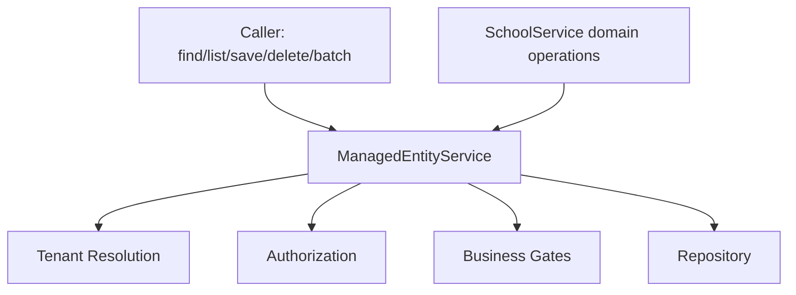

# Service Model Improvement Plan

## Goal

Replace the current duplicated command/query service patterns with a unified, policy-aware service model built around `ManagedEntityService<T>`.

The migration should focus on `packages/core` until the new service model is complete. Unit tests and other packages should be migrated after the core package has a stable `ManagedEntityService`, `BaseSchoolService`, and `SchoolService` API.

The new model should make basic entity operations consistent across the school core:

- `findById`, `findByIds`, `findOne`, `list`, `count`
- `save`, `batchSave`
- `delete`, `batchDelete`

It must preserve the important safety boundaries already present in the codebase:

- Tenant isolation
- Module-level authorization
- Entity-level authorization
- Proposed-state authorization for creates and updates
- Pre-mutation business rules
- Optional atomic execution for multi-entity workflows

Domain-specific operations should live on `SchoolService` only when they are true complex workflows with tight business rules that cannot safely be represented as consecutive managed entity calls.

## Current Problems

Current command services repeatedly hand-code the same flow:

1. Resolve or construct an entity.
2. Check tenant boundaries.
3. Check authorization.
4. Apply business rules.
5. Persist or delete.

This has produced several issues:

- Boilerplate is repeated across many services.
- Delete operations are missing for many entities.
- Different services apply authorization and tenant checks inconsistently.
- Bugs are easy to introduce, such as authorizing a delete path but forgetting to call `delete()`.
- Adding new simple operations has high friction.

The current codebase already has useful partial abstractions:

- `AuthorizedReadService<T>` handles authorized reads.
- `AuthorizedWriteService<T>` handles a small subset of authorized writes for config-style entities.

The improvement is to replace both with a single managed entity layer.

## Target Architecture



## Naming

Use `ManagedEntityService<T>`.

Reasoning:

- It is broader than authorization.
- It describes the actual role: entity access is managed by tenant rules, authorization rules, business gates, and repository persistence.
- It still leaves `BaseSchoolService` and `SchoolService` names clean at the application service level.

## Public Service Shape

Introduce a unified base service:

```ts
export class BaseSchoolService {
  readonly schools: ManagedEntityService<School>
  readonly academicYears: ManagedEntityService<AcademicYear>
  readonly students: ManagedEntityService<Student>
  readonly classGroups: ManagedEntityService<ClassGroup>
  // ...all managed entities
}

export class SchoolService extends BaseSchoolService {
  // Complex domain operations:
  // promoteStudent(...)
  // transferStudent(...)
  // publishReportCard(...)
  // recordPayment(...)
  // reversePayment(...)
  // assignResourceToSession(...)
}
```

Simple CRUD should go through the entity properties on `BaseSchoolService`.

Complex workflows should live on `SchoolService` and should call `BaseSchoolService` managed entity operations internally when that avoids bypassing shared checks.

Only add a method to `SchoolService` when it coordinates a meaningful business workflow, such as:

- Multi-entity transitions that must be atomic.
- Ordered business rules where one write depends on validated current state.
- Aggregate updates coupled to event records.
- Lifecycle transitions with invariants that cannot be expressed as independent `save` calls.

Do not add `SchoolService` methods for simple CRUD wrappers. Those should remain direct `BaseSchoolService` managed entity calls.

## Core Contract

The core service must not rely only on entity ids for write authorization. Creates and updates need to authorize the proposed state, especially for indirect tenant entities such as `ResourceAssignment`, `AttendanceRecord`, `AssessmentResult`, and `Payment`.

Recommended contract:

```ts
export interface ManagedEntityServiceConfig<T> {
  repository: BaseRepositoryInterface<T>

  tenant: EntityTenantResolver<T>
  read: EntityReadAuthorization<T>
  write: EntityWriteAuthorization<T>

  gates?: EntityBusinessGates<T>
  atomicExecution?: AtomicExecution
}

export interface EntityTenantResolver<T> {
  resolve: (entity: T, repositories: SchoolRepositories) => Promise<string | undefined>
  resolveFromFilter?: (filter: Filter<T> | QueryOptions<T> | undefined) => string | undefined
}

export interface EntityReadAuthorization<T> {
  checkModule: (actor: ActorMetadata) => Promise<void>
  checkAccess: (
    actor: ActorMetadata,
    entities: readonly T[],
    repositories: SchoolRepositories,
  ) => Promise<void>
}

export interface EntityWriteAuthorization<T> {
  checkModule: (actor: ActorMetadata) => Promise<void>
  authorizeSave: (
    actor: ActorMetadata,
    entity: T,
    existing: T | undefined,
    repositories: SchoolRepositories,
  ) => Promise<void>
  authorizeDelete: (
    actor: ActorMetadata,
    entity: T,
    repositories: SchoolRepositories,
  ) => Promise<void>
}

export interface EntityBusinessGates<T> {
  preSave?: (
    entity: T,
    existing: T | undefined,
    repositories: SchoolRepositories,
  ) => Promise<void>
  preDelete?: (
    entity: T,
    repositories: SchoolRepositories,
  ) => Promise<void>
}

export interface AtomicExecution {
  execute: <R>(operation: () => Promise<R>) => Promise<R>
}
```

### Important Save Semantics

`existing` should be `undefined` for new entities.

That is still useful. Create operations commonly need business checks such as:

- Parent entity exists.
- Parent belongs to the actor school.
- Unique default per school or grade level.
- Capacity is not exceeded.
- Referenced resource/session/class/student is accessible.
- Proposed FK values are allowed.

For updates, both `entity` and `existing` matter:

- `existing` proves what is currently stored.
- `entity` represents the proposed state.
- Authorization and gates must reject unsafe FK changes or status transitions.

## ManagedEntityService Behavior

### Reads

`findById(id)`:

1. Fetch entity.
2. If missing, return `undefined`.
3. Resolve tenant from entity and compare with actor.
4. Run read module check.
5. Run read entity access check.
6. Return entity.

`findByIds(ids)`:

1. Run read module check.
2. Fetch entities by ids.
3. Resolve tenant for each returned entity and compare with actor.
4. Run read entity access check for returned entities.
5. Return entities.

`findOne(options)` and `list(options)`:

1. Check tenant boundary from filter when possible.
2. Run read module check.
3. Fetch entities.
4. Resolve tenant for each entity and compare with actor.
5. Run read entity access check.
6. Return result.

`count(filter)`:

1. Check tenant boundary from filter when possible.
2. Run read module check.
3. Return repository count.

### Save

`save(entity)`:

1. Resolve tenant from proposed entity and compare with actor.
2. Run write module check.
3. Load `existing` by id when the entity has an id.
4. If `existing` exists, resolve tenant from existing and compare with actor.
5. Run proposed-state write authorization.
6. Run `preSave(entity, existing, repositories)` when configured.
7. Persist.

`batchSave(entities)`:

1. Resolve tenant from each proposed entity and compare with actor.
2. Run write module check once.
3. Load existing entities for proposed ids.
4. Resolve tenant from each existing entity and compare with actor.
5. For each proposed entity, run proposed-state write authorization.
6. For each proposed entity, run `preSave(entity, existing, repositories)` when configured.
7. Persist with repository `batchSave`.
8. Return saved ids.

### Delete

`delete(id)`:

1. Run write module check.
2. Fetch entity by id.
3. If missing, return without error.
4. Resolve tenant from entity and compare with actor.
5. Run delete authorization.
6. Run `preDelete(entity, repositories)` when configured.
7. Delete.

`batchDelete(ids)`:

1. Run write module check once.
2. Fetch existing entities by ids.
3. If no entities exist, return without error.
4. Resolve tenant from each existing entity and compare with actor.
5. For each existing entity, run delete authorization.
6. For each existing entity, run `preDelete(entity, repositories)` when configured.
7. Delete existing ids with repository `batchDelete`.

## Tenant Strategy

Direct tenant entities can resolve tenant from `entity.schoolId`.

School itself should resolve tenant from `entity.id`.

Indirect tenant entities need domain-specific resolvers. Examples:

- `ResourceAssignment` -> `resource` -> `schoolId`
- `ClassSubject` -> `classGroup` -> `schoolId`
- `ClassSubjectMatter` -> `classSubject` -> `classGroup` -> `schoolId`
- `Session` -> `classGroup` -> `schoolId`
- `AttendanceRecord` -> `session` -> `classGroup` -> `schoolId`
- `AssessmentResult` -> `assessment` -> `classGroup` -> `schoolId`
- `Payment` -> `studentFee` -> `student` -> `schoolId`

Tenant resolution should be explicit and test-covered for every indirect entity.

## Authorization Strategy

Read and write authorization must remain separate internally, even though the public service is unified.

Read authorization answers:

- Can this actor read this module?
- Can this actor read these returned entities?

Write authorization answers:

- Can this actor mutate this module?
- Can this actor save this proposed entity state?
- Can this actor delete this existing entity?

Do not force write authorization through read-style `checkAccess(actor, ids)` only. That is insufficient for creates and FK-changing updates.

## Business Gates

Business gates should cover pre-mutation invariants that are not basic constructor validation.

Examples:

- Academic year cannot be deleted while class groups exist.
- Academic period must remain inside its academic year.
- Class group capacity cannot be set below active enrollments.
- Resource assignment cannot overlap or duplicate an existing assignment.
- Published report cards are immutable.
- Payments cannot be added to cancelled fees.
- Student cannot leave graduated status through a profile update.

Constructor validation should continue to enforce entity-local invariants.

Business gates should enforce cross-entity and lifecycle invariants.

## Atomic Execution

Atomic execution should be optional.

`ManagedEntityService` can accept `atomicExecution`, but should not require it.

Complex multi-entity operations should be written in a way that can be wrapped by an atomic executor:

```ts
const run = async () => {
  // multi-entity workflow
}

if (this.atomicExecution) {
  return this.atomicExecution.execute(run)
}

return run()
```

Simple single-entity operations do not need to require atomic execution.

## Code Organization

Use centralized service construction with helpers grouped by domain modules, similar to the authorization organization.

Recommended structure:

```txt
packages/core/src/services/entities/
  managed-entity-service.ts
  base-school-service.ts
  tenant-resolvers.ts
  entity-service-config.ts
  configs/
    setup-config.ts
    student-config.ts
    academics-config.ts
    assessments-config.ts
    scheduling-config.ts
    finance-config.ts
    communications-config.ts
    behavior-config.ts
```

`base-school-service.ts` should compose all domain config helpers into the public entity service surface.

Domain config files should contain:

- Module checks
- Entity access authorization
- Tenant resolver selection
- Business gates

Shared helper files should contain reusable tenant and access utilities.

## Migration Strategy

Replace in one coordinated change rather than maintaining two public models long-term.

The first migration boundary is `packages/core`. Avoid broad updates to apps or other packages until the core model is implemented, wired, and internally verified.

Strategy adjustment:

1. Finish the new service model under `packages/core/src/services/entities`.
2. Treat `BaseSchoolService` as the public surface for simple managed entity operations.
3. Treat `SchoolService` as the public surface for complex workflows only.
4. Keep old command/query services as compatibility adapters while the new entities service surface is completed and tested.
5. After the new core service surface is complete, migrate downstream callers away from old command/query services.
6. Remove old services only after downstream callers have moved.

To keep the replacement safe:

1. Implement `ManagedEntityService<T>`.
2. Implement domain config helpers for all current repositories.
3. Implement `BaseSchoolService`.
4. Convert `SchoolService` to extend `BaseSchoolService`.
5. Implement selected complex workflows directly on `SchoolService`.
6. Complete and test the new entities service surface in `packages/core`.
7. Migrate downstream callers away from old services.
8. Remove `AuthorizedReadService<T>`, `AuthorizedWriteService<T>`, and old command/query services after callers move.

The replacement should avoid exposing partially configured entity services.

## Task Plan

## Progress

Completed core-package work so far:

- [x] Added `ManagedEntityService<T>` with unified read, save, delete, and batch operations.
- [x] Added explicit read authorization, write authorization, tenant resolution, business gates, and optional atomic execution hooks.
- [x] Added direct tenant, school tenant, and indirect tenant resolver helpers.
- [x] Added centralized entity service config for all repositories in `SchoolRepositories`.
- [x] Added `BaseSchoolService` exposing one `ManagedEntityService<T>` per repository.
- [x] Added `SchoolService extends BaseSchoolService`.
- [x] Re-scoped `SchoolService` to complex workflows only; simple CRUD remains on `BaseSchoolService` managed entity properties.
- [x] Exposed the new managed surface on `SchoolHeadlessApp` as `app.base` and `app.service`.
- [x] Made `app.base` reuse the same `SchoolService` instance as `app.service`.
- [x] Moved aggregate query operations onto `SchoolService`: `getOverdueFeeCount` and `getPublishedReportCardCount`.
- [x] Converted `ConfigService` into a compatibility facade over managed entity services.
- [x] Preserved `SubjectMatter` proposed-state authorization for parent subject tenant validation.
- [x] Wired `SchoolSetupService` to `BaseSchoolService` for managed operations.
- [x] Migrated `removeResourceAssignment` to delegate the actual delete to `resourceAssignments.delete(id)`.
- [x] Removed the now-unused setup-local resource assignment context resolver.
- [x] Migrated `removeAttachment` to delegate the actual delete to `attachments.delete(id)` after preserving owner-context authorization.
- [x] Migrated `assignResourceToClass` and `assignResourceToSession` to delegate persistence to `resourceAssignments.save(entity)` after preserving setup-specific duplicate and overlap gates.
- [x] Migrated `registerAttachment` to delegate persistence to `attachments.save(entity)` after preserving owner-context authorization and audit actor assignment.
- [x] Migrated `createAcademicYear`, `activateAcademicYear`, and active-year deactivation writes to delegate persistence to `academicYears.save(entity)`.
- [x] Migrated `createAcademicPeriod` and `publishAcademicPeriod` to delegate persistence to `academicPeriods.save(entity)` after preserving academic-year containment checks.
- [x] Migrated `registerSchool` and `updateSchoolConfiguration` to delegate persistence to `schools.save(entity)` after preserving the registration vs lifecycle authorization split.
- [x] Migrated `createClassGroup` and `updateClassGroupConfiguration` to delegate persistence to `classGroups.save(entity)` after preserving academic-year, grade-level, homeroom staff, and capacity checks.
- [x] Migrated `registerStaffMember` and `updateStaffMemberStatus` to delegate persistence to `staffMembers.save(entity)` after preserving setup authorization and self-deactivation protection.
- [x] Migrated staff assignment creation for classes, class subjects, and sessions to delegate persistence to `staffAssignments.save(entity)` after preserving assignment-target checks.
- [x] Migrated `AcademicsService` curriculum writes to delegate persistence to `classSubjects.save(entity)`, `classSubjectMatters.save(entity)`, and `classSubjectProgress.save(entity)` while preserving existing class-group and session access checks.
- [x] Started implementing complex workflows directly in the new `SchoolService` under `packages/core/src/services/entities`.
- [x] Added `SchoolService.recordSessionProgress(...)` as the first direct complex workflow, including duplicate prevention, monotonic progress validation, atomic writes, managed persistence, and class-subject aggregate update.
- [x] Added `SchoolService` setup active-year workflows: `createAcademicYear` for active-year creation and `activateAcademicYear`, including active-year deactivation, atomic execution, setup authorization split, and managed `academicYears.save(entity)` persistence.
- [x] Added `SchoolService.generateReportCardResult(...)` and `publishReportCardResult(...)`, including report-card generation, attendance summary aggregation, published-card immutability, atomic publishing for publication, and managed `results.save(entity)` persistence.
- [x] Added `SchoolService` finance workflows: `assignFeeToStudent`, `recordPayment`, `reversePayment`, and `cancelPayment`, including installment materialization, fee status derivation, payment lifecycle validation, atomic paid-amount updates, and managed `studentFees`/`payments` persistence.
- [x] Initially ported `SchoolService` finance fee lifecycle wrappers, then demoted `adjustStudentFee` and `cancelStudentFee` after moving their single-entity rules to `studentFees.preSave`.
- [x] Added `SchoolService.enrollStudent(...)`, including active-student validation, student/class school consistency, same-class idempotency, active-enrollment conflict rejection, capacity checks, authorization, and managed `enrollments.save(entity)` persistence.
- [x] Added `SchoolService.linkGuardianToStudent(...)`, including guardian/student school consistency, enrolled-in-school context validation, duplicate-link replacement, relationship state persistence, authorization, and managed `guardianLinks.save(entity)` persistence.
- [x] Added `SchoolService` student transition workflows: `promoteStudent` and `transferStudent`, including active-enrollment validation, successor target validation, promotion grade-order validation, target capacity checks, atomic close-and-successor creation, and managed `enrollments.save(entity)` persistence.
- [x] Added `SchoolService.graduateStudent(...)` as the retained student lifecycle workflow; demoted `closeEnrollment` and `recordProgressionDecision` after moving their single-entity rules to `enrollments.preSave`.
- [x] Refactored `SchoolService` workflow implementations into helper classes under `packages/core/src/services/entities/service-workflows`, with `SchoolService` delegating to the relevant domain workflow helper.
- [x] Added retained `SchoolService` scheduling attendance workflows: `recordAttendance`, `recordDailyAttendance`, `recordSessionAttendance`, and `recordClassDailyAttendance`; demoted `reviewAttendanceJustification` after moving its single-entity rules to `attendance.preSave`.
- [x] Added `SchoolService.generateSessions(...)`, including timetable expansion, recurring and one-off schedule matching, non-school-day calendar exclusions by school/class/grade scope, atomic session generation, and managed `sessions.save(entity)` persistence.
- [x] Added `SchoolService` communications workflows: `publishAnnouncement`, `recordDelivery`, and `materializeDeliveries`, including target precondition validation, publication-state validation, recipient eligibility checks, target expansion, delivery deduplication, atomic materialization, and managed `announcements.save(entity)` / `messageDeliveries.save(entity)` persistence.
- [x] Added retained `SchoolService` behavior workflows: `addStudentInvolvement` and `applyDisciplinaryAction`; demoted `recordIncident`, `updateStudentDisciplinaryActionStatus`, and `resolveIncident` after moving their single-entity rules to managed `preSave` gates.
- [x] Added managed write options so domain workflows can mark module authorization as already checked while still using managed tenant, entity authorization, gate, and repository handling.
- [x] Moved single-entity update business rules into managed `preSave` gates for enrollments, attendance, student fees, incidents, and student disciplinary actions.
- [x] Moved assessment configuration rules into managed `preSave` gates for grade scales, report-card definitions, and report-card definition sections: school/resource consistency, default uniqueness, parent group validation, and section cycle rejection.
- [x] Moved assessment save rules into managed `assessments.preSave`: class-subject/class-group/period/session consistency and completion-after-results rejection.
- [x] Aligned managed staff-assignment write authorization with the workflow action `setup.assign_staff`.
- [x] Added managed class-subject staff-assignment authorization that resolves the class subject back to class-group access.
- [x] Added focused tests for create-state gates, tenant rejection, idempotent delete, academic-year delete gate, indirect resource assignment tenant checks, `SchoolService` aggregate queries, and the managed `ConfigService` facade.
- [x] Added regression coverage proving `removeResourceAssignment` calls repository delete through the managed path while still checking `resources.manage` and class-group access.
- [x] Added regression coverage proving `removeAttachment` calls repository delete through the managed path while still checking `attachments.manage` and student owner access.
- [x] Added regression coverage proving resource assignment creation persists through the managed path and still checks class-group or session access.
- [x] Added regression coverage proving attachment registration persists through the managed path and still checks `attachments.manage` and student owner access.
- [x] Added regression coverage proving academic-year creation persists through the managed path and active-year creation deactivates existing active years through managed saves.
- [x] Added regression coverage proving academic-period creation and publishing persist through the managed path, and invalid dates outside the academic year are still rejected.
- [x] Added regression coverage proving school registration and school configuration updates persist through the managed path while preserving registration/lifecycle authorization.
- [x] Added regression coverage proving class-group creation and configuration updates persist through the managed path while preserving capacity and class-group access checks.
- [x] Added regression coverage proving staff member registration, staff status updates, and staff assignment creation persist through the managed path while preserving assignment authorization.
- [x] Added regression coverage proving subject offering, subject-matter assignment, and session progress recording persist through the managed academics path.
- [x] Added direct `SchoolService` workflow coverage for `recordSessionProgress`, including duplicate progress and decreasing progress rejection.
- [x] Added direct `SchoolService` workflow coverage for active academic-year creation and activation, including deactivation of existing active years through managed saves.
- [x] Added direct `SchoolService` workflow coverage for `generateReportCardResult` and `publishReportCardResult`, including generated averages, attendance summary counts, draft id/generated-at preservation, managed persistence, and already-published rejection.
- [x] Added direct `SchoolService` workflow coverage for finance assignment, payment recording, reversal, cancellation, cancelled-fee payment rejection, and non-recorded payment reversal rejection.
- [x] Replaced direct `SchoolService` workflow coverage for finance fee adjustment/cancellation with managed `studentFees.preSave` coverage.
- [x] Added direct `SchoolService` workflow coverage for initial student enrollment, including first enrollment creation, same-class idempotency, active-enrollment conflict rejection, inactive-student rejection, and full-class rejection.
- [x] Added direct `SchoolService` workflow coverage for guardian-student linking, including managed persistence, existing-link id/created-at preservation, enrolled-in-school context rejection, and guardian/student school mismatch rejection.
- [x] Added direct `SchoolService` workflow coverage for student promotion and transfer, including managed persistence, inactive enrollment rejection, same-class target rejection, invalid promotion target rejection, and full target class-group rejection.
- [x] Kept direct `SchoolService` workflow coverage for graduation and moved enrollment closure/progression decision coverage to managed `enrollments.preSave` tests.
- [x] Kept direct `SchoolService` workflow coverage for attendance recording and moved justification review validation to managed `attendance.preSave` tests.
- [x] Added direct `SchoolService` workflow coverage for scheduling session generation, including recurring and one-off schedule expansion, managed session persistence, class-group authorization, and scoped non-school-day exclusion.
- [x] Added direct `SchoolService` workflow coverage for communications publishing, delivery recording, recipient eligibility rejection, materialized delivery deduplication, and unpublished materialization rejection.
- [x] Kept direct `SchoolService` workflow coverage for behavior involvement/action operations and moved incident creation/resolution plus disciplinary status transition coverage to managed `preSave` tests.
- [x] Added direct managed-service coverage proving `preSave` rejects invalid single-entity updates for enrollment closure, attendance justification, student-fee adjustment/cancellation, incident scope/resolution, and terminal disciplinary-action status changes.
- [x] Added direct managed-service coverage proving assessment configuration `preSave` gates reject duplicate default grade scales, invalid report-card definition resources/defaults, invalid section parents, and section cycles.
- [x] Added direct managed-service coverage proving `assessments.preSave` rejects inconsistent assessment resources and completion after results are recorded.
- [x] Demoted single-entity lifecycle wrappers from the new `SchoolService` surface and `service-workflows` helpers after moving their rules to managed `preSave` gates: `closeEnrollment`, `recordProgressionDecision`, `reviewAttendanceJustification`, `adjustStudentFee`, `cancelStudentFee`, `recordIncident`, `updateStudentDisciplinaryActionStatus`, and `resolveIncident`.
- [x] Added regression coverage proving lifecycle-only setup operations do not accidentally require the generic `setup.manage` action after delegating to managed saves.
- [x] Added `findByIds`, `batchSave`, and `batchDelete` to `ManagedEntityService<T>`.
- [x] Added focused tests for managed bulk read, bulk save, and bulk delete behavior.

Current validation status:

- [x] `bun run --cwd packages/core check`
- [x] `bun run --cwd packages/core lint`
- [x] `bun run --cwd packages/core test` passes with 365 tests.

Compatibility still intentionally present:

- `AuthorizedReadService<T>` still exists.
- `AuthorizedWriteService<T>` still exists.
- Existing domain command services still exist.
- Existing `SchoolQueryService` still exists while callers migrate to `SchoolService`.

## Old Service Audit

Refreshed audit after moving single-entity update rules into managed `preSave` gates.

The new managed surface is usable, but downstream migration should still wait until the old command-service behavior has an explicit destination in `packages/core/src/services/entities`: either a retained `SchoolService` workflow, managed entity config/gates, direct `BaseSchoolService` CRUD, or an intentional compatibility facade.

Covered by the new surface and valid long-term:

- Query CRUD: `SchoolQueryService` entity reads map to `BaseSchoolService.<entity>.findById/findByIds/findOne/list/count`.
- Query aggregates: `getOverdueFeeCount` and `getPublishedReportCardCount` are on `SchoolService`.
- Setup: active academic-year creation and activation are on `SchoolService`.
- Academics: `recordSessionProgress` is on `SchoolService`.
- Assessments: `generateReportCardResult` and `publishReportCardResult` are on `SchoolService`.
- Students: `enrollStudent`, `linkGuardianToStudent`, `promoteStudent`, `transferStudent`, and `graduateStudent` are on `SchoolService`.
- Scheduling: `generateSessions`, attendance recording, and class/session daily attendance are on `SchoolService`.
- Communications: announcement publishing, delivery recording, and delivery materialization are on `SchoolService`.
- Behavior: student involvement and disciplinary action application are on `SchoolService`.
- Finance: fee assignment and payment recording/reversal/cancellation are on `SchoolService`.
- Assessment configuration gates: grade-scale default uniqueness, report-card definition resource/default validation, and report-card section parent/cycle validation are enforced by managed `preSave` gates.
- Assessment save gates: assessment class-subject/period/session consistency and completion-after-results restrictions are enforced by managed `preSave` gates.
- Simple entity CRUD/config writes can use `BaseSchoolService` managed entity services directly when no extra workflow invariant is needed.

Demoted from the new `SchoolService` surface before downstream migration:

- `closeEnrollment`: the current-active enrollment rule is now an `enrollments.preSave` rule. The old command service still provides the compatibility facade.
- `recordProgressionDecision`: progression-decision transition restrictions are now an `enrollments.preSave` rule.
- `reviewAttendanceJustification`: justification-review restrictions are now an `attendance.preSave` rule.
- `adjustStudentFee`: adjustment restrictions are now a `studentFees.preSave` rule.
- `cancelStudentFee`: cancellation restrictions are now a `studentFees.preSave` rule.
- `recordIncident`: scoped incident creation validation is now an `incidents.preSave` rule. Keep only if we intentionally want a convenience constructor for reporter metadata.
- `updateStudentDisciplinaryActionStatus`: terminal-status transition restrictions are now a `studentDisciplinaryActions.preSave` rule.
- `resolveIncident`: resolution transition restrictions are now an `incidents.preSave` rule.

Old command methods that should still be ported as `SchoolService` workflows:

- None currently identified from the latest audit. Remaining old command methods should move to managed entity gates/config, direct `BaseSchoolService` CRUD, read helpers, or compatibility facades.

Old command methods that should move to managed entity gates/config instead of `SchoolService` workflows:

- Setup:
  - `createAcademicPeriod` / `publishAcademicPeriod`: enforce academic-year containment in `academicPeriods.preSave`.
  - `createClassGroup` / `updateClassGroupConfiguration`: enforce academic-year, grade-level, homeroom staff, and capacity rules in `classGroups.preSave`.
  - `registerStaffMember` / `updateStaffMemberStatus`: direct managed save plus a managed rule for self-deactivation. This may require actor-aware write gates or write authorization because the rule depends on the current actor.
  - `assignStaffToClass`, `assignStaffToClassSubject`, and `assignStaffToSession`: enforce staff/target school consistency in `staffAssignments.preSave` while keeping target-specific authorization in config.
  - `assignResourceToClass` and `assignResourceToSession`: enforce resource/target school consistency and overlap rules in `resourceAssignments.preSave`.
  - `registerAttachment` / `removeAttachment`: enforce owner-context validation and owner-scoped authorization in `attachments` config/gates.
- Academics:
  - `offerSubjectToClass`: enforce class-group/subject consistency in `classSubjects.preSave`.
  - `assignMatterToClassSubject`: enforce class-subject/subject-matter consistency in `classSubjectMatters.preSave`.
- Assessments:
  - `recordAssessmentResult` / `recordAssessmentResultCompliance`: enforce assessment max score, student eligibility, and published-report-card immutability in `assessmentResults.preSave`; keep a compatibility helper only if callers need upsert-by-assessment/student semantics.
- Students:
  - `updateStudentStatus`: enforce graduated-status restrictions in `students.preSave`.
  - `updateGuardianStudentLink`: enforce guardian/student link consistency in `guardianStudentLinks.preSave`.
  - `upsertStudentHealthProfile`: prefer managed save plus a uniqueness/latest-profile gate; keep a compatibility helper only if callers need upsert-by-student semantics.
  - `createStudentNote` / `updateStudentNote`: enforce note author/visibility rules in managed authorization or actor-aware gates.
- Scheduling:
  - `createSchedule`: enforce class-group/class-subject consistency in `schedules.preSave`.
  - `createCalendarEvent`: enforce academic-year date bounds and event scope consistency in `calendarEvents.preSave`.
  - `createSession`: enforce class-group/class-subject consistency in `sessions.preSave`.
- Communications:
  - `addTarget`: enforce announcement target ownership and scope consistency in `announcementTargets.preSave`.

Old command methods that can migrate to direct `BaseSchoolService` managed CRUD with no new workflow:

- Setup: `registerSchool`, `updateSchoolConfiguration`, inactive `createAcademicYear`, `removeResourceAssignment`, and simple `removeAttachment` once attachment delete authorization is in config.
- Students: `registerStudent`, `registerGuardian`, `updateStudentProfile`, and `updateGuardianContactMethods`.
- Communications: `createAnnouncement`.
- Finance: `createFee`.

Old command read helpers to port only if the new public API should keep named aggregate/query methods:

- Academics: `listMatterProgress`.
- Assessments: `listClassSubjectAssessmentResultsForPeriod`.
- Scheduling: `buildAttendanceSummary` and `listSessionAttendance`.
- Finance: `buildFeeSummary`.

Downstream migration is therefore premature. The next work should complete the managed-gate destinations in `packages/core/src/services/entities`, then switch package callers/tests away from the old module facades.

## Strict Workflow Audit

Use this stricter rule for `SchoolService` workflow methods:

- A workflow belongs on `SchoolService` only when its business rules coordinate more than one domain entity.
- Private helpers may load/validate related entities, but helper existence alone does not make a public method complex.
- Authorization or tenant-context lookup alone does not make a public method complex.
- Single-entity lifecycle mutations should be expressed through `BaseSchoolService.<entity>.save(entity)` plus entity invariants and `ManagedEntityService` `preSave` gates.
- All single-entity update business rules must be enforced with `preSave` checks in the managed entity config.

Current workflow methods that fit the stricter rule:

- `createAcademicYear` / `activateAcademicYear`: coordinate the target active academic year with deactivation of other active academic years.
- `recordSessionProgress`: coordinates session progress, class-subject matter state, and class-subject aggregate progress.
- `generateReportCardResult` / `publishReportCardResult`: coordinate student enrollment, class group, period, report-card definition/sections, assessment results, attendance summary, draft report-card state, and report-card publishing.
- `assignFeeToStudent`: coordinates student, fee template, generated installments, and student fee state.
- `recordPayment`: coordinates payment creation with student-fee paid amount and status update.
- `reversePayment` / `cancelPayment`: coordinate payment lifecycle with student-fee paid amount and status update.
- `enrollStudent`: coordinates student status, class group, existing enrollment state, same-class idempotency, and class capacity.
- `linkGuardianToStudent`: coordinates guardian, student, enrollment/class context, duplicate-link replacement, and guardian-student link state.
- `promoteStudent` / `transferStudent`: coordinate current enrollment, successor enrollment, class-group target, capacity, and grade progression rules.
- `graduateStudent`: coordinates enrollment closure/progression decision with student status update.
- `generateSessions`: coordinates class-group schedules, calendar events, and generated sessions.
- `recordAttendance`: coordinates session, class group, student, active enrollment, existing attendance correction rules, and attendance record persistence.
- `recordDailyAttendance`: coordinates class-group attendance mode, active enrollment, daily-session creation/reuse, and attendance record persistence.
- `recordSessionAttendance` / `recordClassDailyAttendance`: coordinate batch attendance with session/class daily session, students, active enrollments, and correction rules.
- `publishAnnouncement`: coordinates announcement publication with required announcement targets.
- `recordDelivery`: coordinates announcement status, recipient ownership, target eligibility, and message delivery.
- `materializeDeliveries`: coordinates announcement targets, resolved staff/student/guardian recipients, existing deliveries, and new delivery creation.
- `addStudentInvolvement`: coordinates incident, student, active enrollment in scoped incidents, duplicate involvement prevention, and involvement persistence.
- `applyDisciplinaryAction`: coordinates incident, student, active enrollment, existing involvement, disciplinary-action catalog entry, and applied action persistence.

Workflow methods already removed from the new `SchoolService` surface after classification as compatibility/demotion candidates:

- `closeEnrollment`: current-active enrollment rule is now in `enrollments.preSave`; prefer direct managed save/entity method.
- `recordProgressionDecision`: progression transition restrictions are now in `enrollments.preSave`; prefer direct managed save/entity method.
- `reviewAttendanceJustification`: justification transition restrictions are now in `attendance.preSave`; prefer direct managed save/entity method.
- `adjustStudentFee`: adjustment restrictions are now in `studentFees.preSave`; prefer direct managed save/entity method unless future logic reads payments or adjustment history.
- `cancelStudentFee`: cancellation restrictions are now in `studentFees.preSave`; prefer direct managed save/entity method unless cancellation must inspect related payments.
- `recordIncident`: incident scope validation is now in `incidents.preSave`; keep only if we intentionally want a convenience constructor for reporter metadata.
- `updateStudentDisciplinaryActionStatus`: status transition restrictions are now in `studentDisciplinaryActions.preSave`; prefer direct managed save/entity method.
- `resolveIncident`: incident resolution restrictions are now in `incidents.preSave`; prefer direct managed save/entity method.

Guidance for future ports:

- Do not port old command-service methods merely because they are named commands.
- Put single-entity update rules in managed `preSave` gates, even when the old command service exposed a named method.
- For setup, keep only active academic-year switching as a `SchoolService` workflow. Move academic-period containment, class-group capacity/configuration checks, staff assignment target validation, resource assignment overlap checks, and attachment owner-context validation into managed entity gates/config.
- Prefer direct `BaseSchoolService` managed CRUD for simple school registration/configuration, fee creation, draft announcement creation, and similar single-entity operations unless there is an explicit cross-entity invariant.
- Before removing old services, either demote the questionable `SchoolService` methods or explicitly accept them as compatibility/convenience APIs.

Recommended next slice:

- Continue with assessment managed gates/config rather than adding public `SchoolService` methods.
- Completed target: managed gates now cover `assessmentResults.preSave`, report-card result immutability, finance lifecycle rules, setup dependencies, and remaining managed write invariants.
- Avoid migrating more old command service internals unless needed as a compatibility adapter after the new entities service surface is complete.

### Phase 1: Design Lock

- [x] Confirm final public API names: `ManagedEntityService`, `BaseSchoolService`, `SchoolService`.
- [ ] Confirm final removal timing for current `SchoolQueryService`, `ConfigService`, and individual command service exports.
- [x] List every repository in `SchoolRepositories` and assign it to managed entity service config.
- [x] Classify every entity as direct tenant or indirect tenant.
- [x] Define required write gates for every entity before exposing `save` and `delete`.

### Phase 2: Shared Core

- [x] Create `services/entities/managed-entity-service.ts`.
- [ ] Move duplicated tenant-boundary logic out of query/config services into shared helpers.
- [x] Implement direct tenant resolver.
- [x] Implement school-id tenant resolver for `School`.
- [x] Implement indirect tenant resolver helpers.
- [x] Add support for optional `atomicExecution`.
- [x] Add tests for core read behavior.
- [x] Add tests for core `findByIds` behavior.
- [x] Add tests for core save behavior with `existing === undefined`.
- [x] Add tests for core `batchSave` behavior with mixed existing and new entities.
- [ ] Add tests for update behavior where proposed FK changes must be authorized.
- [x] Add tests for idempotent delete behavior.
- [x] Add tests for core `batchDelete` behavior.

### Phase 3: Domain Configs

- [x] Create setup entity config.
- [x] Create student entity config.
- [x] Create academics entity config.
- [x] Create assessments entity config.
- [x] Create scheduling entity config.
- [x] Create finance entity config.
- [x] Create communications entity config.
- [x] Create behavior entity config.
- [ ] Add tenant resolver tests for every indirect entity.
- [ ] Add authorization tests for representative direct and indirect entities.

### Phase 4: Base Service

- [x] Create `BaseSchoolService`.
- [x] Expose one `ManagedEntityService<T>` per repository.
- [x] Wire domain configs into `BaseSchoolService`.
- [x] Keep property names aligned with `SchoolRepositories` where possible.
- [ ] Add compile-time coverage to ensure each repository has a matching managed service.

### Phase 5: Domain Service Replacement

- [x] Create or update `SchoolService extends BaseSchoolService`.
- [ ] Move selected complex domain operations into `SchoolService`.
- [ ] Refactor complex operations to call base managed services where appropriate.
- [ ] Complete the new `SchoolService` workflow surface before downstream migration.
- [ ] Replace `SchoolQueryService` usage with `SchoolService` or `BaseSchoolService` after the new core service surface is complete.
- [x] Replace `ConfigService` internals with `SchoolService` or `BaseSchoolService`.
- [ ] Remove simple CRUD methods from old domain command services.
- [x] Migrate `SchoolSetupService.removeResourceAssignment` to the managed delete path.
- [x] Migrate `SchoolSetupService.removeAttachment` to the managed delete path.
- [x] Migrate `SchoolSetupService` resource assignment creation to the managed save path.
- [x] Migrate `SchoolSetupService.registerAttachment` to the managed save path.
- [x] Migrate `SchoolSetupService` school registration and configuration writes to the managed save path.
- [x] Migrate `SchoolSetupService` academic-year writes to the managed save path.
- [x] Migrate `SchoolSetupService` academic-period writes to the managed save path.
- [x] Migrate `SchoolSetupService` class-group writes to the managed save path.
- [x] Migrate `SchoolSetupService` staff-member writes to the managed save path.
- [x] Migrate `SchoolSetupService` staff-assignment writes to the managed save path.
- [x] Migrate `AcademicsService` curriculum writes to the managed save path.
- [ ] Remove old command/query service exports after all callers are migrated.

### Phase 6: Business Gate Coverage

- [x] Add delete gate for academic years with class groups.
- [x] Add delete gate for academic periods with dependent records.
- [x] Add class group capacity gate.
- [x] Add staff self-deactivation gate.
- [x] Add resource assignment duplicate and overlap gates.
- [x] Add report-card immutability gates.
- [x] Add finance lifecycle gates for fees, student fees, and payments.
- [x] Add student profile status transition gates.
- [x] Audit remaining existing `BusinessRuleViolationError` usage and decide whether each rule belongs in a gate or a complex workflow.

### Phase 7: Test and Cleanup

- [x] Run TypeScript typecheck.
- [x] Run core package unit tests.
- [x] Run core service-level authorization tests.
- [ ] Run core integration tests if available.
- [ ] Remove `AuthorizedReadService<T>`.
- [ ] Remove `AuthorizedWriteService<T>`.
- [ ] Remove duplicated tenant helper implementations.
- [ ] Update exports and imports.
- [ ] Update README or developer docs if service construction is documented.

### Phase 8: Downstream Migration

- [ ] Migrate unit tests that depend on the old query or command service APIs.
- [ ] Migrate non-core packages to the new `SchoolService` or `BaseSchoolService` API.
- [ ] Migrate app-level callers after package-level callers are updated.
- [ ] Run full workspace tests.
- [ ] Remove compatibility exports only after downstream callers are migrated.

## Acceptance Criteria

- Every repository in `SchoolRepositories` is exposed through `BaseSchoolService`.
- Simple reads, saves, deletes, and batch operations go through `ManagedEntityService<T>`.
- Complex workflows live on `SchoolService`.
- Direct and indirect tenant checks are explicit and tested.
- Create authorization uses the proposed entity state.
- Update authorization considers both existing and proposed state.
- Delete authorization uses the existing stored entity.
- Business gates prevent known unsafe mutations.
- Old read/write wrappers are removed.
- Core package tests pass before downstream migration starts.
- Full workspace tests pass after unit tests and other packages are migrated.
- New tests cover representative direct and indirect entities.

## Key Risks

### Proposed-State Authorization Gaps

Risk: a create or update is authorized using only an id that does not yet exist or no longer represents the proposed relationship.

Mitigation: require `authorizeSave(actor, entity, existing, repositories)` for all writable entities.

### Incomplete Indirect Tenant Resolution

Risk: indirect entities bypass tenant checks because they do not have `schoolId`.

Mitigation: require explicit tenant resolver config for every entity without direct `schoolId`.

### Overexposed Generic Save

Risk: generic `save` allows callers to bypass workflow lifecycle rules.

Mitigation: add gates before exposing each entity, and keep complex transitions on `SchoolService`.

### Large One-Shot Replacement

Risk: replacing read/write services in one change creates a broad regression surface.

Mitigation: make the implementation mechanically conservative, add compile-time coverage for all repositories, and require a full test pass before removing old services.

## Recommended First Implementation Slice

Start with the managed service core and a small but representative set of entities:

- `AcademicYear`: direct tenant, simple read/write, meaningful delete gate.
- `SubjectMatter`: direct or parent-linked validation through `Subject`.
- `ResourceAssignment`: indirect tenant, proposed-state authorization, known delete bug path.
- `AttendanceRecord`: indirect tenant through session and class group.
- `Payment`: indirect tenant through student fee and student.

This slice exercises the important complexity before all entities are migrated.
