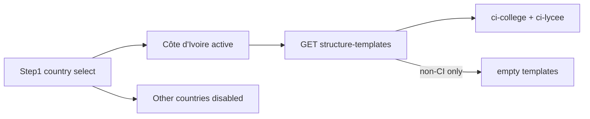

# Country fixture matching — Plan

> **Status:** Complete  
> **Scope:** Per-country structure fixtures; only Côte d’Ivoire active in onboarding until other datasets exist  
> **Packages:** `edaya_backend/tooling/fixtures`, `edaya_web/apps/webapp` onboarding

## Goal

Each country must map to **its own** structure fixture set. Today only Ivory Coast has data, so:

- **Only Côte d’Ivoire** is active / selectable for onboarding country.
- Other countries remain in the list for visibility but look **disabled / muted** (not selectable).
- **No fallback**: selecting (or resolving) a non-CI country must **not** load CI templates.

## Current problem (before)

[`resolveCountryCode`](../../../tooling/fixtures/src/onboarding/country.ts) defaulted unknown labels to `'CI'`, so Sénégal / Mali / etc. silently got Ivory Coast college/lycée templates. Draft default country was also **France**, which had an empty template list.

## Target behavior

| Country | Selectable | Templates |
|---------|------------|-----------|
| Côte d’Ivoire | Yes | `ci-college`, `ci-lycee` |
| All others (France, Sénégal, …) | No (muted in UI) | None if ever queried |

Timezone auto-match stays as-is for when more countries become active later.

## 1. Backend — no CI fallback

Files:

- [`tooling/fixtures/src/onboarding/country.ts`](../../../tooling/fixtures/src/onboarding/country.ts)
- [`tooling/fixtures/src/onboarding/registry.ts`](../../../tooling/fixtures/src/onboarding/registry.ts)
- Tests: `parse-ivory-coast-templates.test.ts`, `test-onboarding-apply-structure-route.test.ts`

Changes delivered:

- Resolve **only** CI aliases / `ivoire` → `'CI'`.
- Keep FR aliases → `'FR'` with empty `TEMPLATES_BY_COUNTRY['FR']`.
- Unknowns / empty / omitted query → `'FR'` + **empty templates** (no CI fallback).
- Registry stays per-country keyed; only CI entry is populated. Future countries = new fixture folder + map entry + unlock in UI.

## 2. Frontend — selector visual + default

Files (in `edaya_web/apps/webapp`):

- `src/lib/onboarding/school-step-defaults.ts` — `STRUCTURE_READY_COUNTRIES`, `isStructureReadyCountry`
- `src/lib/components/onboarding/OnboardingStepSchoolForm.svelte` — disabled muted items + « Bientôt »
- `src/lib/onboarding/draft-storage.ts` — default country Côte d’Ivoire / `Africa/Abidjan`; normalize non-ready drafts to CI
- i18n `onboarding.countryComingSoon`

## 3. Structure step / apply

- Keep `STRUCTURE_MODEL_API_TEMPLATE_IDS` as `ci-*` (only CI active).
- Empty-catalog UX + disable model checkboxes when catalog has no levels.
- No import / multi-country fixture authoring in this pass.

## 4. Validation

- Backend fixture + onboarding route tests (CI returns templates; France / Sénégal / default empty).
- Webapp: school-step-defaults + draft-storage + structure-step tests.
- svelte-autofixer on touched Svelte forms.

## Out of scope

- Authoring fixtures for France or other countries.
- Changing timezone map beyond defaulting with CI.
- Import / class-id alias work.
