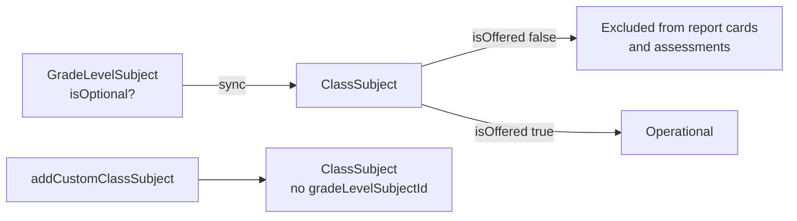
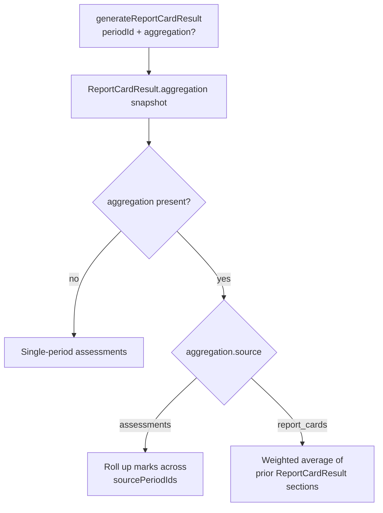

# Curriculum Flexibility & Report Card Aggregation — Sprint Plan

> **Status:** Phase 1–2 backend complete — Phase 3 (web UI) pending  
> **Created:** 2026-07-01  
> **Last updated:** 2026-07-01  
> **Scope:** Keep grade-level → class `ClassSubject` sync; add optional/custom class subjects; cross-period report card aggregation (assessments vs prior bulletins)  
> **Related domain:** `package/domain-core/src/domain/academics/`, `domain/assessments/`, `application/workflows/`

This sprint keeps **eager sync** of `ClassSubject` rows from `GradeLevelSubject` (set-and-forget for the academic year) and adds **class-level flexibility** plus **synthèse / final bulletin** generation from configurable period sets passed at generation time.

---

## 1. Problem statement

### Pain points addressed

| Issue | Before | After |
|-------|--------|-------|
| All-or-nothing curriculum | Every synced subject active in every class | `isOptional` + per-class `isOffered` toggle |
| No class-only subjects | `CLASS_SUBJECT_MANAGED_AT_GRADE_LEVEL` blocked direct create | `addCustomClassSubject` (no `gradeLevelSubjectId`) |
| Single-period report cards | One `periodId` only | Optional `aggregation` on generate — any bulletin can roll up |
| Synthèse with no provenance | Summary section was decorative | `ReportCardResult.aggregation` records how the bulletin was built |

### Design principles (agreed)

1. **Keep sync** — `GradeLevelSubject` remains the grade-level catalog; sync mirrors `ClassSubject` (+ matters) to every class in the grade for the year.
2. **Three class-subject origins** — inherited (synced), optional (synced, default off), custom (manual, no `gradeLevelSubjectId`).
3. **`isOffered` is the class toggle** — disable without deleting; report cards and assessments respect it (scheduling: follow-up).
4. **Custom subjects never sync** — sync skips rows without `gradeLevelSubjectId`; grade-level removal does not delete custom rows.
5. **Aggregation at generation** — any report card can be aggregated when `generateReportCardResult` receives `aggregation`; not stored on the definition template.
6. **Provenance on the result** — `ReportCardResult.aggregation` snapshots the config used; re-generate keeps existing draft aggregation unless the command overrides it.
7. **Publish is gated** — aggregated bulletins require all source periods published; `report_cards` mode also requires all source bulletins published. Single-period bulletins require the target period published.
8. **Draft until ready** — generation leaves the result in `draft` when sources are incomplete; `publishReportCardResult` rejects until readiness checks pass.

---

## 2. Desired architecture

### 2.1 Class subject origins



| Origin | `gradeLevelSubjectId` | Default `isOffered` | Sync updates |
|--------|----------------------|---------------------|--------------|
| Required | set | `true` | coefficient, subjectId |
| Optional | set | `false` | coefficient, subjectId |
| Custom | `null` | `true` | none |

### 2.2 Report card aggregation



**Config shape** (`generateReportCardResult` input; persisted on `ReportCardResult`):

```ts
aggregation?: {
  source: 'assessments' | 'report_cards'
  sourcePeriodIds: string[]
  periodWeightsByPeriodId?: Record<string, number>
}
```

- **Target period** = `periodId` on the command / `ReportCardResult.periodId`.
- **Absent `aggregation`** = normal single-period bulletin from marks in that period.
- **Schema module:** `report-card-aggregation-config.ts` (Zod schema + `ReportCardAggregationSource` enum; no entity class).

**Readiness rules (enforced at publish, reflected in generation):**

| Mode | Included in computation | Required to publish |
|------|-------------------------|---------------------|
| `assessments` | Marks from **published** source periods only | All `sourcePeriodIds` have `AcademicPeriod.isPublished` |
| `report_cards` | Averages from **published** source bulletins only | All source periods published **and** all source bulletins published |
| Single-period | Marks from target period (preview anytime) | Target period published |

### 2.3 Common scenarios

| Scenario | Target `periodId` | `aggregation.source` | `sourcePeriodIds` |
|----------|-------------------|------------------------|-------------------|
| T1 interim | T1 | — (omit) | — |
| Synthèse trimestrielle | synthèse period | `report_cards` | T1, T2, T3 |
| Semestre 1 | S1 period | `report_cards` | T1, T2 |
| Bulletin annuel (preview) | annual period | `assessments` | T1, T2, T3 |
| Bulletin annuel (official) | annual period | `report_cards` | T1, T2, T3 |

### 2.4 Example: synthèse generation

```ts
await generateReportCardResult({
  id: 'rc-synth-1',
  studentId: 'stu1',
  periodId: synthesePeriodId,
  reportCardDefinitionId: 'def1',
  aggregation: {
    source: 'report_cards',
    sourcePeriodIds: [t1Id, t2Id, t3Id],
    periodWeightsByPeriodId: { [t1Id]: 1, [t2Id]: 1, [t3Id]: 1 },
  },
})
```

T1/T2/T3 interim bulletins: same call **without** `aggregation`.

---

## 3. Implementation phases

### Phase 1 — Curriculum flexibility ✅

| Step | Work | Status |
|------|------|--------|
| 1.1 | Migration `0025`: `grade_level_subjects.is_optional`, `class_subjects.is_offered` | ✅ |
| 1.2 | Domain: `isOptional` on `GradeLevelSubject`, `isOffered` on `ClassSubject` | ✅ |
| 1.3 | Sync: default `isOffered` from `!isOptional`; preserve `isOffered` on re-sync | ✅ |
| 1.4 | Validation: allow custom `ClassSubject` without `gradeLevelSubjectId` | ✅ |
| 1.5 | Commands: `addCustomClassSubject`, `setClassSubjectOffered`; extend `updateGradeLevelSubject` with `isOptional` | ✅ |
| 1.6 | Report cards: skip subjects where `isOffered === false` | ✅ |
| 1.7 | Tests: sync defaults, custom subject, offered toggle | ✅ |
| 1.8 | Assessments: reject saves when `isOffered === false` | ✅ |
| 1.9 | Onboarding: pass `isOptional` from template curriculum entries | ✅ |

### Phase 2 — Report card aggregation ✅

| Step | Work | Status |
|------|------|--------|
| 2.1 | Migration `0026`: `report_card_results.aggregation` jsonb; drop `report_card_definition_sections.aggregation` | ✅ |
| 2.2 | `ReportCardAggregation` schema on result + `generateReportCardResult` command | ✅ |
| 2.3 | `buildReportCardResults`: branch when command/result has `aggregation` | ✅ |
| 2.4 | `assessments` mode: multi-period mark rollup | ✅ |
| 2.5 | `report_cards` mode: weighted prior `ReportCardResult` section averages | ✅ |
| 2.6 | Attendance: sum across source period date ranges in aggregation mode | ✅ |
| 2.7 | Tests: both modes, publish readiness gates, missing prior bulletin | ✅ |
| 2.8 | Onboarding: create academic periods from template; synthèse section is label-only | ✅ |

### Phase 3 — Web UI (deferred)

- Optional subjects and per-class `isOffered` toggles
- **Generate bulletin** flow: period picker + optional aggregation (`source`, `sourcePeriodIds`, weights)
- Display `aggregation` provenance on published/draft results

---

## 4. Commands

| Command | Description |
|---------|-------------|
| `addCustomClassSubject` | Manual subject for one class (`gradeLevelSubjectId` absent) |
| `setClassSubjectOffered` | Enable/disable inherited or custom subject for a class |
| `updateGradeLevelSubject` | + `isOptional` (propagates `isOffered = !isOptional` to mirrored rows when changed) |
| `generateReportCardResult` | + optional `aggregation`; snapshot stored on `ReportCardResult` |
| `publishReportCardResult` | Readiness gates use `result.aggregation` (single-period if absent) |

---

## 5. Migrations

| Migration | Changes |
|-----------|---------|
| `0025` | `grade_level_subjects.is_optional`, `class_subjects.is_offered` |
| `0026` | `report_card_results.aggregation` jsonb; removes section-level aggregation column |

Local PGlite applies both on API startup (`RUN_MIGRATIONS_ON_STARTUP=true`).

---

## 6. Key files

| Area | Path |
|------|------|
| Aggregation schema | `package/domain-core/src/domain/assessments/report-card-aggregation-config.ts` |
| Result + aggregation field | `package/domain-core/src/domain/assessments/report-card-result.ts` |
| Generate / publish workflows | `package/domain-core/src/application/workflows/assessments.ts` |
| Rollup helpers | `package/domain-core/src/application/workflows/report-card-aggregation.ts` |
| Onboarding periods | `apps/api/src/lib/onboarding/ensure-academic-periods-from-template.ts` |

---

## 7. Verification

```sh
bun --filter @edaya/core test
bun --filter @edaya/api test
bun run openapi:generate   # after schema changes
bun run verify
```

---

## 8. Resolved decisions

| Question | Decision |
|----------|----------|
| Auto-enable optional subject when first class opts in? | **No.** Optional subjects stay synced everywhere; each class opts in via `setClassSubjectOffered`. |
| Propagate `isOptional` change to existing `isOffered`? | **Yes.** `updateGradeLevelSubject` sets mirrored `isOffered = !isOptional` when `isOptional` changes. |
| One report card definition vs several? | **Several allowed**, not tied to a period. Structure comes from the definition; rollup comes from `aggregation` at generate time. |
| Where does aggregation config live? | **On the generate command**, snapshotted on **`ReportCardResult`**. Not on definition sections. Any bulletin for any period can be aggregated. |
| `isOffered` on scheduling/sessions? | **Deferred.** Report cards and assessments enforce it today. |

---

## 9. Follow-ups (out of scope)

- `isOptional` entries in Ivory Coast fixture JSON (type + onboarding pass-through exist; no sample optional subjects yet)
- `isOffered` gate on session creation
- End-to-end workflow test: T1–T3 publish → synthèse with `aggregation`
- Phase 3 web UI in `edaya_web`
