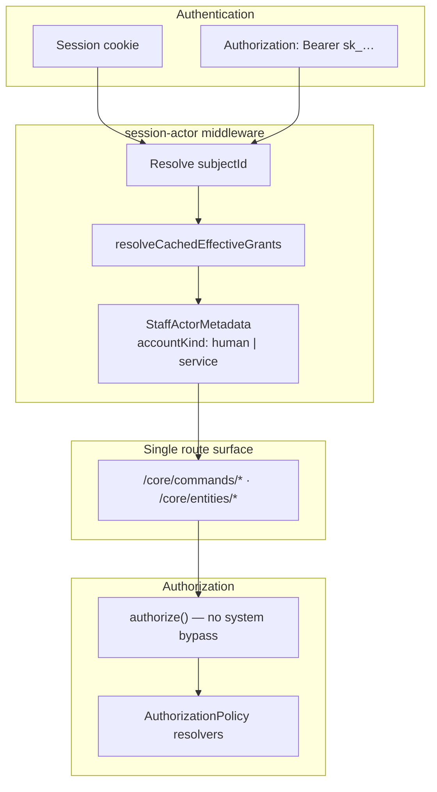

# Service accounts and unified API authorization

**Status: complete** (Phases 1–4). Machine auth uses **API keys** only; OAuth/OIDC is out of scope.

Replace god-mode **system actor** routes (`/core/system/*` + `X-System-Actor-Secret`) with **permissioned service accounts** that use the same `/core/commands/*` and `/core/entities/*` surface as human staff.

**Related docs:** [Authorization README](../package/domain-core/src/authorization/README.md), [API folder structure](../docs/api-folder-structure.md), [integrations restructure](../docs/integrations-restructure.md).

---

## Completion summary

| Area | Status |
|------|--------|
| Domain + Postgres (`service_api_keys`, `StaffMember` service fields) | Done |
| API key middleware + `/core/service-accounts` CRUD | Done |
| Seeding via `SERVICE_ACCOUNT_API_KEY` + session bootstrap on first `seed:init` | Done |
| God-mode removal (`/core/system/*`, `SYSTEM_ACTOR_SECRET`, authorize bypass) | Done |
| `bun run fullcheck` | Passing |

**Credential decision (locked):** API keys via `Authorization: Bearer sk_live_…`. No OAuth/OIDC sprint planned.

**Minor gaps (optional, not blocking):**

- Webapp admin UI for service accounts — still API-only
- `SystemActorMetadata` type remains for metadata/tests; data paths use `createBootstrapStaffActorMetadata` or interactive actors

---

## 1. Goals and non-goals

### Goals

| # | Outcome |
|---|---------|
| G1 | Service accounts are first-class **staff-shaped** actors with `effectiveGrants` |
| G2 | Machine callers authenticate via **API key** and hit **normal** core routes |
| G3 | Creating a service account requires permission; granted permissions ⊆ creator |
| G4 | Owner can provision an **owner-level** service account (for seeding / integrations) |
| G5 | Seeding creates owner service account after school bootstrap, then uses API key |
| G6 | `ActorAssuranceLevel.Service` enables service-only and human-only workflow gates |
| G7 | `/core/system/*` removed; bootstrap via onboarding + session seed |

### Non-goals (this iteration)

- OAuth2 / OpenID Connect — **out of scope**; API keys are the machine-auth mechanism
- Cross-school workflows except **billing** (platform scope defined separately)
- Webapp admin UI for service account management (API + seed first)
- Additional `serviceOnly` commands beyond `materialize-deliveries` (flag is implemented; extend per integration)

### Locked product decisions

| Topic | Decision |
|-------|----------|
| **Credentials** | API keys (`Authorization: Bearer`); no OAuth/OIDC planned |
| **Assurance** | `ActorAssuranceLevel.Service` — orthogonal to human `Standard` / `Verified` / `Strong` |
| **Tenancy** | School-scoped actors only; no cross-school data except billing integrations |
| **Delegation** | `SERVICE_ACCOUNT_*` permissions; assignee grants ⊆ creator grants |
| **Owner bots** | School owner may create owner-level (`isElevated`) service account |
| **Seeding** | After school exists → create owner service account → seed via `/core/*` |

---

## 2. Before (removed)

Historical god-mode path — **deleted in Phase 4**:

```
Machine caller
  └─ X-System-Actor-Secret
       └─ POST /core/system/commands/{name}
       └─ POST /core/system/entities/{entity}/list|one|save
            └─ createSystemActorMetadata()
                 └─ authorize() SKIPPED (god-mode)
                 └─ policy resolvers often SKIPPED

Human caller
  └─ Better Auth session cookie
       └─ POST /core/commands/* · /core/entities/*
            └─ StaffActorMetadata + effectiveGrants
                 └─ full authorize() + policy
```

**Was painful:** duplicated OpenAPI surface, duplicated handlers, no least-privilege for integrations.

**Consumers migrated:** `@edaya/seeding` now uses `core-entity.ts` / `core-command.ts` with Bearer token or director session bootstrap.

---

## 3. Target architecture



**Bootstrap** (no service account yet):

```
POST /core/onboarding/register-school   (authenticated unlinked user)
  OR director session during seed:init     (Better Auth sign-in → /core/*)
  → provision seeding service account      (prints SERVICE_ACCOUNT_API_KEY)
  → subsequent seeds use Bearer token only
```

---

## 4. Domain model

### 4.1 StaffMember extensions

| Field | Type | Purpose |
|-------|------|---------|
| `accountKind` | `'human' \| 'service'` | Distinguish people from integrations |
| `serviceId` | `string?` | Stable integration id (`seeding`, `billing-sync`, …) |
| `createdBySubjectId` | `string?` | Audit: who provisioned this account |

Humans: `accountKind = 'human'` (default). Service accounts: `accountKind = 'service'`, no login UX.

### 4.2 Service API keys (new persistence)

Separate from Better Auth password — machine credentials only.

| Field | Purpose |
|-------|---------|
| `id` | Primary key |
| `staffMemberId` | Linked service staff |
| `schoolId` | Tenant boundary |
| `keyPrefix` | Display / lookup (`sk_live_abc…`) |
| `keyHash` | Stored hash (never persist plaintext) |
| `createdBySubjectId` | Delegation audit |
| `expiresAt` | Optional rotation policy |
| `revokedAt` | Soft revoke |
| `lastUsedAt` | Observability |

**Schema location:** `@edaya/adaptor-postgres` (+ Drizzle migration). Auth adapter stays in `betterauth-d1-migrations` for human users only.

### 4.3 New permissions

Add to `Permission` enum under **Staff and access**:

| Permission | Purpose |
|------------|---------|
| `SERVICE_ACCOUNT_READ` | List service accounts for the school |
| `SERVICE_ACCOUNT_CREATE` | Create service staff + initial API key |
| `SERVICE_ACCOUNT_UPDATE` | Update metadata / role assignment |
| `SERVICE_ACCOUNT_REVOKE` | Revoke keys / deactivate service staff |
| `SERVICE_ACCOUNT_ROTATE_KEY` | Issue new key, invalidate old |

`permissionDefinitions`: school-scoped; `SERVICE_ACCOUNT_CREATE` requires `ActorAssuranceLevel.Verified` for **human** creators (service accounts use `Service` — see §5).

### 4.4 Owner service account

When creator is school owner (`isElevated`) and explicitly requests `elevated: true`:

- Service staff linked with role assignment that resolves to `isElevated: true` (same as owner), **or**
- Dedicated “owner integration” access role seeded per school

**Guardrails:**

- Max **one** active owner-level service account per school (configurable override for platform ops)
- Mandatory `serviceId` (e.g. `school-owner-integration`)
- All actions audited with `systemId` = `serviceId`

---

## 5. `ActorAssuranceLevel.Service`

Extend enum in `package/domain-core/src/authorization/model/actor.ts`:

```ts
export enum ActorAssuranceLevel {
  Standard = 'standard',
  Verified = 'verified',
  Strong = 'strong',
  Service = 'service',  // machine actors only
}
```

**Do not** add `Service` to `ASSURANCE_RANK` ladder used for human step-up.

Instead, extend `assertPermissionAssurance` (or parallel `assertAccountKind`):

| Rule | Behavior |
|------|----------|
| Service account actor | Always `assuranceLevel: Service` |
| Human-only permission | Reject if `accountKind === 'service'` |
| Service-only command | Reject if `accountKind === 'human'` (registry flag `serviceOnly: true`) |
| Shared permissions | Normal grant + scope checks; assurance gate uses explicit map |

Example `PERMISSION_ASSURANCE` additions:

```ts
[Permission.SERVICE_ACCOUNT_CREATE]: ActorAssuranceLevel.Verified, // human creator only
// Service accounts skip human assurance ranks via accountKind check
```

Registry flag on commands (optional — **`materialize-deliveries` uses `serviceOnly: true`**):

```ts
{ methodName: 'bulkImportStudents', serviceOnly: true }
```

---

## 6. Delegation rules (permissions ⊆ creator)

### 6.1 Who may create

Caller must hold `SERVICE_ACCOUNT_CREATE` and pass `authorize()` for the target school.

### 6.2 Permission subset

Requested role permissions ⊆ creator's `effectiveGrants.permissions`.

If creator is not `isElevated`, cannot assign permissions the creator does not hold.

### 6.3 Scope subset

Each requested `ScopeGrant` must be covered by creator's grants:

- Same or narrower `scopeType`
- `scopeEntityIds` ⊆ creator's ids for that permission+scope (or creator has school-wide / elevated)

### 6.4 Owner service account

Only if creator has `isElevated: true` **and** passes explicit `elevated: true` on create request.

### 6.5 Billing exception (future)

Platform billing integrations use a **platform-scoped** service account (separate from school staff), with only `PLATFORM_BILLING_*` permissions (to be defined). Out of scope for phase 1–3 except documenting the boundary.

---

## 7. API layer

### 7.1 API key authentication

**Header:** `Authorization: Bearer <api-key>` (or `X-Api-Key` — pick one, document in OpenAPI).

**Middleware** (extend `session-actor.ts` or sibling `service-actor.ts`):

1. If session cookie present → existing human flow
2. Else if API key → hash lookup → `staffMemberId` → must be `accountKind === 'service'`
3. Resolve grants via `resolveCachedEffectiveGrants` (same as staff)
4. `createStaffActorMetadata({ …, assuranceLevel: Service, accountKind: 'service' })`
5. Set `c.set('actor', …)` — same variable as today

**Precedence:** session wins if both present (or reject ambiguous dual auth — recommend reject).

### 7.2 New routes (hand-written)

| Method | Path | Purpose |
|--------|------|---------|
| `POST` | `/core/service-accounts` | Create service staff + role + API key (returns key once) |
| `GET` | `/core/service-accounts` | List (no secrets) |
| `POST` | `/core/service-accounts/{id}/rotate-key` | Rotate API key |
| `POST` | `/core/service-accounts/{id}/revoke` | Revoke |
| `PATCH` | `/core/service-accounts/{id}` | Update display name, roles, or scope grants |

Implement orchestration in `package/domain-core/authorization/service-accounts/provision.ts`; API routes in `routes/service-accounts.routes.ts` + `lib/service-accounts/schemas.ts`.

### 7.3 System routes (removed)

| Route | Status |
|-------|--------|
| `POST /core/system/entities/*` | **Deleted** |
| `POST /core/system/commands/*` | **Deleted** |
| `SYSTEM_ACTOR_SECRET` | **Removed** from API env and seeding |

---

## 8. Seeding migration

### 8.1 New step in `seed:init` / `seed:all`

After school + human owner exist:

1. Authenticate as director (session) on first `seed:init`, or use in-process `application` in tests
2. `POST /core/service-accounts` with `elevated: true`, `serviceId: 'seeding'`, owner-level role
3. Store returned API key in `.env` as `SERVICE_ACCOUNT_API_KEY` (school-scoped)
4. Subsequent seed scopes use Bearer token → `/core/commands/*`, `/core/entities/*`

### 8.2 Replace `testing/seeding/src/http/system-entity.ts`

| Before | After |
|--------|-------|
| `postSystemEntityList` → `/core/system/entities/.../list` | `postEntityList` → `/core/entities/.../list` |
| `X-System-Actor-Secret` | `Authorization: Bearer …` |
| `schoolId, systemId, reason` in every body | Actor carries `schoolId`; optional `X-Request-Id` |

### 8.3 Env vars

| Variable | Purpose |
|----------|---------|
| `SERVICE_ACCOUNT_API_KEY` | Seeding / local dev machine auth (Bearer on `/core/*`) |

---

## 9. Core authorization changes

### 9.1 Remove system bypass

In `engine/authorize.ts`:

```ts
// REMOVE:
if (actor.kind === 'system') {
  return
}
```

System actors either:

- **Removed** for data paths, or
- **Given explicit grants** for bootstrap-only commands (narrow allowlist)

### 9.2 Policy resolvers

Remove blanket `actor.kind === 'system'` early returns in:

- `policy/resolvers/student.ts`
- `policy/resolvers/academic.ts`
- `policy/resolvers/scheduling.ts`
- `policy/resolvers/finance.ts`

Service accounts with correct grants pass the same checks as staff.

### 9.3 `SystemActorMetadata`

**Done for data paths:** god-mode bypass removed. Bootstrap and dev seed use `createBootstrapStaffActorMetadata()` (synthetic elevated staff with `PLATFORM_REGISTER_SCHOOL`). The `SystemActorMetadata` type remains for tests/metadata only.

---

## 10. Implementation phases

### Phase 1 — Domain and permissions

- [x] `StaffMember.accountKind`, `serviceId`, `createdBySubjectId`, `serviceElevated`
- [x] `service_api_keys` table + repository
- [x] `SERVICE_ACCOUNT_*` permissions + definitions
- [x] `ActorAssuranceLevel.Service`
- [x] `createServiceStaffActorMetadata` + `accountKind` on `StaffActorMetadata`
- [x] Unit tests: delegation subset, owner service account rules

### Phase 2 — API key middleware + service account routes

- [x] API key hash verify + actor resolution in middleware
- [x] `POST/GET /core/service-accounts` + rotate/revoke
- [x] `authorization/service-accounts/provision.ts` with delegation checks
- [x] Integration test: API key → `POST /core/entities/schools/list` (authorized)

### Phase 3 — Seeding migration

- [x] `seed:init` provisions owner service account after school bootstrap (prints `SERVICE_ACCOUNT_API_KEY`)
- [x] Refactor `@edaya/seeding` HTTP client off `/core/system/*` (`core-entity.ts`, `core-command.ts`)
- [x] `SERVICE_ACCOUNT_API_KEY` env var support
- [x] Update integration test harness for service account HTTP seeding
- [x] Document `SERVICE_ACCOUNT_API_KEY` in `docs/local-dev.md`
- [x] Remove `SYSTEM_ACTOR_SECRET` from seeding default path

### Phase 4 — Remove god-mode

- [x] Remove `system` bypass in `authorize()` and policy resolvers
- [x] Delete `buildSystemEntityRoutes()`, `system.routes.ts`, `lib/system-api/`
- [x] Remove `SYSTEM_ACTOR_SECRET` from seeding and API env
- [x] Session-based HTTP seed bootstrap (director sign-in → `/core/*`)
- [x] OpenAPI cleanup (regenerate spec; no `/core/system/*` paths)

---

## 11. Testing strategy

| Layer | Tests |
|-------|-------|
| Core | Delegation subset, assurance/accountKind gates, owner service account |
| API | API key middleware, service account CRUD, 401/403 without grants |
| Integration | Seed with service key through `/core/*`; no system secret |
| Regression | Human session flows unchanged |

---

## 12. Risks and mitigations

| Risk | Mitigation |
|------|------------|
| API key leak = full owner access | Rotation, short-lived keys in CI, separate non-owner service accounts for narrow integrations |
| Chicken-and-egg before first service account | Director session bootstrap on `seed:init`; then `SERVICE_ACCOUNT_API_KEY` |
| Breaking existing seed scripts | Migrated; system secret path removed |
| `Service` assurance confusion | Document orthogonal model; never rank Service with Strong/Verified |

---

## 13. Success criteria

- [x] `@edaya/seeding` runs full `seed:all` with **only** `SERVICE_ACCOUNT_API_KEY` (after bootstrap)
- [x] No integration test requires `POST /core/system/entities/*`
- [x] Unauthorized API key receives 401 (`test-service-accounts-routes.test.ts`)
- [x] Under-privileged service account receives 403 on protected entity route (teacher → `staff-members/list`)
- [x] Creating service account with permission not held by creator fails (`service-account-delegation.test.ts` at core layer)
- [x] Owner-level service account can run seed workflows (HTTP integration test)
- [x] Teacher-scoped service account cannot access staff admin entities (403 test)

---

## 14. File touch map (anticipated)

```
package/domain-core/
  authorization/model/actor.ts
  authorization/engine/authorize.ts
  authorization/permissions/permission.ts
  authorization/permissions/permission-assurance.ts
  domains/school/staff-member.ts
  services/… (createServiceAccount workflow)

package/adaptor-postgres/
  schema (service_api_keys)
  repositories/

apps/api/
  http/dependencies/session-actor.ts
  lib/service-accounts/schemas.ts
  routes/service-accounts.routes.ts
  lib/onboarding/register-school-with-owner.ts   (uses createBootstrapStaffActorMetadata)

testing/seeding/
  src/http/core-entity.ts, core-command.ts, core-seed-application.ts
  src/http/provision-seeding-service-account.ts
  seed:init → session bootstrap + SERVICE_ACCOUNT_API_KEY
```
