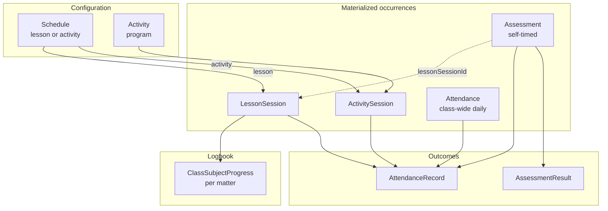
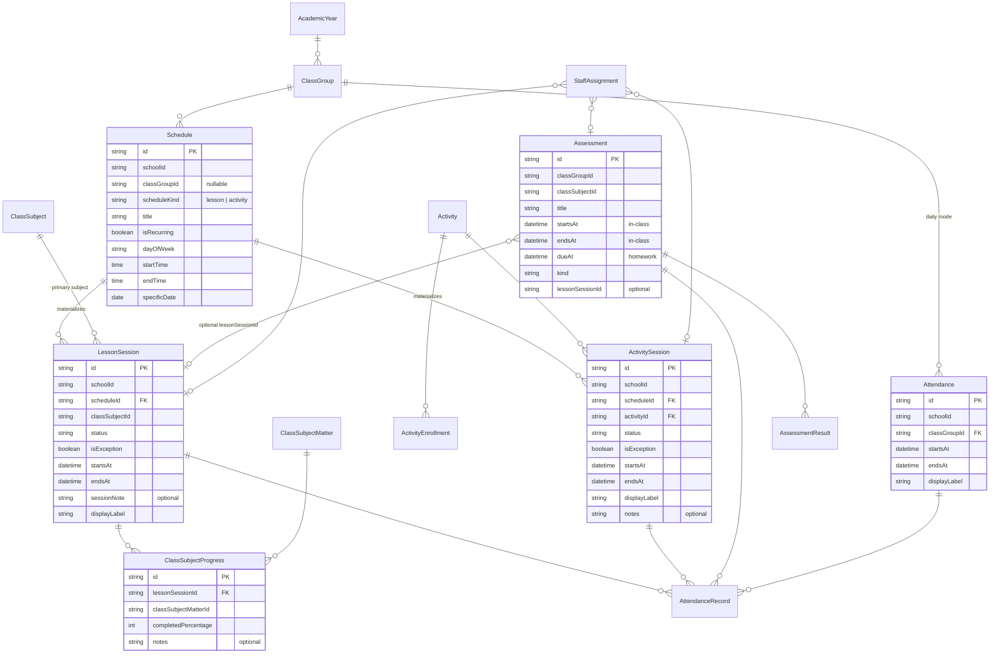
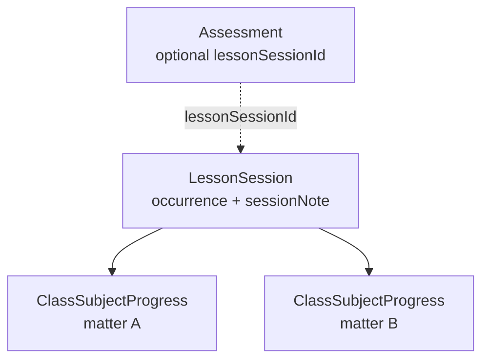

# Schedule & Lesson Model — Sprint Plan

> **Status:** Backend cutover complete through Phase 5 (except optional legacy-field cleanup); UI deferred to `edaya_web`  
> **Created:** 2026-06-29  
> **Last updated:** 2026-07-01 (occurrence mutations, command rename cleanup, `Activity` rename `0033`, `bun run verify` green)  
> **Scope:** Drop generic `Session`; materialize `LessonSession` / `ActivitySession` from `Schedule`; self-timed `Assessment`; class-wide `Attendance` for daily mode; logbook via `ClassSubjectProgress`; homework consolidation  
> **Related domain:** `package/domain-core/src/domain/scheduling/`, `domain/academics/`, `domain/assessments/`, `domain/school/`

This plan replaces the generic **`Session`** entity with **typed occurrence rows** (`LessonSession`, `ActivitySession`), keeps **`Schedule`** as configuration for lessons and activities only, and gives **`Assessment`** its own time model. The timetable is a **union query** over occurrence tables — no virtual expansion at read time.

### Implementation snapshot (2026-07-01)

| Area | State |
|------|--------|
| Generic `Session` | **Removed** — `sessions` table dropped (`0028`); domain entity deleted |
| `LessonSession` | **Shipped** — materialized from lesson schedules (`materializeSchedule`) |
| `Attendance` (daily) | **Shipped** — `getOrCreateAttendance`; `AttendanceRecord.attendanceId` |
| Per-lesson attendance | **Shipped** — `AttendanceRecord.lessonSessionId`; auto-complete pending lesson |
| Occurrence FKs | **Shipped** — progress, staff/resource assignments, assessments, incidents |
| `ActivitySession` | **Shipped** — materialized from activity schedules (`materializeSchedule`); entity + migration `0030` |
| `Activity` (program) | **Shipped** — `ExtracurricularActivity` renamed (`0033`); API entity `activities` |
| Occurrence mutations | **Shipped** — `cancelLessonSession`, `cancelActivitySession`, `rescheduleOccurrence` |
| Assessment self-timing | **Shipped** — `startsAt`/`endsAt` on in-class rows (`0031`); homework uses `dueAt` only |
| Homework consolidation | **Shipped** — `homework_assignments` / `homework_submissions` dropped (`0032`); `Assessment.kind = homework` |
| Timetable union query | **Shipped** — `getClassGroupTimetable` (`LessonSession` + `ActivitySession` + in-class `Assessment`) |
| Deprecated session commands | **Removed** — use `assignStaffToLessonSession`, `recordLessonSessionAttendance`, `materializeSchedule`, etc. |
| `ClassLogbookEntry` table | **Dropped** — entity/API/seeds removed; migration `0029_drop_class_logbook_entries.sql` |

---

## 1. Problem statement

### Current pain points

| Issue | Today | Impact |
|-------|-------|--------|
| Triple homework model | `HomeworkAssignment`, `Assessment.kind = homework`, free-text `ClassLogbookEntry.homework` | Duplicate CRUD, notifications, and UI paths |
| Ambiguous “course” / “session” | `SessionKind.Course` vs `ClassLogbookEntry` | **`SessionKind` removed**; lesson = `LessonSession` |
| Generic `Session` | One table for lessons, exams, events | **Removed** — use typed occurrence tables |
| Loose logbook join | Logbook matched by `classSubjectId + date` | No FK integrity |
| Subject on time slots | `Session.classSubjectId`, `Schedule.classSubjectId` | Timetable edits entangle calendar and curriculum |
| Isolated activities | ~~`ExtracurricularActivity.schedule` is free text~~ | **`Activity` + `ActivitySession`** via `Schedule` |

### Design principles (agreed)

1. **`Schedule` is configuration** — timing rules (one-off or recurring). Scoped to **lessons** and **activities** only. Materializes occurrences within the **academic year** window.
2. **`LessonSession` replaces `Session` for lessons** — one row per materialized lesson occurrence; created and rescheduled on schedule edit. Replaces `ClassLogbookEntry` / `CourseRecord` as the lesson anchor.
3. **`ActivitySession` replaces `Session` for activities** — one row per materialized activity occurrence; `Activity` remains the program definition (coach, enrollment, scope).
4. **`Assessment` is self-timed** — in-class: `startsAt` / `endsAt`; homework: `dueAt` only. No `Schedule` for assessments.
5. **Timetable read model** — `UNION` of `LessonSession`, `ActivitySession`, and in-class `Assessment` rows in the date range. No runtime schedule expansion.
6. **Schedule type exclusivity** — each `Schedule` is either a **lesson** schedule or an **activity** schedule (materializes `LessonSession` or `ActivitySession`, not both).
7. **Attendance** — class-wide occurrence entity with predefined `startsAt` / `endsAt` (primary-school **daily** mode). `AttendanceRecord` references exactly one parent: `attendanceId`, `lessonSessionId`, `activitySessionId`, or `assessmentId`.
8. **Staff assignments** — `StaffAssignment` targets exactly one of: `classGroupId`, `classSubjectId`, `lessonSessionId`, `activitySessionId`, or `assessmentId` (replaces `sessionId`).
9. **Schedule conflicts** — classic class-wide overlap check on `startsAt` / `endsAt`; backend enforcement is **optional** (school-level setting).
10. **Logbook** — `LessonSession` holds an optional `sessionNote`; **multiple `ClassSubjectProgress`** rows per lesson capture per–class-subject-matter progress. In-class **`Assessment`** may optionally reference `lessonSessionId`. Legacy logbook fields (`chapter`, `content`, `objectives`, `homework`) are **not** migrated — narrative → `sessionNote` + matter `notes`.
11. **Occurrence lifecycle** — `status` (`pending` / `completed` / `cancelled`) and `isException` on `LessonSession` and `ActivitySession`. Only non-exception `pending` rows follow schedule resync.
12. **Homework** folds into `Assessment`; drop `HomeworkAssignment` / `HomeworkSubmission`.
13. **Greenfield cutover** — no production DB yet; reset-and-rebuild is acceptable. No compatibility layer or API deprecation period at the end of migration.

---

## 2. Desired architecture

### 2.1 Layer diagram



### 2.2 Entity relationship



### 2.3 Timetable read model

```ts
function getTimetableEvents(classGroupId: string, range: DateRange): TimetableEvent[] {
  const lessons = listLessonSessions({ classGroupId, range })
  const activities = listActivitySessions({ classGroupId, range })
  const exams = listAssessments({ classGroupId, range, inClassOnly: true })
  return [...lessons, ...activities, ...exams].sort(byStartsAt)
}
```

Homework assessments (`dueAt` only) are **out of scope** for the week grid unless product adds a separate due-date lane later.

### 2.4 Lesson logbook model



| Piece | Role |
|-------|------|
| **`LessonSession`** | Time occurrence; optional `sessionNote` (free text) |
| **`Assessment`** | In-class evaluation; optional `lessonSessionId` when delivered in that lesson slot |
| **`ClassSubjectProgress`** | One row per **class subject matter** covered in the lesson; holds `completedPercentage`, matter-level `notes`, `recordedByStaffId` |
| **`ClassSubjectMatter`** | Curriculum unit; aggregate progress lives on the matter; lesson progress is the per-occurrence snapshot |

Multiple `ClassSubjectProgress` rows per `LessonSession` allow tracking several matters (or subjects via their matters) delivered in the same slot.

### 2.5 Occurrence lifecycle

Applies to **`LessonSession`** and **`ActivitySession`**.

| Status | `isException` | Schedule resync | Use |
|--------|---------------|-----------------|-----|
| `pending` | `false` | Yes — times updated | Future occurrence |
| `pending` | `true` | No | Manually moved |
| `completed` | any | No | Attendance / delivery done |
| `cancelled` | `true` | No | Explicit skip for this date |

- `pending` → `completed`: first attendance recorded (preferred).
- Cancel / manual reschedule: sets `isException = true`; cancelled is terminal.
- **Bounds:** materialization only creates rows within `AcademicYear.startDate`–`endDate` (minus non-school days).

### 2.6 UI creation flows

Two entry points; assessments (in-class) use their own time fields.

#### Group 1 — Timetable (primary)

| Step | Action |
|------|--------|
| 1 | Add **Schedule** (lesson or activity; recurring or one-off) |
| 2 | For **lesson**: pick `classSubjectId`, optional default note; for **activity**: pick/create `Activity` program |
| 3 | Save → **materialize** `LessonSession` or `ActivitySession` rows for the academic year |
| 4 | Timetable shows materialized rows immediately |

#### Group 2 — Dedicated menus

| Menu | Creates | Schedule step |
|------|---------|---------------|
| **Lessons** *(rename from Teaching Log)* | `LessonSession` shells via schedule | Required |
| **Activities** | `Activity` + `ActivitySession` shells | Required |
| **Assessments** | `Assessment` | **None** for in-class (`startsAt`/`endsAt`); homework uses `dueAt` only |

#### Menu naming

| Current | Target |
|---------|--------|
| Teaching Log | **Lessons** |

---

## 3. Entity definitions

### 3.1 Schedule

Configuration for **lesson** or **activity** slots only.

| Field | Type | Required | Notes |
|-------|------|----------|-------|
| `id` | string | yes | |
| `schoolId` | string | yes | |
| `classGroupId` | string | no | `null` = school-wide |
| `scheduleKind` | enum | yes | `lesson` \| `activity` — determines materialization target |
| `title` | string | yes | Slot label (e.g. "Period 3") |
| `isRecurring` | boolean | yes | |
| `dayOfWeek` | enum | if recurring | |
| `startTime` | time | yes | |
| `endTime` | time | yes | |
| `specificDate` | date | if one-off | |
| `classSubjectId` | string | if `lesson` | Default subject for materialized `LessonSession` rows |
| `activityId` | string | if `activity` | Program for materialized `ActivitySession` rows |
| `createdAt` | datetime | yes | |

**Removed:** `classSubjectId` on generic schedule without `scheduleKind` distinction — now explicit per kind.

**Materialization:** `materializeSchedule(scheduleId)` expands within the class group's **academic year** (or school year for school-wide), skipping non-school days. Creates **eager shells** (empty `sessionNote`, no progress rows yet).

### 3.2 LessonSession (replaces `Session` + `ClassLogbookEntry`)

Materialized **lesson occurrence**. One row per school day matching the parent schedule.

| Field | Type | Required | Notes |
|-------|------|----------|-------|
| `id` | string | yes | |
| `schoolId` | string | yes | |
| `classGroupId` | string | no | Denormalized from schedule / class subject |
| `scheduleId` | string | yes | Parent schedule (many sessions per schedule) |
| `classSubjectId` | string | yes | Primary subject for this slot |
| `status` | enum | yes | `pending` \| `completed` \| `cancelled` |
| `isException` | boolean | yes | default `false` |
| `startsAt` | datetime | yes | |
| `endsAt` | datetime | yes | |
| `displayLabel` | string | yes | Subject name denormalized (timetable, notifications) |
| `sessionNote` | string | no | Free-text logbook note for the lesson |
| `createdAt` | datetime | yes | |

**Dropped entities / fields:** generic `Session`; `CourseRecord`; logbook `date`, `chapter`, `content`, `objectives`, `homework`, `progress` on a single row (progress → `ClassSubjectProgress`; narrative → `sessionNote` + matter notes).

### 3.3 ClassSubjectProgress (evolved)

Per–class-subject-matter progress for a **lesson occurrence**.

| Change | Detail |
|--------|--------|
| Rename FK | `sessionId` → `lessonSessionId` |
| Keep | `classSubjectMatterId`, `completedPercentage`, `notes`, `recordedByStaffId`, `recordedAt` |
| Cardinality | Many per `LessonSession`; unique `(lessonSessionId, classSubjectMatterId)` |

**Validation:** matter's `classSubject` must belong to the same `classGroupId` as the `LessonSession`.

### 3.4 Assessment (extended)

| Type | Timing | On timetable |
|------|--------|--------------|
| In-class | `startsAt` + `endsAt` required | Yes |
| Homework | `dueAt` required; no `startsAt`/`endsAt` | No (default) |

| Change | Detail |
|--------|--------|
| Remove | `sessionId`, `scheduleId` |
| Add | `startsAt`, `endsAt` for in-class; optional `lessonSessionId` |
| Keep | `kind`, `title`, `maxScore`, `coefficient`, `periodId`, `completedAt`, `description`, `attachments` |
| Homework | Fold `HomeworkAssignment` / `HomeworkSubmission` into `Assessment` / `AssessmentResult` |

**Optional link to lesson:** `Assessment.lessonSessionId` when the in-class evaluation is delivered in that `LessonSession` slot.

### 3.5 Activity (program)

Unchanged intent: coach, capacity, scope, enrollment period.

| Field | Type | Required | Notes |
|-------|------|----------|-------|
| `id` | string | yes | |
| `schoolId` | string | yes | |
| `classGroupId` | string | no | `null` = school-wide |
| `name` | string | yes | |
| `category` | enum | yes | |
| `coach` | string | yes | |
| `capacity` | int | school-wide | Optional class-bound |
| `description` | string | yes | |
| `startDate` / `endDate` | date | no | Optional program bounds |
| `createdAt` | datetime | yes | |

Referenced by `Schedule.activityId` when `scheduleKind = activity`.

### 3.6 ActivitySession

Materialized **activity occurrence** (parallel to `LessonSession`).

| Field | Type | Required | Notes |
|-------|------|----------|-------|
| `id` | string | yes | |
| `schoolId` | string | yes | |
| `scheduleId` | string | yes | |
| `activityId` | string | yes | |
| `status` | enum | yes | same as lesson |
| `isException` | boolean | yes | |
| `startsAt` | datetime | yes | |
| `endsAt` | datetime | yes | |
| `displayLabel` | string | yes | `Activity.name` denormalized |
| `notes` | string | no | Per-occurrence coach notes |
| `createdAt` | datetime | yes | |

### 3.7 Attendance (class-wide occurrence)

Replaces the synthetic daily `Session` pattern for primary schools (`AttendanceMode.Daily`). One row per class per calendar day (or per configured daily window).

| Field | Type | Required | Notes |
|-------|------|----------|-------|
| `id` | string | yes | Stable id, e.g. `{classGroupId}-{date}` |
| `schoolId` | string | yes | |
| `classGroupId` | string | yes | |
| `startsAt` | datetime | yes | Predefined daily window start (school/class config) |
| `endsAt` | datetime | yes | Predefined daily window end |
| `displayLabel` | string | yes | e.g. "Daily attendance" |
| `createdAt` | datetime | yes | |

**Workflow:** `recordDailyAttendance` calls `getOrCreateAttendance(classGroup, date)` instead of creating a `Session`. Only used when `ClassGroup.attendanceMode = daily`.

### 3.8 AttendanceRecord (evolved)

| Change | Detail |
|--------|--------|
| Remove | `sessionId` |
| Add | Exactly one of: `attendanceId`, `lessonSessionId`, `activitySessionId`, `assessmentId` |
| Keep | `studentId`, `date`, `status`, justification fields |

### 3.9 StaffAssignment (evolved)

| Change | Detail |
|--------|--------|
| Remove | `sessionId` |
| Add | `lessonSessionId`, `activitySessionId`, `assessmentId` as occurrence targets |
| Keep | `classGroupId`, `classSubjectId` as broader targets |
| Rule | Exactly one of: `classGroupId`, `classSubjectId`, `lessonSessionId`, `activitySessionId`, `assessmentId` |

**ResourceAssignment** (planning): replace `sessionId` with the same occurrence FKs (`lessonSessionId`, `activitySessionId`, `assessmentId`); keep `classGroupId` target.

### 3.10 Entities to remove / rename

| Current | Target |
|---------|--------|
| `Session` | **Removed** — use `LessonSession` / `ActivitySession` / `Assessment` / `Attendance` |
| `SessionKind` | **Removed** — occurrence type is implicit from table |
| `ClassLogbookEntry` | `LessonSession` + `ClassSubjectProgress` |
| `CourseRecord` | **Dropped** (was interim name) — use `LessonSession` |
| `HomeworkAssignment` | `Assessment` (`kind = homework`) |
| `HomeworkSubmission` | `AssessmentResult` |
| `ExtracurricularActivity` | `Activity` |

---

## 4. Validation rules

### 4.1 Schedule

| Rule | Error code |
|------|------------|
| `scheduleKind` ∈ `lesson`, `activity` | `INVALID_SCHEDULE_KIND` |
| `lesson` schedule: `classSubjectId` required | `CLASS_SUBJECT_REQUIRED` |
| `activity` schedule: `activityId` required | `ACTIVITY_REQUIRED` |
| Recurring: `dayOfWeek` required | `DAY_OF_WEEK_REQUIRED` |
| One-off: `specificDate` required | `SPECIFIC_DATE_REQUIRED` |
| Materialization range ⊆ academic year | `OUTSIDE_ACADEMIC_YEAR` |

### 4.2 Occurrences (`LessonSession`, `ActivitySession`)

| Rule | Error code |
|------|------------|
| `completed` / `cancelled`: immutable | `OCCURRENCE_IMMUTABLE` |
| Resync: only `pending` + `!isException` | — |
| Resync: skip dates with `cancelled` row for same schedule | — |
| Attendance on `cancelled` occurrence | `OCCURRENCE_CANCELLED` |
| Materialization identity | Idempotent upsert by `(scheduleId, calendarDate)` |
| **Schedule overlap conflict** | Within a `classGroupId`, no two timed occurrences (`LessonSession`, `ActivitySession`, in-class `Assessment`, `Attendance`) may overlap `[startsAt, endsAt)` — **when enforcement enabled** (see §4.6) |

### 4.3 Logbook

| Rule | Error code |
|------|------------|
| `ClassSubjectProgress.lessonSessionId` required | `LESSON_SESSION_REQUIRED` |
| Unique `(lessonSessionId, classSubjectMatterId)` | `DUPLICATE_PROGRESS_RECORD` |
| Matter class group matches lesson class group | `PROGRESS_CLASS_MISMATCH` |
| In-class `Assessment.lessonSessionId` if set must reference a `LessonSession` in the same class group | `INVALID_LINKED_LESSON_SESSION` |

### 4.4 Assessment

| Rule | Error code |
|------|------------|
| In-class: `startsAt` + `endsAt` required | `ASSESSMENT_TIME_REQUIRED` |
| Homework: `dueAt` required; no `startsAt`/`endsAt` | `HOMEWORK_TIME_INVALID` |

### 4.5 Attendance

| Rule | Error code |
|------|------------|
| Exactly one parent FK set (`attendanceId` \| `lessonSessionId` \| `activitySessionId` \| `assessmentId`) | `ATTENDANCE_ANCHOR_REQUIRED` |
| Recording on `pending` lesson/activity occurrence → `completed` | — |
| Daily mode: parent must be `attendanceId` (class-wide `Attendance` row) | `DAILY_ATTENDANCE_ANCHOR_REQUIRED` |

### 4.6 Schedule conflict enforcement (optional)

| Rule | Error code |
|------|------------|
| School setting `enforceScheduleConflicts` (default TBD per product) | — |
| When enabled: new/updated occurrence overlaps another in same `classGroupId` on time range | `SCHEDULE_CONFLICT` |
| When disabled: overlaps allowed; UI may still warn | — |
| Overlap test: `startsAt < other.endsAt && other.startsAt < endsAt` (half-open intervals) | — |

### 4.7 StaffAssignment

| Rule | Error code |
|------|------------|
| Exactly one target FK among `classGroupId`, `classSubjectId`, `lessonSessionId`, `activitySessionId`, `assessmentId` | `STAFF_ASSIGNMENT_TARGET_REQUIRED` |
| Occurrence target must belong to same school as `staffId` | `STAFF_ASSIGNMENT_SCHOOL_MISMATCH` |

---

## 5. Service workflows

### 5.1 `saveSchedule`

```ts
interface SaveScheduleInput {
  schedule: ScheduleInput
  materialize?: boolean   // default true
}
```

Saves schedule; if `materialize`, calls `materializeSchedule`.

### 5.2 `materializeSchedule`

| Step | Behavior |
|------|----------|
| 1 | Resolve `AcademicYear` window for `classGroupId` (or school-wide year) |
| 2 | If `scheduleKind = lesson` → create/update `LessonSession` rows |
| 3 | If `scheduleKind = activity` → create/update `ActivitySession` rows |
| 4 | Set `startsAt`/`endsAt`, `displayLabel`, `status = pending` on new shells |
| 5 | Resync eligible pending rows; skip `completed`, `cancelled`, `isException` |
| 6 | **Identity:** idempotent upsert by `(scheduleId, calendarDate)` |
| 7 | **Conflict check:** if school `enforceScheduleConflicts`, reject overlaps with other class-group occurrences (§4.6) |

### 5.3 Daily attendance

```ts
function getOrCreateAttendance(classGroupId: string, date: Date): Attendance
```

Creates or returns the class-wide `Attendance` row for the date using the school's predefined daily window (`startsAt` / `endsAt`). `recordDailyAttendance` attaches `AttendanceRecord` rows via `attendanceId`.

### 5.4 Assessment workflows

In-class and homework assessments saved **outside** `saveSchedule`. Optional `Assessment.lessonSessionId` set when linking an exam to a lesson slot.

### 5.5 Occurrence mutations

| Action | Behavior |
|--------|----------|
| `recordAttendance` | Polymorphic parent FK; auto-complete pending lesson/activity occurrence |
| `recordDailyAttendance` | `getOrCreateAttendance` → `AttendanceRecord.attendanceId` |
| `cancelLessonSession` / `cancelActivitySession` | `status = cancelled`, `isException = true` |
| `rescheduleOccurrence` | Update times + `isException = true`; optional conflict check |

---

## 6. Authorization (sketch)

| Entity | Read | Write |
|--------|------|-------|
| Schedule | `QUERY_TIMETABLE_READ` | `TIMETABLE_UPDATE` |
| LessonSession | `QUERY_TIMETABLE_READ` / `CLASS_LOGBOOK_READ` | `TIMETABLE_UPDATE` / `CLASS_LOGBOOK_UPDATE` |
| ClassSubjectProgress | `CLASS_LOGBOOK_READ` | `CLASS_LOGBOOK_CREATE` |
| ActivitySession | `QUERY_CALENDAR_READ` | `DISCIPLINE_CREATE` |
| Attendance (class-wide) | `QUERY_TIMETABLE_READ` | `ATTENDANCE_RECORD` |
| Assessment | `GRADE_READ` | `EXAM_CONFIG_CONFIGURE` |
| Activity | `QUERY_CALENDAR_READ` | `DISCIPLINE_CREATE` |
| StaffAssignment | `SCHOOL_STRUCTURE_CONFIGURE` | `ACCESS_CONTROL_ASSIGN` |

`ClassSubjectProgress` authorization follows `lessonSessionId` (replaces `sessionId` policy checks).

---

## 7. Migration map

> **Greenfield:** No production database yet. Prefer **reset DB + fresh schema + updated seeds** over incremental backfill. Steps below are the target schema shape, not a live-data migration playbook.

### 7.1 Schema

| Step | Action | Status |
|------|--------|--------|
| M1 | Add `school_id`, `schedule_kind`, nullable `class_group_id` on `schedules` | ✅ `0027_lesson_sessions.sql` |
| M2 | Create `lesson_sessions` (replace `sessions` + `class_logbook_entries`) | ✅ `0027` (`class_logbook_entries` drop deferred) |
| M3 | Create `activity_sessions` with full occurrence fields | ✅ `0030_activity_sessions.sql` |
| M4 | Create `attendances` (class-wide daily occurrence) | ✅ `0028_remove_sessions.sql` |
| M5 | `class_subject_progress.session_id` → `lesson_session_id` | ✅ `0028` |
| M6 | `attendance_records`: polymorphic `attendance_id` / `lesson_session_id` / `activity_session_id` / `assessment_id` | ✅ `0028` |
| M7 | `assessments`: `lesson_session_id`; drop `session_id`; add `starts_at` / `ends_at` | ✅ `0028` + `0031_assessment_self_timing.sql` |
| M8 | `staff_assignments`: `session_id` → `lesson_session_id`; add `activity_session_id`, `assessment_id` | ✅ `0028` |
| M9 | `resource_assignments`: same occurrence FKs as staff assignments | ✅ `0028` |
| M10 | Homework entities → `assessments` / `assessment_results` | ✅ `0032_drop_homework_tables.sql` |
| M11 | Drop `sessions` | ✅ `0028` |
| M12 | `extracurricular_activities` → `activities` | ✅ `0033_rename_extracurricular_activities.sql` |

### 7.2 Seed / dev data (summary)

```text
ClassGroup (attendanceMode = daily)
  → Attendance per class per day (predefined startsAt/endsAt)
  → AttendanceRecord.attendanceId

Schedule (lesson) → materializeSchedule → LessonSession shells
Schedule (activity) → materializeSchedule → ActivitySession shells
Assessment (in-class) → startsAt/endsAt; optional lessonSessionId
Assessment (homework) → dueAt only (kind = homework)

StaffAssignment / ResourceAssignment
  → lessonSessionId | activitySessionId | assessmentId | classGroupId
```

**Seeding (current):** `tooling/seeding` creates schedules then calls `materializeSchedule` (no `createSession` / `generateSessions`). Attendance seeds use `ensureLessonSession` (one-off schedule + materialize, resolves `{scheduleId}:{date}`) or daily `getOrCreateAttendance`. Absence fixture dates must fall on school days (materialization skips non-school calendar days).

**Logbook:** `ClassLogbookEntry.content` → `LessonSession.sessionNote` where useful; structured fields (`chapter`, `objectives`) are not preserved.

---

## 8. Phased delivery

### Progress

- [x] **Phase 0** — Sign off this spec + §11 checklist
- [x] **Phase 1** — `Schedule.scheduleKind`; `LessonSession`; `materializeSchedule` / `saveSchedule`; `School.enforceScheduleConflicts`; **remove generic `Session`**
  - Domain: `LessonSession`, `OccurrenceStatus`, `Attendance` (class-wide), polymorphic `AttendanceRecord` anchors
  - Workflows: `getOrCreateAttendance`, `recordLessonSessionAttendance`, `recordLessonSessionProgress`
  - FK cutover: `ClassSubjectProgress`, `StaffAssignment`, `ResourceAssignment`, `Assessment`, `Incident`
  - Auth: `checkLessonSessionAccess`, `checkAttendanceRecordAccess` (replaces `checkSessionAccess`)
  - API: `lesson-sessions` + `attendances` entities; removed `sessions` entity and `create-session` command
  - Migrations: `0027_lesson_sessions.sql`, `0028_remove_sessions.sql`
  - Tests: `@edaya/core` green; seeds updated (`materializeSchedule`, `lessonSessionId`)
  - Occurrence mutations: `cancelLessonSession`, `cancelActivitySession`, `rescheduleOccurrence` (§5.5)
  - Command cleanup: deprecated `*Session` aliases removed; clients use `assignStaffToLessonSession`, `recordLessonSessionAttendance`, `recordLessonSessionProgress`, `assignResourceToLessonSession`
- [x] **Phase 2** — ~~Logbook UX~~ **deferred (UI)** — backend: dropped `ClassLogbookEntry` entity/table (`0029`); seeds no longer call `saveClassLogbookEntry`
- [x] **Phase 3** — ~~Lessons menu rename; overlap warnings in UI~~ **deferred (UI)** — backend: `getClassGroupTimetable` union query (`LessonSession` + in-class `Assessment`; + `ActivitySession` when Phase 4 lands)
- [x] **Phase 4** — `ActivitySession` entity + activity `materializeSchedule` branch; auth (`checkActivitySessionAccess`); timetable union includes activities; `ExtracurricularActivity` → `Activity` (`0033`, API `activities`) — ~~Activities menu~~ **deferred (UI)**
- [x] **Phase 5** — Assessment self-timing (`startsAt`/`endsAt`, `0031`); homework consolidation (`0032`); `completedAt` replaces `metAt`; legacy `date` dropped (`0034`)
- [x] **Phase 6** — Attendance + assignment occurrence model *(landed with Session removal)*
- [ ] **Phase 7** — ~~Webapp + mobile cutover~~ **deferred (UI / `edaya_web`)**

### Deferred (UI — out of scope until frontend sprint)

| Item | Repo | Notes |
|------|------|-------|
| Lessons menu rename (Teaching Log → Lessons) | `edaya_web` | Naming only |
| Logbook screens on `LessonSession` + `ClassSubjectProgress` | `edaya_web` | Consume existing APIs |
| Timetable grid / week view | `edaya_web` | Consume `get-class-group-timetable` query |
| Schedule overlap warnings | `edaya_web` | Optional; backend already enforces when `enforceScheduleConflicts` |
| Activities menu | `edaya_web` | Consume `activities` entity + `activity-sessions` |
| Session / legacy occurrence references | `edaya_web` | `lessonSessionId`; remove `sessions` / homework entity client usage; adopt renamed commands |

### Remaining backend work (priority order)

| # | Work | Notes |
|---|------|-------|
| 1 | **Web client cutover** | `edaya_web` — regenerate OpenAPI client; adopt `activities`, renamed commands, occurrence mutations |

---

## 9. Outcomes

1. **No generic `Session`** — typed occurrences (`LessonSession`, `ActivitySession`, `Assessment`, `Attendance`).
2. **Timetable** = query materialized rows, not expand schedules at read time.
3. **Logbook** = `LessonSession.sessionNote` + many `ClassSubjectProgress` per matter.
4. **Assessments** own their time; optionally linked to a lesson via `lessonSessionId`.
5. **Attendance** = class-wide `Attendance` parent for daily mode; per-student `AttendanceRecord` with polymorphic FK.
6. **Staff planning** = assignments target occurrences (`lessonSessionId`, `activitySessionId`, `assessmentId`) or broader scope.
7. **Materialization** bounded by academic year; resync on schedule edit; optional overlap enforcement.
8. **Full cutover** — no compatibility shims once migration completes.

---

## 10. Guardrails

- `completed` / `cancelled` / `isException` occurrences never resynced.
- Ports-and-adapters layout preserved.
- Conflict enforcement is configurable — do not hard-block schools that opt out.

### Non-goals

- `CourseUnit` parent entity
- Multi-class joint activities without enrollment workaround
- Incremental live-data migration scripts (greenfield reset is acceptable)
- API deprecation period / dual-read compatibility layer

---

## 11. Open questions

| # | Question | Decision |
|---|----------|----------|
| 1 | School-wide activity attendance | Enrollment-based; defer unified model |
| 2 | `AssessmentResult.submissionStatus` | Optional field on result |
| 3 | Materialization identity + conflicts | Upsert by `(scheduleId, calendarDate)`; class-wide overlap on `[startsAt, endsAt)` with **optional** backend enforcement (`enforceScheduleConflicts`) |
| 4 | `ClassSubjectProgress` across subjects in one lesson | Allowed when matters belong to class group; UI defaults to primary `classSubjectId` |
| 5 | Homework on timetable | Defer due-date lane |
| 6 | Daily attendance (primary schools) | Class-wide **`Attendance`** entity; `AttendanceRecord.attendanceId` parent |
| 7 | Staff / resource planning FKs | `lessonSessionId`, `activitySessionId`, `assessmentId` (+ existing class targets) |
| 8 | Logbook field migration | **Confirmed** — `sessionNote` + matter `notes`; drop structured logbook fields |
| 9 | Migration strategy | **Full cutover** — reset DB acceptable; no compatibility layer |

### Pre-implementation checklist (Phase 0 ✅)

- [x] Agree **Lessons** menu rename
- [x] Confirm `scheduleKind` on `Schedule`
- [x] Confirm `LessonSession` replaces both `Session` and `ClassLogbookEntry`
- [x] Confirm assessment temporal rules (in-class vs homework)
- [x] Class-wide **`Attendance`** for daily mode (replaces synthetic daily `Session`)
- [x] `StaffAssignment` occurrence FKs (`lessonSessionId`, `activitySessionId`, `assessmentId`)
- [x] Optional schedule conflict enforcement on `startsAt` / `endsAt`
- [x] Logbook field migration approach
- [x] Greenfield full cutover (no deprecation layer)

---

## 12. References

### Backend (implemented)

| Topic | Path |
|-------|------|
| Scheduling workflows | `package/domain-core/src/application/workflows/scheduling.ts` |
| `LessonSession` | `package/domain-core/src/domain/scheduling/lesson-session.ts` |
| `Attendance` (class-wide) | `package/domain-core/src/domain/scheduling/attendance.ts` |
| `AttendanceRecord` anchors | `package/domain-core/src/domain/scheduling/attendance-record.ts` |
| `Schedule` | `package/domain-core/src/domain/scheduling/schedule.ts` |
| `ClassSubjectProgress` | `package/domain-core/src/domain/academics/class-subject-progress.ts` |
| `Assessment` | `package/domain-core/src/domain/assessments/assessment.ts` |
| `StaffAssignment` | `package/domain-core/src/domain/school/staff-assignment.ts` |
| `ResourceAssignment` | `package/domain-core/src/domain/school/resource-assignment.ts` |
| Attendance notifications | `package/domain-core/src/capabilities/notifications/handlers/attendance-recorded.ts` |
| Migrations | `package/adaptor-postgres/drizzle/0027`–`0033` (lesson sessions, session removal, logbook drop, activity sessions, assessment timing, homework drop, activity rename) |
| Activity sessions | `package/domain-core/src/domain/scheduling/activity-session.ts` — `activity-sessions` entity; materialized via `materializeSchedule` when `scheduleKind = activity` |
| Activity (program) | `package/domain-core/src/domain/school-life/activity.ts` — `activities` entity |
| Occurrence mutations | `cancelLessonSession`, `cancelActivitySession`, `rescheduleOccurrence` in `scheduling.ts` + API commands |
| Timetable query | `package/domain-core/src/application/queries/timetable.ts` — `POST /core/queries/get-class-group-timetable` |
| Dev seeds | `tooling/seeding/src/domains/scheduling/`, `tooling/seeding/src/domains/attendance/` |

### Deferred (frontend)

| Topic | Path / note |
|-------|-------------|
| Web session detail | `edaya_web` — **deferred (UI)**; regenerate OpenAPI client for `activities`, renamed commands, occurrence mutations |
