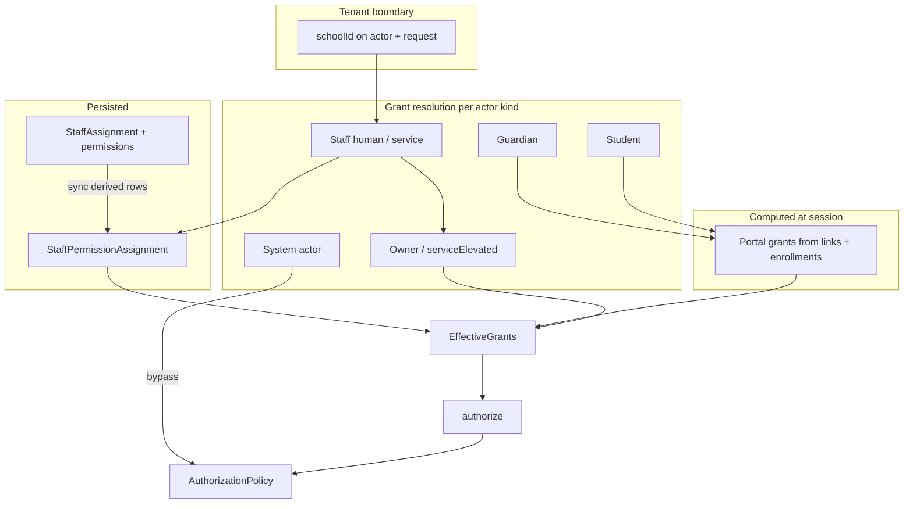

# Authorization Model Simplification — Sprint Plan

> **Status:** Design locked (§8)  
> **Created:** 2026-07-03  
> **Last updated:** 2026-07-03  
> **Scope:** Replace roles + multi-source scope resolution with `StaffPermissionAssignment`, hierarchical scope paths, and `StaffAssignment` sync  
> **Out of scope:** Step-up assurance product, distributed grants cache, per-school custom permission catalogs, mobile UI (beyond client regen)  
> **Related:** [authorization/README.md](../../package/domain-core/src/capabilities/authorization/README.md), [03-authorization-beyond-roles.md](../articles/03-authorization-beyond-roles.md)

This plan replaces **AccessRole + StaffRoleAssignment + implicit StaffAssignment grants** with a school-oriented model: direct per-staff permission rows, tenant-first boundaries, one optional scope grain per permission, and path-based `scopeIds` without type prefixes.

---

## 1. Problem statement

| Issue | Today | Impact |
|-------|-------|--------|
| Role indirection | `AccessRole` templates + `StaffRoleAssignment` + `scopeGrants` patches | Hard to configure; roles rarely shared identically across staff |
| Triple scope sources | Auto school grants, role `scopeGrants`, `StaffAssignment` → grants | Unclear which path authorizes an action |
| Scope type sprawl | `school`, `session`, `course_assignment`, … | Blurs domain entities and grant dimensions |
| `groups.ts` | Parallel permission buckets | Duplicates catalog semantics |
| Split permissions / scope | `permissions` set vs `scopeGrants` array | Drift and seed workarounds |

### Design principles (agreed)

1. **Tenant ≠ scope** — `schoolId` on actor and request; no `school` in staff grant scope types.
2. **One optional scope grain per permission** — `scope?` on catalog; omitted = tenant-wide.
3. **Path `scopeIds` without prefixes** — opaque generated entity IDs; type comes from permission scope + path position.
4. **`StaffPermissionAssignment`** — single persisted staff grant surface (human + service).
5. **`StaffAssignment`** — org placement + explicit `permissions[]`; syncs derived rows.
6. **Two layers kept** — capability (grants) + resource policy (relationships).
7. **Portal / system / elevated** — separate resolution paths; not forced into staff assignment tables.

---

## 2. Target architecture



---

## 3. Core concepts

### 3.1 Tenant boundary

- Every interactive actor has `schoolId`.
- `authorize()` checks `actor.schoolId === request.schoolId`.
- **No `school` scope type** on staff grants.

### 3.2 Permission catalog

```typescript
interface PermissionDefinition {
  permission: Permission
  /** When omitted, permission is tenant-wide within the school (no resource scope). */
  scope?: ScopeType
}
```

| `scope` | Meaning | `scopeIds` on grant |
|---------|---------|---------------------|
| omitted | Tenant-wide (coordinator, accountant, …) | `""` only |
| `class_group` | Scoped to class groups | non-empty path(s) |
| `class_subject` | Scoped to class subjects | non-empty path(s) |
| … | See §3.3 | … |

- Labels / descriptions: **client i18n** only (not in core).
- Drop `groups.ts` over time; replace with catalog + path matcher.

### 3.3 Scope types (staff tree)

| `ScopeType` | Domain entity |
|-------------|----------------|
| `grade_level` | `GradeLevel` |
| `grade_level_subject` | `GradeLevelSubject` |
| `class_group` | `ClassGroup` |
| `class_subject` | `ClassSubject` |
| `activity` | `Activity` | School-wide or class-bounded; session chain-up stops at `activity` (not `class_group`) |

**Removed from staff grants:** `school`, `academic_year`, `subject`, `course_assignment`, `session`, `student_group`.

**Portal (computed):** `student` — single-segment path (`studentId` only); see §4.5.

**Platform:** `platform` for bootstrap / `PLATFORM_REGISTER_SCHOOL` only.

**Period scoping:** `academicYearId` on `StaffPermissionAssignment` and `StaffAssignment` (required when school uses year-bound access). Resolution filters active rows to the request academic year (header / session context). Not a scope dimension in `scopeIds`.

### 3.4 `scopeIds` syntax (no prefixes)

IDs are **opaque generated entity IDs** (UUIDs). Scope type is **not** embedded in the string — it comes from `permission.scope` and path segment position.

**Grammar**

```
grantSet   := clause (';' clause)*
clause     := path (',' path)*          // comma only between root paths
path       := segment (':' segment)*
segment    := id | '*'
id         := opaque entity id (no cg-/cs- prefix)
```

**Rules**

| Form | Meaning |
|------|---------|
| `id1,id2` | Multiple roots at the permission’s scope grain |
| `parentId:*` | That resource and all descendants (chain-down wildcard) |
| `parentId:childId` | Path fixed by hierarchy for the permission scope |
| `id1:*;id2` | OR between clauses (semicolon) |
| `` (empty) | **Only** when `permission.scope` is omitted (tenant-wide) |

**Examples** (permission `scope: class_group`)

- `class-7a,class-8b` — two class groups  
- `class-7a:*` — class 7A and all `class_subject` children (and defined descendants)

**Examples** (permission `scope: class_subject`)

- `class-7a:cs-math` — one subject in a class  
- `class-7a:*` — all subjects in class 7A  

**Examples** (permission `scope: activity`)

- `act-chess` — one school-wide activity  
- `class-7a:act-chess` — activity bounded to class 7A  

**Chain-up hierarchy (check time)**

```
grade_level → grade_level_subject
class_group → class_subject
activity      (activitySession → activityId; not via class_group)
lesson_session → class_group:class_subject
assessment     → class_group:class_subject
```

**Persistence:** store the string as authored; **validate on save** (see §3.5, §8). No `scope/compose` API — UI builds the string; server validates grammar + entity existence.

### 3.5 `StaffPermissionAssignment`

Replaces `AccessRole` + `StaffRoleAssignment`.

```typescript
StaffPermissionAssignment {
  id: string
  staffId: string
  schoolId: string
  academicYearId: string       // required: scopes grant to this academic period
  permission: Permission
  scopeIds: string
  status: 'active' | 'inactive' | 'expired'
  startsAt?: Date
  endsAt?: Date
  sourceStaffAssignmentId?: string  // null = manual; set = synced from StaffAssignment
  createdAt: Date
  updatedAt?: Date
}
```

**Manual vs synced rows:** persisted separately. Sync never updates manual rows (`sourceStaffAssignmentId` null). **Merge at resolution time only** — combine `scopeIds` per `permission` with `;` across all active rows for the staff member + academic year.

**Save validation:** parse `scopeIds`; enforce grammar (§3.4); verify segment ids exist in school; enforce empty `scopeIds` only when catalog `scope` is omitted; reject cross-year entity paths when `academicYearId` is set.

**Resolution (staff human, non-elevated):**

1. Load active rows for `staffId` + `academicYearId` (+ `startsAt` / `endsAt` window).
2. Merge manual + synced rows into `EffectiveGrants` (merge `scopeIds` per permission with `;`).
3. `expiresAt` = earliest `endsAt` (cache bound).

### 3.6 `StaffAssignment` + sync

```typescript
StaffAssignment {
  id, staffId, responsibility
  academicYearId: string     // same period as synced permission rows
  // exactly one target
  classGroupId? | classSubjectId? | lessonSessionId? | activitySessionId? | assessmentId?
  permissions: Permission[]   // explicit; validated against target + catalog scope
}
```

**Target → default `scopeIds` (sync)**

| Target | Resolved path |
|--------|----------------|
| `classGroupId` | `{classGroupId}` or `{classGroupId}:*` |
| `classSubjectId` | `{classGroupId}:{classSubjectId}` |
| `lessonSessionId` | resolve session → `{classGroupId}:{classSubjectId}` |
| `activitySessionId` | resolve session → `{activityId}` |
| `assessmentId` | resolve assessment → `{classGroupId}:{classSubjectId}` |

**`assessmentId` assignment — allowed permissions (agreed):**

| Permission | Notes |
|------------|--------|
| `EXAM_CONFIG_CREATE` | Create assessment in class subject context |
| `GRADE_INPUT` / `GRADE_UPDATE` | Enter / adjust marks for that assessment |
| `ATTENDANCE_RECORD` | Assessment-linked attendance (assessment session) |

Path shape for all above: **`classGroupId:classSubjectId`** (two segments; catalog `scope: class_subject`).

**On save / delete (transactional):**

1. Validate target → school; validate each permission is allowed for target (catalog `scope` + path resolvable).
2. Delete all `StaffPermissionAssignment` where `sourceStaffAssignmentId = assignment.id`.
3. For each permission in `assignment.permissions`, insert row with resolved `scopeIds` and `sourceStaffAssignmentId`.
4. Invalidate grants cache for staff.

| `permissions` | Effect |
|---------------|--------|
| non-empty | Derived permission rows created |
| `[]` | Placement only; derived rows removed |

**UI:** picker filtered by catalog; presets pre-fill permissions (not persisted roles). Derived rows read-only in admin UI.

### 3.7 `EffectiveGrants` (phased)

- **Phase 1:** Keep `permissions` + `scopeGrants`; adapt new rows → current shape for minimal churn.
- **Phase 2 (optional):** Single `grants[]` array.

Keep `isElevated` and `expiresAt`.

### 3.8 Layer 2 — resource policy

Unchanged responsibility: guardian links, enrollment, publish state, fees, etc.

Resolvers simplify to: entity → resource path → `scopePathCovers(grants, path)`.

### 3.9 Scope renderer API (UI support)

Opaque `scopeIds` strings are correct for authorization but unusable in admin UI without resolution. Add a **read-only** school API that parses grants and returns display metadata.

**Why server-side**

- Entity labels live in Postgres (class names, subject titles, activity names).
- Segment → entity type comes from `permission.scope` and path depth (same rules as the engine).
- Avoids duplicating hierarchy logic and batch-fetch patterns in `edaya_web`.
- Renderer can share parsers with grant validation (`parseScopeIds`).

#### Endpoints (proposed)

| Route | Purpose |
|-------|---------|
| `GET authorization/permission-catalog` | `{ permission, scope? }[]` for pickers + i18n keys (no labels in core) |
| `POST authorization/scope/render` | `scopeIds` → human-readable clauses/paths |

No `scope/compose` endpoint — UI constructs `scopeIds`; **validation runs on save** of `StaffPermissionAssignment` / `StaffAssignment` (shared `validateScopeIds`).

#### `POST authorization/scope/render`

**Request**

```typescript
{
  academicYearId?: string   // optional context for class labels
  items: {
    permission?: Permission // disambiguates segment types when provided
    scopeIds: string
  }[]
}
```

**Response**

```typescript
{
  items: {
    scopeIds: string
    permission?: Permission
    tenantWide: boolean      // true when scopeIds === "" and permission has no scope
    clauses: {
      raw: string            // one semicolon clause, e.g. "class-7a:*"
      label: string          // "7ème A — all subjects"
      wildcard: boolean
      segments: {
        id: string
        scope: ScopeType     // type at this path position
        label: string        // resolved entity name
        missing?: boolean    // id not found (stale grant)
      }[]
    }[]
  }[]
}
```

**Behavior**

1. Parse `scopeIds` with shared grammar (§3.4).
2. For each segment id, batch-load entities (`classGroups`, `classSubjects`, `gradeLevels`, …) scoped to actor `schoolId`.
3. Build labels (e.g. `"{classGroup.name} — all subjects"` for `id:*`).
4. Return `missing: true` for unknown ids instead of failing (stale assignments still visible in UI).
5. Gate with `ACCESS_CONTROL_READ` (or stricter if listing other staff’s grants).

**Not in scope for renderer**

- Mutations (assignments use entity save APIs).
- Cross-school ids (reject or mark missing).
- Full effective-grants introspection (existing `GET authorization/effective-grants`).

#### UI usage

| Screen | API |
|--------|-----|
| Staff permission matrix | `scope/render` on each row’s `scopeIds` |
| StaffAssignment editor | render synced derived grants (read-only) |
| Permission picker | `permission-catalog` + local i18n |
| Service account create | render proposed `scopeIds` before save |

Add to **Phase 2** (with `StaffPermissionAssignment`) or early **Phase 7** before web cutover; catalog endpoint can ship in **Phase 1** with the scope engine.

---

## 4. Actor-specific resolution

| Actor | Persisted grants? | Source | Sync from StaffAssignment? | Layer 2 |
|-------|-------------------|--------|----------------------------|---------|
| Staff human | Yes | `StaffPermissionAssignment` | Derived rows optional | Yes |
| Service account | Yes | `StaffPermissionAssignment` | Rarely | Yes |
| Owner / elevated | No | `isElevated` + owner / `serviceElevated` | No | Yes |
| Guardian | No | Computed session grants | N/A | Yes |
| Student | No | Computed session grants | N/A | Yes |
| System | No | Bypass | N/A | Bypass / explicit |

### 4.1 Staff (human)

Core of refactor. Presets (“coordinator package”) write many `StaffPermissionAssignment` rows on hire.

### 4.2 Owner / elevated

Unchanged: `isElevated: true`, all permissions except `PLATFORM_REGISTER_SCHOOL`, scope checks bypassed.

### 4.3 Service accounts

- `StaffPermissionAssignment` on service `StaffMember`.
- API: explicit permission rows (replace `roleIds` + `scopeGrants`).
- Delegation: creator must hold permission; scope subset via new matcher.

### 4.4 Guardian portal

- **Not** in `StaffPermissionAssignment`.
- Fixed `GUARDIAN_PORTAL_PERMISSIONS` constant.
- `scopeIds` built at session from `guardianLinks` + enrollments.
- Student-scoped permissions: **single-segment** `{studentId}` paths. Class group context via layer 2 / enrollment, not compound paths in grants.

### 4.5 Student portal

- Same pattern as guardian: `STUDENT_PORTAL_PERMISSIONS`.
- **Single-segment path:** `scopeIds` = `{studentId}` only (no `class_group:student` compound path). Class context handled in layer 2 if needed.

### 4.6 System actor

- No grants; `createSystemActorMetadata`; policy bypass where coded.
- Cron / workflows unchanged.

### 4.7 Bootstrap

- `createBootstrapStaffActorMetadata` synthetic elevated + platform permission.

**Feasibility:** High for all paths; portal is **computed grant builder** rewrite, not new persistence.

---

## 5. What we remove

| Remove | Replace with |
|--------|----------------|
| `AccessRole` + store + API | UI/code presets |
| `StaffRoleAssignment` | `StaffPermissionAssignment` |
| `school` / `session` staff scope types | Tenant + chain-up |
| `groups.ts` | Catalog + matcher |
| `staff-assignment-scope.ts` in resolver | Sync workflow |
| Auto school grants in resolver | Omitted `scope` + `scopeIds: ""` |
| Type prefixes in `scopeIds` | Opaque ids + `permission.scope` |

**Keep:** `StaffAssignment`, `AuthorizationPolicy`, assurance, grants cache, `isElevated`.

---

## 6. Migration

1. For each active `StaffRoleAssignment`: expand roles → permissions; map `scopeGrants` to new `scopeIds` (strip prefixes if any legacy data).
2. Tenant permissions → `scopeIds: ""`, no `sourceStaffAssignmentId`.
3. Backfill `StaffAssignment.permissions` from former `ASSIGNMENT_SCOPED_PERMISSIONS` where implicit; run sync.
4. Feature flag `USE_STAFF_PERMISSION_ASSIGNMENTS` until staging validated.
5. Drop `accessRoles` / `staffRoleAssignments` tables and API after cutover.

---

## 7. Implementation phases

### Phase 0 — Design lock (1–2 days)

- [x] Lock grammar + hierarchy segment order per `ScopeType`
- [x] Permission → `scope?` table
- [x] Wildcard expansion + activity / assessment / portal rules (§8)
- [x] Resolved decisions (§8)

### Phase 1 — Scope engine (3–5 days)

- [ ] New `ScopeType` enum
- [ ] `parseScopeIds` / `serializeScopeIds` + property tests
- [ ] `resolveResourcePath(entity)` helpers
- [ ] `scopePathCovers(grantScopeIds, resourcePath, permissionScope?)`
- [ ] Slim catalog: `{ permission, scope? }`

### Phase 2 — `StaffPermissionAssignment` (4–6 days)

- [ ] Domain entity + Zod + entity config
- [ ] Postgres table + store + repository slot
- [ ] `resolveStaffGrantsFromPermissionAssignments` behind feature flag
- [ ] `GET authorization/permission-catalog`
- [ ] `POST authorization/scope/render` (parse + batch entity labels)

### Phase 3 — StaffAssignment sync (3–4 days)

- [ ] `permissions: Permission[]` on `StaffAssignment`
- [ ] `validateScopeIds` on `StaffPermissionAssignment` + assignment sync save
- [ ] Cache invalidation hooks

### Phase 4 — Service accounts (2–3 days)

- [ ] Provision / update / delegation on new rows
- [ ] Deprecate `roleIds` on service account API

### Phase 5 — Portal + policy resolvers (4–5 days)

- [ ] Portal grant builder (opaque ids, no prefixes)
- [ ] Refactor scheduling / student / academic resolvers to path matcher
- [ ] Remove `groups.ts`

### Phase 6 — Migration + cutover (3–5 days)

- [ ] Migration script + seed updates
- [ ] Remove `AccessRole`, `StaffRoleAssignment`
- [ ] OpenAPI + `edaya_web` roles UI → permission matrix

### Phase 7 — UI + docs (parallel)

- [ ] i18n permission catalog (labels; keys from `permission-catalog` API)
- [ ] Assignment permission picker
- [ ] Scope display via `scope/render` in permission matrix + assignment detail
- [ ] Update `authorization/README.md`

**Estimate:** ~4–6 weeks backend-focused; UI trails by one phase.

---

## 8. Resolved decisions

| # | Topic | Decision |
|---|--------|----------|
| 1 | **`assessmentId` StaffAssignment** | Permissions: `EXAM_CONFIG_CREATE`, `GRADE_INPUT`, `GRADE_UPDATE`, `ATTENDANCE_RECORD` (assessment attendance). Path: **`classGroupId:classSubjectId`** (two segments). |
| 2 | **Activity / activity session** | Chain-up to **`activity` only**. Activities are school-wide or class-bounded; `activitySessionId` assignments resolve to `{activityId}`. |
| 3 | **Manual vs synced rows** | Persist separately (`sourceStaffAssignmentId` null vs set). **Merge at resolution time** per permission (`scopeIds` joined with `;`). Never coalesce rows in DB. |
| 4 | **Academic period** | **`academicYearId` required** on `StaffPermissionAssignment` and `StaffAssignment`. Resolution filters to request year; not encoded in `scopeIds`. |
| 5 | **Portal student paths** | **Single segment** — `{studentId}` only. |
| 6 | **`scopeIds` authoring** | **UI builds string**; no `scope/compose` API. **Validate on save** (grammar + entity ids + catalog rules). |

### Activity path examples

| Grant intent | `scopeIds` (permission `scope: activity`) |
|--------------|---------------------------------------------|
| School-wide activity | `{activityId}` |
| Class-bounded activity | `{classGroupId}:{activityId}` (when activity is class-scoped) |

Wildcard `:*` applies per §3.4 at the appropriate segment.

---

## 9. Risks

| Risk | Mitigation |
|------|------------|
| Wildcard / empty `scopeIds` leaks | Strict validation; empty only when `scope` omitted |
| Migration drift | Grant snapshot tests before/after per school |
| Portal regression | Guardian/student integration tests |
| Ambiguous paths without prefixes | Fixed segment order per `ScopeType`; validate on save |
| Many permission rows per staff | Presets + grouped UI; derived rows read-only |

---

## 10. Non-goals

- Step-up assurance implementation
- Cross-worker distributed cache invalidation
- Per-school customizable permission enums
- Optional `EffectiveGrants.grants[]`-only shape (deferred)
