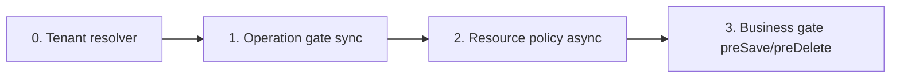
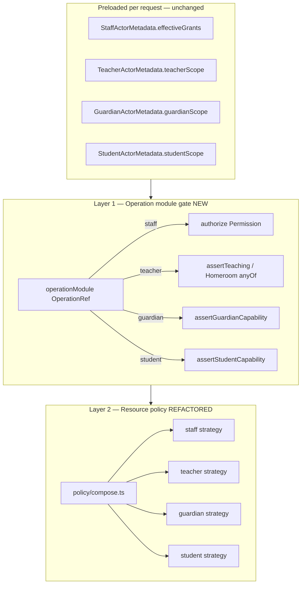
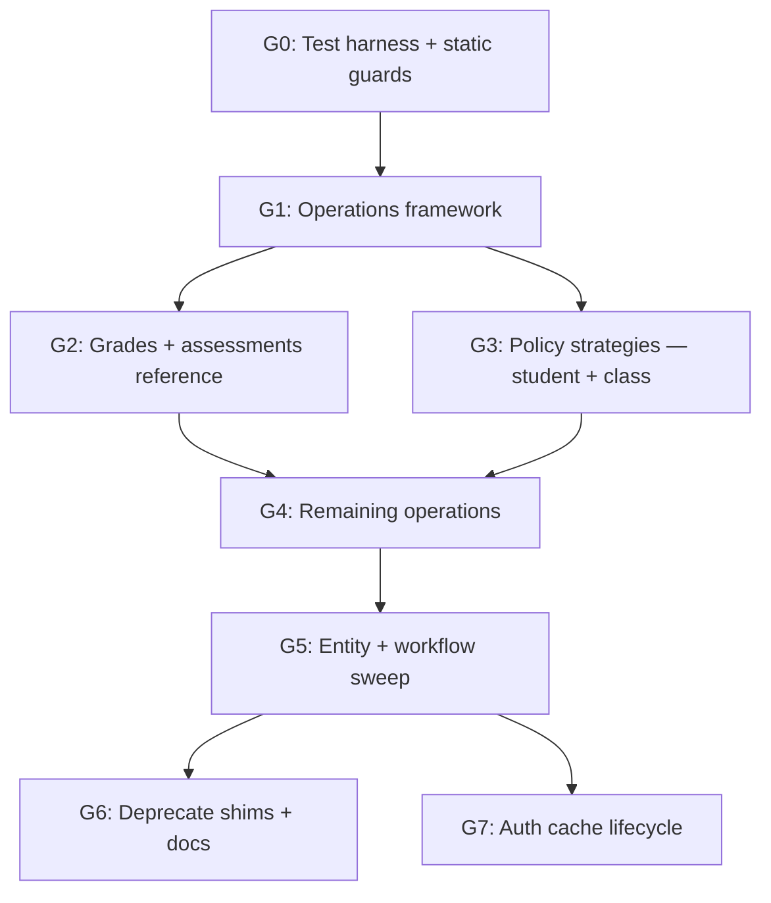

# Authorization Operations — Sprint Plan

> **Status:** G0–G7 + G6b complete  
> **Created:** 2026-07-06  
> **Last updated:** 2026-07-07  
> **Scope:** Unified enforcement layer for staff permissions, teacher capabilities, and guardian/student link scopes  
> **Depends on:** [relationship-native-auth-plan.md](./relationship-native-auth-plan.md) Fold F (session + scope resolution complete)  
> **Out of scope:** Client UI capability pickers, distributed scope cache, per-school custom operation catalogs, assurance product  
> **Related:** [authorization/README.md](../../package/domain-core/src/capabilities/authorization/README.md), [authorization-migration-coverage.test.ts](../../package/domain-core/tests/unit/auth/authorization-migration-coverage.test.ts)

Fold F landed **relationship-native resolution** (multi-profile login, `X-Actor-Kind`, scope preload). Enforcement previously routed three authorization paths through a staff-shaped API (`permissionAction`, ad-hoc `*WriteModule` helpers, and god-function policy resolvers). This plan introduced an **Operation** catalog and **policy strategies** so entity configs and workflows speak one vocabulary while staff, teacher, and link-based portal actors keep their native credentials.

---

## Implementation progress

| Fold | Status | Notes |
|------|--------|-------|
| **G0** — Test harness + static guards | ✅ Done | `AuthFixtures`, `describeOperationMatrix`, migration coverage guards |
| **G1** — Operations framework | ✅ Done | `defineOperation`, `assertOperation`, `operationModule`, `resourceGate*`, write helpers |
| **G2** — Grades + assessments reference | ✅ Done | `assessment.ts`, `class-subject-progress.ts`, removed grade/assessment write shims |
| **G3** — Policy strategies (student + class) | ✅ Done | `policy/compose.ts`, `policy/strategies/*`, focused policy tests |
| **G4** — Remaining operations | ✅ Done | communications, workspace, access-control ops + entity/workflow migrations; legacy read shims removed |
| **G5** — Entity + workflow sweep | ✅ Done | All entity configs, workflows, school-service queries migrated; `actor.kind` removed from domain |
| **G6** — Deprecate shims + docs | ✅ Done | `permissionAction` removed; README rewritten; parity tests deleted; G6b legacy cleanup |
| **G7** — Auth cache lifecycle | ✅ Done | Domain hooks + `AuthCacheInvalidationPort`; API dispatch wrapper removed |

**G2 (complete):**

- `authorization/operations/` — `grades.ts`, `assessments.ts`, `logbook.ts`, `workspace.ts`
- `authorization/gates/` — `operation-module.ts` (`OperationRefResolver` for create/update splits), `resource-gate.ts`
- Migrated entities: `assessment-result.ts`, `assessment.ts`, `class-subject-progress.ts` — **no `actor.kind` in `domain/assessments/**` or class-subject-progress**
- Removed: `gradeInputWriteModule`, `assessmentWriteModule`, `authorizeTeacherAssessmentSave/Delete`
- Tests: `tests/unit/auth/operations/*` (22 cases), static guards updated
- `bun --filter @edaya/core test` — 664+ pass

**G3 (complete):**

- `policy/compose.ts` — `dispatchStudentAccess`, `dispatchClassGroupAccess` (only `actor.kind` switches)
- `policy/strategies/student-access/` — `staff`, `teacher`, `guardian`, `student`
- `policy/strategies/class-group-access/` — `staff`, `teacher`, `guardian`, `student`
- Thinned resolvers: `checkStudentAccess` → compose; `checkClassGroupAccess` → compose
- Tests: `tests/unit/auth/policy/student-access.test.ts`, `class-group-access.test.ts` (17 cases)
- `bun --filter @edaya/core test` — 683 pass

**G4 (complete):**

- Operations: `discipline.ts`, `report-cards.ts`, `attendance.ts`, `scheduling.ts`, `finance.ts`, `attachments.ts`, `communications.ts`, `access-control.ts` (+ `workspace.ts` from G2)
- Migrated entities: incident/report-card/attendance/scheduling/finance/attachment slices, plus `announcement.ts`, `announcement-target.ts`, `message-delivery.ts`, `account-invitation.ts`, `staff-assignment.ts`, `teacher-assignment.ts` (write), `school.ts`, `academic-year.ts`, `academic-period.ts`, `period-definition.ts` (workspace read)
- Policy strategies: `report-card-access/`, `fee-access/`, `attachment-access/`, `scheduling-access/` — **removed `isPortalActor` from finance + attachment resolvers**
- Removed shims: `attendanceRecordWriteModule`, `attachmentReadModule`, `workspaceReadModule`
- Workflows: `communications.ts`, `access-control.ts`, `account-invitation.ts`, `schedule-account-invitation.ts`
- Tests: `discipline-report-cards.test.ts`, `attendance-scheduling.test.ts`, `scheduling-access.test.ts`, `finance-attachments.test.ts`, `workspace-communications-access-control.test.ts`
- `bun --filter @edaya/core test` — 737 pass

**G5.1 — B1 school structure (complete):**

- Operations: `school-structure.ts` (`classGroupRead`, `configure`, `lifecycleManage`), `teachers.ts` (`selfRead`, `assignmentRead`)
- Framework: `TeacherOperationRule.allow` for unconditional teacher module gates
- Migrated: `class-group.ts`, `staff-assignment.ts`, `teacher-assignment.ts`, `school.ts`, `academic-year.ts`, `teacher.ts`
- Removed shims: `disciplineReadModule`, `disciplineCreateModule`, `reportCardCommentWriteModule`, `teacherSelfReadModule`, `teacherAssignmentReadModule`
- Tests: `school-structure.test.ts`
- Remaining shim: `reportCardReadModule` (`report-card-definition*.ts`)

**G5.2 — B2 students (complete):**

- Operations: `students.ts` (`StudentOperations`, `GuardianOperations`, `EnrollmentOperations`); `discipline.validate` added
- Migrated: `student.ts`, `guardian.ts`, `guardian-student-link.ts`, `student-class-enrollment.ts`, `student-disciplinary-action.ts`
- Tests: `students.test.ts`
- `bun --filter @edaya/core test` — 759 pass

**G5.3–G5.5 — Remaining entities + workflows (complete):**

- Operations: `academics.ts`, `platform.ts`, `resources.ts`, `queries.ts`, `service-accounts.ts`; extended `school-structure`, `students`, `access-control`, `attendance`, `scheduling`
- Migrated all remaining domain entities (~30 files) and workflows (`student`, `academics`, `assessments`, `setup`, `scheduling`, `behavior`, `finance`, `notification-templates`)
- Removed last shim: `reportCardReadModule`
- Migrated `school-service.ts` query methods and `service-accounts/provision.ts`
- Tests: `academics.test.ts`; static guard for zero `permissionAction` in domain/workflows
- `bun --filter @edaya/core test` — 772 pass

**G5.6–G5.8 (complete):**

- G5.6: Removed `permissionAction`, `anyPermissionAction`, `teacherScopeAction`, `teacherWithAssignmentAction`, and `directPermissionEntityConfig` from `entity-config/authorization.ts`
- G5.7: Moved `actor.kind` branching to policy resolvers (`checkStaffAssignmentAccess`, `checkStaffMemberReadAccess`, `checkTeacherAssignmentAccess`); static guard enforces **zero** `actor.kind` in `src/domain/**`
- G5.8: ✅ static guard — zero `permissionAction` in `src/domain/**` and `src/application/workflows/**`
- `bun --filter @edaya/core test` — 761 pass

**G7 (complete):**

- `authorization/lifecycle/` — `entity-events`, `invalidation-registry`, `auth-cache-hooks`
- `AuthCacheInvalidationPort` in `ports/gateways/`; API `apiAuthCacheInvalidationPort`
- `withAuthCacheLifecycleHooks` wired in `createCoreEntityServices`
- Removed `withAuthorizationCacheInvalidation` from `apps/api/.../dispatch/entities.ts`
- Tests: `tests/unit/auth/lifecycle/invalidation-registry.test.ts`; API port wiring tests

---

## 1. Problem statement

| Issue | Today | Impact |
|-------|-------|--------|
| Staff permission names at entity boundary | `permissionAction(Permission.GRADE_READ)` in entity configs | Portal enforcement hidden behind permission→capability maps |
| Teacher write branching in domain | `if (actor.kind === 'teacher')` in `assessment-result.ts`, `incident.ts`, etc. | Duplicated teaching/homeroom logic; easy to miss a path |
| `*WriteModule` proliferation | 12+ helpers in `entity-config/authorization.ts` | Each new teacher write adds another special-case helper |
| Policy god-functions | `checkStudentAccess` switches on 4 actor kinds | Hard to test; staff grant logic mixed with link scope |
| `isPortalActor` blobs | `finance.ts`, `attachment.ts` | Portal treated as monolith instead of per-kind strategies |
| Test surface duplication | Actor factories copied across 24 auth test files | Matrix coverage gaps; large monolithic policy tests |
| Stale README principle | “One path for all actors via `authorize()`” | Misleading for new contributors |
| Cache invalidation in API dispatch | `apps/api/.../dispatch/entities.ts` maps entity names → `invalidate*Cache` | Grows with every link/assignment entity; auth lifecycle not owned by domain |

### What is already correct (do not rework)

- Session resolution: `resolveInteractiveActorIdentity` + `X-Actor-Kind` / `X-Actor-Id`
- Scope preload: `resolveCachedActorScope` for portal; `resolveCachedEffectiveGrants` for staff
- Capability enums and `assertTeachingCapability` / `assertGuardianCapability` / etc.
- Four native interactive paths: staff, teacher, guardian, student (one `ActorMetadata` per request)

---

## 2. Design principles

1. **Entity configs speak Operations, not Permissions** — `Permission` is staff implementation detail inside the operation catalog.
2. **Actor switches live in exactly two places** — `operationModule()` (layer 1) and `policy/compose.ts` (layer 2). Not in `src/domain/**`.
3. **Teacher teaching/homeroom `anyOf` is data** — encoded once per operation, not copy-pasted per entity.
4. **Resource policy dispatches by `actor.kind`** — strategies are small files; no `isPortalActor`.
5. **Business gates stay auth-free** — `preSave` / `preDelete` immutability rules remain separate (layer 4 only).
6. **Enforcement runs in a fixed four-step pipeline** — tenant → operation → resource policy → business gate; never skip or merge layers.
7. **Portal rules are per-kind, not per-generic-portal** — `GuardianOperationRule` and `StudentOperationRule` are independent fields even when capabilities match today; no shared portal fallback.
8. **Tests follow the same seams** — operation matrix tests, per-strategy policy tests, thin compose smoke; no entity-domain auth unit tests.

---

## 3. Target architecture

### 3.0 Enforcement pipeline (locked)

Every managed-entity read/write runs through **four layers in order**. Domain code declares the tenant resolver (layer 0), operation gate (layer 1), resource policy (layer 2), and business gates (layer 3).



| Layer | Name | Sync/async | Declared in entity config | Examples |
|-------|------|------------|---------------------------|----------|
| **0** | Tenant | Sync (before auth) | `tenant:` resolver | `schoolId` match, indirect tenant via enrollment |
| **1** | Operation gate | Sync | `read.checkModule` / `write.checkModule` via `operationModule()` | `GradeOperations.input`, `workspace.read` |
| **2** | Resource policy | Async | `read.checkAccess` / `write.authorizeSave` / `authorizeDelete` via `resourceGate*` | `policy.checkStudentAccess`, `policy.checkAssessmentAccess` |
| **3** | Business gate | Async | `gates.preSave` / `gates.preDelete` | Published report card immutability, enrollment status rules |

**Rules**

- Layer 1 answers: “May this **actor kind** perform this **operation** (optionally on a target)?”
- Layer 2 answers: “May this actor reach **this specific resource** (relationship graph)?”
- Layer 3 answers: “Is this **mutation valid** regardless of who is asking?” — no `actor` branching for authorization.
- Do not call `authorize()` or `assertCapability()` from business gates or resource gates.
- Do not re-run the operation in layer 2 — `checkModule` already ran in `write.checkModule` / `read.checkModule`.



### 3.1 Operation type (layer 1 vocabulary)

Portal actors each have their **own capability enum** (`TeachingCapability`, `HomeroomCapability`, `GuardianCapability`, `StudentCapability`). Guardian and student portals share many read operations today but are modeled as **independent rule fields** so a future student portal can diverge without refactoring the operation catalog.

```typescript
/** Declarative cross-actor gate. Defined in authorization/operations/*.ts */
type OperationDefinition = {
  readonly id: string
  readonly staff?: StaffOperationRule
  readonly teacher?: TeacherOperationRule
  readonly guardian?: GuardianOperationRule
  readonly student?: StudentOperationRule
}

type StaffOperationRule = {
  readonly permission: Permission
  readonly scopeFrom?: OperationTargetKey   // optional request-scope binding
}

/** Structural primitive — one capability + optional target binding. */
type PortalOperationRule<C extends PortalCapability> = {
  readonly capability: C
  readonly target?: OperationTargetKey
}

/** Named aliases per portal kind — do not share a single portal rule type at call sites. */
type GuardianOperationRule = PortalOperationRule<GuardianCapability>
type StudentOperationRule = PortalOperationRule<StudentCapability>

/** Teacher uses teaching + homeroom enums; anyOf encodes subject-vs-class reach. */
type TeacherPortalCapability = TeachingCapability | HomeroomCapability

type TeacherOperationRule =
  | PortalOperationRule<TeachingCapability>
  | PortalOperationRule<HomeroomCapability>
  | { readonly anyOf: readonly TeacherOperationRule[] }

type PortalCapability =
  | TeachingCapability
  | HomeroomCapability
  | GuardianCapability
  | StudentCapability

type OperationTargetKey =
  | 'student'
  | 'classGroup'
  | 'classSubject'
  | 'none'

/** Runtime input when scope is entity-derived (save/delete gates) */
type OperationContext = {
  readonly studentId?: string
  readonly classGroupId?: string
  readonly classSubjectId?: string
}
```

#### Portal rule independence (locked)

| Rule | Rationale |
|------|-----------|
| `guardian` and `student` are separate optional fields | Student portal can add capabilities (e.g. `SubmitAssignment`, `ReadOwnDiscipline`) without touching guardian rules |
| No implicit “portal fallback” | If an operation applies to both guardian and student, **both** `guardian` and `student` rules must be declared explicitly in the operation definition |
| `defineOperation` validates enum kind | `guardian.capability` must be `GuardianCapability`; `student.capability` must be `StudentCapability` — caught at define time, not runtime |
| Teacher stays `TeacherOperationRule` | Teaching/homeroom `anyOf` is unique; aliased as `PortalOperationRule<TeachingCapability \| HomeroomCapability>` internally but not merged with link-based portal kinds |
| Staff-only operations omit portal fields | e.g. `access-control.assign` has `staff` only — no empty guardian/student stubs |
| Absent field = forbidden | Omit `guardian` / `student` / `teacher` / `staff`; do not use explicit `undefined` stubs in operation definitions |

#### Write-target rule (locked)

Read/module gates may be **targetless** when the capability is global for that actor (e.g. `workspace.read`, `teacher.self-read`, student self-read). Save/delete gates must supply **target context** unless the operation is explicitly marked global.

| Operation kind | `OperationContext` at call site | `defineOperation` validation |
|----------------|--------------------------------|------------------------------|
| Read (`*.read`) | Optional — provide when rule has `target: 'student' \| 'classGroup' \| 'classSubject'` | Target on rule is optional |
| Write (`*.input`, `*.manage`, `*.record`, …) | **Required** when any actor rule declares a non-`none` target | Fail at define time if write op has `target: 'classSubject'` but no `requiresContext: ['classSubjectId']` |
| Global write (rare) | None | Operation must set `global: true` on the definition (staff-only ops like `access-control.assign`) |

`operationModule()` on write paths must receive a context resolver:

```typescript
operationModule(GradeOperations.input, entity => ({
  classSubjectId: assessment.classSubjectId,  // required — validated before assertCapability
}))
```

`defineOperation` rejects write operations whose teacher/guardian rules declare `target: 'classSubject'` but whose family does not register required context keys.

Example — shared read today, divergent tomorrow:

```typescript
export const GradeOperations = defineOperationFamily({
  read: {
    id: 'grades.read',
    staff: { permission: Permission.GRADE_READ },
    teacher: {
      anyOf: [
        { capability: TeachingCapability.ReadSubjectGrades, target: 'classSubject' },
        { capability: HomeroomCapability.ReadClassGradesOverview, target: 'classGroup' },
      ],
    },
    guardian: { capability: GuardianCapability.ReadGrades, target: 'student' },
    student: { capability: StudentCapability.ReadGrades },  // self-scoped; no target key
  },
  // Future student-only operation — guardian field omitted entirely:
  // requestRegrade: {
  //   id: 'grades.request-regrade',
  //   student: { capability: StudentCapability.RequestGradeReview },
  // },
  input: {
    id: 'grades.input',
    requiresContext: ['classSubjectId'],
    staff: { permission: Permission.GRADE_INPUT },
    teacher: { capability: TeachingCapability.InputGrade, target: 'classSubject' },
    // guardian and student omitted — not allowed for this operation
  },
})
```

Public API:

```typescript
// gates/operation-module.ts
export function operationModule(
  operation: OperationRef,
  context?: OperationContext | ((actor: ActorMetadata) => OperationContext),
): (actor: ActorMetadata) => void

export function anyOperationModule(
  operations: readonly OperationRef[],
  context?: OperationContext | ((actor: ActorMetadata) => OperationContext),
): (actor: ActorMetadata) => void
```

`operationModule` replaces `permissionAction`, `anyPermissionAction`, and all `*WriteModule` / `*ReadModule` helpers for migrated operations.

**Resource gate API (layer 2 only — does not take `OperationRef`):**

```typescript
// gates/resource-gate.ts
export function resourceGate<T>(
  check: (actor: ActorMetadata, ids: readonly string[]) => Promise<void>,
  selectIds: (entity: T) => string | readonly string[],
): EntityReadAuthorization<T>['checkAccess']

export function resourceGateForSave<T>(
  check: (actor: ActorMetadata, ids: readonly string[], repos: SchoolRepositories) => Promise<void>,
  resolveContext: (entity: T, existing: T | undefined, repos: SchoolRepositories) => Promise<{ ids: readonly string[] }>,
): EntityWriteAuthorization<T>['authorizeSave']

export function resourceGateForDelete<T>(
  check: (actor: ActorMetadata, ids: readonly string[], repos: SchoolRepositories) => Promise<void>,
  resolveContext: (entity: T, repos: SchoolRepositories) => Promise<{ ids: readonly string[] }>,
): EntityWriteAuthorization<T>['authorizeDelete']
```

Layer 1 (`operationModule`) and layer 2 (`resourceGate*`) are separate slots in `read()` / `write()` — the operation is not passed into resource gates.

### 3.2 Policy strategies (layer 2)

```typescript
// policy/strategies/student-access/types.ts
export type StudentAccessStrategy = (
  actor: ActorMetadata,
  studentIds: readonly string[],
  repos: SchoolRepositories,
) => Promise<void>

// policy/strategies/student-access/index.ts
const strategies: Record<InteractiveActorKind, StudentAccessStrategy> = {
  staff: staffStudentAccess,
  teacher: teacherStudentAccess,
  guardian: guardianStudentAccess,
  student: studentSelfStudentAccess,
}

export async function checkStudentAccess(actor, studentIds, repos) {
  if (studentIds.length === 0) return
  return strategies[actor.kind](actor, studentIds, repos)
}
```

`AuthorizationPolicy` interface stays stable; factory wires compose functions.

### 3.3 Entity config shape (target)

```typescript
import { AssessmentOperations, GradeOperations } from '@edaya/core/authorization/operations'
import { anyOperationModule, operationModule, read, resourceGate, resourceGateForDelete, resourceGateForSave, write } from '@edaya/core/authorization/gates'

async function resolveAssessmentResultPolicyIds(
  entity: AssessmentResult,
  repositories: SchoolRepositories,
): Promise<{ ids: readonly string[] }> {
  const assessment = await repositories.assessments.findById(entity.assessmentId)
  return {
    ids: assessment ? [assessment.id] : [],
  }
}

export const assessmentResultConfig = ({ repositories, policy, atomicExecution }) =>
  config({
    repository: repositories.assessmentResults,
    tenant: assessmentResultTenant(),                    // layer 0
    read: read(
      anyOperationModule([GradeOperations.read, AssessmentOperations.read]),  // layer 1
      resourceGate(policy.checkAssessmentAccess, e => e.assessmentId),        // layer 2
    ),
    write: write(
      operationModule(GradeOperations.input, async (entity, repos) => ({     // layer 1
        classSubjectId: (await repos.assessments.findById(entity.assessmentId))?.classSubjectId,
      })),
      resourceGateForSave(policy.checkAssessmentAccess, resolveAssessmentResultPolicyIds),   // layer 2
      resourceGateForDelete(policy.checkAssessmentAccess, (entity, repos) =>                 // layer 2
        resolveAssessmentResultPolicyIds(entity, repos)),
    ),
    gates: {                                                                              // layer 3
      preSave: validateAssessmentResultSave,
      preDelete: validateAssessmentResultDelete,
    },
    atomicExecution,
  })
```

Domain files declare **operation + resource selector + business rules**; they never branch on `actor.kind`.

### 3.4 Package layout

```
package/domain-core/src/capabilities/authorization/
├── operations/
│   ├── define-operation.ts       # OperationDefinition builder + OperationRef registry
│   ├── grades.ts
│   ├── assessments.ts
│   ├── attendance.ts
│   ├── discipline.ts
│   ├── report-cards.ts
│   ├── communications.ts
│   ├── workspace.ts
│   ├── attachments.ts
│   ├── finance.ts
│   ├── scheduling.ts
│   ├── access-control.ts
│   └── index.ts                  # re-export all OperationRefs
├── gates/
│   ├── operation-module.ts       # layer 1 entry
│   ├── resource-gate.ts          # layer 2 composables for entity configs
│   └── index.ts
├── policy/
│   ├── strategies/
│   │   ├── student-access/
│   │   │   ├── staff.ts
│   │   │   ├── teacher.ts
│   │   │   ├── guardian.ts
│   │   │   ├── student.ts
│   │   │   └── index.ts
│   │   ├── class-group-access/
│   │   ├── assessment-access/
│   │   ├── attendance-access/
│   │   ├── fee-access/
│   │   ├── attachment-access/
│   │   └── report-card-access/
│   ├── compose.ts                # only file that switches on actor.kind for policy
│   ├── types.ts                  # AuthorizationPolicy interface (unchanged surface)
│   └── create-repository-authorization-policy.ts
├── capabilities/                 # unchanged — enums + assert*
├── permissions/                  # unchanged — staff-only catalog
├── resolution/                   # unchanged — session scope preload
└── lifecycle/                    # G7 — cache invalidation registry (see Fold G7)
    ├── invalidation-registry.ts
    └── hooks.ts
```

`application/entities/entity-config/authorization.ts` is a thin re-export surface from `gates/` (migration complete).

---

## 4. Operation catalog (initial inventory)

Operations are grouped by domain fold. Each row becomes one `OperationDefinition` (read and write are separate operations).

| Group | Operation ID | Replaces (module gate) | Staff | Guardian | Student | Teacher |
|-------|--------------|------------------------|-------|----------|---------|---------|
| **Grades** | `grades.read` | `permissionAction(GRADE_READ)`, teacher read | `GRADE_READ` | `ReadGrades` + student target | `ReadGrades` (self) | teaching/homeroom `anyOf` read |
| | `grades.input` | `gradeInputWriteModule` | `GRADE_INPUT` | — | — | `InputGrade` (classSubject) |
| **Assessments** | `assessments.read` | `ASSESSMENT_ACCESS_PERMISSIONS` | various read perms | — | — | roster read |
| | `assessments.manage` | `assessmentWriteModule`, `authorizeTeacherAssessmentSave/Delete` | `GRADE_INPUT` / structure | — | — | create/update subject assessment |
| **Attendance** | `attendance.read` | `permissionAction(ATTENDANCE_READ)` | `ATTENDANCE_READ` | `ReadAttendance` | `ReadAttendance` | subject/class `anyOf` |
| | `attendance.record` | `attendanceRecordWriteModule` | `ATTENDANCE_RECORD` | — | — | session or daily `anyOf` |
| **Discipline** | `discipline.read` | `disciplineReadModule` | `DISCIPLINE_READ` | — | — | assignment gate |
| | `discipline.create` | `disciplineCreateModule` | `DISCIPLINE_CREATE` | — | — | subject or class incident |
| **Report cards** | `report-cards.read` | `reportCardReadModule` | `QUERY_REPORT_CARD_DETAIL_READ` | `ReadReportCard` | `ReadReportCard` | overview / subject |
| | `report-cards.comment` | `reportCardCommentWriteModule` | `REPORT_CARD_PUBLISH` | — | — | comment capabilities |
| **Workspace** | `workspace.read` | `operationModule(WorkspaceOperations.read)` | `QUERY_WORKSPACE_READ` | `ReadWorkspaceShell` | `ReadWorkspaceShell` | assignment gate |
| **Attachments** | `attachments.read` | `operationModule(AttachmentOperations.read)` | `ATTACHMENT_READ` | `ReadAttachments` | `ReadAttachments` | assignment gate |
| **Finance** | `payments.read` | `permissionAction(PAYMENT_READ)` | `PAYMENT_READ` | `ReadPayments` | `ReadPayments` | — |
| **Scheduling** | `timetable.read` | `permissionAction(QUERY_TIMETABLE_READ)` | `QUERY_TIMETABLE_READ` | `ReadTimetable` | `ReadTimetable` | subject/class read |
| **Access control** | `access-control.assign` | `permissionAction(ACCESS_CONTROL_ASSIGN)` | `ACCESS_CONTROL_ASSIGN` | — | — | — |
| **Teacher self** | `teacher.self-read` | `teacherSelfReadModule` | staff perms OR pass-through | — | — | always allowed |

**Note:** Guardian and student columns are declared independently even when values match today. New student-only capabilities are added to `StudentCapability` and wired only on the `student` field — no guardian stub required.

Full enumeration of entity configs using `permissionAction` / `anyPermissionAction` (~55 files) is migrated fold-by-fold in §6.

---

## 5. Policy strategy inventory

| Resolver (public) | Strategy folder | Notes |
|-------------------|-----------------|-------|
| `checkStudentAccess` | `student-access/` | Extract from `policy/resolvers/student.ts` |
| `checkGuardianAccess` | `guardian-access/` | Self + staff admin |
| `checkClassGroupAccess` | `class-group-access/` | Staff grants + teacher homeroom/teaching |
| `checkAssessmentAccess` | `assessment-access/` | classSubject path |
| `checkAttendanceAccess` / `checkAttendanceRecordAccess` | `attendance-access/` | Merge scheduling branches |
| `checkFeeAccess` / `checkStudentFeeAccess` | `fee-access/` | Remove `isPortalActor`; delegate per kind |
| `checkAttachmentAccess` | `attachment-access/` | Remove `isPortalActor` |
| `checkReportCardResultAccess` | `report-card-access/` | Teacher draft comment scope |
| `checkLessonSessionAccess` | `scheduling-access/` | Teacher assignment |
| `checkStudentNoteAccess` | `student-note-access/` | Staff-only + student path |
| `checkStudentHealthAccess` | stays staff-only | No portal path |

`policy/compose.ts` is the **only** policy file that reads `actor.kind` for dispatch (plus system-actor short-circuit).

---

## 6. Implementation folds

Folds are ordered by dependency. Each fold ships with tests (§7) and updates static guards before merge.



**G2 and G3 can run in parallel** after G1. **G7 can run in parallel with G5–G6** (not blocking operations migration).

| Order | Fold | Name | Depends on |
|-------|------|------|------------|
| 0 | G0 | Test harness + static guards | — |
| 1 | G1 | Operations framework | G0 |
| 2a | G2 | Grades + assessments reference | G1 |
| 2b | G3 | Policy strategies (student + class) | G1 |
| 3 | G4 | Remaining operations + strategies | G2, G3 |
| 4 | G5 | Entity + workflow sweep | G4 |
| 5 | G6 | Deprecate shims + docs | G5 |
| 5b | G7 | Auth cache lifecycle | G5 (parallel with G6) |

---

### Fold G0 — Test harness and static guards

**Goal:** Establish shared test infrastructure and CI rules before moving production code.

| Task | Path / action |
|------|----------------|
| G0.1 | Add `tests/support/authorization-fixtures.ts` — unified actor builders (staff, teacher, guardian, student, system) |
| G0.2 | Add `tests/support/operation-matrix.ts` — parametric runner for operation × actor × expect allow/deny |
| G0.3 | Add `tests/support/policy-fixtures.ts` — minimal in-memory `SchoolRepositories` stubs per strategy |
| G0.4 | Extend `authorization-migration-coverage.test.ts`: forbid `actor.kind` in `src/domain/**` (allowlist during migration) |
| G0.5 | Extend coverage test: forbid new `*WriteModule` / `*ReadModule` exports in `entity-config/authorization.ts` after G1 |
| G0.6 | Extend coverage test: forbid `isPortalActor` outside `policy/strategies/` (allowlist legacy files until G3) |

**Acceptance**

- [x] `bun --filter @edaya/core test tests/support/` passes (fixtures used from operations tests)
- [x] Static guards green with explicit allowlists documented in test file comments

---

### Fold G1 — Operations framework

**Goal:** Ship `defineOperation`, `operationModule`, `anyOperationModule` with no entity migrations yet.

| Task | Path / action |
|------|----------------|
| G1.1 | Implement `operations/define-operation.ts` — builder, `OperationRef` registry; validate capability enum matches rule field (`GuardianOperationRule` → `GuardianCapability`, etc.) |
| G1.2 | Implement `gates/operation-module.ts` — staff `authorize`; dispatch `guardian` / `student` / `teacher` rules independently; teacher `anyOf` |
| G1.3 | Wire `OperationContext` resolution from entity fields; enforce write-target rule (`requiresContext`, `global` flag) |
| G1.4 | Implement `gates/resource-gate.ts` — `resourceGate`, `resourceGateForSave`, `resourceGateForDelete` (policy + id resolver only; no `OperationRef`) |
| G1.5 | Unit tests: `tests/unit/auth/operations/operation-module.test.ts` |
| G1.6 | Unit tests: `tests/unit/auth/operations/define-operation.test.ts` — invalid defs rejected at define time (wrong capability enum; guardian/student cross-wiring; write op missing `requiresContext`) |
| G1.7 | Export from `@edaya/core` authorization index |

**Acceptance**

- [x] `operationModule` passes parity with `permissionAction` for pilot operation (`workspace.read`) in test
- [x] Teacher `anyOf` (teaching miss → homeroom hit) covered by matrix test

---

### Fold G2 — Reference slice: grades + assessments

**Goal:** End-to-end reference implementation touching all three paths and write gates.

| Task | Path / action |
|------|----------------|
| G2.1 | Define `GradeOperations`, `AssessmentOperations`, `LogbookOperations` in `operations/` |
| G2.2 | Migrate `assessment-result.ts` — remove `actor.kind` branches; use operations + resource gates |
| G2.3 | Migrate `assessment.ts` entity config |
| G2.4 | Migrate `class-subject-progress.ts` teacher branches |
| G2.5 | Delete `gradeInputWriteModule`, `assessmentWriteModule`, `authorizeTeacherAssessmentSave/Delete` after migration |
| G2.6 | Operation matrix tests: `tests/unit/auth/operations/operation-module.test.ts` |
| G2.7 | Parity window test: deferred to G5/G6 (workspace.read parity covered in operation-module.test) |

**Acceptance**

- [x] No `actor.kind` in `domain/assessments/**`
- [x] No `actor.kind` in `domain/academics/class-subject-progress.ts`
- [x] Teacher capability scenarios covered by operation matrix (grades, assessments, logbook)
- [x] `assessment-result` save/delete: staff + teacher paths via operations; guardian denied at operation gate
- [x] `gradeInputWriteModule`, `assessmentWriteModule`, `authorizeTeacherAssessmentSave/Delete` removed

---

### Fold G3 — Policy strategies: student + class group

**Goal:** Decompose the largest god-functions; unlock cleaner finance/scheduling migrations.

| Task | Path / action |
|------|----------------|
| G3.1 | Extract `policy/strategies/student-access/{staff,teacher,guardian,student}.ts` from `resolvers/student.ts` |
| G3.2 | Extract `policy/strategies/class-group-access/` from academic + scheduling resolvers |
| G3.3 | Add `policy/compose.ts`; thin wrappers keep `checkStudentAccess` signature |
| G3.4 | Split `repository-authorization-policy.test.ts` → `tests/unit/auth/policy/student-access.test.ts`, `class-group-access.test.ts` |
| G3.5 | Per-strategy tests use `policy-fixtures.ts` stubs (no full repo graph unless integration) |
| G3.6 | Delete duplicated cases from monolithic policy test as slices land |

**Acceptance**

- [x] `checkStudentAccess` implementation is only compose + strategies (no inline kind switches)
- [x] Policy test file count increases; focused strategy tests added
- [x] All former `repository-authorization-policy` student/class cases still pass

---

### Fold G4 — Remaining operations + policy strategies

**Goal:** Complete operation catalog and policy strategy folders.

| Task | Domain area |
|------|-------------|
| G4.1 | `attendance.ts` operations + `attendance-access/` strategies |
| G4.2 | `discipline.ts` operations; migrate `incident.ts` |
| G4.3 | `report-cards.ts` operations; migrate `report-card-result.ts` |
| G4.4 | `finance.ts` operations + `fee-access/`; remove `isPortalActor` |
| G4.5 | `attachments.ts` + `attachment-access/` |
| G4.6 | `scheduling.ts` + `scheduling-access/` |
| G4.7 | `communications.ts`, `workspace.ts`, `access-control.ts` |
| G4.8 | Operation matrix test file per operations module |

**Acceptance**

- [ ] Zero `isPortalActor` in `policy/resolvers/`
- [ ] `teacher-portal-read-gates.test.ts` replaced by operation matrix tests (file deleted)
- [ ] `portal-permission-map.ts` used only inside `operations/` (not from entity configs)

---

### Fold G5 — Entity config and workflow sweep

**Goal:** Migrate remaining ~50 `permissionAction` call sites.

| Batch | Files (representative) |
|-------|------------------------|
| B1 — School structure | `class-group.ts`, `staff-assignment.ts`, `teacher-assignment.ts`, `school.ts`, `academic-year.ts` |
| B2 — Students | `student.ts`, `guardian.ts`, `guardian-student-link.ts`, `student-class-enrollment.ts`, `student-disciplinary-action.ts` |
| B3 — Scheduling | `schedule.ts`, `lesson-session.ts`, `activity-session.ts`, `attendance-record.ts`, `attendance.ts` |
| B4 — Finances | `fee.ts`, `student-fee.ts`, `payment.ts` |
| B5 — Workflows | `student.ts`, `communications.ts`, `scheduling.ts`, `academics.ts`, `setup.ts`, `access-control.ts` |

| Task | Action |
|------|--------|
| G5.1 | Migrate batch B1; run `bun --filter @edaya/core test` |
| G5.2–G5.5 | B2–B5 sequentially or parallel PRs per batch |
| G5.6 | Remove `permissionAction` / `anyPermissionAction` from `entity-config/authorization.ts` (re-export only) |
| G5.7 | Tighten static guard: **zero** `actor.kind` in `src/domain/**` (remove allowlist) |
| G5.8 | Tighten static guard: **zero** `permissionAction` in `src/domain/**` and `src/application/workflows/**` |

**Acceptance**

- [x] `authorization-migration-coverage` passes with no allowlists
- [x] `bun --filter @edaya/core test` green (761 pass)
- [x] `bun repo verify` green
- [x] Integration auth tests in `tooling/integration-tests/src/auth/` unchanged behavior

---

### Fold G6 — Deprecation and documentation

| Task | Action |
|------|--------|
| G6.1 | Remove `permissionAction` shims (no deprecation period) | ✅ Done |
| G6.2 | Update `authorization/README.md` — operations model, corrected design principles |
| G6.3 | Add “Adding a new operation” section to README (replaces “Adding a new permission” for entity gates) |
| G6.4 | Link this plan from `relationship-native-auth-plan.md` as enforcement follow-up |
| G6.5 | Delete parity window tests from G2 |
| G6.6 | Optional: `GET /me/capabilities` documents operation IDs for portal (out of scope unless mobile needs it) |

**Acceptance**

- [x] README no longer claims single `authorize()` path for all actors
- [x] No deprecated shim exports (`permissionAction` removed)
- [x] Legacy deprecation cleanup complete — see **Fold G6b** below

---

### Fold G6b — Legacy deprecation cleanup (2026-07-07)

Follow-up after G6 removed runtime shims. Removed dead aliases, mis-tagged seed types, staff-teacher constants, and the mobile `scopeGrants` derivation bridge.

| Phase | Scope | Status |
|-------|--------|--------|
| **0** | Dead aliases (`relinkSubjectToActor`, `DEFAULT_ACCESS_ROLE_TEMPLATES`, `readLocalDevMemoryObject`, `findDuplicateClassSubjectScopePathIndex`, `cleanup-seed-data.ts`, mobile `sessionId` getter) | ✅ Done |
| **1** | Remove incorrect `@deprecated` tags on active dev seed types (`AccessRolePresetRecord`, `StaffRoleAssignmentPresetRecord`) | ✅ Done |
| **2** | Remove `TEACHER_PERMISSIONS`, orphaned `role-teacher` dev seed preset | ✅ Done |
| **3** | Drop `legacyScopeGrantsFromScopeIdsByPermission`; webapp scoped checks use `scopeIdsByPermission`; mobile client stops parsing `scopeGrants` | ✅ Done |
| **4** | Docs/articles — replace `permissionAction` examples; close sprint deprecation notes | ✅ Done |

**Acceptance**

- [x] Zero `@deprecated` / `@Deprecated` in application source (`.ts`, `.tsx`, `.dart`, `.svelte`)
- [x] `legacy-scope-grants-from-scope-ids.ts` deleted; `serialize-grants.ts` passes through internal grants only
- [x] Webapp `permission-check.ts` uses `scopeIdsByPermission` path matching

---

### Fold G7 — Auth cache lifecycle (API dispatch → domain-owned)

**Goal:** Move scope/grant cache invalidation out of `apps/api/src/lib/school-api/dispatch/entities.ts` into auth-owned hooks so new link/assignment entities do not require API-layer entity-name switches.

**Problem today:** `withAuthorizationCacheInvalidation` wraps write services by entity registry name (`staffPermissionAssignments`, `guardianLinks`, `enrollments`, `students`, `staffMembers`, `staffAssignments`, …). This is orthogonal to operations enforcement but becomes the next hack pile as teacher assignments and portal links grow.

| Task | Path / action |
|------|----------------|
| G7.1 | Add `authorization/lifecycle/invalidation-registry.ts` — maps domain events to `invalidateEffectiveGrantsCacheForActor` / `invalidateActorScopeCache` (teacher scope when added) |
| G7.2 | Declare invalidation triggers on entity `hooks.postSave` / `postDelete` in domain-core (or thin `authLifecycle` helper called from hooks) |
| G7.3 | Cover staff grants: `StaffPermissionAssignment`, `StaffMember`, `StaffAssignment` |
| G7.4 | Cover portal scopes: `GuardianStudentLink`, `StudentClassEnrollment`, `Student`; add `TeacherAssignment` / `Teacher` when teacher scope cache is separate |
| G7.5 | Remove `withAuthorizationCacheInvalidation` from API `entities.ts` dispatch once parity tests pass |
| G7.6 | Unit tests: `tests/unit/auth/lifecycle/invalidation-registry.test.ts` |
| G7.7 | Keep existing API test `getEntityWriteService authorization cache invalidation` green (behavior unchanged, wiring moved) |

**Registry shape (sketch):**

```typescript
// authorization/lifecycle/invalidation-registry.ts
export type AuthCacheInvalidationEvent =
  | { kind: 'staff-grants'; staffMemberId: string; schoolId: string }
  | { kind: 'guardian-scope'; guardianId: string; schoolId: string }
  | { kind: 'student-scope'; studentId: string; schoolId: string }
  | { kind: 'teacher-scope'; teacherId: string; schoolId: string }

export function invalidateAuthCacheForEvent(event: AuthCacheInvalidationEvent): void
```

Entity hooks emit events; the registry calls the existing `apps/api` cache functions via an injected port (or moves cache implementation into a shared package boundary documented in `authorization/README.md`).

**Acceptance**

- [x] No entity-name `if (name === 'guardianLinks')` switches in API dispatch for auth invalidation
- [x] Invalidation covered for all entities that previously triggered cache bust in `entities.ts`
- [x] `bun --filter @edaya/api test` auth cache tests pass

**Not in G7:** distributed cross-worker cache invalidation (remains out of scope per §10).

---

## 7. Domain unit testing surface optimization

Today auth tests sprawl across **24 files** with duplicated actor factories, permission-shim tests (`teacher-portal-read-gates.test.ts`), and a **600+ line** `repository-authorization-policy.test.ts`. Entity domain tests rarely assert auth (correct — auth belongs in authorization package). This fold optimizes for **fewer, denser, better-located tests**.

### 7.1 Target test pyramid

```
                    ┌─────────────────────────┐
                    │  Integration (unchanged) │  tooling/integration-tests/src/auth/
                    │  session → scope → API    │  ~10 scenarios, full HTTP + DB
                    └───────────┬─────────────┘
                                │
              ┌─────────────────┴─────────────────┐
              │     Policy compose smoke (thin)    │  1 file, ~15 cases
              └─────────────────┬─────────────────┘
                                │
        ┌───────────────────────┼───────────────────────┐
        │                       │                       │
 ┌──────┴──────┐      ┌─────────┴────────┐    ┌────────┴────────┐
 │  Operation  │      │ Policy strategy  │    │ Resolution +  │
 │   matrix    │      │  per actor kind  │    │ grants (keep) │
 │  per module │      │  per resource    │    │               │
 └─────────────┘      └──────────────────┘    └───────────────┘
```

| Layer | What to test | What **not** to test |
|-------|--------------|----------------------|
| Operation matrix | Allow/deny per actor kind for each `OperationRef` | Individual entity config wiring |
| Policy strategy | One kind + one resource graph scenario per file | Full cross-product in one file |
| Compose smoke | Dispatch reaches correct strategy; system actor bypass | Business logic duplicated from strategies |
| Resolution / grants | Keep existing `effective-grants.test.ts`, `resolve-portal-scopes.test.ts` | — |
| Entity domain | Business rules only (`preSave` immutability) | `actor.kind` branches |
| Static guards | CI forbids regression patterns | — |

### 7.2 Shared fixtures (`tests/support/authorization-fixtures.ts`)

Consolidate factories currently duplicated in `repository-authorization-policy.test.ts`, `teacher-portal-read-gates.test.ts`, `teacher-capability-gates.test.ts`:

```typescript
export const AuthFixtures = {
  staff: {
    elevated: () => ActorMetadata,
    withPermissions: (perms: Permission[], scope?: ScopeFixture) => ActorMetadata,
    coordinator: (classGroupId: string) => ActorMetadata,
  },
  teacher: {
    subject: (classSubjectId: string) => ActorMetadata,
    homeroom: (classGroupId: string) => ActorMetadata,
    unassigned: () => ActorMetadata,
    both: (classSubjectId: string, classGroupId: string) => ActorMetadata,
  },
  guardian: {
    linkedTo: (studentId: string, classGroupId?: string) => ActorMetadata,
  },
  student: {
    enrolledIn: (classGroupId: string) => ActorMetadata,
  },
}
```

Migrate existing tests to `AuthFixtures` as files are touched; do not big-bang refactor all 24 files in G0.

### 7.3 Operation matrix runner (`tests/support/operation-matrix.ts`)

Parametric tests replace permission-shim tests and reduce case duplication:

```typescript
describeOperationMatrix(GradeOperations.read, [
  { actor: () => AuthFixtures.staff.withPermissions([Permission.GRADE_READ]), expect: 'allow' },
  { actor: () => AuthFixtures.teacher.subject('cs-math'), expect: 'allow', context: { classSubjectId: 'cs-math' } },
  { actor: () => AuthFixtures.teacher.unassigned(), expect: 'deny' },
  // Guardian and student are separate matrix concerns — same operation, different rule fields:
  { actor: () => AuthFixtures.guardian.linkedTo('student-1'), expect: 'allow', context: { studentId: 'student-1' } },
  { actor: () => AuthFixtures.guardian.linkedTo('student-2'), expect: 'deny', context: { studentId: 'student-1' } },
  { actor: () => AuthFixtures.student.enrolledIn('class-1'), expect: 'allow' },
  // Future: student-only operation rows omit guardian fixtures entirely
])
```

**Rules**

- One matrix file per operations module: `tests/unit/auth/operations/<module>.operations.test.ts`
- Matrix rows are data, not copy-pasted `test()` blocks
- Negative cases must name the **failing path** (wrong student, wrong classSubject, missing assignment)

### 7.4 Policy strategy test layout

```
tests/unit/auth/policy/
├── compose.smoke.test.ts           # thin dispatch verification
├── student-access/
│   ├── staff.test.ts
│   ├── teacher.test.ts
│   ├── guardian.test.ts
│   └── student.test.ts
├── class-group-access/
│   └── ...
└── fee-access/
    └── ...
```

Each strategy file:

- Uses `policy-fixtures.ts` — minimal mock repos (only methods the strategy calls)
- **≤ 80 LOC** target; split by scenario if larger
- No staff grant resolution unless testing staff strategy (inject grants directly, do not call `resolveEffectiveGrants` unless testing resolution integration)

### 7.5 Tests to delete or merge (net reduction target)

| File | Action |
|------|--------|
| `teacher-portal-read-gates.test.ts` | **Delete** after `workspace.operations.test.ts` + read ops matrix cover same cases |
| `portal-permission-policy.test.ts` | **Merge** into operation matrices for guardian/student read ops |
| `repository-authorization-policy.test.ts` | **Shrink** to compose smoke (~100 LOC); move cases to strategy files |
| `teacher-capability-gates.test.ts` | **Keep** low-level `assertTeachingCapability` edge cases; duplicate operation-level cases removed |
| `permission-engine-parity.test.ts` | **Keep** — staff `authorize()` only |

**Target:** auth unit test LOC −25% vs baseline; file count +~8 (operations/ + policy/), monolith −1.

### 7.6 Parity window (G2 only)

During G2, temporary test file `grades.operations.parity.test.ts`:

```typescript
// For each migrated operation, assert operationModule and legacy permissionAction
// agree on allow/deny for a shared fixture set. Delete in G6.
```

Prevents silent behavior drift while entity configs still partially migrated.

### 7.7 Static guards (CI — extend `authorization-migration-coverage.test.ts`)

| Guard | Enforced after |
|-------|----------------|
| No `actor.kind` in `src/domain/**` | G5 (allowlist G0–G4) |
| No `permissionAction` in entity configs / workflows | G5 |
| No new `*Module()` helpers in `entity-config/authorization.ts` | G1 |
| No `isPortalActor` outside strategies | G4 |
| Operations must have ≥1 actor path defined | G1 (AST check on `defineOperation` calls) |
| `student` rule must not use `GuardianCapability` (and vice versa) | G1 (`define-operation` runtime validation) |
| Write ops with non-`none` target must declare `requiresContext` | G1 |
| Every `OperationRef` has a matrix test file | G4 (registry cross-check) |
| No new `invalidate*Cache` branches in `apps/api/.../dispatch/entities.ts` | G7 (allowlist until G7 lands) |

### 7.8 What we explicitly do not add

- **Per-entity authorization unit tests** — if `assessment-result.ts` only wires `GradeOperations.input`, testing belongs in `grades.operations.test.ts` + `assessment-access/` strategy tests
- **Full managed-entity-service auth integration tests per entity** — integration auth harness is sufficient
- **Duplicated mobile portal parity** — `fold-f-parity.test.ts` stays; operation matrices subsume permission-map parity

### 7.9 Verification commands

```sh
# Package auth tests only
bun --filter @edaya/core test tests/unit/auth/

# Static guards
bun --filter @edaya/core test tests/unit/auth/authorization-migration-coverage.test.ts

# Full verify before PR
bun repo verify
```

---

## 8. Multi-profile and link-based access (no special cases)

| Scenario | Enforcement behavior |
|----------|---------------------|
| Coordinator + teacher, same `subjectId` | Each request uses one `X-Actor-Kind`; operations evaluate that actor only |
| Guardian link to student | `guardianScope.studentIds` checked in guardian strategy; operation `context.studentId` for targeted reads |
| Student self | `studentScope.studentId` in student strategy |
| Teacher homeroom + subject same class | Operation `anyOf` tries teaching then homeroom — no entity branching |
| Staff with class_group grant | Staff strategy uses grant paths + enrollment lookup (unchanged logic, moved file) |

---

## 9. Risks and mitigations

| Risk | Mitigation |
|------|------------|
| Behavior drift during migration | G2 parity window; batch PRs with integration auth run |
| Operation catalog sprawl | Group by domain file; `OperationRef` registry + matrix coverage guard |
| Teacher context missing on write | Write-target rule + `requiresContext` validated in `defineOperation`; `operationModule` throws if context incomplete |
| Large PR for G5 | Split into B1–B5 batches per §6 |
| README / AGENTS drift | G6 doc fold mandatory before closing epic |
| Cache invalidation drift during G7 | G7.7 API tests lock behavior before removing dispatch wrappers |

---

## 10. Out of scope

- Webapp `/me/permissions` → `/me/capabilities` UI (mobile may already use scope endpoints)
- Custom per-school operation sets
- Folding staff and teacher into one actor type
- Re-synthesizing portal `EffectiveGrants`
- Performance work on policy resolvers (orthogonal; strategies may help profiling)
- Distributed cross-worker cache invalidation (G7 moves wiring only; not multi-node cache)

---

## 11. Definition of done (epic)

- [x] All entity configs and workflows use `operationModule` / `anyOperationModule`
- [x] Zero `actor.kind` switches in `src/domain/**`
- [x] Policy resolvers decomposed into strategies; `compose.ts` sole dispatcher
- [x] `permissionAction` and `*WriteModule` helpers removed with no call sites
- [ ] Operation matrix tests cover every `OperationRef`
- [ ] Auth unit test LOC reduced ≥25% vs 2026-07-06 baseline
- [x] `authorization/README.md` reflects operations model
- [x] `bun repo verify` green
- [ ] Portal actors verified per [edaya_web demo-accounts.md](../../../edaya_web/docs/reference/demo-accounts.md) after G5
- [x] Auth cache invalidation owned by `authorization/lifecycle/`; API dispatch free of entity-name invalidation switches (G7)
- [x] Legacy deprecation cleanup (G6b): no `@deprecated` markers; no `scopeGrants` derivation bridge

---

## 12. Suggested first PR (G0 + G1 + G2 partial)

Smallest valuable slice:

1. G0 fixtures + static guard allowlists
2. G1 `defineOperation` + `operationModule`
3. G2 `GradeOperations.read` + `GradeOperations.input` only
4. Migrate `assessment-result.ts` as reference entity
5. `grades.operations.test.ts` matrix + parity window

Estimated size: ~800–1200 LOC production + ~400 LOC tests. Validates the pattern before G3–G5 scale-up.
