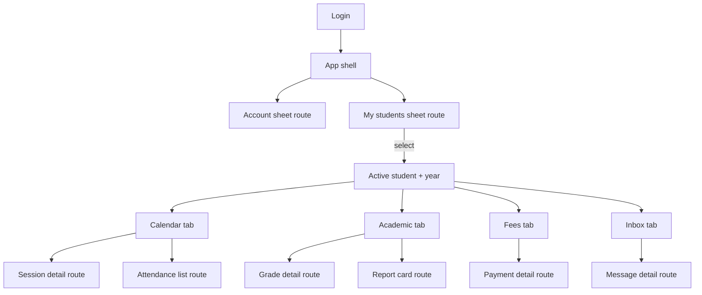

# Guardian App UI — Sprint Plan

> **Status:** Phase 2 **done** (Calendar tab) — Academic / Fees / Inbox pending  
> **Last updated:** 2026-06-27  
> **Scope:** Guardian Flutter app shell, navigation, and read-only feature tabs (student + academic year context)  
> **Related:** [mobile-push-notifications-plan.md](./mobile-push-notifications-plan.md), `edaya_mobile/apps/guardian`, `package/domain-core/src/authorization/grants/portal-permission-sets.ts`  
> **Code style reference:** `simple_stock_v2_code/apps/frontend` — Levit + go_router, `features/` slices, route-backed bottom sheets

Build the guardian mobile interface while iOS/Android dev accounts are pending. All work can be validated against the local API, emulators, and the dev guardian fixture (`c.laurent@mail.com`).

---

## 1. Goal

Deliver a production-shaped guardian app where a signed-in parent can:

1. Pick a **linked student** and **academic year** from the app shell.
2. Browse four bottom tabs scoped to that context.
3. Drill into **read-only detail sheets** inside each tab.

Guardian portal permissions are **read-only** (no inline edits except notification preferences in Account).

---

## 2. UI architecture

### 2.1 Navigation hierarchy

```text
App shell (persistent)
├── Top left  → Account (route-backed sheet above shell)
├── App bar   → Student context line + academic year picker
├── Top right → My students (route-backed sheet · list · select · details)
└── Body
    ├── Tab: Calendar   → session / event / attendance list details
    ├── Tab: Academic   → subject / bulletin details
    ├── Tab: Fees       → fee / payment details
    └── Tab: Inbox      → message details
```

**Invariant:** shell overlays (Account, My students) and tab detail routes use `parentNavigatorKey: rootNavigatorKey` so they sit above the `ShellRoute`. Tab child pages are **body-only** (no nested `Scaffold` / `AppBar`).

### 2.2 App bar context

| State | App bar |
|-------|---------|
| No student selected | `Select a student` + year chip |
| Student selected | `Emma · 6ème A` + `2025–26 ▾` |
| No enrollment for year | `Emma · Not enrolled` + year chip |
| Loading enrollment | Skeleton / `…` on class line |

- **Year chip** → route-backed picker sheet (`/calendar/academic-year-picker` or global shell route).
- **My students** → list; row tap = select active student + `context.pop()`; info/chevron = nested student details sheet.

### 2.3 Default tab

**Calendar** (`/calendar`) on first login redirect.

### 2.4 Mermaid — context flow



---

## 3. Code architecture (simple_stock pattern)

Mirror `simple_stock_v2_code/apps/frontend` — same Levit version (`levit_flutter` 0.0.7) already in use.

### 3.1 Top-level `lib/` layout

```text
edaya_mobile/apps/guardian/lib/
├── main.dart                         # Levit bootstrap, permanent controllers, MaterialApp.router
├── app/
│   ├── router.dart                   # AppRouter extends LevitController, GoRouter + ShellRoute
│   └── theme.dart                    # Material 3 theme (extract from guardian_app.dart)
├── access/
│   ├── app_access.dart               # barrel export
│   └── app_runtime.dart              # AppRuntime.* → Levit.find (session, year, student context, school client)
├── common/
│   ├── models/
│   │   └── modal_bottom_sheet_page.dart   # copy pattern from simple_stock
│   ├── widgets/
│   │   ├── data_state.dart
│   │   ├── student_avatar.dart
│   │   └── route_error_page.dart
│   └── utils/
│       └── entity_query.dart         # move from lib/api/
├── services/                         # thin app adapters (optional)
│   └── push_notification_service.dart
└── features/                         # vertical slices
    ├── app_shell/
    ├── auth/
    ├── context/                      # global year + student selection (permanent controllers)
    ├── account/
    ├── my_students/
    ├── calendar/
    ├── academic/
    ├── fees/
    └── inbox/
```

**Layering rule (from simple_stock):**

| Folder | Role |
|--------|------|
| `app/` | Router, theme, app-wide wiring |
| `access/` | `AppRuntime` service facade — controllers call this, not raw `Levit.find` |
| `common/` | Cross-feature widgets, route page types, utils |
| `features/` | Pages, controllers, feature-private widgets/dialogs |
| `services/` | App-specific adapters (push, etc.) |

### 3.2 Feature slice convention

Each feature is a flat folder:

```text
features/<name>/
├── <name>_page.dart              # entry — LScopedView.put(() => XController(), ...)
├── <name>_controller.dart        # LevitController — LxVar state, API via AppRuntime
├── widgets/                      # feature-private presentational widgets
└── dialogs/                      # read-only detail overlays (or *_details_dialog.dart at root)
```

| Kind | Naming | Example |
|------|--------|---------|
| Page | `<Feature>Page` | `CalendarPage` |
| Controller | `<Feature>Controller` | `CalendarController` |
| Detail overlay | `<Entity>DetailsDialog` | `SessionDetailsDialog` |
| Files | `snake_case.dart` | `calendar_controller.dart` |
| Routes | kebab-case paths | `/calendar/session-details` |

### 3.3 State management & DI

Same primitives as simple_stock:

| Primitive | Guardian usage |
|-----------|----------------|
| `Levit.put` (permanent) | `AppRouter`, `AppSessionController`, `AcademicYearController`, `StudentContextController`, `AuthClient` |
| `LScopedView.put` | Per-page / per-dialog controller lifetime |
| `LxVar` / `LxComputed` | Reactive state in controllers |
| `LWatch` / `LView<T>` | Narrow UI rebuild scopes |
| `LevitReactiveTasksMixin` | Async loads (`loadStudents`, tab fetches) |

**`AppRuntime` facade** (new — mirrors `simple_stock_frontend/lib/access/app_runtime.dart`):

```dart
class AppRuntime {
  static AppSessionController get session => Levit.find();
  static AcademicYearController get academicYear => Levit.find();
  static StudentContextController get studentContext => Levit.find();
  static SchoolClient schoolClient() => createEdayaSchoolClient(Levit.find<AuthClient>());
}
```

### 3.4 Routing pattern

Two navigator keys (same as simple_stock):

```dart
final rootNavigatorKey = GlobalKey<NavigatorState>();
final shellNavigatorKey = GlobalKey<NavigatorState>();
```

`AppRouter extends LevitController` registered in `main.dart`; `MaterialApp.router(routerConfig: AppRouter.find.config())`.

**Auth redirect:** unauthenticated → `/login`; authenticated on `/login` → `/calendar`.

**Route table (target):**

| Path | Page | Navigator |
|------|------|-----------|
| `/login` | `LoginPage` | root |
| `/account` | `AccountSheet` | root (ModalBottomSheetPage) |
| `/my-students` | `MyStudentsSheet` | root (ModalBottomSheetPage) |
| `/my-students/student-details` | `StudentDetailsDialog` | root (nested, typed `extra`) |
| `/calendar` | `CalendarPage` | shell |
| `/calendar/session-details` | `SessionDetailsDialog` | root |
| `/calendar/attendance` | `AttendanceListPage` | shell (or root sheet) |
| `/academic` | `AcademicPage` | shell |
| `/academic/grade-details` | `GradeDetailsDialog` | root |
| `/academic/report-card` | `ReportCardDetailsDialog` | root |
| `/fees` | `FeesPage` | shell |
| `/fees/payment-details` | `PaymentDetailsDialog` | root |
| `/inbox` | `InboxPage` | shell |
| `/inbox/message` | `MessageDetailsDialog` | root |

**Open detail (preferred):**

```dart
context.push('/calendar/session-details', extra: sessionId);
```

Validate `state.extra` in `pageBuilder`; fallback to `RouteErrorPage` on mismatch.

### 3.5 Overlay strategy (documented per use case)

| Use case | Pattern | Reference |
|----------|---------|-----------|
| Read-only details (session, message, report card) | Route-backed `ModalBottomSheetPage` + `parentNavigatorKey: rootNavigatorKey` | simple_stock `product_details` |
| Shell pickers (Account, My students, year) | Route-backed sheet on root navigator | same |
| Quick confirm / single-field edit (notification contact) | Imperative `showDialog` + `AlertDialog` | simple_stock `ProductFormDialog` |
| Action menus | `showModalActionSheet` (add `adaptive_dialog` if needed) | simple_stock inventory |

### 3.6 Anti-patterns to avoid

1. **Double `Scaffold` / `AppBar`** — only `AppShellPage` owns the shell scaffold; tab pages are body content.
2. **Global feature controllers** — tab controllers via `LScopedView.put` on the page; only session/year/student context are permanent.
3. **Business logic in pages** — navigation, `showDialog`, API calls live in controllers.
4. **Untyped route extras** — always validate `state.extra`; show `RouteErrorPage` on bad data.
5. **Over-broad `LWatch`** — split watch scopes on large lists (see simple_stock `sku_picker_page.dart`).
6. **Imperative sheets for primary flows** — prefer route-backed sheets so Android back dismisses correctly and deep links work later.

### 3.7 Migration from current `lib/`

| Current | Target |
|---------|--------|
| `lib/auth/*` | `features/auth/*` |
| `lib/students/*` | `features/my_students/*` |
| `lib/auth/home_page.dart` | **delete** (replaced by shell + tabs) |
| `lib/auth/auth_gate.dart` | **delete** (replaced by router redirect) |
| `lib/app/guardian_app.dart` | `main.dart` + `app/router.dart` + `app/theme.dart` |
| `lib/di/guardian_module.dart` | `main.dart` bootstrap + `access/app_runtime.dart` |
| `lib/di/edaya_module.dart` | `access/app_runtime.dart` (school client factory + year header) |
| `lib/api/entity_query.dart` | `common/utils/entity_query.dart` |
| `lib/notifications/*` | `services/push_notification_service.dart` |

---

## 4. Current state

| Area | Status |
|------|--------|
| Auth (email/password, session restore) | **Done** — `features/auth/` after migration |
| Effective grants + linked students list | **Done** — `GuardianStudentsController` |
| FCM token registration | **Done** |
| Navigation | **Not started** — `AuthGate` swaps login ↔ debug `HomePage` |
| Academic year header (`X-Academic-Year-Id`) | **Not wired** in `edaya_module.dart` |
| App shell / tabs | **Not started** |
| `go_router` | **Not in** `pubspec.yaml` |
| `AppRuntime` facade | **Not started** |
| Feature slices | **Not started** |

### Guardian API surface (read-only)

From `GUARDIAN_PORTAL_PERMISSIONS`:

| Permission | Feature |
|------------|---------|
| `QUERY_GUARDIAN_SELF_READ` | `features/account/` |
| `QUERY_STUDENT_DETAIL_READ` | `features/my_students/` |
| `QUERY_ENROLLMENT_HISTORY_READ` | `features/my_students/` details |
| `QUERY_TIMETABLE_READ` | `features/calendar/` |
| `ATTENDANCE_READ` | `features/calendar/` |
| `CLASS_LOGBOOK_READ` | `features/calendar/` session detail |
| `QUERY_CALENDAR_READ` | `features/calendar/` school events |
| `GRADE_READ` | `features/academic/` |
| `QUERY_CLASS_CURRICULUM_READ` | `features/academic/` |
| `QUERY_REPORT_CARD_DETAIL_READ` | `features/academic/` |
| `PAYMENT_READ` | `features/fees/` |
| `QUERY_COMMUNICATIONS_READ` | `features/inbox/` |

---

## 5. Outcomes

| # | Outcome | Phase | Status |
|---|---------|-------|--------|
| 1 | `lib/` restructure (`app/`, `access/`, `common/`, `features/`) | 0 | Pending |
| 2 | `AppRouter` (LevitController) + `ShellRoute` + auth redirect | 0 | Pending |
| 3 | `AppRuntime` facade + `ModalBottomSheetPage` | 0 | Pending |
| 4 | `AcademicYearController` + `X-Academic-Year-Id` on API client | 0 | Pending |
| 5 | `StudentContextController` (active student, enrollment for year) | 0 | Pending |
| 6 | `AppShellPage` + `AppShellController` + `GuardianAppBar` | 1 | Pending |
| 7 | Account sheet route (`/account`) | 1 | Pending |
| 8 | My students sheet route + student details | 1 | Pending |
| 9 | `DataState` + `RouteErrorPage` in `common/` | 1 | Pending |
| 10 | Calendar feature — timetable, events, session detail, attendance list | 2 | Pending |
| 11 | Academic feature — grades, curriculum, report cards | 3 | Pending |
| 12 | Fees feature — summary, lines, payment detail | 4 | Pending |
| 13 | Inbox feature — deliveries, mark read, message detail | 5 | Pending |
| 14 | Push deep link → `/inbox/message` | 6 | Pending |
| 15 | Tests mirroring `test/features/` layout | 6 | Pending |

---

## 6. Phases

### Phase 0 — Foundations & restructure

**Goal:** Match simple_stock project skeleton; global context and routing before feature UI.

- [ ] Add `go_router` to `pubspec.yaml`
- [ ] Create folder structure: `app/`, `access/`, `common/`, `features/`
- [ ] Copy/adapt `common/models/modal_bottom_sheet_page.dart` from simple_stock
- [ ] `access/app_runtime.dart` — facade over session, auth, school client, context controllers
- [ ] `app/router.dart` — `AppRouter extends LevitController`, `rootNavigatorKey` + `shellNavigatorKey`, auth redirect
- [ ] Migrate `lib/auth/` → `features/auth/`; remove `AuthGate`, wire `/login`
- [ ] `features/context/academic_year_controller.dart` — load years, persist selection, expose `selectedYearId`
- [ ] `features/context/student_context_controller.dart` — `activeStudentId`, enrollment + class for year
- [ ] Wire `getAcademicYearId` in school client factory (`access/app_runtime.dart` or `edaya_module` successor)
- [ ] `main.dart` — `Levit.enableAutoLinking()`, permanent `AppRouter`, bootstrap controllers, `MaterialApp.router`
- [ ] `app/theme.dart` — extract theme from `guardian_app.dart`

**Exit criteria:** Login → `/calendar` shell route; API sends `X-Academic-Year-Id`; `AppRuntime` used in at least one controller.

---

### Phase 1 — App shell

**Goal:** Production chrome; placeholder tab bodies.

- [ ] `features/app_shell/app_shell_page.dart` — single `Scaffold` with drawer slot (optional), `GuardianAppBar`, `NavigationBar`, `body: child`
- [ ] `features/app_shell/app_shell_controller.dart` — `selectedIndexForLocation` + `onDestinationSelected` → `router.go('/calendar'|'/academic'|...)`
- [ ] `features/app_shell/widgets/guardian_app_bar.dart` — context line, year chip, account / my-students actions → `context.push('/account')` etc.
- [ ] Route `/account` → `AccountSheet` (ModalBottomSheetPage on root navigator)
- [ ] `features/account/account_page.dart` + `account_controller.dart`
- [ ] Route `/my-students` → `MyStudentsSheet`; nested `/my-students/student-details`
- [ ] Migrate `features/my_students/` from `lib/students/`; extend controller with `selectStudent(id)`
- [ ] `common/widgets/data_state.dart`
- [ ] Tab pages: `CalendarPage`, `AcademicPage`, `FeesPage`, `InboxPage` — body-only placeholders + `LScopedView.put`
- [ ] Delete `home_page.dart`, `_DebugSessionPanel`, `auth_gate.dart`, `guardian_app.dart`

**Exit criteria:** Full shell navigable; student + year in app bar; tab switch via URL; shell sheets dismiss with back.

---

### Phase 2 — Calendar feature

```text
features/calendar/
├── calendar_page.dart
├── calendar_controller.dart
├── widgets/               # week_strip, session_tile, event_tile
├── attendance_list_page.dart
└── session_details_dialog.dart
```

- [ ] Timetable week/day view — `schedules` / `sessions` for student's `classGroupId`
- [ ] School events segment — `calendarEvents`
- [ ] Route `/calendar/session-details` — logbook + session attendance
- [ ] Route `/calendar/attendance` — full attendance list (month filter)
- [ ] Empty states via `DataState`

**Exit criteria:** Schedule visible; session detail opens via `context.push`; attendance list reachable.

---

### Phase 3 — Academic feature

```text
features/academic/
├── academic_page.dart
├── academic_controller.dart
├── widgets/
├── grade_details_dialog.dart
└── report_card_details_dialog.dart
```

- [ ] Grades by subject/period — `assessmentResults`, `academicPeriods`
- [ ] Course progress — curriculum query
- [ ] Report cards — published `results` only
- [ ] Detail routes on root navigator

---

### Phase 4 — Fees feature

```text
features/fees/
├── fees_page.dart
├── fees_controller.dart
├── widgets/
└── payment_details_dialog.dart
```

- [ ] Summary card + fee lines + payments list
- [ ] `/fees/payment-details` route

---

### Phase 5 — Inbox feature

```text
features/inbox/
├── inbox_page.dart
├── inbox_controller.dart
├── widgets/
└── message_details_dialog.dart
```

- [ ] `messageDeliveries.list` + unread styling
- [ ] `mark-delivery-read` on open
- [ ] Align with [mobile-push-notifications-plan.md](./mobile-push-notifications-plan.md) Phase 5

---

### Phase 6 — Polish & hardening

- [ ] Push deep link → `context.go('/inbox/message', extra: deliveryId)`
- [ ] Pull-to-refresh on tab roots
- [ ] `test/features/` mirroring `lib/features/` (see simple_stock `test/support/runtime_test_bootstrap.dart`)
- [ ] Widget tests: `GuardianAppBar`, `DataState`, router redirect
- [ ] Gate dev login prefills behind `kDebugMode`
- [ ] `melos run analyze` + `flutter test` clean

---

## 7. Data loading conventions

| Rule | Detail |
|------|--------|
| Scope | `AppRuntime.studentContext` + `AppRuntime.academicYear` on every tab fetch |
| API access | Controllers call `AppRuntime.schoolClient()`, never construct transport inline |
| Lazy load | Tab controllers fetch in `onInit` or first `LWatch` trigger |
| Context change | Year/student change → `LxVar` listeners invalidate tab state; `router.go` to tab root if needed |
| Enrollment gate | Shared `DataState` empty when `!studentContext.isEnrolled` |
| Typed models | Thin per-feature types (e.g. `LinkedStudent`); grow incrementally |

---

## 8. API / entity map

| Feature | Entities / queries |
|---------|-------------------|
| `calendar/` | `schedules`, `sessions`, `calendarEvents`, `attendance`, class logbook |
| `academic/` | `assessmentResults`, `academicPeriods`, curriculum query, `results` |
| `fees/` | `studentFees`, `payments` |
| `inbox/` | `messageDeliveries`, `announcements`; `mark-delivery-read` |
| `my_students/` | `students`, `enrollments`, `classGroups` |
| `account/` | `guardians`; `update-notification-contact` |

---

## 9. Test plan

### Prerequisites

```bash
# edaya
bun dev && bun seed:auth:link

# edaya_mobile
cd edaya_mobile && melos bootstrap
flutter run -d chrome
```

Sign in: `c.laurent@mail.com`

### Manual checklist

| Phase | Verify |
|-------|--------|
| 0 | Router redirect; `AppRuntime.academicYear` persists; year header on API |
| 1 | Shell tabs change URL; `/account` and `/my-students` overlay shell; no double app bar |
| 2–5 | Feature-specific (see prior plan) |
| 6 | `flutter test` green |

### Automated layout

```text
test/
├── support/guardian_test_bootstrap.dart   # Levit reset + fake AppRuntime deps
├── features/app_shell/
├── features/context/
└── features/my_students/
```

---

## 10. Key files

| Concern | Path (current → target) |
|---------|-------------------------|
| Entry | `lib/main.dart` |
| Router pattern | `simple_stock_v2_code/apps/frontend/lib/app/router.dart` |
| App shell pattern | `simple_stock_v2_code/apps/frontend/lib/features/app_shell/` |
| AppRuntime pattern | `simple_stock_v2_code/apps/frontend/lib/access/app_runtime.dart` |
| Bottom sheet route | `simple_stock_v2_code/apps/frontend/lib/common/models/modal_bottom_sheet_page.dart` |
| Session (migrate) | `lib/auth/app_session_controller.dart` → `features/auth/` |
| Students (migrate) | `lib/students/` → `features/my_students/` |
| Portal permissions | `edaya/package/domain-core/src/authorization/grants/portal-permission-sets.ts` |

---

## 11. Dependencies & blockers

| Blocker | Mitigation |
|---------|------------|
| No store dev accounts | Emulators + Chrome |
| Report card PDFs | Summary first; [file-storage-r2-plan.md](./file-storage-r2-plan.md) later |
| Sparse dev seed | Extend `testing/dev-fixtures` as features land |

---

## 12. Implementation order

```text
Phase 0 (restructure + router + AppRuntime + context)
    → Phase 1 (app_shell + account + my_students)
        → Phase 2–5 (feature slices, one folder each)
            → Phase 6 (polish + tests)
```

**First PR:** Phase 0 + Phase 1 — navigable shell matching simple_stock structure, no feature data yet.

---

## 13. Progress tracker

- [x] **Phase 0** — Foundations & restructure
- [x] **Phase 1** — App shell
- [x] **Phase 2** — Calendar feature
- [ ] **Phase 3** — Academic feature
- [ ] **Phase 4** — Fees feature
- [ ] **Phase 5** — Inbox feature
- [ ] **Phase 6** — Polish & hardening
