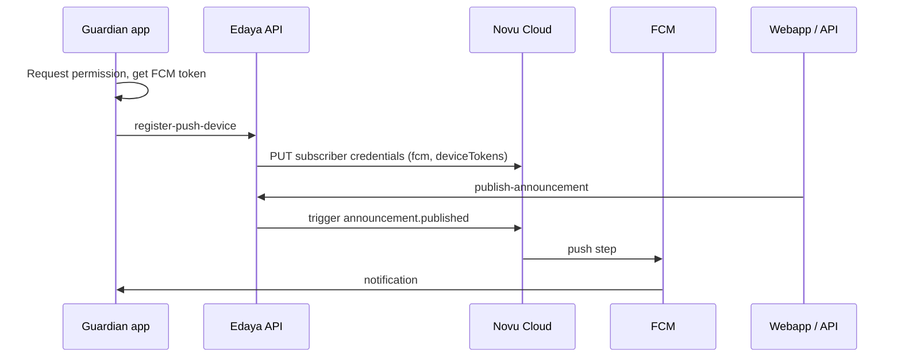

# Mobile Push Notifications — Sprint Plan

> **Status:** In progress  
> **Created:** 2026-06-26  
> **Scope:** Wire FCM push from Novu to the guardian Flutter app; test by publishing an announcement from the backend  
> **Related:** [notifications-plan.md](./notifications-plan.md), `edaya_mobile/apps/guardian`

---

## 1. Goal

When staff publish an announcement, guardians who have the mobile app installed receive a **push notification** on their device. The first milestone validates the full pipe:

1. Guardian signs in on mobile → device token registered with Novu (via API).
2. Staff publishes announcement → existing `announcement.published` Novu workflow fires.
3. Novu push step delivers to device via FCM.
4. Guardian sees notification title/body on device.

Inbox UI and deep links are follow-up work (Phase 4).

---

## 2. Current state

| Layer | Status |
|-------|--------|
| Announcement → Novu trigger | **Done** — `publishAnnouncement` materializes deliveries and enqueues |
| Novu workflows | In-app + email only; push disabled in defaults |
| Device token API | **Not started** |
| Mobile FCM | `firebase_core` + FlutterFire config only; no `firebase_messaging` |
| Subscriber identity | Novu `subscriberId` = Better Auth `subjectId` |

---

## 3. Architecture



**Design decisions:**

- Novu dispatches push (FCM/APNS credentials in Novu dashboard, not in app).
- Mobile registers tokens through a **school command** — Novu secret stays server-side.
- Flutter Firebase Messaging uses **FCM** on both Android and iOS; command sends `provider: 'fcm'`.
- Announcement send path unchanged — only Novu workflow gains a push step.

---

## 4. Phases

### Phase 1 — Novu push workflow (backend)

- [x] Add `edayaPushStep()` to `package/adaptor-novu/bootstrap/lib/templates.ts`
- [x] Include push in `standardNotificationWorkflow` steps
- [x] Enable `push: { enabled: true }` in workflow defaults
- [ ] Run `bun novu:bootstrap:apply` (ops — requires Novu credentials)
- [ ] Configure FCM + APNs in Novu dashboard

### Phase 2 — Device token registration (backend)

- [x] Extend `NotificationGatewayPort` with `registerPushDevice` / `unregisterPushDevice`
- [x] Implement in `@edaya/adaptor-novu` via `novu.subscribers.credentials.update/delete`
- [x] Add `register-push-device` and `unregister-push-device` school commands
- [x] Regenerate OpenAPI + API client bindings

### Phase 3 — Push preferences

- [x] Enable `channels.push` in `buildGuardianRecipientProfile` when `allowsNotifications`
- [ ] Guardian push toggle in webapp settings (deferred)

### Phase 4 — Mobile FCM (guardian app)

- [x] Add `firebase_messaging` dependency
- [x] Initialize Firebase in `main.dart`
- [x] `PushNotificationService` — permission, token, register/unregister
- [x] Wire to `AppSessionController` on sign-in / sign-out
- [x] Android `POST_NOTIFICATIONS` + default FCM channel meta-data
- [ ] iOS push capability + entitlements (manual Xcode step)

### Phase 5 — Inbox + deep links (deferred)

- [ ] `GuardianInboxController` using `messageDeliveries.list`
- [ ] `markDeliveryRead` on open
- [ ] Navigate from push tap to announcement detail

---

## 5. Test plan

### Prerequisites

```bash
# edaya
bun seed:auth:link          # guardian must have subjectId
# NOVU_SECRET_KEY in apps/api/.env
# FCM configured in Novu dashboard
bun novu:bootstrap:apply
```

### End-to-end

1. Start API: `bun dev`
2. Run guardian app on a **physical device** (push unreliable on iOS Simulator)
3. Sign in as linked guardian (`c.laurent@mail.com`)
4. Accept notification permission
5. Publish announcement (webapp or smoke script):

```bash
bun novu:e2e-smoke
```

6. Verify push on device; check Novu subscriber has FCM credential

### Troubleshooting

| Symptom | Fix |
|---------|-----|
| No `MessageDelivery` rows | Run `bun seed:auth:link` |
| Deliveries stuck `pending` | Check `NOVU_SECRET_KEY`, run bootstrap |
| Novu push failed | FCM/APNS not configured in Novu |
| No push on phone | Token not registered; check API logs for `register-push-device` |
| iOS no push | Enable push capability in Xcode; test on device |

---

## 6. Key files

| Concern | Path |
|---------|------|
| Publish workflow | `package/domain-core/src/services/service-workflows/communications.ts` |
| Novu handler | `package/domain-core/src/notifications/handlers/announcement-published.ts` |
| Gateway port | `package/domain-core/src/ports/notification-gateway.ts` |
| Novu push credentials | `package/adaptor-novu/src/novu-subscriber-client.ts` |
| Workflow IaC | `package/adaptor-novu/bootstrap/catalog/workflows.ts` |
| E2E smoke | `scripts/novu-e2e-smoke.ts` |
| Mobile push service | `edaya_mobile/apps/guardian/lib/notifications/push_notification_service.dart` |
| Mobile session hook | `edaya_mobile/apps/guardian/lib/auth/app_session_controller.dart` |

---

## 7. Ops checklist (manual)

- [ ] Novu → Integrations → FCM (Firebase service account JSON for `edayaplus`)
- [ ] Novu → Integrations → APNs (for iOS production push)
- [ ] Novu → Webhook → `POST /webhooks/notification-delivery` + `NOVU_WEBHOOK_SECRET`
- [ ] Xcode → Guardian target → Signing & Capabilities → Push Notifications
- [ ] Physical device for first test
