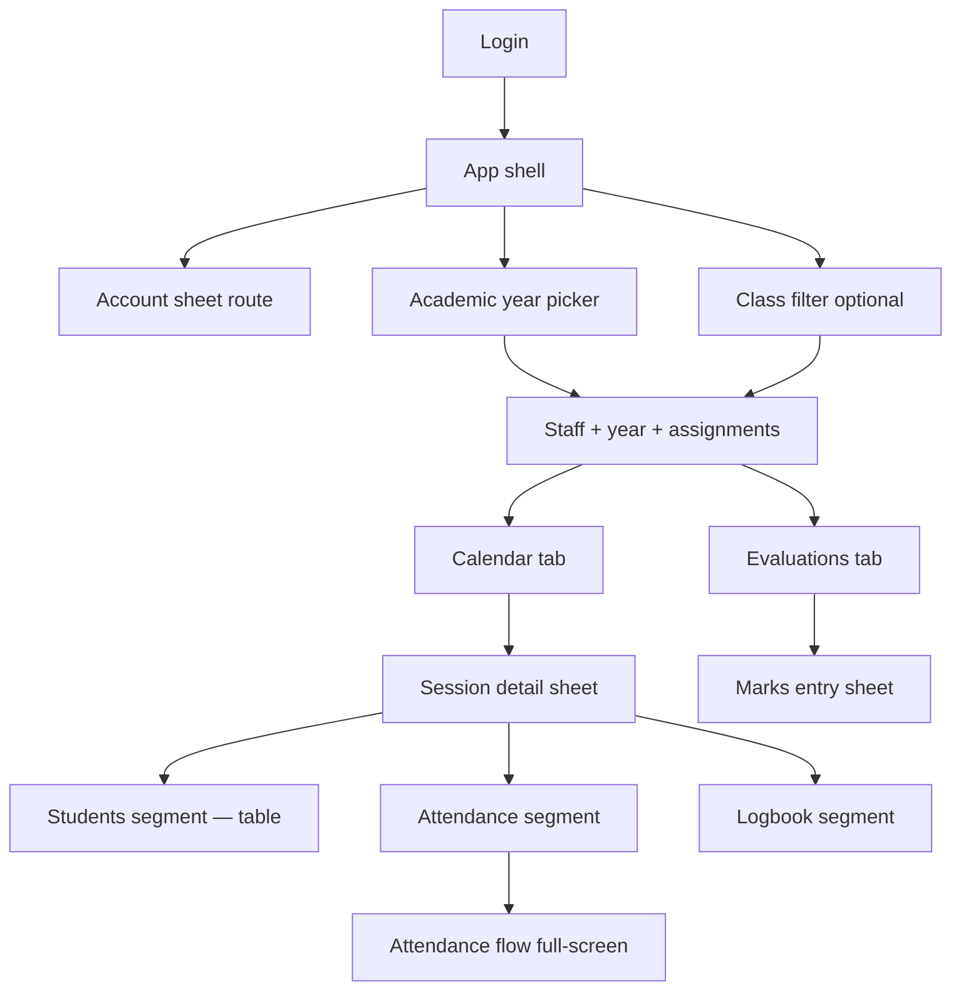

# Teacher App UI — Sprint Plan

> **Status:** Not started — `apps/teacher` is a Flutter scaffold only  
> **Last updated:** 2026-06-27  
> **Scope:** Teacher Flutter app shell, navigation, and classroom workflows (calendar, attendance, logbook, evaluations)  
> **Related:** [guardian-app-ui-plan.md](./guardian-app-ui-plan.md), `edaya_mobile/apps/teacher`, `edaya_mobile/apps/guardian`, `apps/webapp/src/lib/components/school/scheduling/`  
> **Code style reference:** Guardian app + `simple_stock_v2_code/apps/frontend` — Levit + go_router, `features/` slices, route-backed bottom sheets

Build the teacher mobile interface in parallel with the guardian app. Validate against the local API, emulators, and dev teacher fixtures (`m.dupont@school.edu` → `st1`, maths in 6a / 6b / 5a).

---

## 1. Goal

Deliver a production-shaped teacher app where a signed-in staff member can:

1. See a **merged calendar** of sessions across all classes they teach (current academic year).
2. Open a session and **record attendance** (list + optional swipe flow like the web app).
3. **Record or edit the class logbook** entry for that session.
4. Browse **evaluations** for assigned classes and **enter marks**.

Unlike the guardian app, this app is **read/write** for teaching workflows. Permissions are **assignment-scoped** (class group / class subject / session via `StaffAssignment`).

---

## 2. UI architecture

### 2.1 Navigation hierarchy

```text
App shell (persistent)
├── Top left  → Account (route-backed sheet above shell)
├── App bar   → Staff name + academic year chip + optional class filter
└── Body
    ├── Tab: Calendar    → merged teacher timetable → session detail sheet
    │       └── Session detail (segments: Students · Attendance · Logbook)
    │           └── Attendance flow (full-screen route, optional)
    └── Tab: Evaluations → assessment list → marks entry sheet
```

**Invariant:** Same as guardian — shell overlays and tab detail routes use `parentNavigatorKey: rootNavigatorKey`. Tab pages are **body-only** (no nested `Scaffold` / `AppBar`).

Attendance and logbook are **not separate bottom tabs**. They live inside the session detail sheet with **three segments** — **Students** (default) · Attendance · Logbook. Session metadata (time, class, subject, room) sits in the **sheet header** above the segment control, not in its own tab.

### 2.2 App bar context

| State | App bar |
|-------|---------|
| Loading staff context | Skeleton / `…` |
| Ready | `Mme Dupont` + `2025–26 ▾` |
| Class filter active | `Mme Dupont · 6ème A` + year chip |

- **Year chip** → `/academic-year-picker` (reuse guardian pattern).
- **Class filter** (optional chip or sheet) → `All classes` \| assigned class groups only. Filters calendar + evaluations lists; does not change API actor.

### 2.3 Default tab

**Calendar** (`/calendar`) on first login redirect.

### 2.4 Mermaid — context flow



### 2.5 Session detail — three segments

Opened from a calendar session tile. **Default segment: Students.**

| # | Segment | Purpose |
|---|---------|---------|
| 1 | **Students** | Read-only class roster **table** (first tab on open) |
| 2 | Attendance | Record / edit per-student status |
| 3 | Logbook | Session teaching log (chapter, content, homework, progress) |

Session metadata (time, class, subject, room, attendance summary) is always shown in the **sheet header**, not as a fourth segment.

---

## 3. Code architecture (mirror guardian)

### 3.1 Top-level `lib/` layout

```text
edaya_mobile/apps/teacher/lib/
├── main.dart
├── app/
│   ├── router.dart
│   └── theme.dart
├── access/
│   ├── root_scope.dart
│   ├── school_client.dart          # X-Academic-Year-Id header
│   └── app_runtime.dart
├── common/                         # copy from guardian; extract shared package later
│   ├── models/modal_bottom_sheet_page.dart
│   ├── widgets/data_state.dart, route_error_page.dart, student_avatar.dart
│   └── utils/entity_query.dart, entity_filters.dart, date_time_parse.dart
├── services/
│   └── push_notification_service.dart   # Phase 6
└── features/
    ├── app_shell/
    ├── auth/
    ├── context/                    # academic year + staff teaching context
    ├── account/
    ├── calendar/
    ├── session/                    # session detail, attendance, logbook
    └── evaluations/
```

### 3.2 Feature slice convention

Same as guardian (`<feature>_page.dart`, `<feature>_controller.dart`, `widgets/`, `*_dialog.dart`).

| Kind | Example |
|------|---------|
| Page | `CalendarPage`, `EvaluationsPage` |
| Controller | `CalendarController`, `SessionDetailController` |
| Full-screen flow | `AttendanceFlowPage` |
| Detail overlay | `SessionDetailsSheet`, `MarksEntrySheet` |
| Routes | `/calendar/session-details`, `/evaluations/marks` |

### 3.3 State management & DI

| Primitive | Teacher usage |
|-----------|---------------|
| `Levit.put` (permanent) | `AppRouter`, `AppSessionController`, `AcademicYearController`, `StaffContextController` |
| `LScopedView.put` | Tab controllers, session detail, marks entry |
| `AppRuntime` facade | `session`, `academicYear`, `staffContext`, `schoolClient()` |

**`StaffContextController`** (teacher equivalent of `StudentContextController`):

- `staffId` from `effectiveGrants.actorId` when `kind == 'staff'`
- `assignedClassGroupIds` from `staffAssignments` + `classSubjects.teacherId`
- `optionalClassFilterId` — `null` = all classes
- `canTeachSession(sessionId)` — assignment graph check (client-side prefilter; server enforces)

### 3.4 Routing pattern

| Path | Page | Navigator |
|------|------|-----------|
| `/login` | `LoginPage` | root |
| `/account` | `AccountSheet` | root (`ModalBottomSheetPage`) |
| `/academic-year-picker` | `AcademicYearPickerSheet` | root |
| `/calendar` | `CalendarPage` | shell |
| `/calendar/session-details` | `SessionDetailsSheet` | root |
| `/calendar/attendance-flow` | `AttendanceFlowPage` | root (full-screen, typed `SessionDetail` extra) |
| `/evaluations` | `EvaluationsPage` | shell |
| `/evaluations/marks` | `MarksEntrySheet` | root |
| `/evaluations/create` | `CreateAssessmentSheet` | root (Phase 5) |

**Do not** set `backgroundColor: Colors.transparent` on `ModalBottomSheetPage` unless the child draws its own `Material` surface (guardian lesson learned).

### 3.5 Overlay strategy

| Use case | Pattern |
|----------|---------|
| Session detail (segment tabs) | Route-backed `ModalBottomSheetPage` on root; **default segment = Students** |
| Class roster | **Students** segment — scrollable table (name, optional attendance status column) |
| Per-student attendance edit | Imperative `showDialog` or inline row action (web: `PlanningSessionAttendanceModal`) |
| Whole-class attendance | Full-screen `AttendanceFlowPage` route (web: `AttendanceFlow.svelte`) |
| Logbook create/edit | Segment in session sheet + `showDialog` for long form if needed |
| Marks per student | List in `MarksEntrySheet` with inline numeric field + save |
| Create evaluation | Route-backed sheet |

### 3.6 Shared code with guardian

| Approach | When |
|----------|------|
| **Phase 0:** copy `common/` + auth bootstrap from guardian | Fastest path to parity |
| **Phase 6:** extract `packages/edaya_mobile_shell` | `DataState`, `ModalBottomSheetPage`, `AcademicYearController`, auth session, entity utils |

Calendar **models** (`CalendarSession`, weekday projection) can be shared; **controllers differ** (staff-scoped multi-class query vs student class group).

---

## 4. Current state

| Area | Status |
|------|--------|
| `apps/teacher` Flutter project | **Scaffold** — counter demo in `main.dart` |
| `pubspec.yaml` | Missing `levit_flutter`, `go_router`, `shared_preferences` (guardian parity) |
| Auth / API client packages | Available via workspace (`edaya_auth`, `edaya_api_client`) |
| Guardian app patterns | **Done** — reference implementation |
| Webapp teaching UI | **Done** — `PlanningDetail`, `AttendanceFlow`, `PlanningSessionLogbookModal`, `EvaluationsView` |

### Dev login fixtures

| Account | Staff | Role | Teaching scope (seed) |
|---------|-------|------|------------------------|
| `m.dupont@school.edu` | `st1` | Teacher | Maths — 6a, 6b, 5a |
| `m.garnier@school.edu` | `st2` | Teacher | French — 6a, 6b, 5a |
| `m.leon@school.edu` | `st3` | Coordinator | History + homeroom 6a, 5a |

Password: `DevPassword1!` (after `bun seed:auth:link`).

---

## 5. Staff API surface (teacher role)

From `role-teacher` access seed (`testing/seeding/src/run-dev-access-seed.ts`):

| Permission | Mobile feature |
|------------|----------------|
| `QUERY_WORKSPACE_READ` | Academic years, school context |
| `QUERY_TIMETABLE_READ` | Calendar sessions |
| `QUERY_CLASS_DIRECTORY_READ` | Class group labels |
| `STUDENT_READ` | Roster for attendance / marks |
| `ATTENDANCE_READ` | Existing attendance on session |
| `ATTENDANCE_RECORD` | Record / update attendance |
| `CLASS_LOGBOOK_READ` | Load logbook entry |
| `CLASS_LOGBOOK_CREATE` / `CLASS_LOGBOOK_UPDATE` | Save logbook |
| `GRADE_READ` | List assessments & results |
| `GRADE_INPUT` | `recordAssessmentResult`, `createAssessment` |

Assignment-scoped writes are enforced server-side via `StaffAssignment` rows linked to class groups, class subjects, or sessions.

---

## 6. Outcomes

| # | Outcome | Phase |
|---|---------|-------|
| 1 | Teacher `lib/` structure + deps parity with guardian | 0 |
| 2 | `AppRouter` + `ShellRoute` + staff auth redirect | 0 |
| 3 | `AppRuntime` + `AcademicYearController` + `StaffContextController` | 0 |
| 4 | `AppShellPage` + `TeacherAppBar` + 2-tab shell | 1 |
| 5 | Account + academic year picker routes | 1 |
| 6 | Calendar — merged teacher timetable (all assigned classes) | 2 |
| 7 | Session detail sheet — **Students** / Attendance / Logbook segments (Students first) | 3 |
| 8 | Attendance list + `recordAttendance` mutations | 3 |
| 9 | Attendance flow full-screen (swipe UI, web parity) | 4 |
| 10 | Logbook form + `classLogbookEntries.save` | 4 |
| 11 | Evaluations list (per assigned class) | 5 |
| 12 | Marks entry + `recordAssessmentResult` | 5 |
| 13 | Create assessment sheet (optional) | 5 |
| 14 | Shared package extraction + tests | 6 |

---

## 7. Phases

### Phase 0 — Foundations

**Goal:** Match guardian skeleton; staff context and routing before feature UI.

- [ ] Align `pubspec.yaml` with guardian (`levit_flutter`, `go_router`, `shared_preferences`, …)
- [ ] Copy/adapt `common/`, `access/`, `app/theme.dart` from guardian
- [ ] `features/auth/` — `AppSessionController` (staff `effectiveGrants`, `kind: staff`)
- [ ] `features/context/academic_year_controller.dart` — same as guardian
- [ ] `features/context/staff_context_controller.dart` — load assignments + taught class subjects
- [ ] `app/router.dart` — auth redirect to `/calendar`
- [ ] `main.dart` — Levit bootstrap, permanent controllers, `MaterialApp.router`
- [ ] Delete counter demo from `main.dart`

**Exit criteria:** Login as `m.dupont@school.edu` → `/calendar` shell; API sends `X-Academic-Year-Id`; `StaffContextController` exposes assigned class IDs.

---

### Phase 1 — App shell

**Goal:** Production chrome; placeholder tab bodies.

- [ ] `features/app_shell/app_shell_page.dart` — `NavigationBar` with **Calendar** + **Evaluations**
- [ ] `features/app_shell/widgets/teacher_app_bar.dart` — staff name, year chip, optional class filter
- [ ] Route `/account` → `AccountSheet`
- [ ] Route `/academic-year-picker`
- [ ] Placeholder `CalendarPage`, `EvaluationsPage` with `LScopedView.put`
- [ ] `DataState`, `RouteErrorPage` in `common/`

**Exit criteria:** Tab switch via URL; shell sheets dismiss with back; no double `Scaffold`.

---

### Phase 2 — Calendar (read)

**Goal:** Merged timetable for the connected teacher across all assigned classes.

```text
features/calendar/
├── calendar_page.dart
├── calendar_controller.dart
├── models/teacher_session.dart      # extends guardian CalendarSession + classLabel
└── widgets/session_tile.dart, week_header.dart, day_selector.dart
```

**Data loading:**

1. `staffAssignments.list({ staffId })` for active year (class group / class subject / session scopes).
2. `classSubjects.list` where `teacherId == staffId` (course ownership).
3. `sessions.list` for union of assigned `classGroupId`s; **client-filter** to sessions the teacher may teach (assignment match on session or `classSubjectId`).
4. Project recurring slots by **weekday** (reuse guardian `projectOntoDay` / `defaultCalendarDay`).
5. Join `classGroups`, `subjects`, `classSubjects` for labels (`6ème A · Maths`).

**UI:**

- Week strip + day list (reuse guardian calendar layout).
- Session tile → `context.push('/calendar/session-details', extra: TeacherSession)`.
- Pull-to-refresh; `DataState` for loading / empty / error.
- Empty: “No classes scheduled for this day.”

**Exit criteria:** `st1` sees maths sessions in 6a/6b/5a on the correct weekdays; year change reloads.

---

### Phase 3 — Session detail + attendance (list)

**Goal:** Session sheet with three segments (**Students** first); per-student attendance like web `PlanningSessionAttendanceModal`.

```text
features/session/
├── session_details_sheet.dart
├── session_detail_controller.dart
├── models/session_detail.dart       # port webapp SessionDetail
├── widgets/student_roster_table.dart   # Students segment — DataTable / table view
├── widgets/attendance_row.dart
└── attendance_status_dialog.dart    # present / absent / late
```

**Data loading** (port `apps/webapp/src/lib/api/session-detail-data.ts`):

- `sessions.get(sessionId)`
- `enrollments` + `students` for `classGroupId`
- `attendance.list({ sessionId })`
- Build `SessionDetail` with `attendance[]` rows + full class roster

**Mutations** (port `planning-session.mutations.ts`):

```dart
client.recordAttendance({
  'id': attendanceId ?? '${studentId}-${sessionId}',
  'studentId': studentId,
  'sessionId': sessionId,
  'status': status, // present | absent | late
  'createdAt': now,
});
```

**Sheet header** (always visible above segments): weekday · time range, session title, `class · subject`, recorded attendance summary (`3 / 28`).

**UI segments** (order fixed; **Students** is the default on open):

| # | Segment | Content |
|---|---------|---------|
| 1 | **Students** | Class roster as a **table**: columns e.g. **Name** (avatar + label), optional **Status** (attendance chip if already recorded). Read-only roster reference; tap row optional → jump to Attendance segment for that student. |
| 2 | Attendance | Same students with status chips / edit actions; tap → status dialog (`present` / `absent` / `late`). “Take attendance” FAB → full-screen flow (Phase 4). |
| 3 | Logbook | Placeholder until Phase 4 |

**Students table** (mobile):

- Use `DataTable` or a lightweight custom table inside a vertical `ListView` / `SingleChildScrollView`.
- Sort by student name (locale-aware).
- Show enrollment count in segment label or header (`Students · 28`).
- If roster is empty, `DataState.empty` with “No enrolled students for this class.”

**Exit criteria:** Open a session → **Students** tab shown first with roster table; switch to Attendance → mark one student present; persists after refresh.

---

### Phase 4 — Attendance flow + logbook

**Goal:** Web-parity immersive attendance + logbook save.

**Attendance flow** — port `AttendanceFlow.svelte`:

```text
features/session/
├── attendance_flow_page.dart
├── attendance_flow_controller.dart
└── widgets/attendance_flow_student_card.dart
```

- Route `/calendar/attendance-flow` with `SessionDetail` extra.
- One student at a time: Present / Absent / Late; progress bar; summary at end.
- Batch `recordAttendance` on complete (or per tap like web).
- Entry from session sheet: “Take attendance” FAB.

**Logbook** — port `PlanningSessionLogbookModal.svelte`:

```text
features/session/
├── widgets/logbook_form.dart
└── logbook_controller.dart (or methods on SessionDetailController)
```

- Load `classSubjectMatters` + `subjectMatters` for chapter picker.
- `classLogbookEntries.save` with session date + `classSubjectId`.
- Fields: chapter (matter), content, objectives (multiline), homework, progress %.

**Exit criteria:** Full attendance flow for a 6a session; logbook entry visible in webapp class logbook tab.

---

### Phase 5 — Evaluations & marks

**Goal:** List assessments for assigned classes; enter marks.

```text
features/evaluations/
├── evaluations_page.dart
├── evaluations_controller.dart
├── marks_entry_sheet.dart
├── create_assessment_sheet.dart     # optional
├── models/evaluation_summary.dart
└── widgets/evaluation_tile.dart, mark_input_row.dart
```

**Data loading:**

- `assessments.list` filtered by assigned `classGroupId`s (+ active period if required).
- `assessmentResults.list` per assessment for progress (`graded / total`).
- Respect class filter from app bar.

**Mutations:**

- `recordAssessmentResult` — per student score.
- `createAssessment` — title, max score, coefficient, class subject (needs `academicPeriodId`).

**UI:**

- List tiles: title, subject, date, graded progress bar (like `EvaluationsView.svelte`).
- Tap → `/evaluations/marks` sheet with student roster + score fields.
- Optimistic update + toast on save; `DataState` + retry.

**Exit criteria:** Teacher records a mark for `s1` on an existing seed assessment; average updates in list.

---

### Phase 6 — Polish & shared extraction

- [ ] Extract `packages/edaya_mobile_shell` from guardian + teacher `common/` + context auth
- [ ] Push notifications + deep link → `/calendar/session-details` (future)
- [ ] `melos run analyze` + `flutter test` for teacher app
- [ ] Widget tests: `TeacherAppBar`, router redirect, `StaffContextController`
- [ ] Gate dev login prefills behind `kDebugMode`

---

## 8. Data loading conventions

| Rule | Detail |
|------|--------|
| Scope | `AppRuntime.staffContext` + `AppRuntime.academicYear` on every fetch |
| API access | `AppRuntime.schoolClient()` only |
| Assignment gate | Hide or disable actions when `!staffContext.canTeachSession(id)` |
| Context change | Year or class filter → invalidate tab controllers |
| Mutations | Optimistic UI where safe; toast on success/error; rollback on failure |
| Typed models | Port thin types from webapp (`SessionDetail`, `Evaluation`) incrementally |

### Entity / command map

| Feature | Entities / commands |
|---------|---------------------|
| `calendar/` | `staffAssignments`, `classSubjects`, `sessions`, `classGroups`, `subjects` |
| `session/` | `sessions`, `enrollments`, `students`, `attendance`, `classLogbookEntries`, `classSubjectMatters` |
| | `recordAttendance` |
| | `classLogbookEntries.save` |
| `evaluations/` | `assessments`, `assessmentResults`, `academicPeriods` |
| | `createAssessment`, `recordAssessmentResult` |
| `context/` | `academicYears`, `staffAssignments`, `effectiveGrants` |

### Suggested `entity_filters.dart` additions

```dart
EntityQuery staffAssignmentsForStaff(String staffId);
EntityQuery classSubjectsForTeacher(String staffId);
EntityQuery sessionsForClassGroups(List<String> classGroupIds);
EntityQuery attendanceForSession(String sessionId);
EntityQuery assessmentsForClass(String classGroupId);
EntityQuery resultsForAssessment(String assessmentId);
```

---

## 9. Webapp reference map

| Mobile feature | Webapp source |
|----------------|---------------|
| Session detail layout | `PlanningDetail.svelte` (mobile: **Students** tab replaces web **Details**; metadata in header) |
| Class roster table | New — `student_roster_table.dart` (no direct web equivalent; web lists students only under Attendance) |
| Per-student attendance | `PlanningSessionAttendanceModal.svelte` |
| Swipe attendance | `AttendanceFlow.svelte` |
| Logbook form | `PlanningSessionLogbookModal.svelte` |
| Session data loader | `session-detail-data.ts` |
| Attendance / logbook mutations | `planning-session.mutations.ts` |
| Evaluations list | `EvaluationsView.svelte` |
| Marks mutation | `evaluation.mutations.ts` |
| Class planning sources | `planning-data.ts` |

---

## 10. Test plan

### Prerequisites

```bash
# edaya
bun dev && bun seed:auth:link

# edaya_mobile
cd edaya_mobile && melos bootstrap
cd apps/teacher && flutter run
```

Sign in: `m.dupont@school.edu` / `DevPassword1!`

### Manual checklist

| Phase | Verify |
|-------|--------|
| 0 | Staff login; redirect `/calendar`; year header on API; assignments loaded |
| 1 | Two tabs change URL; account sheet works |
| 2 | Calendar shows maths sessions across 6a, 6b, 5a |
| 3 | Session sheet opens on **Students** table; Attendance segment saves one mark |
| 4 | Attendance flow completes class; logbook saved |
| 5 | Evaluation list; mark recorded for a student |
| 6 | `flutter test` green |

### Automated layout

```text
apps/teacher/test/
├── support/teacher_test_bootstrap.dart
├── features/context/staff_context_controller_test.dart
├── features/calendar/calendar_session_test.dart   # reuse guardian weekday tests
└── features/app_shell/router_redirect_test.dart
```

---

## 11. Dependencies & blockers

| Blocker | Mitigation |
|---------|------------|
| Teacher app scaffold only | Phase 0 copies guardian foundations |
| Multi-class session query cost | Start with class-group session lists + client filter; optimize with backend query later if needed |
| `createAssessment` needs period | Load `academicPeriods`; default to current period by date |
| No shared mobile package yet | Copy `common/` first; extract in Phase 6 |
| Assignment scope errors (403) | Surface clear “Not assigned to this session” in UI |

---

## 12. Implementation order

```text
Phase 0 (structure + router + staff context)
    → Phase 1 (app shell)
        → Phase 2 (calendar read)
            → Phase 3 (session detail + attendance list)
                → Phase 4 (attendance flow + logbook)
                    → Phase 5 (evaluations + marks)
                        → Phase 6 (shared package + tests)
```

**First PR:** Phase 0 + Phase 1 — navigable shell, staff login, empty calendar/evaluations tabs.

**Second PR:** Phase 2 + Phase 3 — calendar data + session sheet with attendance list (core teaching loop).

---

## 13. Progress tracker

- [x] **Phase 0** — Foundations
- [x] **Phase 1** — App shell
- [x] **Phase 2** — Calendar (read)
- [x] **Phase 3** — Session detail + attendance list
- [x] **Phase 4** — Attendance flow + logbook
- [x] **Phase 5** — Evaluations & marks
- [ ] **Phase 6** — Polish & shared extraction
