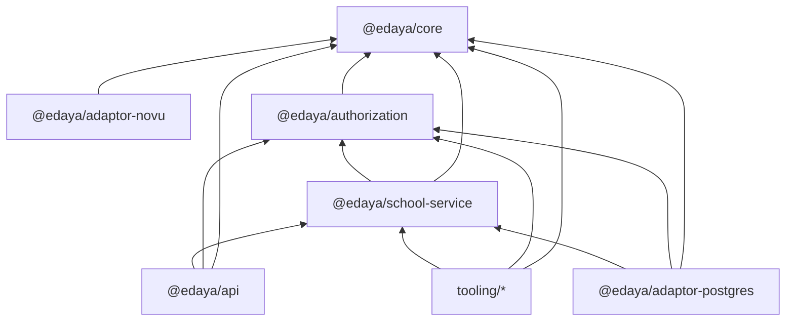

# Plan: `@edaya/core` + `@edaya/authorization` + `@edaya/school-service`

## 1. Goals

| Goal | Success criterion |
|------|-------------------|
| Enforceable dependency direction | `school-service → authorization → core`; no reverse imports |
| Thin adaptors | Postgres/Novu/R2 depend on **core** for entities + port interfaces |
| Auth isolation | Portal/staff permission work lives in one package (~140 files, ~50 test files) |
| Pure domain | `domain/` has zero imports from auth or entity-config |
| Green CI at each PR | `bun run verify` + `bun run test:integration` after every slice |



---

## 2. Package definitions

### `@edaya/core` — `package/domain-core/`

**Owns:** what the school *is* + port contracts adaptors implement.

```text
src/
  domain/                    entities, schemas, invariants, business gates
  ports/                     repository + gateway interfaces
  adapters/                  in-memory / no-op port impls
  registry/                  NEW — CoreEntityMap, CORE_ENTITY_KEYS
  entity-access/             NEW — shared auth wiring interfaces (types only)
  shared/                    NEW — unique(), other tiny pure utils
```

**Stays / moves into core:**

| Item | Action |
|------|--------|
| All entity classes + zod schemas | Keep |
| `validateStudentDelete`, `validateStudentSave`, … | Keep (pure gates using ports) |
| `BusinessRuleViolationError`, value objects (except scope-grant) | Keep |
| `BaseRepositoryInterface`, `Filter`, `NotificationGatewayPort`, … | Keep |
| `CoreEntityMap`, `CORE_ENTITY_KEYS` | Move from `application/runtime/` |
| `EntityReadAuthorization`, `EntityWriteAuthorization` | Extract interfaces from `managed-entity-service` |
| `findActiveAcademicYear` | Move from `application/academic-year.ts` |
| `unique()` from `entity-config/helper-utils` | Move to `shared/unique.ts` |

**Leaves core:**

| Item | Destination |
|------|-------------|
| `*Config` factories (54 entities) | `school-service` |
| `ScopeGrant`, `Permission` | `authorization` |
| `report-card-comment-access.ts` | `authorization` (auth logic, not domain) |
| `SchoolRepositories` (full aggregate) | `school-service` |
| `CronJobKey`, cron catalog | `school-service` |

**`package.json` exports:**

```json
{
  "name": "@edaya/core",
  "exports": {
    ".": "./src/index.ts",
    "./domain": "./src/domain/index.ts",
    "./ports": "./src/ports/index.ts"
  }
}
```

---

### `@edaya/authorization` — `package/authorization/`

**Owns:** who can do what — staff grants, portal capabilities, operation modules, policy resolvers.

```text
src/
  bootstrap-actor.ts
  capabilities/              portal/teacher permission maps, homeroom gates
  engine/
  gates/                     resourceGate, operationModule
  grants/
  lifecycle/                 invalidation-registry, entity-events, types
                            (NOT auth-cache-hooks — see school-service)
  migration/
  model/                     Actor, Permission, ScopeGrant, EffectiveGrants, errors
  operations/                operation matrices, assert-operation
  permissions/
  policy/                    resolvers, strategies, AuthorizationPolicy
  resolution/                DefaultAuthorizationRepository, grant resolution
  scope/
  service-accounts/
  sync/                      staff-assignment permission sync
  ports/                     NEW — AuthorizationRepository, AuthCacheInvalidationPort
```

**Dependencies:** `@edaya/core` only.

**Cycle-breaking (required before this package is “clean”):**

| Current import (auth → application) | Resolution |
|-------------------------------------|------------|
| `EntityReadAuthorization` / `EntityWriteAuthorization` | Import from `@edaya/core/entity-access` |
| `CoreEntityKey`, `CoreEntityMap` | Import from `@edaya/core/registry` |
| `unique()` | Import from `@edaya/core/shared` |
| `findActiveAcademicYear` | Import from `@edaya/core/domain/school/...` |
| `ManagedEntityServiceConfig` in `auth-cache-hooks` | **Move file to school-service** |
| `SchoolRepositories` in `policy/types.ts` | Replace with `AuthorizationRepositories` (narrow pick from core repos) |

**`AuthorizationRepositories`** — define in authorization, structurally satisfied by school-service's full repos:

```typescript
// authorization/policy/repository-ports.ts
import type { CoreEntityRepositories } from '@edaya/core'

export type AuthorizationRepositories = Pick<
  CoreEntityRepositories,
  | 'students' | 'guardians' | 'guardianLinks' | 'teachers' | 'teacherAssignments'
  | 'staffMembers' | 'staffAssignments' | 'classGroups' | 'assessments'
  | 'results' | 'fees' | 'studentFees' | 'lessonSessions' | 'activitySessions'
  | 'attendance' | 'attachments' | 'studentNotes' | 'studentHealthProfiles'
  // ...complete list from policy resolvers audit
>
```

`AuthorizationPolicy.getRepositories?` returns `AuthorizationRepositories`, not `SchoolRepositories`.

**`package.json` exports:**

```json
{
  "name": "@edaya/authorization",
  "dependencies": { "@edaya/core": "workspace:*" },
  "exports": {
    ".": "./src/index.ts",
    "./model": "./src/model/index.ts",
    "./operations": "./src/operations/index.ts"
  }
}
```

---

### `@edaya/school-service` — `package/school-service/`

**Owns:** orchestration — CRUD wiring, workflows, notifications, cron, invitations.

```text
src/
  services/                  ← application/
    entities/
      managed-entity-service.ts
      entity-config/         read(), write(), tenant resolvers
      config/                NEW — 54 extracted *Config factories
        students/student.ts
        school/class-group.ts
        ...
    workflows/
    queries/
    commands/
    runtime/                 core-entity-catalog, school-command-catalog
    school-service.ts
    service-args.ts
  capabilities/              ← non-auth capabilities/
    notifications/
    scheduling-jobs/
    files/
    invitations/
    email/
  integration/               NEW — cross-layer glue
    auth-cache-hooks.ts      moved from authorization/lifecycle
    notification-entity-hooks.ts  (if needed)
```

**Dependencies:** `@edaya/core` + `@edaya/authorization`.

**Owns types that compose layers:**

| Type | Why here |
|------|----------|
| `SchoolRepositories` | extends `CoreEntityRepositories` + `authorization` + cron/templates |
| `ManagedEntityService`, `ManagedEntityServiceConfig` | implementation, not interface |
| `ServiceArgs`, `SchoolService` | top-level orchestration |
| `CORE_ENTITY_CONFIG_FACTORIES`, `createCoreEntityServices` | stitches auth + notifications + entities |
| `buildSchoolOverview`, query services | application queries |
| `CronJobKey`, cron runner | scheduling-jobs capability |

**`package.json` exports:**

```json
{
  "name": "@edaya/school-service",
  "dependencies": {
    "@edaya/core": "workspace:*",
    "@edaya/authorization": "workspace:*",
    "cron-parser": "...",
    "zod": "..."
  },
  "exports": {
    ".": "./src/index.ts",
    "./entities": "./src/services/entities/index.ts"
  }
}
```

---

## 3. Entity config extraction (54 entities)

**Pattern per entity:**

```text
# Before (one file)
domain-core/src/domain/students/student.ts
  → Student class + studentConfig + validateStudentDelete

# After (two files)
core/src/domain/students/student.ts
  → Student class + validateStudentDelete only

school-service/src/services/entities/config/students/student.ts
  → studentConfig (imports Student from @edaya/core)
```

**Registry** (`core-entity-catalog.ts`) stays in school-service; update imports:

```typescript
import { Student } from '@edaya/core'
import { studentConfig } from './config/students/student'
```

**Batch order** (lowest cross-domain coupling first):

| PR | Domain area | Entities | ~count |
|----|-------------|----------|--------|
| 3a | `school/` structure | academic-year, academic-period, grade-level, class-group, period-definition, grade-scale, resource, school | 12 |
| 3b | `school/` people + access | staff-member, staff-assignment, teacher, teacher-assignment, staff-permission-assignment, attachment, account-invitation | 7 |
| 3c | `students/`, `access/` | student, guardian, guardian-link, enrollment, notes, health, discipline, incidents | 14 |
| 3d | `scheduling/`, `school-life/` | schedule, lesson-session, activity-session, calendar-event, attendance, attendance-record, activity, enrollments | 12 |
| 3e | `academics/`, `assessments/` | subjects, class-subjects, progress, assessments, report cards | 14 |
| 3f | `finances/`, `messaging/` | fee, student-fee, payment, announcement, targets, deliveries, notification-templates | 9 |

---

## 4. Port & type placement

| Type / port | Package | Consumers |
|-------------|---------|-----------|
| `BaseRepositoryInterface`, `Filter`, `QueryOptions` | core | adaptors, all |
| `NotificationGatewayPort`, `InvitationDeliveryPort` | core | adaptor-novu, api |
| `AtomicExecutionPort`, `FileStoragePort` | core | adaptors, api |
| `CoreEntityRepositories` | core | adaptor-postgres stores |
| `AuthorizationRepository` | authorization | adaptor-postgres, school-service |
| `AuthCacheInvalidationPort` + event types | authorization | api runtime, school-service hooks |
| `SchoolRepositories` (full) | school-service | school-service, api, adaptor-postgres impl |
| `CronJobSchedulePort`, `CronJobKey` | school-service | adaptor-postgres, api cron |

**`adaptor-postgres` after split:**

```typescript
import type { Student, AcademicYear, ... } from '@edaya/core'
import type { SchoolRepositories } from '@edaya/school-service'
import { DefaultAuthorizationRepository } from '@edaya/authorization'
```

Entity stores: **core only**. Auth repo + overview helpers: **authorization** / **school-service**.

**`adaptor-novu`:** stays **core only** (notification port types).

---

## 5. Test split

| Current path | New package |
|--------------|-------------|
| `tests/unit/domain/**` | core |
| `tests/unit/value-objects/**` (except scope-grant) | core |
| `tests/unit/auth/**` (~50 files) | authorization |
| `tests/services/**` | school-service |
| `tests/cron/**` | school-service |
| `tests/notifications/**` | school-service |
| `tests/queries/**` | school-service |
| `tests/application/**` | school-service |
| `tests/contracts/repositories/**` | core |
| `tests/support/authorization-fixtures.ts`, `policy-fixtures.ts` | authorization |
| `tests/support/create-test-app.ts` | school-service (or shared testkit later) |

Each package runs its own `bun test` via turbo.

---

## 6. Consumer import map

| Symbol | Import from |
|--------|-------------|
| `Student`, `Fee`, `School`, schemas | `@edaya/core` |
| `Permission`, `ActorMetadata`, `AuthorizationPolicy` | `@edaya/authorization` |
| `EffectiveGrants`, `ScopeGrant`, `authorize()` | `@edaya/authorization` |
| `DefaultAuthorizationRepository` | `@edaya/authorization` |
| `SchoolService`, `ManagedEntityService` | `@edaya/school-service` |
| `SchoolRepositories`, `buildSchoolOverview` | `@edaya/school-service` |
| `CORE_ENTITY_KEYS` | `@edaya/core` |
| `createCoreEntityServices` | `@edaya/school-service` |
| `createInMemoryFileStorage` | `@edaya/core` |
| `runCronJob`, `CronJobKey` | `@edaya/school-service` |
| `NotificationGatewayPort` | `@edaya/core` |

**`apps/api` (~70 files):** add both `@edaya/authorization` and `@edaya/school-service`; keep `@edaya/core` for entity types and ports.

**`tooling/fixtures`:** mostly `@edaya/core`; seed workflows add `@edaya/school-service`.

---

## 7. PR sequence

### PR 1 — Scaffold + mechanical move (~2–3 days)

**Scope:** Create packages, move code, fix imports. Entity configs may still live in domain files temporarily.

1. Create `package/authorization/` and `package/school-service/` with `package.json`, `tsconfig.json`, eslint config mirroring domain-core.
2. `git mv capabilities/authorization → package/authorization/src/`
3. `git mv application → package/school-service/src/services/`
4. `git mv capabilities/{notifications,files,invitations,scheduling-jobs,email} → package/school-service/src/capabilities/`
5. Slim `domain-core/src/index.ts` to domain + ports + adapters.
6. Add workspace deps to `apps/api`, adaptors, tooling.
7. Fix all import paths (mechanical).
8. Move auth tests → authorization package; service/cron/notification tests → school-service.

**Exit criteria:** `bun run verify` green. Document known violations: domain files still export `*Config`.

---

### PR 2 — Break cycles + core purity (~1–2 days)

**Scope:** Make `authorization → core` clean; no auth → school-service imports.

1. Add `core/src/registry/core-entity-map.ts` (move from school-service runtime).
2. Add `core/src/entity-access/types.ts` (extract interfaces from `ManagedEntityService`).
3. Add `core/src/shared/unique.ts`; add `findActiveAcademicYear` under `domain/school/`.
4. Move `scope-grant.ts` and `report-card-comment-access.ts` to authorization.
5. Move `auth-cache-hooks.ts` to `school-service/src/integration/`.
6. Define `AuthorizationRepositories`; update `AuthorizationPolicy` to use it.
7. Slim `core/ports/` — remove upward refs to application/auth.
8. Define `SchoolRepositories` in school-service composing core + auth ports.

**Exit criteria:**

```sh
rg "@edaya/school-service" package/authorization   # must be empty
rg "application/|school-service" package/authorization/src  # must be empty
rg "capabilities/authorization|@edaya/authorization" package/domain-core/src/domain  # may still have *Config refs until PR 3
```

---

### PR 3 — Entity config extraction (6 sub-PRs: 3a–3f)

**Scope:** Domain files have zero auth/entity-config imports.

Per batch:
1. Extract `*Config` to `school-service/.../config/`.
2. Remove auth imports from domain file.
3. Update `core-entity-catalog` imports.
4. Adjust tests.

**Exit criteria per batch:** `bun run verify` + relevant integration tests.

---

### PR 4 — Consumer migration (~1–2 days)

1. Update `apps/api` imports (~70 files) per cheat sheet.
2. Update `adaptor-postgres`, `tooling/fixtures`, `tooling/seeding`, `tooling/integration-tests`.
3. Optional one-release shim: `@edaya/core` re-exports commonly used auth/service symbols with `@deprecated` JSDoc — remove in PR 5.

---

### PR 5 — Enforcement + docs (~0.5 day)

1. Update `docs/reference/integrations-restructure.md`, `AGENTS.md`.
2. Add boundary checks to `bun repo verify`:

```sh
# authorization must not depend on school-service
! rg -q "@edaya/school-service" package/authorization

# core domain must be pure
! rg -q "authorization|entity-config|EntityConfigFactory" package/domain-core/src/domain

# core must not depend on upper packages
! rg -q "@edaya/(authorization|school-service)" package/domain-core
```

3. ESLint `import/no-restricted-paths` per package.
4. Turbo `dependsOn: ["^check"]` ordering: core → authorization → school-service.

---

## 8. Workspace / turbo config

**Root workspaces** — no change (`package/*` already covers new dirs).

**Per-package `package.json` scripts** — mirror domain-core: `check`, `lint`, `test`, `quality`.

**Recommended turbo pipeline addition:**

```json
{
  "tasks": {
    "check": { "dependsOn": ["^check"] },
    "test": { "dependsOn": ["^check"] }
  }
}
```

TypeScript project references (optional, later): `school-service` references `authorization` references `core`.

---

## 9. Risk register

| Risk | Likelihood | Mitigation |
|------|------------|------------|
| Missed import after split | High | PR 4 grep audit; TS strict |
| Portal auth regression | Medium | Integration tests + demo accounts checklist |
| `AuthorizationPolicy` repo type too narrow | Medium | Audit all policy resolvers before defining `AuthorizationRepositories` |
| Large PR 3 conflicts | High | Six batched sub-PRs by domain area |
| `core-entity-catalog` export order (auth README note) | Low | Preserve export order comment in school-service index |
| Novu adaptor breaks | Low | Port types stay in core — no change |

---

## 10. Definition of done

- [ ] Three packages with enforced dependency chain
- [ ] `domain/` has no `*Config`, no auth imports
- [ ] `adaptor-novu` depends only on `@edaya/core`
- [ ] `adaptor-postgres` depends on core + authorization + school-service (not a single barrel)
- [ ] `bun run verify` + `bun run test:integration` pass
- [ ] Portal actors verified per demo-accounts.md
- [ ] Docs updated

---

## 11. Recommended next step

Start **PR 1** (scaffold + mechanical move). It is mostly `git mv` and import rewrites, gives you the three-package skeleton quickly, and unblocks parallel work on PR 2 (cycle breaking) and PR 3a (first entity config batch).

If you want to proceed, I can begin PR 1 in the repo.