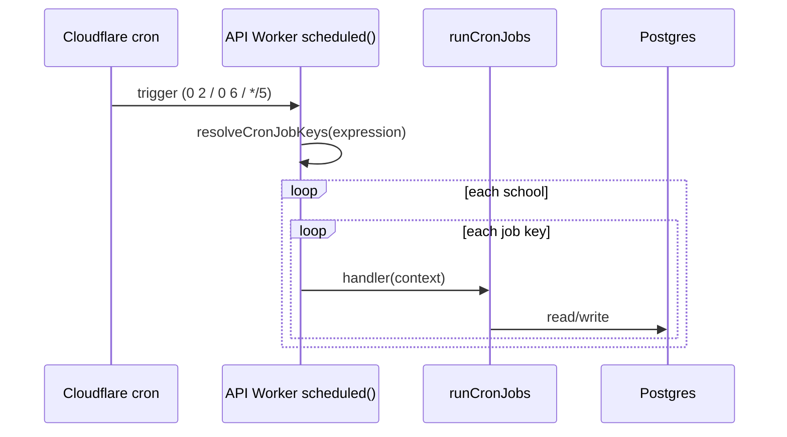
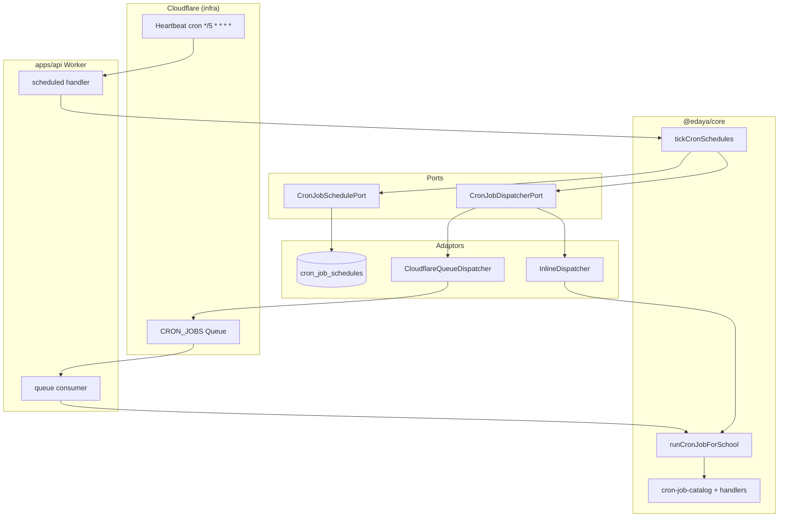
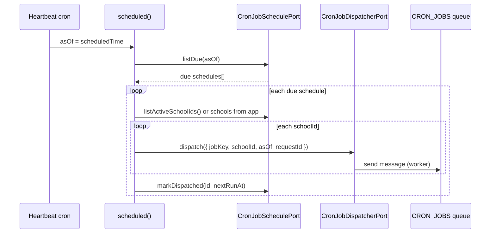
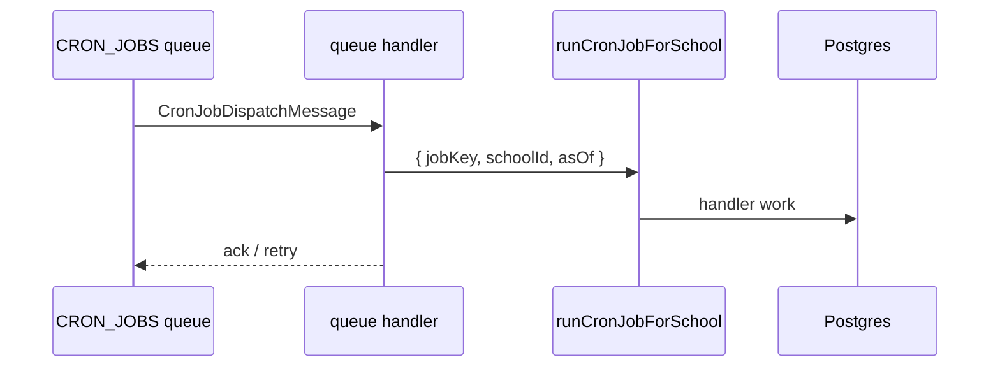

# Cron Heartbeat & Job Dispatcher — Sprint Plan

> **Status:** Complete (Phases 0–3)  
> **Created:** 2026-07-03  
> **Last updated:** 2026-07-03  
> **Scope:** Replace multiple Cloudflare cron triggers with a single heartbeat tick, DB-backed job schedules, and a `CronJobDispatcherPort` (inline locally, Cloudflare Queue in production)  
> **Out of scope:** Per-school schedule overrides, admin UI for cron config, separate `edaya-cron` worker, moving job handler logic out of `@edaya/core`  
> **Related:** [cron-runtimes.md](../reference/cron-runtimes.md), [runtime-boundaries.md](../reference/runtime-boundaries.md), `package/domain-core/src/capabilities/scheduling-jobs/`

This plan evolves scheduled background work from **expression-mapped Worker triggers** to a **heartbeat + schedule table + dispatcher** model. Job handlers stay in `@edaya/core`; only scheduling and execution wiring change.

---

## 1. Problem statement

### Current pain points

| Issue | Today | Impact |
|-------|-------|--------|
| Schedules in deploy config | Three cron expressions in `wrangler.jsonc` mapped via `resolve-cron-job-keys.ts` | Schedule changes require redeploy; mapping duplicated across env blocks |
| Monolithic execution | `scheduled()` runs all schools × all due jobs in one `waitUntil` | CPU/time limits as tenant count grows; one slow job blocks the batch |
| No execution isolation | Serial nested loops in `runCronJobs` | Hard to retry a single school/job; poor observability per unit of work |
| No async dispatch port | `scheduleBackgroundTask` covers HTTP `waitUntil` only | Cron path cannot swap to queue without rewriting worker entry |
| Legacy worker risk | `apps/cron/` still exists in repo | Risk of duplicate schedules if both workers are deployed |

### Current flow (baseline)



### Design principles (agreed)

1. **One Worker heartbeat** — single cron trigger in `wrangler.jsonc` (`*/5 * * * *`, matching today's tightest schedule).
2. **Schedules in DB, handlers in code** — table stores `job_key`, `cron_expression`, `enabled`, `next_run_at`; handlers remain typed in `cron-job-catalog.ts`.
3. **Dispatch granularity = `(jobKey, schoolId)`** — one queue message (or inline call) per school per job; aligns with `SchoolCronJobContext`.
4. **Ports and adapters** — `CronJobSchedulePort` + `CronJobDispatcherPort` in core; Postgres + Queue adaptors in infrastructure packages / `apps/api`.
5. **`next_run_at` due detection** — heartbeat queries due rows; advance `next_run_at` after dispatch (not re-parse all expressions on every tick).
6. **Idempotent handlers** — queue retries must be safe; existing idempotency keys on notifications already support this.
7. **Profile parity** — local dev uses inline dispatcher; worker uses Queue in production/staging.
8. **Behavior parity on cutover** — seed table with today's three jobs and expressions; no functional regression.

---

## 2. Desired architecture

### 2.1 Layer diagram



### 2.2 Heartbeat tick (new)



### 2.3 Queue consumer (new)



---

## 3. Data model

### 3.1 Table: `cron_job_schedules`

Platform-global schedule rows (not per-school). School fan-out happens at dispatch time.

| Column | Type | Notes |
|--------|------|-------|
| `id` | `uuid` PK | |
| `job_key` | `text` NOT NULL UNIQUE | Must match `CronJobKey` in core |
| `cron_expression` | `text` NOT NULL | Standard 5-field cron (UTC) |
| `enabled` | `boolean` NOT NULL DEFAULT `true` | |
| `next_run_at` | `timestamptz` NOT NULL | Due when `<= heartbeat asOf` |
| `last_dispatched_at` | `timestamptz` | Audit / ops |
| `created_at` | `timestamptz` | |
| `updated_at` | `timestamptz` | |

**Seed data (parity with today):**

| `job_key` | `cron_expression` | Notes |
|-----------|-------------------|-------|
| `expireAccountInvitations` | `0 2 * * *` | Daily 02:00 UTC |
| `processDueNotifications` | `0 6 * * *` | Daily 06:00 UTC |
| `reconcilePendingDeliveries` | `*/5 * * * *` | Every 5 minutes |

`next_run_at` initialized via cron parser from migration seed or first heartbeat backfill.

### 3.2 Queue message: `CronJobDispatchMessage`

```ts
type CronJobDispatchMessage = {
  jobKey: CronJobKey
  schoolId: string
  asOf: string          // ISO-8601
  requestId: string     // idempotency / tracing
}
```

---

## 4. Port definitions (core)

### 4.1 `CronJobSchedulePort`

```ts
type CronJobSchedule = {
  id: string
  jobKey: CronJobKey
  cronExpression: string
  enabled: boolean
  nextRunAt: Date
  lastDispatchedAt: Date | null
}

interface CronJobSchedulePort {
  listDue(asOf: Date): Promise<readonly CronJobSchedule[]>
  markDispatched(id: string, input: { nextRunAt: Date; dispatchedAt: Date }): Promise<void>
}
```

### 4.2 `CronJobDispatcherPort`

```ts
interface CronJobDispatcherPort {
  dispatch(message: CronJobDispatchMessage): Promise<void>
}
```

### 4.3 Core orchestration

| Function | Responsibility |
|----------|----------------|
| `tickCronSchedules(deps, { asOf })` | Load due schedules, fan out per school, mark dispatched |
| `runCronJobForSchool(app, { jobKey, schoolId, asOf, requestId })` | Single school × single job (extracted from `runCronJobs`) |
| `computeNextRunAt(cronExpression, after: Date)` | Shared cron math (small dep or minimal parser) |

`runCronJobs` remains for local bulk runs / tests; internally may delegate to `runCronJobForSchool`.

---

## 5. Adaptor matrix

| Profile | `CronJobSchedulePort` | `CronJobDispatcherPort` |
|---------|----------------------|------------------------|
| `local` | Postgres (PGlite) | `InlineCronJobDispatcher` (await in-process) |
| `in-memory` | In-memory fixture / no-op schedule | Inline |
| `worker` | Postgres (Hyperdrive) | `CloudflareQueueCronJobDispatcher` → `CRON_JOBS` binding |

### 5.1 Wrangler changes

**Before:**

```jsonc
"triggers": { "crons": ["0 2 * * *", "0 6 * * *", "*/5 * * * *"] }
```

**After:**

```jsonc
"triggers": { "crons": ["*/5 * * * *"] },
"queues": {
  "producers": [{ "binding": "CRON_JOBS", "queue": "edaya-cron-jobs" }],
  "consumers": [{ "queue": "edaya-cron-jobs", "max_batch_size": 10, "max_retries": 3 }]
}
```

Queue names suffixed per env (`edaya-cron-jobs-staging`, etc.) following existing naming patterns.

### 5.2 Worker entry changes

`apps/api/src/entries/worker.ts`:

- `scheduled()` → `tickCronSchedules` only (fast; no heavy job work).
- `queue()` → `runCronJobForSchool` per message.

`apps/api/src/entries/cron-local.ts`:

- Option A (v1): run full `tickCronSchedules` + inline dispatcher (end-to-end local).
- Option B: keep `CRON_JOB_KEYS` filter for targeted handler debugging.

---

## 6. Migration map

| Current artifact | Action |
|------------------|--------|
| `resolve-cron-job-keys.ts` | **Remove** after Phase 1 |
| `wrangler.jsonc` multi-cron triggers | **Replace** with single heartbeat |
| `run-scheduled-cron.ts` | **Refactor** to call `tickCronSchedules` / queue path |
| `runCronJobs` nested loops | **Extract** `runCronJobForSchool`; keep bulk helper |
| `apps/cron/` legacy worker | **Delete** or archive (confirm not deployed) |
| `docs/reference/cron-runtimes.md` | **Update** |

---

## 7. Phased delivery

### Progress

- [x] **Phase 0** — Sign off this plan + §10 checklist
- [x] **Phase 1** — DB table, ports, heartbeat tick, inline dispatcher (parity, no queue)
- [x] **Phase 2** — Cloudflare Queue producer/consumer, worker wiring, staging deploy
- [x] **Phase 3** — Cleanup, docs, observability, remove legacy paths

---

### Phase 1 — Heartbeat + schedule table + inline dispatch

**Goal:** Replace wrangler expression mapping with DB-driven schedules; execution still inline (acceptable for current scale).

| # | Task | Package / path |
|---|------|----------------|
| 1.1 | Add migration `cron_job_schedules` + seed rows | `package/adaptor-postgres/drizzle/` |
| 1.2 | Domain type + `CronJobSchedulePort` | `package/domain-core/src/ports/` |
| 1.3 | `CronJobScheduleRepository` | `package/adaptor-postgres/` |
| 1.4 | `computeNextRunAt` + `tickCronSchedules` | `package/domain-core/src/capabilities/scheduling-jobs/` |
| 1.5 | Extract `runCronJobForSchool` from `runCronJobs` | same |
| 1.6 | `InlineCronJobDispatcher` | `package/domain-core/src/adapters/` or `apps/api/src/runtime/` |
| 1.7 | Wire schedule port into API runtime | `apps/api/src/runtime/` |
| 1.8 | Refactor `scheduled()` → heartbeat only | `apps/api/src/entries/worker.ts` |
| 1.9 | Update `cron-local.ts` to use tick path | `apps/api/src/entries/cron-local.ts` |
| 1.10 | Single cron in `wrangler.jsonc` (all envs) | `apps/api/wrangler.jsonc` |
| 1.11 | Unit tests: `tickCronSchedules`, `computeNextRunAt`, schedule repo | `package/domain-core/tests/`, `apps/api/tests/` |
| 1.12 | Update `cron-runtimes.md` | `docs/reference/` |

**Acceptance criteria (Phase 1):**

- [ ] `bun run verify` green
- [ ] `bun run cron:local` runs heartbeat tick and executes all three jobs for all schools
- [ ] `CRON_JOB_KEYS` filter still works for debugging
- [ ] Only one cron expression in `wrangler.jsonc`
- [ ] `resolve-cron-job-keys.ts` deleted
- [ ] Seeded schedules match pre-change behavior (manual spot-check on staging data)

---

### Phase 2 — Cloudflare Queue dispatcher

**Goal:** Heartbeat dispatches work asynchronously; consumers execute one school × job per message.

| # | Task | Package / path |
|---|------|----------------|
| 2.1 | `CronJobDispatcherPort` interface | `package/domain-core/src/ports/` |
| 2.2 | `CloudflareQueueCronJobDispatcher` | `apps/api/src/runtime/worker/adapters/` |
| 2.3 | Queue binding in `wrangler.jsonc` (staging + production) | `apps/api/wrangler.jsonc` |
| 2.4 | `queue()` handler on Worker export | `apps/api/src/entries/worker.ts` |
| 2.5 | Runtime resolver: inline (local) vs queue (worker) | `apps/api/src/runtime/` |
| 2.6 | Integration test with Miniflare queue (if feasible) or smoke script | `apps/api/tests/` |
| 2.7 | Deploy staging; verify messages flow heartbeat → queue → handler | manual |
| 2.8 | Structured logs: `cron.tick`, `cron.dispatch`, `cron.execute` | `apps/api/` |

**Acceptance criteria (Phase 2):**

- [ ] Staging heartbeat completes in < few seconds (dispatch only)
- [ ] Queue consumer runs jobs per school; failures retry without poisoning unrelated work
- [ ] `reconcilePendingDeliveries` still runs every 5 minutes end-to-end
- [ ] No duplicate execution for same `(jobKey, schoolId, next_run_at window)` under normal operation

---

### Phase 3 — Cleanup & operability

| # | Task | Package / path |
|---|------|----------------|
| 3.1 | Remove `apps/cron/` if unused | `apps/cron/` |
| 3.2 | Confirm legacy `edaya-cron` Workers deleted in Cloudflare dashboard | ops |
| 3.3 | Add `doctor` check: wrangler has exactly one cron trigger | `tooling/repo/` |
| 3.4 | Document queue setup + local limitations | `docs/reference/cron-runtimes.md` |
| 3.5 | (Optional) SQL runbook: disable job, shift `next_run_at` | docs |

**Acceptance criteria (Phase 3):**

- [ ] No duplicate cron workers in Cloudflare
- [ ] Docs reflect new architecture end-to-end
- [ ] `bun run doctor` passes

---

## 8. Outcomes

1. **Single heartbeat trigger** — minimal Cloudflare surface; schedule changes without redeploy.
2. **DB-backed schedules** — enable/disable and retime jobs via data migration or future admin UI.
3. **Scalable execution** — per-school job units via Queue with retries.
4. **Clean boundaries** — schedule + dispatch as ports; handlers unchanged in core.
5. **Observable units of work** — one log line / trace per `(jobKey, schoolId)` execution.

---

## 9. Guardrails

- Job **handlers** and **job keys** stay in `@edaya/core` — never in DB as executable code.
- Heartbeat handler must stay **lightweight** — no direct handler invocation in production after Phase 2.
- `markDispatched` + `next_run_at` update should be **atomic per schedule row** to avoid double dispatch on overlapping heartbeats.
- Queue messages must carry a stable **`requestId`** for tracing (reuse pattern from `createSystemActorMetadata`).
- Cron expressions stored in **UTC**; document timezone assumption.
- Ports-and-adapters boundary preserved — `domain-core` does not import Cloudflare types.

### Non-goals (this sprint)

- Per-school cron overrides (all schools run the same job schedule)
- Admin UI for cron management
- Dynamic registration of new job handlers without code deploy
- Dead-letter queue admin tooling (use Cloudflare dashboard initially)
- Separate Worker service for cron (stays on API worker)

---

## 10. Open questions

| # | Question | Proposed decision |
|---|----------|-------------------|
| 1 | Heartbeat frequency | `*/5 * * * *` (matches current minimum) |
| 2 | Due detection | `next_run_at <= asOf`; advance with cron parser after dispatch |
| 3 | Dispatch before or after `markDispatched` | Dispatch first, then mark — accept rare duplicate on crash (handlers idempotent); or transactional outbox later |
| 4 | Cron parser dependency | `cron-parser` npm package in core or thin wrapper in adaptor |
| 5 | Queue batch size | Start with `max_batch_size: 10`, tune under load |
| 6 | `runCronJobs` bulk API | Keep for tests / `CRON_JOB_KEYS` local runs |
| 7 | Legacy `apps/cron/` | Delete in Phase 3 after confirming not deployed |

### Pre-implementation checklist (Phase 0)

- [ ] Agree heartbeat interval (`*/5`)
- [ ] Agree global (not per-school) schedule table
- [ ] Agree dispatch unit = `(jobKey, schoolId)`
- [ ] Agree Queue on same API worker (not separate service)
- [ ] Agree seed data preserves current three jobs
- [ ] Confirm `edaya-cron` legacy worker status in Cloudflare

---

## 11. Test plan

| Layer | What to test |
|-------|----------------|
| Unit | `computeNextRunAt` across daily + `*/5` expressions; `tickCronSchedules` fans out correct message count |
| Unit | `markDispatched` advances `next_run_at`; disabled rows skipped |
| Unit | `runCronJobForSchool` invokes correct handler only |
| Integration | Schedule repo against PGlite |
| Integration | Inline dispatcher end-to-end tick |
| Worker smoke | Staging: heartbeat logs + queue depth + job completion logs |
| Regression | Existing `cron-job-runner.test.ts` scenarios still pass |

---

## 12. Rollout

1. Deploy Phase 1 to staging — inline dispatch, verify parity.
2. Create Queue in Cloudflare; deploy Phase 2 to staging.
3. Monitor queue depth and error rate for 24–48h.
4. Deploy production; remove extra cron triggers from dashboard if any drift.
5. Delete legacy `edaya-cron` worker(s).

**Rollback:** Revert to previous deploy (multi-cron + inline `runScheduledCron`) if queue consumer fails; schedule table is backward-compatible if unused by old code.

---

## 13. References

- Cron handlers: `package/domain-core/src/capabilities/scheduling-jobs/`
- Worker entry: `apps/api/src/entries/worker.ts`
- Scheduled cron adapter: `apps/api/src/cron/run-scheduled-cron.ts`
- Runtime docs: [cron-runtimes.md](../reference/cron-runtimes.md), [runtime-boundaries.md](../reference/runtime-boundaries.md)
- Background task pattern: `apps/api/src/lib/school-api/schedule-background-task.ts`
- Legacy cron worker: `apps/cron/`

---

## 14. Effort estimate

| Phase | Estimate | Notes |
|-------|----------|-------|
| Phase 0 | 0.5 day | Review + checklist sign-off |
| Phase 1 | 2–3 days | Migration, ports, heartbeat, tests, docs |
| Phase 2 | 2–3 days | Queue wiring, worker handlers, staging validation |
| Phase 3 | 0.5–1 day | Cleanup, doctor, ops confirmation |
| **Total** | **~5–7 days** | Single engineer; assumes no production incident during rollout |
