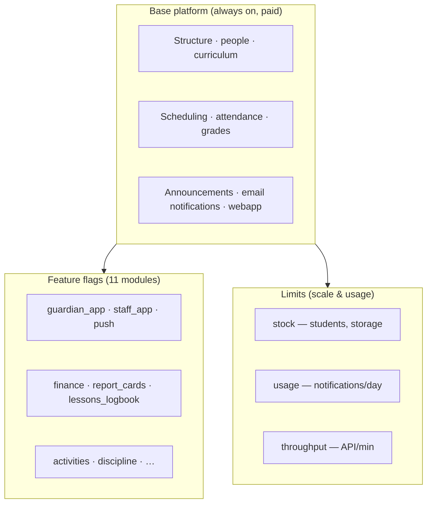
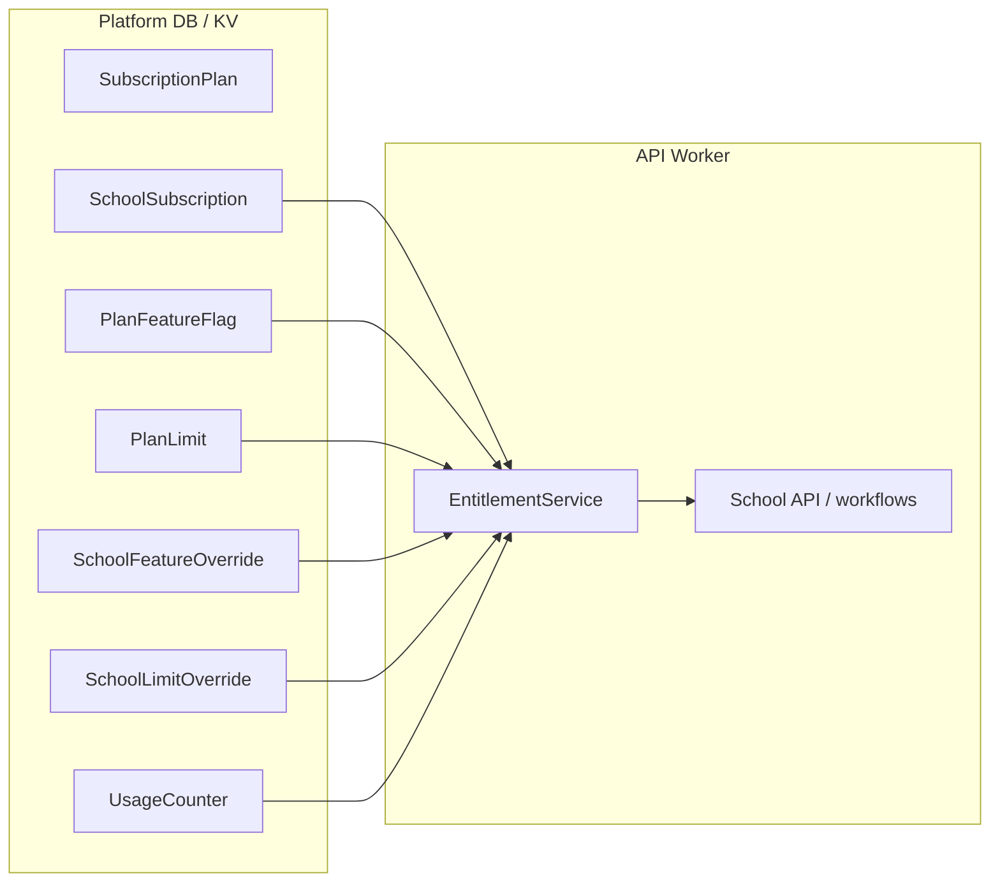

# Platform Limits & Subscription Plans — Sprint Plan

> **Status:** Phase 0 — proposal draft  
> **Created:** 2026-06-30  
> **Last updated:** 2026-06-30 (§7.1 single `UsageCounter`; no `UsageSnapshot` / nightly cron in v1)  
> **Scope:** Edaya **SaaS** entitlements per school — feature flags, numeric quotas, usage metering, enforcement in API/workflows, `saas-admin` plan management  
> **Out of scope:** School → family billing (`Fee` / `CatalogService`, `StudentCharge`, etc.) — separate domain  
> **Related:** `edaya_web/apps/saas-admin`, school API `ServiceArgs`, Cloudflare KV (rate limits), R2/storage metering

This plan defines how Edaya bills and constrains **its own customers** (schools on the platform): which modules they can use, how much they can scale, and when operations are blocked vs metered for overage.

---

## 1. Problem statement

### Current pain points

| Issue | Today | Impact |
|-------|-------|--------|
| No plan model | Every school has full product access | Cannot price by size or module |
| No enforcement | Limits exist only as ad-hoc validation (e.g. upload size) | Cost exposure on storage, notifications, materialization |
| `saas-admin` placeholder | Billing page is static copy | No ops control plane |
| Feature vs quota confusion | — | Risk of 50+ interdependent flags |
| School finance ≠ SaaS billing | Finance module is tenant-scoped | Must not mix `CatalogService` with platform plans |

### Design principles (agreed)

1. **Two entitlement mechanisms** — **Feature flags** (module on/off) and **limits** (`limit` + `unit` + `period`). Separate registries, tables, and resolvers.
2. **Small feature surface** — A feature must pass: *“Could a real school operate without this?”* If not → **base platform**, not a flag.
3. **Independent features** — No `requires[]` graph between feature keys.
4. **Coherent base product** — Grades include entry **and** publish; not sold as separate flags.
5. **Mobile inherits school features** — `guardian_app` / `staff_app` gate portals; screens follow resolved features + base.
6. **Platform scope** — Plan data lives in **platform storage**, resolved before tenant workflows run.
7. **Enforcement layers** — Hard block on exceed (default); optional soft warn in UI before hard cap.
8. **School finance is separate** — `finance` feature gates the school’s fee module; unrelated to Edaya invoicing schools.

---

## 2. Product model

### 2.1 Three layers



### 2.2 Feature decision test

| # | Question | Fail → |
|---|----------|--------|
| 1 | Could a real school run without it? | Base platform |
| 2 | Does it materially increase SaaS cost? | Limit only (not a feature) |
| 3 | Credible tier upsell? | Not a feature |
| 4 | Toggle without forcing other features? | Redesign or merge |

### 2.3 Limit definition

Describes **scale and usage caps** only. Feature flags do not appear in the limit registry.

| Field | On registry (`LimitDefinition`) | On plan (`PlanLimit`) |
|-------|--------------------------------|----------------------|
| **`limit`** | — | `number \| null` (`null` = unlimited) |
| **`unit`** | required | — (from registry) |
| **`period`** | optional | — (from registry) |

**Semantics** (inferred from `unit` + `period`):

| Shape | `period` | Meaning | Example |
|-------|----------|---------|---------|
| **Stock cap** | — | Current level ≤ limit | `student.active` / `students` |
| **Usage cap** | `day`, `month`, `billing_period` | Accumulated usage in window ≤ limit | `notification.sent` / `notifications` / `day` |
| **Throughput cap** | `minute`, `hour`, `day` | Events per window ≤ limit | `api.command.requests` / `requests` / `minute` |

```ts
type LimitUnit =
  | 'students' | 'staff' | 'guardians' | 'accounts' | 'occurrences' | 'rows' | 'days'
  | 'bytes' | 'notifications' | 'requests' | 'attempts' | 'sends' | 'recipients'
  | 'count'

type LimitPeriod = 'minute' | 'hour' | 'day' | 'month' | 'billing_period'

type LimitDefinition = {
  key: string
  unit: LimitUnit
  period?: LimitPeriod
  scope: 'school' | 'actor' | 'platform'
  description: string
}

type PlanLimitValue = {
  limit: number | null
}

type ResolvedLimit = LimitDefinition & {
  limit: number | null   // effective cap after override
}
```

### 2.4 Feature flag definition

Describes **optional modules** only. Separate registry — no `unit` or `period`.

| Field | On registry (`FeatureFlagDefinition`) | On plan (`PlanFeatureFlag`) |
|-------|--------------------------------------|----------------------------|
| **`enabled`** | — | `boolean` |

```ts
type FeatureFlagDefinition = {
  key: string              // e.g. 'guardian_app', 'finance' — no 'feature.' prefix
  description: string
}

type PlanFeatureFlagValue = {
  enabled: boolean
}

type ResolvedFeature = FeatureFlagDefinition & {
  enabled: boolean         // effective value after override
}

type SchoolEntitlements = {
  features: Record<FeatureFlagKey, ResolvedFeature>
  limits: Record<LimitKey, ResolvedLimit>
}
```

---

## 3. Base platform (no flags)

Included on every **paid** plan (and trial with reduced numeric caps).

| Area | Capabilities |
|------|----------------|
| **Structure** | School setup, academic years, periods, grade levels, classes |
| **People** | Students, staff, guardians, links, invitations, lifecycle (promote, transfer, graduate) |
| **Curriculum** | Subject catalog, class subject offerings |
| **Scheduling** | Timetable, calendar, recurring schedules, materialization (within limits) |
| **Attendance** | Lesson/session + daily mode, justification workflow |
| **Grades** | Assessments, entry, validation, **publish to guardians** (when `guardian_app` enabled) |
| **Communications** | Announcements with targeting |
| **Notifications** | Transactional email, in-app inbox |
| **Core UX** | Webapp, dashboard, attachments, basic CSV export (within row caps) |

---

## 4. Feature flags (11)

Independent modules. Each has a `FeatureFlagDefinition` (registry) and `PlanFeatureFlag.enabled` per tier.

| Key | Why optional | Primary cost |
|-----|--------------|--------------|
| `guardian_app` | Parent digital access not always wanted | Mobile API, support |
| `staff_app` | Staff may use web only | Mobile API |
| `push_notifications` | Email/in-app may suffice | FCM, delivery volume |
| `finance` | External school accounting | DB, future gateway |
| `report_cards` | Gradebook without formal bulletins | PDF CPU, R2 |
| `lessons_logbook` | No daily lesson narrative | Extra rows per lesson |
| `activities` | No extracurricular programs | Sessions, enrollments |
| `discipline` | No formal incident module | Storage, notifications |
| `health_records` | Privacy / not all schools store health data | Sensitive storage |
| `integrations` | API keys for machine clients | API volume |
| `custom_notifications` | Default templates sufficient | Template storage |

### 4.1 Mobile inheritance

Portal features gate **app access** only. Screen visibility is derived at runtime:

```
screenVisible = features.<portal>.enabled AND (features.<module>.enabled if applicable)
```

| Guardian screen | Resolved features |
|-----------------|-------------------|
| Calendar | `guardian_app` (base scheduling) |
| Attendance | `guardian_app` (base attendance) |
| Grades | `guardian_app` (base grades) |
| Report cards | `guardian_app` + `report_cards` |
| Fees | `guardian_app` + `finance` |
| Inbox | `guardian_app` (base notifications / communications) |

| Staff screen | Resolved features |
|--------------|-------------------|
| Timetable / classes | `staff_app` (base) |
| Attendance capture | `staff_app` (base) |
| Grade entry | `staff_app` (base) |
| Lesson log | `staff_app` + `lessons_logbook` |
| Incidents | `staff_app` + `discipline` |

Push delivery: `push_notifications` + relevant portal feature.

### 4.2 Explicitly not flags

| Rejected | Reason |
|----------|--------|
| `grades` / `grades.publish` | Base; publish bundled with grades |
| `scheduling.recurring`, `conflicts` | Base capability; cost → numeric limits |
| `finance.subscriptions`, `credits`, … | Inside `finance`; tier via limits or future `advanced_finance` limit keys |
| Granular `guardian_portal.*` | Mobile inheritance |
| `communications`, core `notifications` | Base |
| `exports.*` | Numeric limits |

---

## 5. Scale & usage limits (SaaS cost)

Only limits that affect **Edaya operational cost** or **abuse surface**. School business rules (max guardians per student, grade scale bounds) stay in domain validation — not plan limits.

### 5.1 Tier 1 — cap on every plan (hard)

| Key | Unit | Period | Notes |
|-----|------|--------|-------|
| `student.active` | `students` | — | Primary pricing axis (stock) |
| `staff.active` | `staff` | — | stock |
| `guardian.active` | `guardians` | — | stock |
| `storage.total_bytes` | `bytes` | — | R2 total (stock) |
| `notification.sent` | `notifications` | `day` | Email + push fan-out |
| `api.command.requests` | `requests` | `minute` | Per actor; KV preferred |
| `occurrence.materialized` | `occurrences` | `billing_period` | Lesson + activity sessions |

### 5.2 Tier 2 — plan differentiation

| Key | Unit | Period |
|-----|------|--------|
| `service_account.active` | `accounts` | — |
| `storage.uploaded_bytes` | `bytes` | `month` |
| `announcement.targets.recipients` | `recipients` | — |
| `report_card.generate.batch` | `students` | — |
| `api.export.rows` | `rows` | — |
| `api.list.page_size` | `rows` | — |
| `class_group.active` | `count` | — |
| `platform.trial.duration` | `days` | — |

### 5.3 Tier 3 — abuse floor (same all tiers, not marketed)

| Key | Unit | Period |
|-----|------|--------|
| `auth.sign_in.attempts` | `attempts` | `hour` |
| `upload.file_size` | `bytes` | — |
| `upload.file_size.pdf` | `bytes` | — |
| `schedule.materialize.occurrences` | `occurrences` | — |
| `timetable.query.range` | `days` | — |
| `account_invitation.resends` | `sends` | `day` |

### 5.4 Companion limits when a feature is enabled

| Feature | Companion limits |
|---------|------------------|
| `push_notifications` | `notification.sent` |
| `integrations` | `service_account.active`, `api.command.requests` |
| `finance` | (school finance rules — domain, not SaaS) |
| `report_cards` | `report_card.generate.batch`, `upload.file_size.pdf` |
| Base attachments | `storage.total_bytes`, `storage.uploaded_bytes`, `upload.file_size` |

---

## 6. Subscription plans

### 6.1 Plan tiers

| Plan | Code | Positioning |
|------|------|-------------|
| **Trial** | `trial` | Time-boxed Standard; strict caps |
| **Starter** | `starter` | Small school; web + guardian app |
| **Standard** | `standard` | Full day-to-day operations |
| **Pro** | `pro` | Integrations, compliance modules, headroom |
| **Enterprise** | `enterprise` | Custom overrides; sales-led |

### 6.2 Feature flags per plan (`PlanFeatureFlag.enabled`)

| Key | Trial | Starter | Standard | Pro |
|-----|:-----:|:-------:|:--------:|:---:|
| `guardian_app` | ✓ | ✓ | ✓ | ✓ |
| `staff_app` | — | — | ✓ | ✓ |
| `push_notifications` | — | — | ✓ | ✓ |
| `finance` | — | — | ✓ | ✓ |
| `report_cards` | — | — | ✓ | ✓ |
| `lessons_logbook` | — | — | ✓ | ✓ |
| `activities` | — | — | ✓ | ✓ |
| `discipline` | — | — | — | ✓ |
| `health_records` | — | — | — | ✓ |
| `integrations` | — | — | — | ✓ |
| `custom_notifications` | — | — | — | ✓ |

Enterprise: all features `enabled: true` unless overridden via `SchoolFeatureOverride`.

### 6.3 Illustrative scale limits (TBD — tune for market)

| Key | Trial | Starter | Standard | Pro |
|-----|------:|--------:|---------:|----:|
| `student.active` | 50 | 150 | 500 | null |
| `staff.active` | 5 | 15 | 50 | null |
| `guardian.active` | 50 | 200 | 1 000 | null |
| `storage.total_bytes` | 1e9 | 5e9 | 25e9 | 100e9 |
| `notification.sent` | 100 | 500 | 2 000 | 10 000 |
| `occurrence.materialized` | 2 000 | 5 000 | 25 000 | null |
| `service_account.active` | 0 | 0 | 0 | 10 |
| `api.command.requests` | 30 | 60 | 120 | 300 |

`null` = unlimited (`PlanLimitValue.limit`).

---

## 7. Architecture

### 7.1 Storage boundary



- **Platform tables** — no `schoolId` filtering mistakes in tenant repos; platform service owns resolution.
- **Single usage store** — `UsageCounter` for all measurable limits (stock, usage windows, throughput). No separate snapshot table or nightly capacity cron in v1.
- **Hot throughput path** — Cloudflare KV or Durable Object for `minute` / `hour` limits; async flush to `UsageCounter` for durability and `saas-admin` display.

#### Usage accounting model

| Limit shape | `period` on counter | How `currentValue` moves | Period flush |
|-------------|---------------------|--------------------------|--------------|
| **Stock** | `null` (no window) | `recordUsage(±delta)` on domain events (enroll, archive, upload, delete) | Never — running total |
| **Usage window** | `day`, `month`, `billing_period` | `recordUsage(+delta)` per event | New row / reset when window rolls |
| **Throughput** | `minute`, `hour` | `recordUsage(+delta)` per request | KV or counter reset per window |

**Why no `UsageSnapshot` / nightly cron**

Period-based counters already flush at window boundaries — a separate snapshot + reconcile loop is redundant for usage and throughput limits.

Stock limits (`student.active`, `storage.total_bytes`) stay accurate via **incremental `recordUsage` on the mutating workflow** (same transaction or immediately after success). Enforcement reads `currentValue + delta ≤ limit` from the counter; no full-table `COUNT` on each request.

Optional **reconcile job** (Phase 7+, not v1): compare counter vs ground truth for ops dashboards; fix drift after bugs — not on the enforcement hot path.

**Cold start:** on first check for a stock key with no counter row, seed from a one-time `measure()` (e.g. `COUNT` active students) then maintain incrementally.

### 7.2 Entity definitions

#### 7.2.1 `LimitDefinition` (code registry)

Scale and usage caps only. TypeScript registry in `package/platform-core/src/limits/`.

```ts
type LimitDefinition = {
  key: string
  unit: LimitUnit
  period?: LimitPeriod
  scope: 'school' | 'actor' | 'platform'
  description: string
}
```

#### 7.2.2 `FeatureFlagDefinition` (code registry)

Optional modules only. Separate file: `package/platform-core/src/features/`.

```ts
type FeatureFlagDefinition = {
  key: string
  description: string
}
```

#### 7.2.3 `SubscriptionPlan`

| Field | Type | Required |
|-------|------|----------|
| `id` | string | yes |
| `code` | string | yes, unique |
| `name` | string | yes |
| `status` | enum | `active` \| `deprecated` |
| `sortOrder` | int | yes |
| `defaultTrialDays` | int? | |
| `createdAt` | datetime | yes |

#### 7.2.4 `PlanFeatureFlag`

| Field | Type | Required |
|-------|------|----------|
| `id` | string | yes |
| `planId` | string | yes |
| `featureKey` | string | yes |
| `value` | json | yes — `{ enabled: boolean }` |

**Unique:** `(planId, featureKey)`

```ts
type PlanFeatureFlagValue = {
  enabled: boolean
}
```

#### 7.2.5 `PlanLimit`

| Field | Type | Required |
|-------|------|----------|
| `id` | string | yes |
| `planId` | string | yes |
| `limitKey` | string | yes |
| `value` | json | yes — `{ limit: number \| null }` |

**Unique:** `(planId, limitKey)` — `limitKey` must exist in `LimitDefinition` only (not feature registry).

```ts
type PlanLimitValue = {
  limit: number | null
}
```

`unit` and `period` come from `LimitDefinition` at resolve time.

#### 7.2.6 `SchoolSubscription`

| Field | Type | Required |
|-------|------|----------|
| `id` | string | yes |
| `schoolId` | string | yes |
| `planId` | string | yes |
| `status` | enum | `trialing` \| `active` \| `past_due` \| `suspended` \| `cancelled` |
| `startedAt` | datetime | yes |
| `currentPeriodStart` | date | yes |
| `currentPeriodEnd` | date | yes |
| `trialEndsAt` | datetime? | |
| `suspendedAt` | datetime? | |
| `cancelledAt` | datetime? | |
| `createdAt` | datetime | yes |

One active subscription per school (enforce in service).

#### 7.2.7 `SchoolFeatureOverride`

| Field | Type | Required |
|-------|------|----------|
| `id` | string | yes |
| `schoolId` | string | yes |
| `featureKey` | string | yes |
| `value` | json | yes — `{ enabled: boolean }` |
| `reason` | string | yes |
| `validFrom` | datetime | yes |
| `validUntil` | datetime? | |
| `createdByOperatorId` | string | yes |

#### 7.2.8 `SchoolLimitOverride`

| Field | Type | Required |
|-------|------|----------|
| `id` | string | yes |
| `schoolId` | string | yes |
| `limitKey` | string | yes |
| `value` | json | yes — `{ limit: number \| null }` |
| `reason` | string | yes |
| `validFrom` | datetime | yes |
| `validUntil` | datetime? | |
| `createdByOperatorId` | string | yes |

#### 7.2.9 `UsageCounter`

Single store for **all** measurable limits.

| Field | Type | Required |
|-------|------|----------|
| `id` | string | yes |
| `schoolId` | string | yes |
| `limitKey` | string | yes |
| `actorId` | string? | for actor-scoped limits (e.g. API per user) |
| `period` | enum? | `null` for **stock**; else `minute` \| `hour` \| `day` \| `month` \| `billing_period` |
| `periodStart` | datetime? | `null` when `period` is `null`; else start of current window |
| `currentValue` | bigint | yes |
| `unit` | string | yes — denormalized from `LimitDefinition` |
| `updatedAt` | datetime | yes |

**Unique:** `(schoolId, limitKey, actorId, period, periodStart)`

| `period` | Behaviour |
|----------|-----------|
| `null` | Stock total — updated by ±delta on domain events; no flush |
| `day`, `month`, … | Usage window — new counter row (or reset) when window rolls |
| `minute`, `hour` | Throughput — prefer KV hot path; flush to Postgres for billing UI |

### 7.3 Resolution

```ts
function resolveFeature(schoolId: string, key: FeatureFlagKey): ResolvedFeature {
  // 1. FeatureFlagDefinition from registry
  // 2. SchoolFeatureOverride.value.enabled if valid
  // 3. else PlanFeatureFlag.value.enabled for active plan
  // 4. else false
}

function resolveLimit(schoolId: string, key: LimitKey): ResolvedLimit {
  // 1. LimitDefinition from registry
  // 2. SchoolLimitOverride.value.limit if valid
  // 3. else PlanLimit.value.limit for active plan
  // 4. else registry default (abuse floors only)
}

function resolveEntitlements(schoolId: string): SchoolEntitlements
```

**Suspended schools:** `platform.schools.suspended.block_writes` — reject mutations except billing/support endpoints.

### 7.4 Enforcement service

```ts
interface EntitlementService {
  assertFeatureEnabled(schoolId: string, key: FeatureFlagKey): void

  assertWithinLimit(input: {
    schoolId: string
    key: LimitKey
    actorId?: string
    delta?: number              // proposed change; compared to UsageCounter + limit
    measure?: () => Promise<number>  // cold-start seed only when no counter row exists
  }): void

  recordUsage(input: {
    schoolId: string
    key: LimitKey
    actorId?: string
    delta: number               // +1 student, +bytes, +1 notification, etc.
  }): void

  resolveEntitlements(schoolId: string): SchoolEntitlements
}
```

Injected as `entitlements` on `ServiceArgs` (replaces a single mixed limits service).

**Error codes:**

| Code | When |
|------|------|
| `FEATURE_DISABLED` | `PlanFeatureFlag.enabled === false` |
| `LIMIT_EXCEEDED` | Usage/stock/throughput over cap |
| `SUBSCRIPTION_INACTIVE` | No active/trial subscription |
| `SUBSCRIPTION_SUSPENDED` | Writes blocked |

### 7.5 Enforcement points

| Layer | What |
|-------|------|
| **API middleware** | Rate limits, subscription status, `$limit` cap |
| **Workflow entry** | `assertFeatureEnabled` + `assertWithinLimit` on commands |
| **Domain gates** | Upload policy already has size; extend with storage total |
| **Post-action** | `recordUsage` after notification send, student enroll, attachment register, materializeSchedule |
| **Webapp** | Hide nav items when flag off; upgrade CTA |
| **Guardian / staff app** | Portal + module resolution at bootstrap |

### 7.6 Injection into school runtime

```ts
type ServiceArgs = {
  // existing...
  entitlements: EntitlementService
}
```

Resolve `schoolId` from actor metadata (existing tenant boundary). Platform operator routes use separate auth — not school `ServiceArgs`.

---

## 8. `saas-admin` integration

### 8.1 Screens

| Screen | Actions |
|--------|---------|
| **Plans** | Edit `PlanFeatureFlag` (enabled) and `PlanLimit` (limit) per tier |
| **Schools** | Assign plan, trial dates, suspend, view usage |
| **Overrides** | Per-school feature + limit overrides with reason + expiry |
| **Usage** | Dashboard: storage, notifications/day, students vs cap |

### 8.2 API surface (platform routes)

```
GET  /platform/plans
GET  /platform/plans/{id}/features
PATCH /platform/plans/{id}/features
GET  /platform/plans/{id}/limits
PATCH /platform/plans/{id}/limits

GET  /platform/schools/{schoolId}/subscription
PUT  /platform/schools/{schoolId}/subscription
GET  /platform/schools/{schoolId}/entitlements
GET  /platform/schools/{schoolId}/usage

POST /platform/schools/{schoolId}/feature-overrides
DELETE /platform/schools/{schoolId}/feature-overrides/{id}
POST /platform/schools/{schoolId}/limit-overrides
DELETE /platform/schools/{schoolId}/limit-overrides/{id}
```

School-facing (read-only, for upgrade UX):

```
GET /core/school/entitlements   // { features, limits } — resolved effective values
```

### 8.3 Seeding

- Seed 4 plans + `PlanFeatureFlag` rows (§6.2) + `PlanLimit` rows (§6.3).
- On `registerSchool`, create `SchoolSubscription` (`trial` or `starter` per product decision).
- Dev schools: `enterprise` or overrides for local full access.

---

## 9. Phased delivery

### Progress

- [ ] **Phase 0** — Sign off this spec + limit registry + tier matrix values
- [ ] **Phase 1** — Registries; platform schema (`PlanFeatureFlag`, `PlanLimit`, …); seed plans; no enforcement
- [ ] **Phase 2** — `EntitlementService`; `assertFeatureEnabled` on 11 modules; API + webapp nav gating
- [ ] **Phase 3** — Stock limits via `UsageCounter` (`period: null`) + `recordUsage` on enroll/archive/upload; assert before mutate
- [ ] **Phase 4** — Period limits (`notification.sent`, `api.command.requests`); period flush; KV for throughput
- [ ] **Phase 5** — `saas-admin` plans + school subscription UI; effective limits API
- [ ] **Phase 6** — Guardian/staff app entitlement bootstrap; upgrade messaging
- [ ] **Phase 7** — Optional reconcile job (ops); usage dashboard; trial expiry + suspend automation

### Phase 1 detail

1. New package or module: `platform-core` + `adaptor-postgres/platform-schema`
2. Migrations: `subscription_plans`, `plan_feature_flags`, `plan_limits`, `school_subscriptions`
3. Seed plans from §6
4. Hook `registerSchool` → default subscription
5. `GET /core/school/entitlements` stub

### Phase 2 detail — feature hook map (minimum)

| Feature key | Gate |
|-------------|------|
| `guardian_app` | Guardian invite accept; guardian API routes |
| `staff_app` | Staff mobile auth bootstrap |
| `push_notifications` | `registerPushDevice` |
| `finance` | Finance routes + `createFee` / future catalog commands |
| `report_cards` | Report card definition + generate/publish |
| `lessons_logbook` | Teaching log routes / `recordSessionProgress` |
| `activities` | Activity CRUD + enrollments |
| `discipline` | Incident / sanction workflows |
| `health_records` | `upsertStudentHealthProfile` |
| `integrations` | Service account CRUD |
| `custom_notifications` | `updateSchoolNotificationTemplates` |

---

## 10. Outcomes

1. **11 feature flags** — `FeatureFlagDefinition` + `PlanFeatureFlag.enabled`; independent, no dependency graph.
2. **~20 limits** — `LimitDefinition` (`unit` + `period`) + `PlanLimit.limit`.
3. **Platform entities** — separate feature and limit plan rows, overrides, subscriptions, usage.
4. **Split enforcement** — `assertFeatureEnabled` vs `assertWithinLimit`; combined `resolveEntitlements`.
5. **Mobile inheritance** — two portal flags; screens from school entitlements.
6. **`saas-admin` control plane** — assign plans, overrides, view usage.
7. **Clear boundary** — platform billing ≠ school `finance` module.

---

## 11. Guardrails

- Platform limits never stored on `School` row as source of truth — always via `SchoolSubscription`.
- Do not conflate `feature.finance` with Edaya invoicing; platform billing is operator-managed (manual v1; Stripe etc. post-v1).
- Abuse floors (auth rate, max page size) are not plan-marketed — same all tiers.
- `LIMIT_EXCEEDED` responses include `limitKey`, `current`, `max`, `upgradePlan` hint for UI.
- Cache resolved entitlements; invalidate on subscription / feature or limit override change.

### Non-goals (v1)

- Automated Edaya → school invoicing (Stripe Billing)
- Overage charging / `OverageCharge` entity
- `UsageSnapshot` table / nightly capacity cron (v1 uses `UsageCounter` + incremental `recordUsage` only)
- Per-school custom plans (use overrides only)
- School-admin self-service plan upgrade checkout
- Granular mobile feature keys
- School finance limits in platform plan engine
- Mixing feature keys into `PlanLimit` or limit keys into `PlanFeatureFlag`
- Feature dependency graph / `requires[]` enforcement

---

## 12. Open questions

| # | Question | Proposal |
|---|----------|----------|
| 1 | Default plan on `registerSchool` | `trial` 14 days → `starter` unless sales assigns |
| 2 | Platform DB location | Same Postgres, `platform_*` schema vs separate Neon DB |
| 3 | `advanced_finance` | Fold into `finance` feature; subscriptions/credits via domain when finance on |
| 4 | Unlimited sentinel | `null` limit in JSON; never omit key (explicit unlimited) |
| 5 | Trial features | Same as Standard `PlanFeatureFlag` values; lower `PlanLimit` caps only |
| 6 | Existing dev schools | Seed `enterprise` or feature/limit overrides |
| 7 | Block vs log on exceed | v1: hard block at 100%; v2: overage billing |

### Pre-implementation checklist (Phase 0)

- [ ] Agree 11 feature flags (§4) — separate from limits
- [ ] Agree base platform scope (§3)
- [ ] Agree limit shape: `limit` + `unit` + `period` (§2.3)
- [ ] Agree feature shape: `enabled` (§2.4)
- [ ] Agree scale/usage limit catalog (§5)
- [ ] Agree tier matrix — flags (§6.2)
- [ ] Agree tier matrix — numeric values (§6.3) with business input
- [ ] Agree platform storage boundary (§7.1)
- [ ] Agree mobile inheritance rules (§4.1)
- [ ] Confirm separation from school finance domain

---

## 13. References

- SaaS admin placeholder: `edaya_web/apps/saas-admin`
- Upload limits (pattern): `package/domain-core/src/storage/upload-policy.ts`
- School entity: `package/domain-core/src/domains/school/school.ts`
- Service args injection: `package/domain-core/src/shared/service-args.ts`
- School commands (hook points): `package/domain-core/src/services/school-command-catalog.ts`
- Permissions (not replaced by flags): `package/domain-core/src/authorization/permissions/permission.ts`
- Guardian mobile features: `edaya_mobile/apps/guardian/lib/features/`
- Product constraints article: `docs/articles/01-product-constraints-to-software-boundaries.md`

---

## 14. Registry appendix (machine-readable sketch)

### Feature flags

```ts
export const FEATURE_FLAG_REGISTRY: FeatureFlagDefinition[] = [
  { key: 'guardian_app', description: 'Guardian mobile app' },
  { key: 'staff_app', description: 'Staff mobile app' },
  { key: 'push_notifications', description: 'Push notification channel' },
  { key: 'finance', description: 'School fee / billing module' },
  { key: 'report_cards', description: 'Report card generation & publish' },
  { key: 'lessons_logbook', description: 'Lesson log / teaching log' },
  { key: 'activities', description: 'Extracurricular programs' },
  { key: 'discipline', description: 'Incidents & sanctions' },
  { key: 'health_records', description: 'Student health profiles' },
  { key: 'integrations', description: 'Service accounts / API keys' },
  { key: 'custom_notifications', description: 'Custom notification templates' },
]

export type FeatureFlagKey = typeof FEATURE_FLAG_REGISTRY[number]['key']
```

### Limits

```ts
export const LIMIT_REGISTRY: LimitDefinition[] = [
  // Stock — unit, no period
  { key: 'student.active', unit: 'students', scope: 'school', description: 'Active enrolled students' },
  { key: 'staff.active', unit: 'staff', scope: 'school', description: 'Active staff' },
  { key: 'guardian.active', unit: 'guardians', scope: 'school', description: 'Active guardians' },
  { key: 'storage.total_bytes', unit: 'bytes', scope: 'school', description: 'Total attachment storage' },
  { key: 'service_account.active', unit: 'accounts', scope: 'school', description: 'Active API keys' },
  { key: 'class_group.active', unit: 'count', scope: 'school', description: 'Class groups per year' },

  // Usage — unit + period
  { key: 'notification.sent', unit: 'notifications', period: 'day', scope: 'school', description: 'Notifications per school per day' },
  { key: 'storage.uploaded_bytes', unit: 'bytes', period: 'month', scope: 'school', description: 'Upload volume per month' },
  { key: 'occurrence.materialized', unit: 'occurrences', period: 'billing_period', scope: 'school', description: 'Materialized sessions per year' },

  // Throughput — unit + short period
  { key: 'api.command.requests', unit: 'requests', period: 'minute', scope: 'actor', description: 'API commands per actor per minute' },
  { key: 'auth.sign_in.attempts', unit: 'attempts', period: 'hour', scope: 'actor', description: 'Sign-in attempts per hour' },
  { key: 'account_invitation.resends', unit: 'sends', period: 'day', scope: 'school', description: 'Invitation resends per day' },

  // … Tier 2–3 keys from §5.2–5.3
]

export type LimitKey = typeof LIMIT_REGISTRY[number]['key']
```

### Plan seed examples

```ts
// Features — PlanFeatureFlag
{ planId: 'plan-standard', featureKey: 'finance', value: { enabled: true } }
{ planId: 'plan-starter', featureKey: 'finance', value: { enabled: false } }

// Limits — PlanLimit
{ planId: 'plan-standard', limitKey: 'student.active', value: { limit: 500 } }
{ planId: 'plan-pro', limitKey: 'student.active', value: { limit: null } }
```
