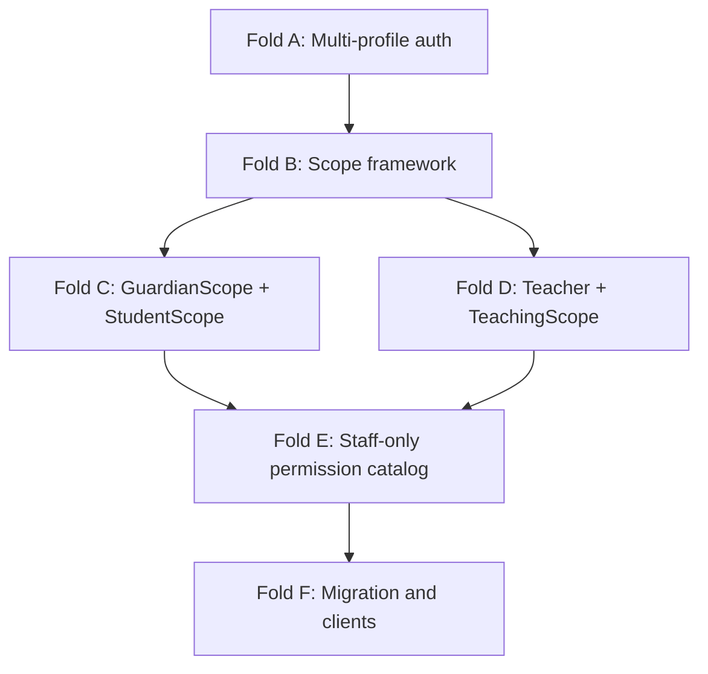
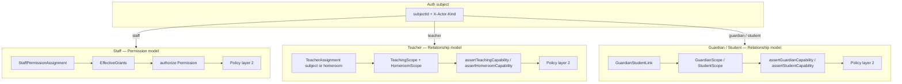

# Relationship-Native Authorization — Sprint Plan

> **Status:** Design locked  
> **Created:** 2026-07-05  
> **Scope:** Multi-profile auth, relationship scopes for portal actors (teacher, guardian, student), staff-only permission catalog  
> **Out of scope:** Step-up assurance product, distributed grants cache, per-school custom capability catalogs, webapp teacher UI  
> **Related:** [authorization-model-simplification-plan.md](./authorization-model-simplification-plan.md), [authorization/README.md](../../package/domain-core/src/capabilities/authorization/README.md)

This plan replaces the current **portal-permission synthesis** model (`GUARDIAN_PORTAL_PERMISSIONS` → `EffectiveGrants` → `authorize()`) and **teacher-as-staff** model (`StaffAssignment` sync → `StaffPermissionAssignment`) with **relationship-native scopes** and a **staff-only** `Permission` catalog.

Portal actors get fixed capabilities from relationships. Staff keep configurable permissions.

---

## 1. Problem statement

| Issue | Today | Impact |
|-------|-------|--------|
| Teacher as staff | Teachers onboarded via staff preset + `WEBAPP_READ_PERMISSIONS` | Permission bloat; webapp access teachers do not need |
| Assignment permission sync | `StaffAssignment.permissions[]` → `StaffPermissionAssignment` | Complex config for a fixed, known capability set |
| Portal permission synthesis | `guardianLinks` → `GUARDIAN_PORTAL_PERMISSIONS` → `scopeIdsByPermission` | Relationships translated into staff permission language unnecessarily |
| Single identity per subject | `assertSubjectIdAvailable` rejects cross-kind links; session requires exactly one entity | Coordinator+teacher, parent+staff impossible without friction |
| Mixed authorization languages | `authorize(Permission)` used for staff and portal actors | Hard to reason about; catalog scope rules leak into portals |

### Design principles (agreed)

1. **`Permission` is staff-only** — configurable capability language for workspace users (coordinators, directors, accountants, service accounts).
2. **Portal actors use relationship scopes** — assignment or link graph *is* the grant; fixed capability enums, no permission rows.
3. **Teachers are not staff** — separate `Teacher` entity; no sync with `StaffMember`.
4. **`class_group` is the deepest staff scope** — staff teaching permissions (e.g. `GRADE_INPUT`) apply class-wide, all subjects.
5. **Subject-teacher assignments are `classSubjectId`-scoped** — capabilities apply only to that subject in that class, not all subjects in the class.
6. **Homeroom is a separate assignment kind** — class-scoped capabilities via `homeroom` assignments (see §3.1).
7. **Assignment history is retained** — ended assignments stay in the database; session scope uses active rows only.
8. **Multi-profile without friction** — same auth `subjectId` across entity kinds (per school); client declares intent via `X-Actor-Kind`.
9. **Two layers kept** — capability/scope gate + resource policy (enrollment, ownership, etc.).

---

## 2. Folds (dependency order)

Folds are ordered by **what must land first**. Do not start a later fold until its dependencies are done.



| Order | Fold | Name | Depends on |
|-------|------|------|------------|
| **A** | 3 | Multi-profile auth | — |
| **B** | — | Relationship-scope framework | A |
| **C** | 4 | GuardianScope + StudentScope | B |
| **D** | 1 | Teacher entity + TeachingScope | B |
| **E** | 2 | Staff-only permission catalog | C, D |
| **F** | — | Migration, fixtures, clients | E |

**C and D can run in parallel** after B. **E requires both C and D** (all portal actors off permissions before catalog cleanup).

---

## 3. Target architecture



### Actor metadata (end state)

```typescript
type InteractiveActorMetadata =
  | StaffActorMetadata      // effectiveGrants: EffectiveGrants
  | TeacherActorMetadata    // teacherScope: TeacherActorScope (teaching + homeroom)
  | GuardianActorMetadata   // guardianScope: GuardianScope
  | StudentActorMetadata    // studentScope: StudentScope
```

`effectiveGrants` is **staff-only**. Portal actors carry a `scope` field instead.

### 3.1 Homeroom teachers

Homeroom (prof principal) is a **class-level role**, not a subject assignment. It needs class-wide reach that subject-scoped teachers do not get.

**Model:** `TeacherAssignment.kind` discriminates placement type.

| `kind` | Target field | Capability scope | Typical use |
|--------|--------------|------------------|-------------|
| `subject` | `classSubjectId` | That subject only | Math teacher in 7A |
| `homeroom` | `classGroupId` | Whole class | Prof principal of 7A |

A teacher can hold **both** for the same class (homeroom + one or more subject rows).

**Homeroom capabilities (class-scoped, fixed):**

```typescript
enum HomeroomCapability {
  ReadClassRoster,
  RecordDailyAttendance,       // class-wide attendance mode
  ReadClassAttendance,
  WriteHomeroomReportComment,
  CreateClassDisciplineIncident,
  ReadClassGradesOverview,     // read-only, all subjects in class — not input (locked)
  ReadClassTimetable,
  ReadClassLogbook,
  SendClassCommunication,
}
```

Subject teachers keep **subject-scoped** `TeachingCapability` (grade input, session attendance, logbook for their subject only).

**`ClassGroup.homeroomTeacherId` (migration):**

Today `ClassGroup.homeroomStaffId` points at `StaffMember`. Replace with `homeroomTeacherId` → `Teacher`.

- **Source of truth:** active `TeacherAssignment` where `kind = homeroom`.
- **Denormalized:** `homeroomTeacherId` on `ClassGroup` for fast UI lookup (synced on assignment save/end).
- Coordinators who are homeroom but use webapp: `StaffMember` + `Teacher` with homeroom assignment (multi-profile).

**Gate logic:**

```typescript
// Resource tied to a class subject (grade, lesson attendance)
assertTeachingCapability(actor, TeachingCapability.InputGrade, { classSubjectId })

// Resource tied to class (daily attendance roll, homeroom comment)
assertHomeroomCapability(actor, HomeroomCapability.RecordDailyAttendance, { classGroupId })
```

### Entity gate pattern

```typescript
async function gateReadGrades(actor, studentId) {
  switch (actor.kind) {
    case 'staff':
      await permissionAction(Permission.GRADE_READ)(actor)
      return checkStudentAccess(actor, [studentId])
    case 'teacher':
      return assertTeachingOrHomeroomReadGrades(actor, { studentId, classSubjectId })
    case 'guardian':
      return assertGuardianCapability(actor, GuardianCapability.ReadGrades, { studentId })
    case 'student':
      return assertStudentCapability(actor, StudentCapability.ReadGrades)
  }
}
```

---

## Fold A — Multi-profile auth

**Goal:** One login, multiple domain profiles; each client resolves the right actor kind.

### Changes

| Area | Change |
|------|--------|
| `link-subject-to-actor` | Allow same `subjectId` across **different** kinds; reject duplicate **same kind + same subjectId + same school** |
| `session-actor.ts` | Resolve by `X-Actor-Kind` (+ `X-Actor-Id` when ambiguous), not "exactly one identity" |
| `resolveActorGrants` | Dispatch by kind; stub scope resolvers for portal kinds |
| Grant cache | Key: `subjectId + schoolId + actorKind + actorId + academicYearId` |
| Clients | Webapp → `X-Actor-Kind: staff`; teacher app → `teacher`; guardian app → `guardian` |

### Multi-profile scenarios (locked)

| Scenario | Behavior |
|----------|----------|
| Coordinator who teaches | `StaffMember` + `Teacher`, same `subjectId`; app picks kind |
| Teacher promoted to coordinator | Add `StaffMember`; keep `Teacher` |
| Teacher leaves classroom, stays admin | Deactivate `Teacher` / end assignments; keep `StaffMember` |
| Parent who is also staff | `Guardian` + `StaffMember` |
| Pure teacher | `Teacher` only; no webapp |
| Same email, different schools | One profile per kind **per school**; same `subjectId` may link `Teacher` in school A and school B |
| Two teacher records, one person | Rejected in **same school** (same kind + subjectId + schoolId); allowed across schools |

### `subjectId` uniqueness rule (locked)

```
UNIQUE (entityKind, subjectId, schoolId)   — per Teacher, StaffMember, Guardian, Student
```

- ✅ `StaffMember` + `Teacher` in school X, same `subjectId`
- ✅ `Teacher` in school A + `Teacher` in school B, same `subjectId`
- ❌ Two `Teacher` rows in school X, same `subjectId`
- ❌ Two `StaffMember` rows in school X, same `subjectId`

### Acceptance

- [ ] Same `subjectId` on `StaffMember` + `Teacher` in one school; staff and teacher sessions resolve independently
- [ ] Two `Teacher` rows with same `subjectId` in the **same school** rejected
- [ ] Two `Teacher` rows with same `subjectId` in **different schools** allowed
- [ ] Missing / invalid `X-Actor-Kind` returns clear error (not silent wrong profile)

---

## Fold B — Relationship-scope framework

**Goal:** Shared infrastructure before migrating guardian or introducing teacher.

### New types (`capabilities/authorization/scope/` or `model/`)

```typescript
/** Active subject-teacher placements (capabilities scoped per classSubjectId). */
interface TeachingScope {
  readonly classSubjectIds: readonly string[]
}

/** Active homeroom placements (capabilities scoped per classGroupId). */
interface HomeroomScope {
  readonly classGroupIds: readonly string[]
}

/** Combined on TeacherActorMetadata. */
interface TeacherActorScope {
  readonly teaching: TeachingScope
  readonly homeroom: HomeroomScope
}

interface GuardianScope {
  readonly studentIds: readonly string[]
  readonly classGroupIds: readonly string[]   // from active enrollments
}

interface StudentScope {
  readonly studentId: string
  readonly classGroupId?: string
}
```

### Session resolution

```typescript
resolveActorScope(args: {
  actorKind: 'staff' | 'teacher' | 'guardian' | 'student'
  actorId: string
  schoolId: string
  academicYearId?: string
  repositories: SchoolRepositories
}): Promise<EffectiveGrants | TeacherActorScope | GuardianScope | StudentScope>
```

- Staff → existing `resolveEffectiveGrants` (unchanged path)
- Portal kinds → dedicated resolvers (implement in C / D)

### Actor metadata refactor

- Split `InteractiveActorContext`: staff keeps `effectiveGrants`; teacher carries `teacherScope` (`TeachingScope` + `HomeroomScope`); guardian/student carry their scopes
- `createTeacherActorMetadata`, update guardian/student factories
- `isInteractiveActor` includes `teacher`
- `authorize()` — document: **staff only**; portal actors must not call it

### API surface

| Endpoint | Staff | Portal |
|----------|-------|--------|
| `/me/permissions` | effective grants | deprecate → `/me/capabilities` + `/me/scope` |
| Cache invalidation | on `StaffPermissionAssignment` change | on assignment / link / enrollment change |

### Acceptance

- [ ] `TeacherActorMetadata` type exists; no dummy `effectiveGrants` on portal actors
- [ ] Scope cache separate from grants cache
- [ ] `assertCapability` module skeleton with kind dispatch

---

## Fold C — GuardianScope + StudentScope

**Goal:** Remove guardian/student portal permission synthesis. **Land before Teacher** — read-only, existing entity, proves the relationship-native pattern on live guardian mobile.

### Why first (among portal folds)

- Data already exists (`guardianLinks` + enrollments)
- Read-only capabilities — simpler gate refactor than teacher writes
- Guardian app is live — parity tests validate the pattern before teacher writes

### GuardianCapability (fixed, read-only)

```typescript
enum GuardianCapability {
  ReadSelfProfile,
  ReadStudentDetail,
  ReadGrades,
  ReadReportCard,
  ReadAttendance,
  ReadPayments,
  ReadEnrollmentHistory,
  ReadLogbook,
  ReadTimetable,
  ReadCalendar,
  ReadCommunications,
  ReadCurriculum,
  ReadWorkspaceShell,
}
```

### StudentCapability

Same read set, scoped to self (degenerate guardian).

### Scope resolution

Replace `resolveGuardianGrants` / `resolveStudentGrants`:

```typescript
resolveGuardianScope({ guardianId, schoolId, repositories })
  // guardianLinks → studentIds → uniqueActiveClassGroupIds
  // returns GuardianScope — no Permission synthesis

resolveStudentScope({ studentId, schoolId, repositories })
  // returns StudentScope
```

### Gate refactor

- `checkStudentAccess` — add guardian branch: `studentId ∈ actor.guardianScope.studentIds`
- Audit all `permissionAction` + `actor.kind === 'guardian'` call sites
- Entity read configs: `guardianCapabilityAction(GuardianCapability.X)` instead of `permissionAction`

### Link flags (v1 — locked)

**Full capabilities for all linked students.** Link flags (`isBillingContact`, `receivesAcademicReports`, etc.) continue to drive **notifications only**, not auth. Flag-gated capabilities deferred to v1.1.

### Delete after this fold

| Remove | Replaced by |
|--------|-------------|
| `GUARDIAN_PORTAL_PERMISSIONS` | `GuardianCapability` |
| `STUDENT_PORTAL_PERMISSIONS` | `StudentCapability` |
| `resolveGuardianGrants` / `resolveStudentGrants` | `resolveGuardianScope` / `resolveStudentScope` |
| `buildPortalScopeIdsByPermission` (guardian/student usage) | scope membership checks |
| `PORTAL_PERMISSION_POLICIES` | capability registries |

### Acceptance

- [ ] Parity test: every route guardian could hit before, same after (no permission grants on actor)
- [ ] Guardian mobile works with `X-Actor-Kind: guardian`
- [ ] `authorize()` never called for guardian/student actors

---

## Fold D — Teacher entity + TeachingScope

**Goal:** Dedicated teacher domain; implicit teaching capabilities from `classSubjectId` assignments. **Can parallel Fold C** after B.

### Domain model

```
Teacher
  id, schoolId
  firstName, lastName, email, phone, photoUrl, notification*
  subjectId?
  isActive
  createdAt

TeacherAssignment
  id, teacherId, academicYearId
  kind: 'subject' | 'homeroom'
  classSubjectId?         // required when kind = subject
  classGroupId?           // required when kind = homeroom; derived when kind = subject
  responsibility?         // optional label ("Math", "Prof principal")
  status: 'active' | 'ended'
  startsAt?: Date
  endsAt?: Date            // set when teacher changes; row kept for history
  createdAt
  updatedAt?
```

**Refinement:** `kind = subject` → exactly one `classSubjectId`; `kind = homeroom` → exactly one `classGroupId`. `classGroupId` on subject rows is derived from `ClassSubject` at resolution time (may be stored denormalized for queries).

### Assignment history (locked)

- **Never hard-delete** assignments when a teacher changes class or subject.
- End the current row: `status = ended`, `endsAt = now`; create a new active row for the replacement teacher.
- Session scope resolution loads only `status = active` rows within `startsAt` / `endsAt` window for the requested `academicYearId`.
- History supports audit, report cards ("who taught Math in T1"), and timetable retrospectives.

### Rules (locked)

- No `staffMemberId`; no sync with staff
- `kind = subject` → implicit **subject-scoped** `TeachingCapability` set for that `classSubjectId`
- `kind = homeroom` → implicit **class-scoped** `HomeroomCapability` set for that `classGroupId`
- `AccountInvitationKind.Teacher`
- `ClassGroup.homeroomStaffId` → migrate to `homeroomTeacherId`

### TeacherActorScope

Resolved from active `TeacherAssignment` rows:

```typescript
interface TeacherActorScope {
  readonly teaching: { classSubjectIds: readonly string[] }
  readonly homeroom: { classGroupIds: readonly string[] }
}
```

**Empty scope (locked):** A teacher with no active assignments still resolves a valid session (`TeacherActorMetadata` with empty `classSubjectIds` and `classGroupIds`). This is not an error. Write capabilities fail at gates (`403`); shell/read-self endpoints may still work. Same rule for guardian with no links (empty `studentIds`).

### TeachingCapability (subject-scoped)

```typescript
enum TeachingCapability {
  // Write — only for assigned classSubjectId
  RecordSessionAttendance,
  CreateSubjectAssessment,
  UpdateSubjectAssessment,
  InputGrade,
  CreateLogbookEntry,
  UpdateLogbookEntry,
  CreateSubjectDisciplineIncident,
  // Read — only for assigned classSubjectId
  ReadSubjectRoster,
  ReadSubjectTimetable,
  ReadSubjectAssessments,
  ReadSubjectGrades,
  ReadSubjectAttendance,
  ReadSubjectLogbook,
  ReadSubjectCurriculum,
}
```

**Assessment capabilities (locked):**

| Capability | Scope | Notes |
|------------|-------|-------|
| `CreateSubjectAssessment` | `classSubjectId` | Quiz, homework, project for assigned subject |
| `UpdateSubjectAssessment` | `classSubjectId` | Edit title, dates, coefficient, etc. before lock/completion rules apply |
| `ReadSubjectAssessments` | `classSubjectId` | List/detail for teacher's subjects |
| `InputGrade` | `classSubjectId` | Results on existing assessments (separate from assessment config) |

Staff-only assessment ops stay on `Permission`: `EXAM_CONFIG_CONFIGURE`, `EXAM_CONFIG_LOCK` / `UNLOCK`, report-card definition — not granted to subject teachers via `TeachingCapability`.

**Implementation note (locked):** Today `assessment` entity write uses `Permission.GRADE_INPUT` for both assessment CRUD and results. Fold D must **split gates**: `assessment` save → `CreateSubjectAssessment` / `UpdateSubjectAssessment`; `assessment-result` save → `InputGrade`. Staff path unchanged until Fold E catalog cleanup.

### HomeroomCapability (class-scoped)

See §3.1. Separate enum; checked via `assertHomeroomCapability(actor, capability, { classGroupId })`.

No `Permission` enum on teacher path. No `StaffPermissionAssignment`. No assignment permission checkboxes.

### Gate refactor (teaching domains)

Dual-path gates on:

- `attendance-record` — session attendance → `TeachingCapability`; daily class roll → `HomeroomCapability`
- `assessment` entity — create/update → `CreateSubjectAssessment` / `UpdateSubjectAssessment`; read → `ReadSubjectAssessments`
- `assessment-result` / grade input → `TeachingCapability.InputGrade` + `classSubjectId`
- class logbook → subject vs class entries per anchor
- discipline / incident → subject or class scope per incident type
- report card homeroom comment → `HomeroomCapability.WriteHomeroomReportComment`
- timetable query surfaces used by teacher app

```typescript
if (actor.kind === 'teacher') {
  assertTeachingCapability(actor, TeachingCapability.RecordSessionAttendance, { classSubjectId })
  // or
  assertHomeroomCapability(actor, HomeroomCapability.RecordDailyAttendance, { classGroupId })
  return
}
// staff path unchanged
```

### Fold D sub-phases (locked)

| Sub-phase | Deliverables |
|-----------|--------------|
| **D1** | `Teacher`, `TeacherAssignment`, repos, migration, `resolveTeacherScope`, `TeacherActorMetadata`, invitation kind, session + `/me/scope` |
| **D2** | Teaching/homeroom capability gates per domain (attendance, assessment, grades, logbook, discipline, timetable) |

Ship D1 before D2 so teacher app can authenticate and load scope before write paths are migrated.

Coordinators with `GRADE_INPUT` at `class_group` scope use the **staff permission path**. No `Teacher` entity required.

### Acceptance

- [ ] Pure teacher: no `StaffMember` row; teacher app authenticates via `X-Actor-Kind: teacher`
- [ ] Teacher assigned to Math in 7A can input grades for Math only, not French in 7A
- [ ] Homeroom teacher for 7A can record daily attendance for 7A; cannot input Math grades without a subject assignment
- [ ] Ended assignment no longer in scope; row still queryable for history
- [ ] `ClassGroup.homeroomTeacherId` synced from active homeroom assignment
- [ ] `StaffAssignment` sync not used for teachers

---

## Fold E — Staff-only permission catalog

**Goal:** `Permission` is configuration for staff only. **Requires C and D complete.**

### Catalog changes

| Change | Detail |
|--------|--------|
| Teaching write permissions | `GRADE_INPUT`, `ATTENDANCE_RECORD`, `CLASS_LOGBOOK_*`, `DISCIPLINE_CREATE` → scope `class_group` (was `class_subject`) |
| Remove teacher staff preset | Delete "Professeur" from `STAFF_INVITE_PERMISSION_PRESETS` (or repurpose for coordinator-only) |
| `ASSIGNMENT_SCOPED_PERMISSIONS` | Staff/coordinator assignment sync only; not teacher |
| Portal `QUERY_*` on guardian/student | Remove from portal paths; keep staff `QUERY_*` where webapp needs them |
| `permission-sets.ts` | Drop portal/teaching branches that assumed permission grants on non-staff actors |

### StaffAssignment fate

- Teaching placements → `TeacherAssignment`
- `StaffAssignment` → admin/coordinator placements only (optional `permissions[]` sync for staff grants)

### Delete / shrink

- `TEACHER_PERMISSIONS` staff constant (or staff-coordinator-only if retained)
- Teacher rows in staff permission seed paths
- `buildPortalScopeIdsByPermission` entirely if no callers remain
- Portal permission tests replaced by capability parity tests

### Acceptance

- [ ] No code path synthesizes `Permission` grants for teacher, guardian, or student
- [ ] Staff `GRADE_INPUT` on `class-7a` covers all subjects in 7A
- [ ] `bun repo verify` green

---

## Fold F — Migration, fixtures, clients

### Data migration

| From | To |
|------|-----|
| Staff with teacher preset + teaching assignments | Create `Teacher`, move assignments to `TeacherAssignment`, strip teacher `StaffPermissionAssignment` rows |
| `ClassGroup.homeroomStaffId` | Map to `homeroomTeacherId` via new `Teacher` record or homeroom assignment |
| Existing guardians / students | No data change — resolution path only |

### Seeds / fixtures

- `demo-ci`: teachers as `Teacher` entities, not staff
- Dev access seed: separate teacher login for teacher app
- `build-dev-access-seed-records.ts`: remove teacher staff permission rows

### Clients

| Client | Header | Notes |
|--------|--------|-------|
| Staff webapp | `X-Actor-Kind: staff` | default if omitted for webapp origin (optional) |
| Teacher mobile | `X-Actor-Kind: teacher` | `api_config.dart` |
| Guardian mobile | `X-Actor-Kind: guardian` | already live |
| Codegen | regenerate after API `/me/*` changes | `edaya-client-codegen` |

### Test plan

- [ ] Multi-profile: coordinator+teacher same subject
- [ ] Guardian parity: before/after route matrix
- [ ] Teacher: subject-scoped write; homeroom class-scoped write; no cross-subject leakage
- [ ] Teacher assignment history: ended row excluded from scope, retained in DB
- [ ] Staff: class_group scoped teaching unchanged
- [ ] Integration: session middleware resolves all four kinds

---

## 4. Execution phases (sprint checklist)

| Phase | Fold | Deliverables |
|-------|------|--------------|
| **1** | A | Multi-profile linking + `X-Actor-Kind` session resolution |
| **2** | B | Scope types, actor metadata split, `resolveActorScope` dispatch, cache |
| **3** | C | `GuardianScope`, `StudentScope`, capability gates, remove portal permission synthesis |
| **4** | D | `Teacher`, `TeacherAssignment`, `TeachingScope`, capability gates, teacher invitation |
| **5** | E | Staff catalog `class_group` deepest; remove teacher/guardian portal perms; `StaffAssignment` cleanup |
| **6** | F | Migration script, seeds, mobile headers, parity tests, docs |

Phases **3 and 4** may run in parallel across two workstreams after phase 2.

---

## 5. Locked decisions log

| # | Decision | Rationale |
|---|----------|-----------|
| 1 | Teacher separate from staff, no sync | Different product surface (mobile portal vs webapp) |
| 2 | Subject assignments → subject-scoped capabilities | Teacher of Math cannot grade French in same class |
| 2b | Subject teachers create/update assessments for their subject | `CreateSubjectAssessment`, `UpdateSubjectAssessment`; lock/configure stays staff |
| 3 | Homeroom via `kind = homeroom` assignment + `homeroomTeacherId` | Class-wide ops without widening all subject teachers |
| 3b | Homeroom `ReadClassGradesOverview` is read-only, all subjects in class | Prof principal sees class picture; grade input stays subject-scoped |
| 4 | Assignment history retained (`status`, `endsAt`) | Teacher changes, audit, retrospective reports |
| 5 | `subjectId` unique per `(kind, schoolId)` | Multi-profile across kinds; no duplicate teacher accounts per school |
| 6 | `class_group` deepest **staff** scope | Staff coordinators class-wide; teachers use capability scopes |
| 7 | No `Permission` for portal actors | Assignment/link *is* the configuration |
| 8 | Guardian v1: full capabilities for all links | Simpler; flags stay notification-only |
| 9 | Multi-profile via `X-Actor-Kind` | Zero friction when each app knows its kind |
| 10 | GuardianScope before Teacher entity | Read-only proof of pattern on live app |
| 11 | Staff-only catalog cleanup last | Requires all portal actors off permissions |

---

## 6. Risks

| Risk | Mitigation |
|------|------------|
| Missed guardian gate during C | Parity test matrix; grep `permissionAction` + guardian |
| Teacher write gates incomplete in D | List all teaching entities upfront; integration tests per capability |
| Dual-path gate drift | Shared `gateTeachingAccess(actor, capability, target)` helper |
| Mobile breakage on `/me/permissions` | Ship `/me/capabilities` + `/me/scope` first; deprecate old shape |
| Coordinator+teacher confusion | HR UI shows both records; each app uses its kind |
| Homeroom vs subject capability overlap | Split enums; gate picks path from resource anchor (session vs class) |
| `homeroomStaffId` migration | Create Teacher from staff or new record; backfill homeroom assignments |

---

## 7. References

- Current portal synthesis: `resolution/resolve-portal-grants.ts`, `grants/portal-permission-sets.ts`
- Current session actor: `apps/api/src/http/dependencies/session-actor.ts`
- Subject linking: `application/account-linking/link-subject-to-actor.ts`
- Staff assignment sync: `capabilities/authorization/sync/staff-assignment-permission-sync.ts`
