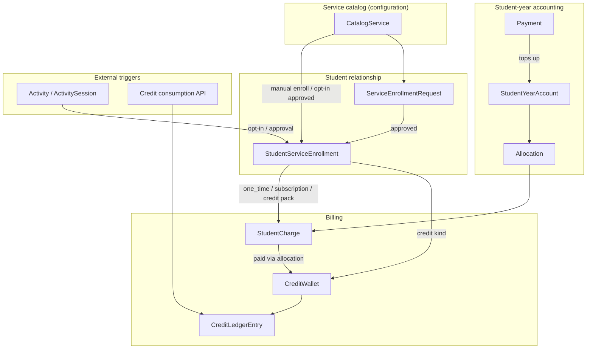
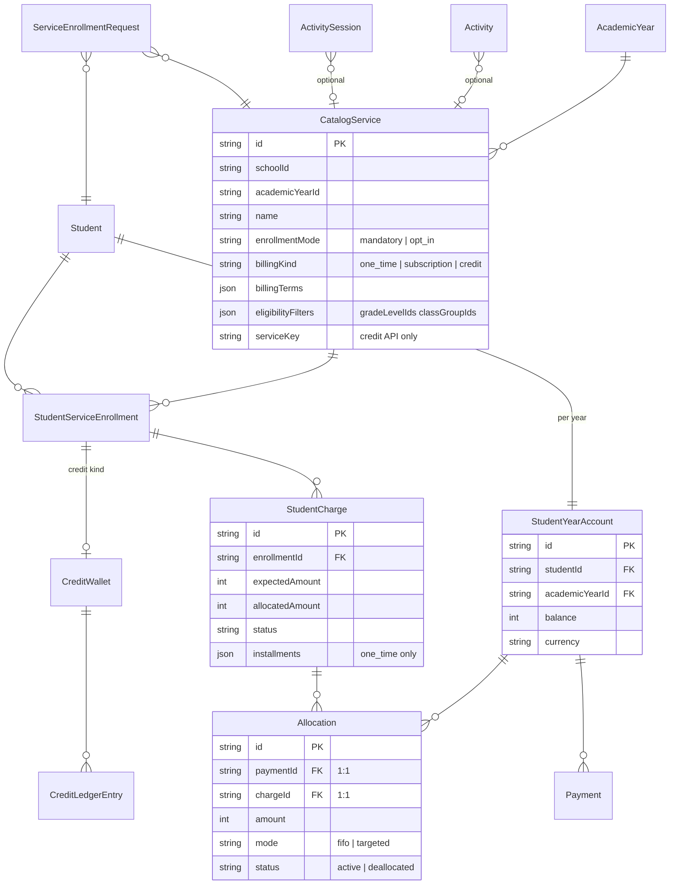

# Service Catalog & Student Accounting — Sprint Plan

> **Status:** Phase 0 signed off — ready for Phase 1  
> **Created:** 2026-06-29  
> **Last updated:** 2026-06-29 (§14 implementation readiness review)  
> **Scope:** Replace flat `Fee` catalog with typed **service catalog** (mandatory / opt-in, three billing kinds); **student-year account** with payment top-up and charge allocation; activity/session billing hooks; guardian opt-in with approval  
> **Related domain:** `package/domain-core/src/domains/finances/`, `domains/school-life/` (activities), `services/service-workflows/finance.ts`

This plan evolves the finance module from a direct **payment → student fee** model to a **catalog → enrollment → charge → account → allocation** model. Payments increase a per-student **year account balance**; an allocation layer dispatches funds to individual **charges**. Refunds and year-end handling become account operations rather than unwinding direct payment links.

---

## 1. Problem statement

### Current pain points

| Issue | Today | Impact |
|-------|-------|--------|
| Flat fee catalog | `Fee` = name + amount + optional installments | No service types, no opt-in vs mandatory semantics |
| Direct payment link | `Payment.studentFeeId` | Hard refunds, no prepaid balance, no cross-charge flexibility |
| Manual-only assignment | `assignFeeToStudent` one-by-one | No catalog browsing, no guardian self-service |
| One billing shape | All fees are one-time with installments | No subscriptions, no consumable credits |
| Activity billing disconnected | Activities have no finance hook | Sports club / per-session fees require duplicate catalog setup |
| UI / domain drift | Webapp `Fee.period` vs domain `installments[]` | Confusing admin UX |

### Design principles (agreed)

1. **`CatalogService` is configuration** — what the school sells for an academic year (price, billing kind, enrollment mode, optional eligibility filters).
2. **`StudentServiceEnrollment` is the student relationship** — explicit enrollment in a catalog service (manual in v1; automation deferred).
3. **`StudentCharge` is what is owed** — one-time bill, subscription period bill, or credit-pack purchase; replaces `StudentFee`.
4. **`StudentYearAccount` is the money layer** — one account per `(student, academicYear)`; **payments top up balance**; **no negative balance**.
5. **`Allocation` dispatches account balance to charges** — **one payment → exactly one allocation → exactly one charge**; **partial allocation per charge** allowed (pay less than charge remainder); payer chooses **FIFO** (auto-pick oldest unpaid charge) or **targeted** (pick the charge). Refunds **de-allocate** (reverse allocation, restore account balance).
6. **`CreditWallet` is the unit layer** — for `credit` billing kind only; fed when a credit-pack charge is paid; consumed manually or via API (`serviceKey`).
7. **Opt-in uses approval workflow** — guardian app self-service or staff-initiated request → notification with approval link.
8. **Activity billing hooks** — optional `catalogServiceId` on `Activity` (program-level) or `ActivitySession` (occurrence-level); approval / opt-in triggers charge creation.
9. **Eligibility filters (v1)** — `gradeLevelIds` / `classGroupIds` on catalog entries for **guardian app catalog filtering only**; no auto-provisioning rules yet.
10. **Greenfield cutover** — no production DB yet; reset-and-rebuild acceptable. Drop `Fee` / direct `Payment → StudentFee` once migration completes.

---

## 2. Desired architecture

### 2.1 Layer diagram



### 2.2 Entity relationship



### 2.3 Money vs unit layers

| Layer | Entity | Holds | Example |
|-------|--------|-------|---------|
| **Money** | `StudentYearAccount` | Cash balance for the year | 50 000 XAF deposited |
| **Obligation** | `StudentCharge` | Amount owed for a service / period / pack | Tuition T1 — 160 000 XAF |
| **Units** | `CreditWallet` + `CreditLedgerEntry` | Consumable credits for credit-kind services | 180 cafeteria meals |

Credit-pack flow: charge created → payment tops account → allocation pays charge → wallet credited → consumption deducts units.

### 2.4 Payment & allocation flow

Each payment is a **1:1:1** chain: `Payment` → `Allocation` → `StudentCharge`.

```mermaid
sequenceDiagram
  participant Payer
  participant Account as StudentYearAccount
  participant Charge as StudentCharge

  Payer->>Account: Payment +amount
  Note over Payer,Charge: FIFO picks charge, or payer targets one charge
  Account->>Charge: Allocation −amount (partial OK)
  Note over Charge: allocatedAmount += amount; status pending/partial/paid
```

| Rule | Detail |
|------|--------|
| **1:1 payment → allocation** | Every payment with allocation creates exactly one `Allocation` row; **`account_only` mode** is the exception (no allocation) |
| **1:1 allocation → charge** | That allocation targets exactly one `StudentCharge` |
| **Partial per charge** | `Allocation.amount` may be **less than** charge remaining due |
| **FIFO** | Auto-select **which charge** — oldest unpaid (`dueDate`, then `createdAt`) |
| **Targeted** | Payer explicitly selects **which charge** |
| **Account net** | Credit account by `Payment.amount`, debit by `Allocation.amount`; surplus (`Payment.amount − Allocation.amount`) stays on account |
| **Refund** | **De-allocate** — reverse active allocation, credit account, reduce charge `allocatedAmount`; optionally reverse payment in same workflow |

---

## 3. Entity definitions

### 3.1 CatalogService (replaces `Fee`)

School-wide service definition for an academic year.

| Field | Type | Required | Notes |
|-------|------|----------|-------|
| `id` | string | yes | |
| `schoolId` | string | yes | |
| `academicYearId` | string | yes | |
| `name` | string | yes | |
| `description` | string | no | |
| `category` | enum | yes | `tuition`, `transport`, `meals`, `activities`, `materials`, `other` (evolve from `FeeCategory`) |
| `enrollmentMode` | enum | yes | `mandatory` \| `opt_in` — workflow hint; v1 enrollment still **manual** |
| `billingKind` | enum | yes | `one_time` \| `subscription` \| `credit` |
| `defaultPrice` | Money | yes | Base price |
| `billingTerms` | discriminated JSON | yes | See §3.1.1 |
| `eligibilityFilters` | object | no | `{ gradeLevelIds?: string[], classGroupIds?: string[] }` — **guardian catalog filter only** in v1 |
| `serviceKey` | string | if `credit` | Secret for external consumption API; rotatable |
| `isActive` | boolean | yes | default `true` |
| `createdAt` | datetime | yes | |

#### 3.1.1 `billingTerms` by kind

**`one_time`**

```ts
{
  kind: 'one_time'
  paymentTerms: InstallmentTemplate[] | { singleDueDate: Date }
}
```

**`subscription`**

```ts
{
  kind: 'subscription'
  interval: 
    | { type: 'weekly'; dayOfWeek: DayOfWeek }
    | { type: 'monthly'; dayOfMonth: number }   // 1–28 recommended
    | { type: 'period'; periodDefinitionId: string }  // one charge per AcademicPeriod
  amount: Money   // per interval (defaults to defaultPrice if omitted)
}
```

**`credit`**

```ts
{
  kind: 'credit'
  packSize: number          // units per purchase (e.g. 180 meals)
  unitLabel: string         // e.g. "meal", "session"
  unitPrice: Money          // price per pack (defaults to defaultPrice)
  allowTopUp: boolean       // guardian can buy additional packs
}
```

### 3.2 StudentServiceEnrollment

Student subscribed to a catalog service for an academic year.

| Field | Type | Required | Notes |
|-------|------|----------|-------|
| `id` | string | yes | |
| `studentId` | string | yes | |
| `catalogServiceId` | string | yes | |
| `academicYearId` | string | yes | Denormalized from catalog |
| `status` | enum | yes | `active` \| `cancelled` \| `suspended` |
| `source` | enum | yes | `staff` \| `guardian` \| `activity` |
| `priceOverride` | Money | no | Scholarship / custom price |
| `enrolledAt` | datetime | yes | |
| `cancelledAt` | datetime | no | |
| `createdAt` | datetime | yes | |

Unique: `(studentId, catalogServiceId, academicYearId)`.

### 3.3 ServiceEnrollmentRequest (opt-in approval)

| Field | Type | Required | Notes |
|-------|------|----------|-------|
| `id` | string | yes | |
| `studentId` | string | yes | |
| `catalogServiceId` | string | yes | Must be `opt_in` service |
| `status` | enum | yes | `pending` \| `approved` \| `rejected` \| `expired` |
| `requestedByKind` | enum | yes | `staff` \| `guardian` |
| `requestedById` | string | yes | Staff or guardian user id |
| `approvedById` | string | no | Guardian or staff approver |
| `approvalToken` | string | yes | Single-use link token for notification |
| `expiresAt` | datetime | yes | |
| `createdAt` | datetime | yes | |
| `resolvedAt` | datetime | no | |

Approval creates `StudentServiceEnrollment` + initial charge(s) via `enrollInService`.

### 3.4 StudentCharge (replaces `StudentFee`)

Bill line tied to an enrollment.

| Field | Type | Required | Notes |
|-------|------|----------|-------|
| `id` | string | yes | |
| `enrollmentId` | string | yes | FK → `StudentServiceEnrollment` |
| `studentId` | string | yes | Denormalized |
| `academicYearId` | string | yes | Denormalized |
| `label` | string | yes | e.g. "Tuition — Term 1", "Bus — October", "Meal pack" |
| `expectedAmount` | Money | yes | |
| `allocatedAmount` | Money | yes | Sum of allocations; default 0 |
| `adjustmentAmount` | Money | no | Bursar discount (same rules as today) |
| `dueDate` | date | no | |
| `installments` | array | no | One-time only; materialized from catalog template |
| `status` | enum | yes | `pending` \| `partial` \| `paid` \| `overdue` \| `cancelled` |
| `periodStart` / `periodEnd` | date | no | Subscription period bounds |
| `createdAt` | datetime | yes | |

**Status derivation:** `allocatedAmount + adjustmentAmount >= expectedAmount` → `paid`; overdue if past `dueDate` and not paid.

**Dropped:** direct `feeId` on charge — use `enrollmentId → catalogServiceId`.

### 3.5 StudentYearAccount

| Field | Type | Required | Notes |
|-------|------|----------|-------|
| `id` | string | yes | Stable, e.g. `{studentId}-{academicYearId}` |
| `studentId` | string | yes | |
| `academicYearId` | string | yes | |
| `balance` | Money | yes | **Must never go negative** |
| `createdAt` | datetime | yes | |

Created lazily on first payment or explicit `getOrCreateStudentYearAccount`.

### 3.6 Payment (evolved)

| Change | Detail |
|--------|--------|
| Remove | `studentFeeId` direct FK |
| Add | `accountId` FK → `StudentYearAccount` |
| Add | `allocationMode` | `fifo` \| `targeted` \| `account_only` — charge selection; `account_only` = deposit only |
| Add | `targetChargeId` | if `targeted` — the single charge to allocate to |
| Keep | `amount`, `method`, `status`, audit fields |

Payment workflow: validate amount → credit account → resolve target charge (FIFO or targeted) → create **one** allocation (partial per charge OK) → debit account by allocation amount → update charge status → if credit-pack charge fully paid, credit wallet.

### 3.7 Allocation

| Field | Type | Required | Notes |
|-------|------|----------|-------|
| `id` | string | yes | |
| `accountId` | string | yes | |
| `paymentId` | string | yes | **Exactly one allocation per payment** |
| `chargeId` | string | yes | **Exactly one charge per allocation** |
| `amount` | Money | yes | ≤ charge remaining due; **partial per charge allowed** |
| `mode` | enum | yes | `fifo` \| `targeted` — charge selection mode |
| `status` | enum | yes | `active` \| `deallocated` |
| `deallocatedAt` | datetime | no | Set on refund / reversal |
| `createdAt` | datetime | yes | |

**Rules (Phase 0 ✅):**

- **One payment → one allocation → one charge** — no splitting one payment across multiple charges.
- **Partial per charge** — `Allocation.amount` ≤ charge remaining due (`expectedAmount − adjustmentAmount − allocatedAmount`); charge may stay `partial`.
- **FIFO** — auto-select the **oldest unpaid charge** as allocation target; does not imply multi-charge split.
- **Targeted** — payer selects the **single** charge to allocate to.
- **No negative account balance** — allocation rejected if `account.balance < allocation.amount` after payment credit.
- **Surplus on account** — if `Payment.amount > Allocation.amount`, remainder stays unallocated on `StudentYearAccount`.
- **Refund / reversal** — **de-allocate**: set allocation `status = deallocated`, credit account by `allocation.amount`, reduce charge `allocatedAmount`; reverse linked `Payment` when refunding cash.

### 3.8 CreditWallet & CreditLedgerEntry

**CreditWallet** (one per credit-kind enrollment)

| Field | Type | Required | Notes |
|-------|------|----------|-------|
| `id` | string | yes | |
| `enrollmentId` | string | yes | |
| `balance` | int | yes | Unit count ≥ 0 |
| `unitLabel` | string | yes | Denormalized from catalog |

**CreditLedgerEntry**

| Field | Type | Required | Notes |
|-------|------|----------|-------|
| `id` | string | yes | |
| `walletId` | string | yes | |
| `kind` | enum | yes | `purchase` \| `consumption` \| `adjustment` \| `expiry` |
| `quantity` | int | yes | Signed: + purchase, − consumption |
| `reference` | string | no | External idempotency key |
| `recordedById` | string | no | Staff for manual; null for API |
| `createdAt` | datetime | yes | |

**Consumption API:** `POST /consume-credits` with `serviceKey`, `studentId`, `quantity`, `reference` (idempotent).

### 3.9 Activity / ActivitySession hooks

| Entity | Field | When billing fires |
|--------|-------|-------------------|
| `Activity` | `catalogServiceId?` | On activity enrollment **approval** → create enrollment + charge (or subscription enrollment) |
| `ActivitySession` | `catalogServiceId?` | On session opt-in / attendance confirmation → per-occurrence charge |

Session-level service overrides or supplements activity-level (product rule: session wins if both set).

Aligns with `Activity` / `ActivitySession` from [session-content-model-plan.md](./session-content-model-plan.md). Implement activity hooks in **Phase 6** after session model lands, or against current `ExtracurricularActivity` + `ActivityEnrollment` as interim.

### 3.10 Entities to remove / rename

| Current | Target |
|---------|--------|
| `Fee` | `CatalogService` |
| `StudentFee` | `StudentCharge` |
| `Payment.studentFeeId` | `Payment.accountId` + `Allocation` |
| Direct payment → charge | **Removed** |

---

## 4. Validation rules

### 4.1 CatalogService

| Rule | Error code |
|------|------------|
| `billingTerms.kind` matches `billingKind` | `BILLING_TERMS_MISMATCH` |
| `serviceKey` required when `billingKind = credit` | `SERVICE_KEY_REQUIRED` |
| `opt_in` only for `ServiceEnrollmentRequest` path | `MANDATORY_SERVICE_NO_REQUEST` |
| Installment percentages total 100 (one_time) | `INSTALLMENT_PERCENTAGE_INVALID` |
| Subscription `periodDefinitionId` exists in school | `INVALID_PERIOD_DEFINITION` |

### 4.2 StudentYearAccount & Payment

| Rule | Error code |
|------|------------|
| Account balance ≥ 0 always | `NEGATIVE_BALANCE` |
| Payment amount > 0 | `INVALID_PAYMENT_AMOUNT` |
| Exactly one allocation per payment | `MULTIPLE_ALLOCATIONS_PER_PAYMENT` |
| Targeted: `targetChargeId` belongs to same student + year | `CHARGE_STUDENT_MISMATCH` |
| FIFO: unresolved if no unpaid charges | Falls back to `account_only` (credit account, no allocation) |

### 4.3 Allocation

| Rule | Error code |
|------|------------|
| `amount` > 0 | `INVALID_ALLOCATION_AMOUNT` |
| `amount` ≤ charge remaining due | `ALLOCATION_EXCEEDS_CHARGE` |
| `amount` ≤ `Payment.amount` | `ALLOCATION_EXCEEDS_PAYMENT` |
| Cannot allocate to `cancelled` charge | `CHARGE_CANCELLED` |
| De-allocate only `active` allocations | `ALLOCATION_ALREADY_DEALLOCATED` |
| De-allocate restores account + reduces charge `allocatedAmount` | — |

### 4.4 CreditWallet

| Rule | Error code |
|------|------------|
| Balance ≥ 0 | `NEGATIVE_CREDIT_BALANCE` |
| Consumption ≤ balance | `INSUFFICIENT_CREDITS` |
| API: valid `serviceKey` + wallet for student | `INVALID_SERVICE_KEY` |
| Idempotent `reference` on consumption | `DUPLICATE_CONSUMPTION` |

### 4.5 Year-end / departure

| Rule | Error code |
|------|------------|
| **Roll forward:** remaining balance → new year account when student re-enrolled | — |
| **Refund:** disburse remaining balance on departure (workflow command) | `REFUND_EXCEEDS_BALANCE` |
| Roll forward + refund mutually exclusive for same closing balance | `ACCOUNT_ALREADY_CLOSED` |

---

## 5. Service workflows

### 5.1 `createCatalogService` / `updateCatalogService`

Replaces `createFee`. Admin configures catalog entry with billing terms and optional eligibility filters.

### 5.2 `enrollStudentInService` (manual, staff)

| Step | Behavior |
|------|----------|
| 1 | Validate catalog service active for student's academic year |
| 2 | Create `StudentServiceEnrollment` |
| 3 | Materialize initial billing artifact (see §5.6) |

No auto-enroll on `enrollStudent` in v1.

### 5.3 `requestServiceEnrollment` (opt-in)

| Step | Behavior |
|------|----------|
| 1 | Validate `enrollmentMode = opt_in` |
| 2 | Create `ServiceEnrollmentRequest` (`pending`) + approval token |
| 3 | Send notification (guardian approval link or staff confirmation) |

### 5.4 `approveServiceEnrollment`

| Step | Behavior |
|------|----------|
| 1 | Validate token / approver permissions |
| 2 | Mark request `approved` |
| 3 | Call `enrollStudentInService` |
| 4 | If activity-linked, sync activity enrollment state |

### 5.5 `recordPayment` (evolved)

```ts
interface RecordPaymentInput {
  id: string
  studentId: string
  academicYearId: string
  amount: number
  paymentDate: Date
  method: PaymentMethod
  allocationMode: 'fifo' | 'targeted' | 'account_only'
  targetChargeId?: string      // required if targeted
  allocationAmount?: number    // defaults to amount; partial per charge OK; ignored if account_only
  reference?: string
  notes?: string
}
```

| Step | Behavior |
|------|----------|
| 1 | `getOrCreateStudentYearAccount(student, year)` |
| 2 | Create `Payment` → credit account by `amount` |
| 3 | If `account_only`: stop (no allocation) |
| 4 | Resolve target charge: `fifo` → oldest unpaid (fallback to step 3 if none); `targeted` → `targetChargeId` |
| 5 | Create **one** `Allocation` for `allocationAmount ?? amount` (≤ charge remaining) |
| 6 | Debit account by allocation amount; update charge `allocatedAmount` + status |
| 7 | If credit-pack charge fully paid → credit wallet |
| 8 | Return payment + allocation summary |

### 5.5b `reversePayment` / `deallocate`

| Step | Behavior |
|------|----------|
| 1 | Load payment + its single active allocation |
| 2 | Set allocation `status = deallocated`, `deallocatedAt = now` |
| 3 | Credit account by `allocation.amount` |
| 4 | Reduce charge `allocatedAmount`; recompute charge status |
| 5 | Reverse payment (`status = reversed`); if credit wallet was credited, reverse proportionally |
| 6 | If cash refund to payer, record disbursement from account (must not go negative) |

### 5.6 `materializeBilling` (on enrollment / subscription tick)

| `billingKind` | Action |
|---------------|--------|
| `one_time` | Create `StudentCharge` from payment terms / installments |
| `subscription` | Create period `StudentCharge` for current interval |
| `credit` | Create pack purchase `StudentCharge`; create empty `CreditWallet` on first enrollment |

### 5.7 `generateSubscriptionCharges` (scheduled / period boundary)

Cron or academic-period hook: for each active subscription enrollment, create next period charge if not already billed.

### 5.8 `consumeCredits`

Manual (staff) or API (`serviceKey`). Writes `CreditLedgerEntry`; decrements wallet.

### 5.8b `allocateFromBalance`

Move unallocated account balance to a charge without new cash-in.

| Step | Behavior |
|------|----------|
| 1 | Validate account balance ≥ amount |
| 2 | Validate charge remaining ≥ amount |
| 3 | Create `Allocation` (no `paymentId`, or link to internal transfer record) |
| 4 | Debit account; update charge `allocatedAmount` + status |
| 5 | If credit-pack charge fully paid → credit wallet |

### 5.9 `closeStudentYearAccount`

End of year or student departure:

| Scenario | Behavior |
|----------|----------|
| **Re-enrollment** | Transfer remaining balance to new year's account (`rollForwardBalance`) |
| **Departure / no re-enrollment** | `refundAccountBalance` — disburse via payment reversal record or refund command |

---

## 6. Guardian app — catalog browsing

Filter catalog services where:

- `enrollmentMode = opt_in` and `isActive`
- Student matches `eligibilityFilters` if present:
  - `gradeLevelIds` contains student's current grade level, OR filter empty
  - `classGroupIds` contains student's current class group, OR filter empty

Staff sees full catalog; guardians see filtered opt-in services only.

---

## 7. Authorization (sketch)

| Entity | Read | Write |
|--------|------|-------|
| `CatalogService` | `FINANCIAL_CONFIG_READ` | `FINANCIAL_CONFIG_CONFIGURE` |
| `StudentServiceEnrollment` | `PAYMENT_READ` | `PAYMENT_RECORD` |
| `ServiceEnrollmentRequest` | Guardian (own students) / staff | Guardian approve / staff |
| `StudentYearAccount` | `PAYMENT_READ` / guardian (own) | — (balance changed via payment) |
| `StudentCharge` | `PAYMENT_READ` / guardian (own) | `PAYMENT_RECORD` (adjust/cancel) |
| `Payment` | `PAYMENT_READ` | `PAYMENT_RECORD` |
| `Allocation` | `PAYMENT_READ` | Created by payment workflow |
| `CreditWallet` | `PAYMENT_READ` / guardian (own) | `PAYMENT_RECORD` / API key |
| Credit consumption API | — | `serviceKey` scoped to catalog service |

---

## 8. Migration map

> **Greenfield:** No production database yet. Prefer **reset DB + fresh schema + updated seeds** over incremental backfill.

### 8.1 Schema

| Step | Action |
|------|--------|
| M1 | Create `catalog_services` (replace `fees`) |
| M2 | Create `student_service_enrollments` |
| M3 | Create `service_enrollment_requests` |
| M4 | Create `student_charges` (replace `student_fees`; add `enrollment_id`, `allocated_amount`) |
| M5 | Create `student_year_accounts` |
| M6 | Alter `payments`: `account_id`, `allocation_mode`, drop `student_fee_id` |
| M7 | Create `allocations` |
| M8 | Create `credit_wallets`, `credit_ledger_entries` |
| M9 | Add `catalog_service_id` on `activities` / `activity_sessions` (when session model lands) |
| M10 | Drop `fees`, `student_fees` |

### 8.2 Workflow / API renames

| Current | Target |
|---------|--------|
| `createFee` | `createCatalogService` |
| `assignFeeToStudent` | `enrollStudentInService` |
| `adjustStudentFee` | `adjustStudentCharge` |
| `cancelStudentFee` | `cancelStudentCharge` |
| `recordPayment` | `recordPayment` (account + allocation) |
| `getOverdueFeeCount` | `getOverdueChargeCount` (query update) |

### 8.3 Seed data

Map existing `SEED_FEES` → catalog services with appropriate `billingKind` and `enrollmentMode`. Replay payments through account + one allocation per payment (partial where seed data implies it).

---

## 9. Phased delivery

### Progress

- [x] **Phase 0** — Sign off model + §11 checklist
- [ ] **Phase 1** — `CatalogService`, `StudentServiceEnrollment`, `StudentCharge`; manual staff enrollment; replace `Fee` / `StudentFee` entities
- [ ] **Phase 2** — `StudentYearAccount`, evolved `Payment`, `Allocation` (1:1:1, partial per charge); FIFO/targeted charge pick; `deallocate` on refund
- [ ] **Phase 3** — Subscriptions: `billingTerms.subscription`, period charge generation
- [ ] **Phase 4** — Credits: `CreditWallet`, ledger, consumption API (`serviceKey`), manual consumption UI
- [ ] **Phase 5** — Opt-in: `ServiceEnrollmentRequest`, approval notifications, guardian catalog browse + filters
- [ ] **Phase 6** — Activity / session billing hooks (coordinate with session-content-model Phase 4)
- [ ] **Phase 7** — Year-end: roll forward + refund workflows; webapp + guardian mobile cutover; drop legacy names

---

## 10. Outcomes

1. **Typed service catalog** — mandatory vs opt-in, three billing kinds with explicit terms.
2. **Student-year account** — payments top up balance; no negative balance.
3. **Allocation layer** — one payment → one charge; partial per charge OK; FIFO/targeted picks the charge; de-allocate on refund.
4. **Credit services** — unit wallets fed by paid packs; manual + API consumption.
5. **Guardian opt-in** — filtered catalog + approval workflow via notifications.
6. **Activity billing** — optional service attachment at program or session level.
7. **Full cutover** — no `Fee` / direct `Payment → StudentFee` compatibility shims.

---

## 11. Guardrails

- Account balance never negative.
- **One payment → one allocation → one charge** — no multi-charge split from a single payment.
- **Partial per charge** allowed — allocation amount may be less than charge remainder.
- Refunds **de-allocate** before cash disbursement.
- Eligibility filters are **display filters** in v1, not auto-provisioning rules.
- Ports-and-adapters layout preserved.
- `Money` value object for all monetary fields.

### Non-goals (v1)

- Auto-provision mandatory services on `enrollStudent`
- Eligibility-based auto-matching beyond guardian filter
- One payment allocating to **multiple charges** (make separate payments instead)
- Online payment gateway integration (record-only payments remain)
- Multi-currency per account
- API deprecation period / dual-read compatibility layer

---

## 12. Open questions

| # | Question | Decision |
|---|----------|----------|
| 1 | Eligibility rules | **Filter only** — `gradeLevelIds`, `classGroupIds` for guardian catalog browse; no auto-assign in v1 |
| 2 | Mandatory service provisioning | **Manual** after enrollment; automation deferred |
| 3 | Subscription intervals | **Configurable** — weekly, monthly, period-bounded (`AcademicPeriod`) |
| 4 | Credit consumption | **Manual** (staff) + **API** with per-service `serviceKey` |
| 5 | Opt-in channel | **Guardian app** + staff-initiated request with **approval link** via notifications |
| 6 | Activity billing | Optional `catalogServiceId` on **Activity** or **ActivitySession**; approval/opt-in triggers billing |
| 7 | Payment → charge link | **Removed** — payment → `StudentYearAccount` → `Allocation` → `StudentCharge` |
| 8 | Allocation model | **One payment → one allocation → one charge**; **partial per charge** allowed; **FIFO** or **targeted** selects the charge; **de-allocate** on refund |
| 9 | Account balance | **Never negative** |
| 10 | Year-end balance | **Roll forward** if student re-enrolled; **refund option** on departure |
| 11 | Naming | **`StudentYearAccount`**, **`Allocation`**, **`CatalogService`**, **`StudentCharge`** |
| 12 | Migration strategy | **Full cutover** — reset DB acceptable |

### Pre-implementation checklist (Phase 0 ✅)

- [x] Agree catalog service types (`one_time`, `subscription`, `credit`)
- [x] Agree enrollment modes (`mandatory`, `opt_in`) — manual provisioning v1
- [x] Agree student-year account + allocation model
- [x] Agree 1:1 payment → allocation → charge; partial per charge; FIFO/targeted charge selection; de-allocate on refund
- [x] Agree no negative balance
- [x] Agree year-end roll forward + refund
- [x] Agree eligibility as guardian filter (grade level, class group)
- [x] Agree activity/session service attachment
- [x] Agree opt-in approval via notifications
- [x] Greenfield full cutover (no deprecation layer)

---

## 13. References

- Current finance domain: `package/domain-core/src/domains/finances/`
- Finance workflow: `package/domain-core/src/services/service-workflows/finance.ts`
- Activity enrollment: `package/domain-core/src/domains/school-life/`
- Session / activity model (billing hooks): [session-content-model-plan.md](./session-content-model-plan.md)
- Webapp finance UI: `apps/webapp/src/lib/components/school/finance/`
- Guardian fees UI: `edaya_mobile/apps/guardian/lib/features/fees/`
- Seeds: `tooling/fixtures/src/finance-seed.ts`

---

## 14. Implementation readiness review

> **Verdict:** Ready for **Phase 1** after resolving the **4 pre-flight items** in §14.2 below.  
> **Reviewed:** 2026-06-29 against `package/domain-core`, `apps/webapp`, `edaya_mobile`, seeding, and integration tests.

### 14.1 Readiness scorecard

| Area | Status | Notes |
|------|--------|-------|
| Domain model & relationships | ✅ Ready | Entities, FKs, and money/unit split are coherent |
| Phase 0 decisions | ✅ Locked | §12 table complete |
| Payment / allocation rules | ✅ Ready | 1:1:1 + partial per charge + de-allocate documented (§2.4, §3.7) |
| Workflows (core) | ⚠️ Mostly | `recordPayment`, enroll, de-allocate sketched; gaps in §14.2 |
| Validation / error codes | ⚠️ Mostly | §4 solid; subscription + enrollment cancel rules thin |
| Authorization | ⚠️ Sketch only | Reuse `PAYMENT_*` / `FINANCIAL_*`; new policies TBD (§14.3) |
| Migration / cutover | ✅ Ready | Greenfield reset; M1–M10 mapped |
| Phase sequencing | ✅ Ready | Phase 6 correctly depends on session-content-model Phase 4 |
| UI / mobile impact | 📋 Tracked | §14.4 touch-surface checklist |
| Tests & seeds | 📋 Tracked | Finance workflow tests + `finance-seed.ts` must replay new model |

### 14.2 Pre-flight items (resolve before Phase 1 code)

| # | Gap | Resolution (locked for implementation) |
|---|-----|------------------------------------------|
| 1 | **Deposit without a charge** — parent tops up account but no open bill | Add `allocationMode: 'account_only'` on `recordPayment`: credits account, **creates no allocation row** (only exception to 1:1). FIFO with no unpaid charges falls back to `account_only`. |
| 2 | **Allocate existing balance** — bursar applies unallocated funds without new cash-in | Add workflow `allocateFromBalance(accountId, chargeId, amount)` — debits account, creates `Allocation` with `paymentId = null` (or synthetic internal transfer id). Same partial-per-charge rules. |
| 3 | **Installment overdue** — charge has `installments[]` but status uses charge-level `allocatedAmount` | Keep installments as **schedule metadata** on the charge (same as today). `dueDate` on charge = next unpaid installment due date (maintained on allocation). Overdue = past that date and not `paid`. |
| 4 | **Eligibility filter logic** | Empty filter dimension = no constraint. When both set: student must match **grade level AND class group** (intersection). Guardian query implements this in Phase 5. |

### 14.3 Authorization & policy follow-ups (Phase 1–2)

| Current | Target |
|---------|--------|
| `checkFeeAccess` | `checkCatalogServiceAccess` |
| `checkStudentFeeAccess` | `checkStudentChargeAccess` (+ account via student) |
| `Payment` attachment owner | Resolve via `payment.accountId → student` |
| Credit API `serviceKey` | New middleware: hash compare against `CatalogService.serviceKey`; scoped to that service's wallets |
| Guardian read | Own students: account balance, charges, allocations, wallets |

No new top-level permissions required for v1; credit API uses service key, not staff grants.

### 14.4 Touch-surface checklist (cutover)

**Domain & persistence**

- [ ] `package/domain-core/src/domains/finances/*` — replace / add entities
- [ ] `package/domain-core/src/core-entity-map.ts` — register new keys
- [ ] `package/domain-core/src/services/core-entity-catalog.ts`
- [ ] `package/domain-core/src/services/service-workflows/finance.ts`
- [ ] `package/domain-core/src/services/school-command-catalog.ts` + handlers
- [ ] `package/domain-core/src/value_object/student-fee-summary.ts` → `student-charge-summary.ts`
- [ ] `package/adaptor-postgres/src/postgres-schema.ts` + drizzle migration
- [ ] `package/adaptor-postgres/src/stores/entity-stores.ts`
- [ ] `package/domain-core/src/domains/school/attachment.ts` (payment owner resolution)

**API & clients**

- [ ] `apps/api/src/lib/school-api/schemas/commands.ts`
- [ ] `apps/api/src/lib/school-api/registry.ts`
- [ ] `package/generated-api-client/` + `edaya_web` / `edaya_mobile` bindings
- [ ] Dashboard query `getOverdueFeeCount` → `getOverdueChargeCount`

**UI**

- [ ] `apps/webapp/src/lib/components/school/finance/*`
- [ ] `apps/webapp/src/lib/api/mutations/fee.mutations.ts`, `billing.mutations.ts`
- [ ] `apps/webapp/src/lib/types/school.ts` — drop `Fee.period` drift
- [ ] `edaya_mobile/apps/guardian/lib/features/fees/*` — account balance + charges

**Seeding & tests**

- [ ] `tooling/fixtures/src/finance-seed.ts`
- [ ] `tooling/seeding/src/finance/*`
- [ ] `package/domain-core/tests/services/workflows/finance-workflows.test.ts`
- [ ] `tooling/integration-tests/src/services/atomic-workflows.integration.test.ts`

### 14.5 Phase 1 implementation order (recommended)

1. Zod schemas + domain classes: `CatalogService`, `StudentServiceEnrollment`, `StudentCharge`
2. Postgres tables + stores (keep old tables until Phase 2 cutover, or greenfield drop in one branch)
3. `createCatalogService`, `enrollStudentInService`, `materializeBilling` (one_time only)
4. `adjustStudentCharge`, `cancelStudentCharge` (port from existing student-fee logic)
5. Entity configs + authorization policy renames
6. API commands + minimal webapp catalog / assign UI
7. Update seeds + finance workflow tests

Phase 2 adds account, allocation, and evolved `recordPayment` — do **not** ship partial Phase 1 with old payment model if avoidable; greenfield allows atomic swap.

### 14.6 Known deferrals (acceptable)

| Item | Phase |
|------|-------|
| Subscriptions + cron | 3 |
| Credit wallet + consumption API | 4 |
| Opt-in approval + notifications | 5 |
| Activity / session billing hooks | 6 (after session model) |
| Year-end roll forward / refund | 7 |
| Auto-provision on `enrollStudent` | Post-v1 |
| Online payment gateway | Post-v1 |

### 14.7 Risk register

| Risk | Mitigation |
|------|------------|
| Large blast radius (fees touch dashboard, mobile, seeds) | Phase 1 domain-only + API; UI in same PR per phase; greenfield reset |
| Session model not ready for activity billing | Phase 6 uses interim `ExtracurricularActivity` if needed |
| Credit refund after partial consumption | De-allocate payment first; wallet adjustment only if pack fully unused; document manual adjustment for consumed units |
| Concurrent payments on same account | Reuse `atomicExecution` wrapper (already used in `recordPayment`) |
| `billingTerms` JSON drift | Zod discriminated union on `CatalogService`; validate at save gate |

### 14.8 Open questions → closed (post-review)

| # | Question | Decision |
|---|----------|----------|
| 13 | Deposit without charge | `allocationMode: 'account_only'` — no allocation row |
| 14 | Allocate from existing balance | `allocateFromBalance` workflow |
| 15 | Installment vs charge status | Installments = schedule metadata; charge-level `allocatedAmount` drives status |
| 16 | Eligibility filter combine | AND across dimensions; empty = wildcard |
| 17 | `StudentFeeSummary` | Rename to `StudentChargeSummary`; add `accountBalance` field in Phase 2 |
