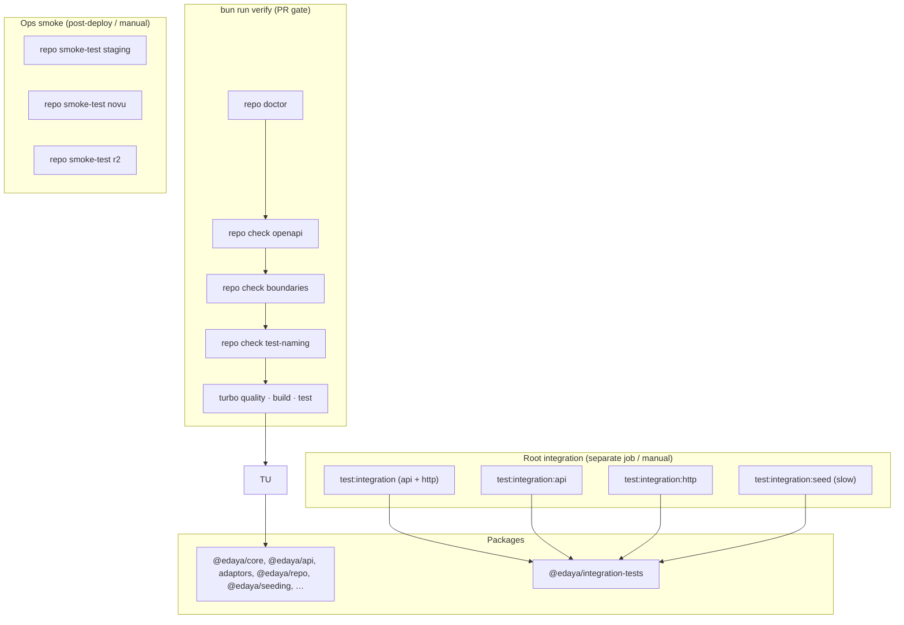

# Test Pyramid & Verify Pipeline — Sprint Plan

> **Historical plan.** Current lane selection and commands are in [CI setup](../reference/ci-setup.md) and the [implemented cleanup](test-suite-cleanup-plan.md). Package-owned SQL/composition tests now use `*.integration.test.ts`; cross-package journeys remain in the integration workspace.

> **Status:** T0–T1 complete (2026-07-07) · T2–T3 pending  
> **Created:** 2026-07-07  
> **Scope:** Separate unit tests from integration tests; consolidate repo hygiene checks under `bun repo verify`; centralize non-unit tests in `@edaya/integration-tests` with explicit slices  
> **Out of scope:** Mobile E2E (`edaya_mobile`), Playwright/webapp tests, load testing, enforced coverage gates, moving domain unit tests out of their packages  
> **Related:** [repo-cli.md](../reference/repo-cli.md), [archive/repo-cli-proposal.md](./archive/repo-cli-proposal.md), [unit-test-coverage-plan.md](./unit-test-coverage-plan.md), [AGENTS.md](../../AGENTS.md)

---

## 1. Problem statement

### Current pain points

| Issue | Today | Impact |
|-------|-------|--------|
| Blurred unit/integration boundary | `turbo run test` includes `@edaya/integration-tests` | “Unit test” runs are slow and flaky; PR verify time inflated |
| Split root `test` script | `test:repo` then `turbo run test` | `@edaya/repo` treated specially; easy to forget when iterating |
| Split integration entry | `test:integration` + `test:integration-seeds` at root | Hard to add new slices; naming inconsistent |
| Duplicate hygiene aliases | `check:boundaries`, `check:test-naming`, `openapi:check` at root **and** `bun repo check …` | Two ways to run the same check; docs drift |
| Verify owns test orchestration quirks | `verify.ts` runs `@edaya/repo test` separately, then `turbo test` (which also hits integration-tests) | Redundant steps; integration accidentally in default verify path |
| Stray integration tests | `@edaya/adaptor-r2` has `test:integration`; staging smoke lives beside PGlite journeys | No single home for “beyond unit” tests |

### Current command map (baseline)

```text
bun run test              → turbo test (unit only; excludes integration-tests)
bun run verify            → quality + build + test + bun repo verify
bun repo verify           → repo hygiene only (doctor + repo check *)
bun run test:integration  → integration-tests api + http slices
bun run test:integration:seed → slow seed slice (opt-in)
CI verify job             → bun run verify
CI integration job        → bun run test:integration (after verify)
```

### Design principles (agreed)

1. **Turbo `test` = unit only** — fast, hermetic, no HTTP server boot, no full seed datasets.
2. **`@edaya/integration-tests` = all non-unit backend tests** — three slices: **`api`** (headless PGlite), **`http`** (embedded API harness), **`seed`** (HTTP seeding, slow / opt-in).
3. **`bun run verify` = pre-PR gate** — Turbo quality + build + unit tests, then `bun repo verify` (repo hygiene only). **No Turbo in `bun repo`.**
4. **`bun repo verify` = repo hygiene** — doctor + all `repo check *` targets only.
5. **Integration is opt-in at root** — `bun run test:integration[:slice]`; never part of default `verify`.
6. **Smokes stay operational** — `bun repo smoke-test staging|novu|r2` remain outside integration package (live env / provider).
7. **Repo CLI = ops + hygiene** — no Turbo shortcuts (`lint`, `check`, `test`, `build`, `quality`, `lint:fix`).

---

## 2. Target architecture

### 2.1 Layer diagram



### 2.2 Test taxonomy

| Layer | Package | Turbo `test`? | Default `verify`? | Proves |
|-------|---------|---------------|-------------------|--------|
| **Unit** | Domain packages, adaptors (mocked IO), `apps/api` (in-process), `@edaya/repo`, `@edaya/seeding` | Yes | Yes | Branches, policy, domain rules, CLI parse, port logic |
| **Integration — api** | `@edaya/integration-tests` | No | No | Headless PGlite service journeys (no HTTP server) |
| **Integration — http** | `@edaya/integration-tests` | No | No | Embedded API app + HTTP client (auth, routes, generated client) |
| **Integration — seed** | `@edaya/integration-tests` | No | No | All seed HTTP paths incl. full demo (`scope: all`); **slow**, not PR default |
| **Smoke / ops** | Scripts via `repo smoke-test` | No | No | Live staging API, Novu, R2 credentials |
| **Coverage** | All unit packages | No (`test:coverage`) | No | Informational lcov; not a verify gate |

### 2.3 What moves into `@edaya/integration-tests`

| Source | Action |
|--------|--------|
| Already in package | Reassign to **`api`**, **`http`**, or **`seed`** slice — see §5.2 |
| `src/seed/**` (contract, `http/`, `slow/full-demo`) | **`seed`** slice only — entire tree is slow / opt-in |
| `src/staging/*` smoke tests | **Move impl to `repo smoke-test staging`** or mark `@slow` + exclude from PR slice — not default integration |
| `@edaya/adaptor-r2` `test:integration` | Relocate file to integration-tests; drop package script |
| Any future HTTP / PGlite / multi-package journey | Must land here first |

### 2.4 What stays unit (do not move)

- `tooling/repo/tests/**` — CLI parser, boundary rules, test-naming guard (runs via turbo)
- `tooling/seeding/src/**` unit tests — port workflows, doctor repair order, mocked fetch
- `apps/api/tests/**` — in-process route/unit tests without live HTTP server
- `@edaya/core/tests/**` — domain, auth matrices, workflows with test doubles

---

## 3. Verify split — Turbo vs repo CLI

**Pre-PR gate:** `bun run verify` (root `package.json`). **Repo hygiene:** `bun repo verify` only.

### 3.1 `bun run verify` (root)

```sh
bun run quality && bun run build && turbo run test -- --dots && bun repo verify
```

| # | Step | Notes |
|---|------|-------|
| 1 | `turbo run quality` | lint + check per package |
| 2 | `turbo run build` | |
| 3 | `turbo run test -- --dots` | unit packages only — see §4 |
| 4 | `bun repo verify` | repo hygiene — see §3.2 |

### 3.2 `bun repo verify` (repo CLI)

**No Turbo.** Implementation: `tooling/repo/cli/commands/verify.ts`.

| # | Step | Notes |
|---|------|-------|
| 1 | `repo doctor` | Tracked env hygiene |
| 2 | `repo check openapi` | Generated client / fixture drift |
| 3 | `repo check boundaries` | Runtime import rules |
| 4 | `repo check test-naming` | Unit test filename conventions |

### 3.3 Removed from `bun repo verify`

| Item | Action |
|------|--------|
| `turbo run lint|check|build|test|quality|lint:fix` | Root Turbo only — never in `bun repo` |
| Separate `@edaya/repo test` step | Delete — covered by turbo `test` |
| `@edaya/integration-tests` in turbo `test` | Exclude — see §4 |
| `test:integration*` | Never call from verify |
| `repo smoke-test *` | Post-deploy / manual only |
| Root `check:*` duplicate scripts | Deprecate aliases in favor of `bun repo check …` inside verify |

### 3.3 `bun repo check` — complete target list

All custom repo checks are invoked **only** through `check` subcommands; verify calls each explicitly (no hidden one-offs).

| Target | Script | In verify? |
|--------|--------|------------|
| `openapi` | `tooling/repo/openapi/check-drift.ts` | Yes |
| `boundaries` | `tooling/repo/ci/check-boundaries.ts` | Yes |
| `test-naming` | `tooling/repo/ci/check-test-naming.ts` | Yes |
| *(future)* `openapi-bindings` | if split from drift | Optional |

**Future checks** (e.g. package boundary drift, committed secret scan) → add `repo check <name>` + one line in `VERIFY_STEPS`.

---

## 4. Turbo — unit-only `test`

### 4.1 Exclude `@edaya/integration-tests`

**Option A (recommended):** Rename integration package scripts so Turbo has no `test` task:

```json
// tooling/integration-tests/package.json
{
  "scripts": {
    "test:integration": "…",
    "test:integration:api": "…",
    "test:integration:http": "…",
    "test:integration:seed": "…"
  }
}
```

Turbo `test` task simply skips packages without a `test` script.

**Option B:** Keep `test` script but add turbo filter at root:

```json
"test": "turbo run test --filter=!@edaya/integration-tests"
```

Prefer **Option A** — clearer package intent; integration never accidentally re-enters turbo.

### 4.2 Simplify root `test`

```json
// package.json (target)
"test": "turbo run test"
```

Remove `test:repo` — `@edaya/repo` participates in turbo like other workspaces.

### 4.3 Turbo task registry (unchanged)

```json
{
  "tasks": {
    "build": { "outputs": ["dist/**", "build/**", ".svelte-kit/**"] },
    "check": {},
    "quality": {},
    "test": {},
    "lint": {},
    "lint:fix": {}
  }
}
```

Optional follow-up: add `"test:integration"` turbo task with `cache: false` if we want `turbo run test:integration` — not required for phase 1.

---

## 5. Integration test slices

### 5.1 Naming convention

Four scripts. **`test:integration`** is the PR default; **`test:integration:seed`** is the slow opt-in slice (not part of default `test:integration`).

| Script | Harness | PR integration job? |
|--------|---------|---------------------|
| `test:integration` | `api` + `http` | **Yes** |
| `test:integration:api` | Headless PGlite — `SchoolService` journeys, adaptor repos, runtime persistence | Yes (via default) |
| `test:integration:http` | Embedded `@edaya/api` app + `fetch` — auth sessions, `/core/*` routes, generated client | Yes (via default) |
| `test:integration:seed` | HTTP seeding — contract, validate/doctor scopes, full demo (`scope: all`) | **No** — slow (~2+ min); manual / nightly / seed PRs |

**Slice rule:** name by **harness + domain**, not duration — except document `seed` as the one slow slice in prose and CI labels.

**Root scripts:**

```text
bun run test:integration           # PR default — api + http only
bun run test:integration:api       # PGlite service journeys
bun run test:integration:http      # embedded API HTTP harness
bun run test:integration:seed      # all seed tests — slow, opt-in
```

**Package scripts** (`@edaya/integration-tests`):

```json
{
  "test:integration": "bun run test:integration:api && bun run test:integration:http",
  "test:integration:api": "bun test src/services src/runtime src/adaptor --parallel=1",
  "test:integration:http": "bun test src/auth src/routes src/generated/api-client --parallel=1",
  "test:integration:seed": "bun test src/seed --parallel=1"
}
```

Root forwards:

```json
"test:integration": "bun --filter @edaya/integration-tests test:integration",
"test:integration:api": "bun --filter @edaya/integration-tests test:integration:api",
"test:integration:http": "bun --filter @edaya/integration-tests test:integration:http",
"test:integration:seed": "bun --filter @edaya/integration-tests test:integration:seed"
```

**Drop:** `test:integration-seeds`, package `test:slow`, package `test` (turbo-facing).

**Optional reorg (T2):** align folders to slices — `src/api/`, `src/http/`, `src/seed/` — not required for script rename.

### 5.2 Slice → directory map

| Slice | Paths (today) | ~duration | In `test:integration`? |
|-------|---------------|-----------|-------------------------|
| `api` | `src/services/**`, `src/runtime/**`, `src/adaptor/**` | ~1 min | Yes |
| `http` | `src/auth/**`, `src/routes/**`, `src/generated/api-client/**` | ~2–3 min | Yes |
| `seed` | `src/seed/**` (`contract.test.ts`, `http/`, `slow/full-demo-seed.test.ts`) | ~2+ min | **No** |

**Out of integration slices:** `src/staging/**` → `repo smoke-test staging` only.

### 5.3 CI integration job

Default PR job runs **`bun run test:integration`** (`api` + `http` only).

Optional `workflow_dispatch` input to add **`seed`** slice for seed-heavy PRs or nightly:

```yaml
inputs:
  slice:
    type: choice
    options: [default, api, http, seed, all]
    # default = api + http; all = api + http + seed
```

---

## 6. Root `package.json` — target scripts

```json
{
  "scripts": {
    "verify": "bun run quality && bun run build && turbo run test -- --dots && bun repo verify",
    "test": "turbo run test",
    "test:coverage": "turbo run test -- --coverage --coverage-reporter=lcov",
    "test:integration": "bun --filter @edaya/integration-tests test:integration",
    "test:integration:api": "bun --filter @edaya/integration-tests test:integration:api",
    "test:integration:http": "bun --filter @edaya/integration-tests test:integration:http",
    "test:integration:seed": "bun --filter @edaya/integration-tests test:integration:seed",
    "doctor": "bun repo doctor",
    "check:openapi": "bun repo check openapi",
    "check:boundaries": "bun repo check boundaries",
    "check:test-naming": "bun repo check test-naming"
  }
}
```

**Deprecate / remove:**

| Script | Replacement |
|--------|-------------|
| `test:repo` | `turbo run test --filter=@edaya/repo` |
| `test:integration-seeds` | `test:integration:seed` |
| `test:slow` (integration-tests package) | `test:integration:seed` |

Keep root `check:*` aliases temporarily for muscle memory; document `bun repo check …` as canonical.

---

## 7. CI workflows

### 7.1 `_verify.yml` — unchanged entry

```yaml
- run: bun run verify
```

Verify must **not** run integration tests after this change (today it accidentally includes them via turbo).

### 7.2 `_integration.yml` — explicit slice

```yaml
- run: bun run test:integration
```

Optional `workflow_dispatch` inputs per slice — see §5.3.

### 7.3 `_coverage.yml` — unit only

```yaml
- run: bun run test:coverage
```

Integration coverage remains out of scope.

### 7.4 PR job graph (unchanged shape)

```text
gate → verify (unit + hygiene)
     → integration (depends on verify)
     → coverage (after verify, informational)
```

---

## 8. Documentation updates

| Doc | Change |
|-----|--------|
| [AGENTS.md](../../AGENTS.md) | Verify = unit only; point to `test:integration` for HTTP/PGlite |
| [repo-cli.md](../reference/repo-cli.md) | Update verify steps table; document full `check` list; integration explicitly excluded |
| [local-dev.md](../reference/local-dev.md) | Pre-PR: `bun run verify` + optional `bun run test:integration` |
| [unit-test-coverage-plan.md](./unit-test-coverage-plan.md) | Note turbo test excludes integration-tests |
| [README.md](../../README.md) | Testing section: unit vs integration commands |

---

## 9. Implementation phases

### Phase T0 — Verify cleanup (low risk)

- [x] **T0.1** Update `verify.ts`: remove `@edaya/repo test` step; keep ordered checks per §3.1
- [x] **T0.2** Exclude integration from turbo unit test (Option A or B)
- [x] **T0.3** Root `"test": "turbo run test"` — drop `test:repo`
- [x] **T0.4** Run `bun run verify` locally; fix any ordering regressions
- [x] **T0.5** Update `repo-cli.md` verify section

**Verification:** `bun run verify` green; `bun repo verify` is repo hygiene only.

### Phase T1 — Integration slices

- [x] **T1.1** Add `@edaya/integration-tests` scripts per §5.1 (`api`, `http`, `seed`)
- [x] **T1.2** Add root `test:integration:*` forwards; remove `test:integration-seeds`
- [x] **T1.3** Update `_integration.yml` — default job runs `test:integration` (api + http); document `seed` as opt-in
- [x] **T1.4** Confirm PR integration job ~27 tests (api + http); seed slice separate (11 tests)

**Verification:** `bun run test:integration` green; `bun run test:integration:seed` green when run explicitly.

### Phase T2 — Consolidate stray integration tests

- [ ] **T2.1** Move `@edaya/adaptor-r2` integration test into `@edaya/integration-tests` (new file under `src/adaptor/`)
- [ ] **T2.2** Audit `apps/api/tests` for tests that boot live HTTP — move if any
- [ ] **T2.3** Resolve `src/staging/*` — wire to `repo smoke-test staging` or exclude from PR slices

**Verification:** No package other than integration-tests has non-unit test scripts in turbo path.

### Phase T3 — Docs & deprecation

- [ ] **T3.1** README + AGENTS + local-dev updated
- [ ] **T3.2** Mark deprecated root aliases in repo-cli.md (remove in follow-up PR if desired)
- [ ] **T3.3** Archive note in [repo-cli-proposal.md](./archive/repo-cli-proposal.md) pointing to this plan

---

## 10. Verification checklist (definition of done)

- [x] `bun repo verify` runs: doctor → all `repo check *` only (no Turbo)
- [x] `bun run verify` runs Turbo quality + build + test, then `bun repo verify`
- [x] `turbo run test` does **not** execute `@edaya/integration-tests`
- [x] `@edaya/repo` tests run via turbo only (no special verify step)
- [x] `bun run test:integration` runs **api + http** only (PR integration job)
- [x] `bun run test:integration:seed` is opt-in (all seed paths, slow)
- [ ] `bun repo smoke-test staging` unchanged; not called from verify
- [ ] CI `_verify.yml` + `_integration.yml` green on clean clone
- [ ] No enforced coverage gate in verify

---

## 11. Open questions (resolve during T1)

| # | Question | Default if unset |
|---|----------|------------------|
| 1 | Include `build` in every PR verify? | Yes (keep today) |
| 2 | Include `seed` in default PR integration? | **No** — opt-in / seed PRs / nightly |
| 3 | Nightly workflow for `test:integration:seed`? | Defer; document manual run |
| 4 | Turbo task for `test:integration` with caching? | No — phase 2 |

---

## 12. Related commands (quick reference)

```sh
# Pre-PR (required)
bun run verify

# Repo hygiene only
bun repo verify

# Pre-PR (recommended when touching HTTP, auth, routes, PGlite services)
bun run test:integration          # api + http

# Seed / demo dataset changes (slow)
bun run test:integration:seed

# Informational
bun test:coverage

# Post-deploy / ops
bun repo smoke-test staging
```
