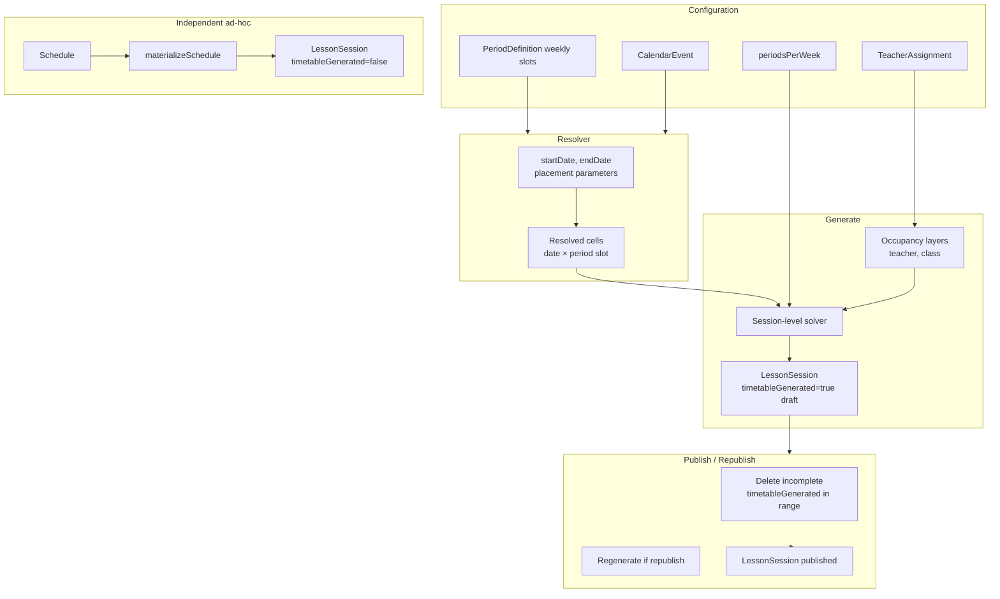

# Auto Timetable Generation — Sprint Plan

> **Status:** Locked — ready for Phase 0  
> **Created:** 2026-07-08  
> **Last updated:** 2026-07-08 (session-native resolver model; timetable flag on `LessonSession`)  
> **Scope:** Date-range timetable generation via resolver + session-level solver; publish writes flagged `LessonSession`s; ad-hoc `Schedule` + materialize remains independent  
> **Out of scope (v1):** Activity/assessment generation, room requirements, teacher availability, CP-SAT solver, stored generation process / draft entities  
> **Related domain:** `package/domain-core/src/domain/scheduling/`, `domain/academics/`, `domain/school/`  
> **Related plans:** [session-content-model-plan.md](./archive/session-content-model-plan.md), [relationship-native-auth-plan.md](./relationship-native-auth-plan.md)

---

## Locked design summary

| Decision | Choice |
|----------|--------|
| Period model | **Weekly `PeriodDefinition`** (`dayOfWeek`, `isTeachingSlot`, `isBreak`) |
| Planning space | **Resolver** maps `startDate`–`endDate` + weekly slots + calendar → resolved **cells** `(date, period slot)` |
| Periodicity | **No periodicity field** — repetition is implicit in resolver expansion from placement **parameters** |
| Generate output | **`LessonSession` rows** with dedicated **`timetableGenerated: true`** flag (draft until publish) |
| Publish | Promote / finalize generated sessions in range (delete incomplete prior generated, write new) |
| Republish | **= regenerate** — delete previous `timetableGenerated` sessions that are **not completed**, then generate again |
| Conflicts | **Session level** — lessons, activities, in-class assessments share one overlap check |
| Occupancy | **Layered** — e.g. `OccupiedCell` keyed by **teacher** (and class group for own-class placement) |
| `scheduleId` | **Optional** on generated sessions — ad-hoc path still uses `Schedule` → `materializeSchedule` |
| Process storage | **None** — no stored solver run, no `schoolDraftId` process entity |
| Sequential generation | Per class; pin **teacher occupancy layers** from existing sessions in range |

### Two independent paths

| Path | Creates | Use case |
|------|---------|----------|
| **Timetable generator** | `LessonSession` (`timetableGenerated: true`, `scheduleId` optional) | Auto timetable for a date range |
| **Schedule + materialize** | `LessonSession` (`timetableGenerated: false`, `scheduleId` required) | Manual / ad-hoc recurring or one-off |

---

## Core invariants (revised)

1. **Session-level conflicts** — one overlap engine for `LessonSession`, `ActivitySession`, and in-class `Assessment` in the resolved datetime range.
2. **Resolver owns repetition** — placement **parameters** (e.g. weekly pattern) are expanded into concrete cells at resolution time; the solver places on cells, not on abstract recurrence.
3. **Generated sessions are flagged** — `timetableGenerated: true` distinguishes solver output from schedule-materialized sessions.
4. **Republish replaces incomplete generated work** — completed generated sessions are kept; all other `timetableGenerated` sessions in scope are deleted and regenerated.
5. **Teacher occupancy is a layer** — cross-class sequential generation pins occupied cells per teacher.

---

## 1. Architecture

### 1.1 Process flow



### 1.2 Resolver

**Input:**

```typescript
interface ResolveTimetableSpaceInput {
  classGroupId: string
  academicYearId: string
  startDate: Date
  endDate: Date
  placementParameters: TimetablePlacementParameters  // pattern for expansion — not stored as periodicity enum
}
```

**Behaviour (v1):**

1. Iterate each calendar date in `[startDate, endDate]`.
2. Skip non-school dates (`CalendarEvent`, scoped to class).
3. Map `date → dayOfWeek` → `PeriodDefinition` rows where `isTeachingSlot && !isBreak`.
4. Emit **resolved cell** per `(date, periodDefinitionId)` with computed `startsAt` / `endsAt`.

**Placement parameters** (solver input, not persisted as a process):

- Define how subject workload maps onto the weekly slot pattern (e.g. “5 periods/week” satisfied across resolved cells in range).
- Weekly repetition is a **resolver concern**: parameters describe the pattern; resolver emits all candidate cells in the date range.

No `periodicity` enum — only `startDate` / `endDate` and parameter-driven expansion.

### 1.3 Occupancy layers

Occupancy is **layered**; each layer blocks cells for a specific concern:

| Layer | Key | Used for |
|-------|-----|----------|
| **Teacher** | `teacherId` | Cross-class conflict; sequential generation pins |
| **Class group** | `classGroupId` | One lesson per cell in own class |
| **Pinned / completed** | session id | `isException`, `completed` sessions immovable |

```typescript
interface OccupiedCell {
  date: string
  periodDefinitionId: string
  layer: 'teacher' | 'class_group'
  layerKey: string   // teacherId or classGroupId
  sourceSessionId?: string
}
```

When generating class **G**, build teacher layer from `LessonSession`s (and activities if in scope) for teachers assigned to **G**, across other classes, within `[startDate, endDate]`.

### 1.4 Session-level conflicts

```typescript
assertNoSessionConflict({
  classGroupId,
  teacherId?,
  startsAt,
  endsAt,
  excludeSessionId?,
}): void
```

Checks overlap against:

- `LessonSession` (all origins)
- `ActivitySession`
- In-class `Assessment` (`startsAt` / `endsAt`)

Used by **generator** (on each candidate cell) and available for **ad-hoc** saves.  
`materializeConflictPolicy` (`fail` | `skip`) applies to the **Schedule → materialize** path only.

### 1.5 `LessonSession` extensions

```typescript
timetableGenerated: z.boolean().default(false)
scheduleId: z.string().trim().min(1).nullable().optional()  // required when timetableGenerated=false
```

| Field | Generated path | Ad-hoc (materialized) path |
|-------|----------------|----------------------------|
| `timetableGenerated` | `true` | `false` |
| `scheduleId` | optional | **required** |
| `status` | `pending` on publish | `pending` / `completed` / `cancelled` |

Validation:

- `timetableGenerated === false` → `scheduleId` required.
- `timetableGenerated === true` → `scheduleId` optional.

Direct `lessonSessions.save` for **new** rows: allowed only via timetable publish workflow or materialize workflow (`moduleChecked`).

---

## 2. Domain changes (Phase 0)

### 2.1 `PeriodDefinition` (extend in place)

```typescript
dayOfWeek: z.nativeEnum(DayOfWeek)
isTeachingSlot: z.boolean().default(true)
// existing: order, startTime, endTime, isBreak, academicYearId
```

Blocked Wed PM → `isTeachingSlot: false`.

### 2.2 `GradeLevelSubject.periodsPerWeek`

Synced to `ClassSubject`. Required when workload enforcement is on.

### 2.3 `LessonSession`

- `timetableGenerated: boolean`
- Relax `scheduleId` to optional when `timetableGenerated === true`

### 2.4 School generation defaults (`School`)

```typescript
timetableEnforceWorkloadFulfillment: boolean    // default true
timetableExcludeBreakSlots: boolean             // default true
timetableMinPeriodGapSameSubject: number         // default 2 (weekly index within each week slice)
timetablePreferredPeriodDefinitionIds: string[]
```

### 2.5 `resolveTimetableSpace` query

Returns resolved cells for a class group and date range (teaching days only).

### 2.6 Session conflict helper

Extract / extend `assertNoClassGroupScheduleConflict` → `assertNoSessionConflict` (lessons + activities + assessments).

---

## 3. Generate & publish (Phase 1–2)

### 3.1 Generate

```typescript
interface GenerateClassGroupTimetableInput {
  classGroupId: string
  academicYearId: string
  startDate: Date
  endDate: Date
  placementParameters?: TimetablePlacementParameters  // defaults from school + workload
  options?: Partial<TimetableGenerationDefaults>
}
```

**Steps:**

1. Resolve space → cells.
2. Build occupancy layers (teacher pins from other classes; class layer from existing sessions in range).
3. Greedy solver: place `classSubject` instances on cells; enforce workload, `minPeriodGapSameSubject` (per week slice in range), teacher layer.
4. Write `LessonSession` rows with `timetableGenerated: true`, `status: pending` (unpublished draft state — see §3.2).

**No stored process** — output is only the flagged sessions (and transient solver state in memory).

**Sequential / school-wide:** `generateSchoolTimetable` loops class groups ordered by `GradeLevel.order`, then name; each run sees updated teacher occupancy layers.

### 3.2 Publish

```typescript
interface PublishClassGroupTimetableInput {
  classGroupId: string
  startDate: Date
  endDate: Date
  sessionConflictPolicy?: 'fail' | 'skip'  // default 'fail'
}
```

**Publish = finalize generated sessions in range** (no separate artifact).

For sessions with `timetableGenerated: true` in range:

- Already written by generate; publish validates conflicts once more if needed and marks them live (or generate writes publish-ready rows and publish is a no-op validation — implementer choice; prefer **generate writes draft, publish commits** via status or `publishedAt` flag if needed).

**Simpler v1:** generate writes sessions; **publish** only runs final conflict pass + sets `publishedAt` or flips `isDraft: false` if we add a draft bit. If no draft bit: generate creates replaceable rows; publish confirms.

**Recommended v1:** add `timetableDraft: boolean` on generated sessions (`true` after generate, `false` after publish) OR use `publishedAt: Date | null`.

### 3.3 Republish (= regenerate)

```typescript
interface RepublishClassGroupTimetableInput {
  classGroupId: string
  startDate: Date
  endDate: Date
  // same options as generate
}
```

**No separate republish state machine:**

1. Delete all `timetableGenerated` `LessonSession`s in `[startDate, endDate]` where `status !== completed` (and not `cancelled` if preserving audit — **completed only is kept**).
2. Run **generate** again (same inputs).
3. Run **publish** (or generate produces publish-ready rows in one step).

`isException` manual reschedules on generated sessions: treat as **completed or pinned** occupancy (do not delete if completed; if pending exception, pin cell in occupancy layer).

### 3.4 Ad-hoc path (unchanged)

- `Schedule` + `materializeSchedule` → `LessonSession` with `timetableGenerated: false`, `scheduleId` required.
- `school.enforceScheduleConflicts` + `materializeConflictPolicy` for this path only.

---

## 4. Generator options

```typescript
interface TimetableGenerationDefaults {
  enforceWorkloadFulfillment: boolean
  excludeBreakSlots: boolean
  minPeriodGapSameSubject: number   // weekly index within each calendar week in range
  preferredPeriodDefinitionIds: string[]
}
```

Teacher conflicts: **mandatory** via teacher occupancy layer (not optional).

---

## 5. Phases

### Phase 0 — Foundation

| Task | Deliverable |
|------|-------------|
| `PeriodDefinition`: `dayOfWeek`, `isTeachingSlot` | Migration + demo Wed PM |
| `LessonSession`: `timetableGenerated`, optional `scheduleId` | Domain + validation |
| `periodsPerWeek` on `GradeLevelSubject` + sync | Domain + API |
| `resolveTimetableSpace` | Query |
| `assertNoSessionConflict` | Shared conflict module |
| School timetable default fields | `School` schema |
| Demo fixtures | Weekly slots |

### Phase 1 — Resolver + generator

| Task | Deliverable |
|------|-------------|
| Occupancy layer builder (teacher, class) | `timetable-generation.ts` |
| Greedy solver on resolved cells | Unit tests |
| `generateClassGroupTimetable` | Command |
| `generateSchoolTimetable` | Wrapper (`GradeLevel.order`) |

### Phase 2 — Publish / republish

| Task | Deliverable |
|------|-------------|
| `publishClassGroupTimetable` | Finalize + conflict policy |
| `republishClassGroupTimetable` | Delete incomplete generated + regen |
| `timetablePublish` authorization op | `SchedulingOperations` |
| Integration: range, calendar skip, teacher pin | `tooling/integration-tests` |

### Phase 3 — Seeds & UI deferral

Demo `periodsPerWeek`, seed optional generate+publish, portal smoke.

---

## 6. Edge cases

| Case | Behavior |
|------|----------|
| Christmas in range | Resolver skips dates — no cells |
| Completed generated session in range | **Kept** on republish |
| Pending generated session in range | **Deleted** on republish |
| `isException` pending session | Pin occupancy; do not delete if policy says pin |
| Activity overlaps generated lesson | `assertNoSessionConflict` at generate / publish |
| Ad-hoc materialized session | `timetableGenerated: false`; blocks via session conflict |
| Teacher not assigned | Generate fails preflight |
| Generate then republish without option changes | Deletes incomplete generated → new placements |

---

## 7. Verification

```sh
bun run verify
bun run test:integration
```

- Generate for date range → flagged sessions created.
- Publish → sessions finalized in range.
- Republish → completed kept; pending regenerated.
- No overlap between generated lessons and activity sessions in range.
- Ad-hoc `Schedule` materialize still works with `scheduleId` required.
- Teacher sequential: 6A then 6B — no double-book.

---

## 8. Locked decisions log

| Topic | Decision |
|-------|----------|
| Draft artifact | **Flag on `LessonSession`** (`timetableGenerated` + draft/publish state) — not a separate placement entity |
| Placement pattern | **Resolver parameters** expand to cells; no periodicity enum |
| `scheduleId` | Optional for generated sessions |
| Occupancy | **Layered by teacher** (and class for own-group) |
| Process storage | **None**; republish = delete incomplete generated + regenerate |
| Period definitions | Weekly; extend `PeriodDefinition` in place |
| Conflict policy param | `sessionConflictPolicy` on publish; materialize path keeps `materializeConflictPolicy` |
| School generation order | `GradeLevel.order`, then class name |

---

## 9. Key files

| Area | Path |
|------|------|
| Period definition | `package/domain-core/src/domain/scheduling/period-definition.ts` |
| Lesson session | `package/domain-core/src/domain/scheduling/lesson-session.ts` |
| Schedule (ad-hoc) | `package/domain-core/src/domain/scheduling/schedule.ts` |
| Materialization | `package/domain-service/src/services/workflows/scheduling.ts` |
| Conflicts | `package/domain-service/src/services/workflows/schedule-conflicts.ts` |
| Grade subject sync | `package/domain-service/src/services/workflows/grade-level-subject-sync.ts` |
| Scheduling ops | `package/domain-authorization/src/operations/scheduling.ts` |
