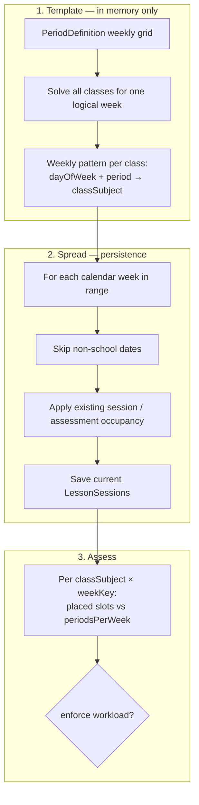

# Timetable Solver Evolution — Phases A, B & C

> **Status:** Phase A implemented — 2026-07-11; Phase C core implemented — 2026-07-11; Phase B designed  
> **Prerequisite:** [timetable-generation-implementation-plan.md](./archive/timetable-generation-implementation-plan.md) (v1 shipped)  
> **Scope:** Solver spacing, session-duration rules, and weekly-template generation mode.

---

## Generation modes (locked 2026-07-11)

| Mode | Default | Behaviour |
|------|---------|-----------|
| **`weekly`** | **Yes** | Build one **template week** from `PeriodDefinition`, solve school-wide, replicate across the selected range, persist sessions on spread only. |
| **`free`** | No | Current behaviour: solve independently on each calendar week’s concrete cells across the full range. |

- Operator chooses mode per generation run (class or school).
- **Generation is final** — saved sessions are current and printable. Both modes replace only untouched pending generated sessions; recorded work, manual exceptions, cancellations and linked records survive.
- School default: `timetableGenerationMode: 'weekly'`.

---

## Implementation order

| Step | Phase | Status | Deliverable |
|------|-------|--------|-------------|
| 1 | **A** — Day-based gap | ✅ Done | `minDayGapSameSubject`; gap across full range in `free` mode |
| 2 | **C** — Weekly template core | ✅ Done | Logical week grid, in-memory template solve, spread → current sessions, workload assessment |
| 3 | **A** — Weekly gap scope | ✅ Done | Day gap restricted to template week (single `WEEKLY_TEMPLATE_WEEK_KEY` solve) |
| 4 | **C** — School orchestration | ✅ Done | School-wide template solve (shared-teacher occupancy), then per-class spread |
| 5 | **C** — API + web | ✅ Done | `generationMode` (`weekly` default), mode selector in advanced panel |
| 6 | **B** — Session span domain + solver | ✅ Done | `minPeriodSpan` / `maxPeriodSpan`; block placement on template week and `free` mode |
| 7 | **B** — UI + fixtures | ✅ Done | Advanced panel, `ClassSubject` config, demo-ci Math 1–2 spans |

**Rationale:** `weekly` is the default generation mode — ship template solve + spread before double-period blocks. Phase B builds on the weekly template solver once single-period weekly timetables are stable.

---

## Phase A — Day-based gap (same subject) ✅

Implemented. Replaces slot-index spacing with **calendar-day spacing** (`minDayGapSameSubject`).

| `minDayGapSameSubject` | Meaning |
|------------------------|---------|
| `0` | Next lesson may be on the **same calendar day** (different slot). |
| `1` | Earliest next lesson is the **next calendar day**. |
| `n` | At least `n` full calendar days between lesson **dates** (weekends and vacations included). |

**Mode-specific application:**

| Mode | Where day gap applies |
|------|------------------------|
| `weekly` | During **template-week solve** and concrete-week repair, including preserved lesson dates. |
| `free` | Across the **full selected date range** (current implementation). |

---

## Phase B — Session span (min / max periods per session)

### Locked decisions (2026-07-11)

| # | Decision |
|---|----------|
| 1 | **`periodsPerWeek` is always a slot count.** A double-period session consumes **2** slots toward the weekly target. |
| 2 | **Min / max span** defines allowed **session length in periods**, not a count of doubles per week. Example: `minPeriodSpan = 1`, `maxPeriodSpan = 2` for Mathematics → each Math session is **1 or 2 periods long**; the solver chooses block size while filling weekly slot quota. |
| 3 | **Any subject** may define span bounds. Config will eventually flow **timetable resolver / generation defaults → `ClassSubject` → `GradeLevelSubject`** (class override wins over grade-level template). |

### Solver behaviour (target)

- A **placement** is either one cell (span 1) or **N consecutive teaching cells on the same day** with adjacent `PeriodDefinition.order` (span N), where `minPeriodSpan ≤ N ≤ maxPeriodSpan`.
- Weekly workload: sum of slot spans placed for `classSubjectId` in `weekKey` must reach `periodsPerWeek` (minus existing sessions in range).
- **Occupancy:** class group and all resolved teachers blocked for every cell in the block.
- **Day gap (Phase A):** compare gap using the **session start date** (first cell date of the block).
- **Unmet workload:** reported per `(classSubjectId, weekKey)` when placed slot sum &lt; required slot sum.

### Domain fields (proposed)

```typescript
minPeriodSpan: number  // default 1
maxPeriodSpan: number  // default 1, ≥ minPeriodSpan

minPeriodSpanByClassSubjectId?: Record<string, number>
maxPeriodSpanByClassSubjectId?: Record<string, number>
```

### Out of scope for Phase B v1

- Spans crossing lunch or breaks.
- Span &gt; 2 unless period grid and UX explicitly support it later.

---

## Phase C — Weekly template mode (`weekly`)

### Locked decisions (2026-07-11)

| # | Decision |
|---|----------|
| 1 | **Template source** — the **defined weekly `PeriodDefinition` grid** (`dayOfWeek` × period slots). Not anchored to the first calendar week in the range. Template solve uses a logical week; spread maps `(dayOfWeek, periodDefinitionId)` → concrete dates. |
| 2 | **Short / partial weeks** — Closed dates are excluded. Retain available template lessons, fill missing workload, and replan affected weeks when necessary. Preserved sessions remain fixed; strict fulfillment still fails if the bounded solver cannot complete the workload. |
| 3 | **Existing sessions & occupancy** — considered **only when spreading**, not during template resolution. Template build is **in-memory only** (no persistence). **`LessonSession` rows are created during spread** only. |
| 4 | **School generation** — solve **all classes for the template week first** (sequential by grade order, shared-teacher occupancy pinned across classes — same as today but on one logical week), then **spread each class pattern** across the date range. Repair remaining shortfalls jointly across selected classes in the affected week, trying a bounded set of deterministic placement orders. Persist the final plans only after conflict and workload checks in the shared transaction. |
| 5 | **Regeneration** — operator selects `weekly` or `free` per run; **the same protected replacement and transaction rules apply to both modes**. |

### Pipeline



### Template solve

- Resolve **one logical teaching week** from `PeriodDefinition` (all teaching slots; breaks excluded per school option).
- **No** calendar closure filtering during template solve (closures apply at spread time).
- **No** existing-session occupancy during template solve.
- Apply solver constraints: teacher assignment, day gap, preferred periods, span (Phase B), workload `periodsPerWeek` for the template week.
- Output: `WeeklyTimetableTemplate` per class — list of `(dayOfWeek, periodDefinitionId, classSubjectId, teacherIds, span?)`.

### Spread

- For each **calendar week** (`weekKey`) intersecting `startDate`–`endDate`:
  - For each template placement, compute concrete `date` from `dayOfWeek`.
  - Skip if date is non-school (calendar event, out of range).
  - Check occupancy from **existing** lessons, assessments, activities, teacher unavailability in range.
  - Skip conflicting slots (dropped, not moved).
  - Create `LessonSession` (`timetableGenerated: true`).

### Workload assessment

- After spread: for each `(classSubjectId, weekKey)`, compare **placed slot count** vs `periodsPerWeek`.
- **Non-teaching weeks** (zero school days in the week, e.g. full vacation) are **excluded** from workload assessment.
- Short weeks with some teaching days → `unmetWorkloads` entries (warnings if enforce off, error if enforce on).
- Full template week that satisfies `periodsPerWeek` should repeat cleanly on complete teaching weeks.

### API (proposed)

```typescript
type TimetableGenerationMode = 'weekly' | 'free'

interface TimetableGenerationDefaults {
  // ...existing options
  generationMode?: TimetableGenerationMode  // default 'weekly'
}
```

### `free` mode (unchanged)

- Resolve concrete cells for entire `startDate`–`endDate`.
- Solve week-by-week on calendar cells with full occupancy from the start.
- Day gap applies across the full range.

### Verification

- Template: 6A pattern stable across 3 identical teaching weeks.
- Short week: Christmas week drops Fri sessions only; unmet workload reported.
- Spread: preserved active session blocks slot and counts toward workload; template unchanged.
- School: two classes sharing `ci-t5` get non-overlapping template slots.
- `free` mode regression suite unchanged.

---

## Verification

**Phase A (done):** day gap across weekends and vacation; enforce on/off.

**Phase C:** template stable across identical teaching weeks; short-week drops; spread respects existing occupancy; school shared-teacher slots; `free` mode regression.

**Phase B:** span-2 Math filling `periodsPerWeek: 4` as 2+2 or 2+1+1; unmet slot counts on partial weeks; demo-ci Math with `minPeriodSpan: 1`, `maxPeriodSpan: 2`. Solver uses greedy lookahead (no backtracking) to prefer span packings that still allow the weekly quota to complete — e.g. non-overlapping doubles on one day instead of a preferred middle double that blocks the second double.
