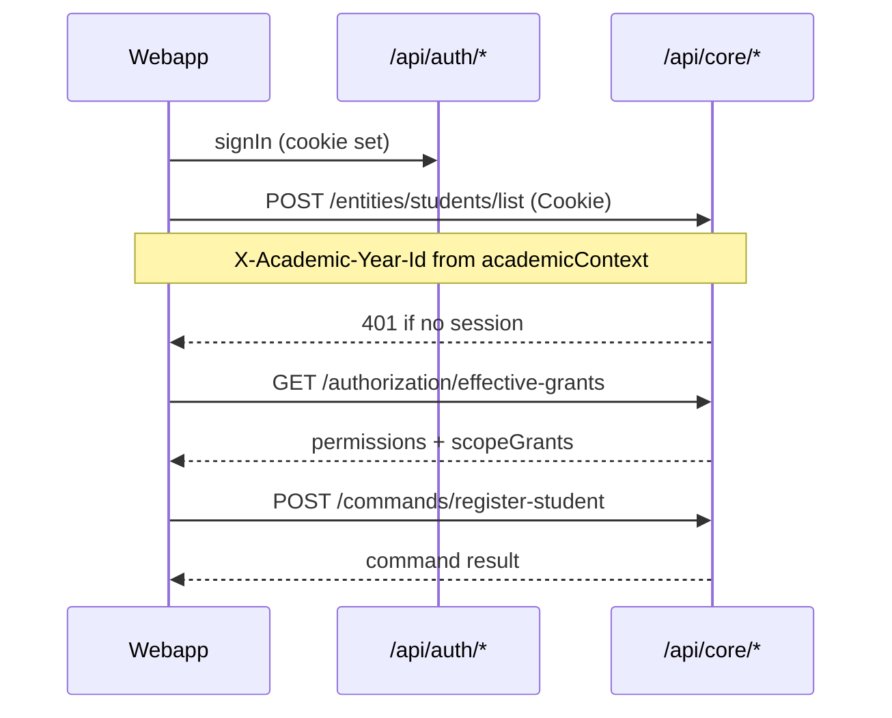

# Webapp ↔ API Integration Plan

This document crosschecks `apps/webapp` (SvelteKit UI) against the current monorepo — especially `apps/api` and `@edaya/core` — and outlines how to wire them together.

**Related docs:** [API folder structure](./api-folder-structure.md), [API improvement plan](./api-improvement-plan.md), [Authorization README](../packages/core/src/authorization/README.md).

---

## 1. Executive summary

`apps/webapp` is a **UI prototype** with deliberate seams for API wiring, but **no live integration** today:

- All data comes from local mocks (`school.ts`, `report-cards.ts`, `teachingLog.ts`).
- Auth is a demo picker backed by `sessionStorage`, not Better Auth.
- Permissions are a client-side `StaffRole` enum, not `effective-grants` from the API.
- There are **zero** `fetch` calls, env vars, or workspace dependencies on `@edaya/*`.

The webapp is physically under `apps/*` but operationally isolated (separate `package-lock.json`, not in root `bun.lock`).

---

## 2. Current architecture

```
┌─────────────────────────────────────────────────────────────┐
│ apps/webapp (SvelteKit, port 5173)                          │
│                                                             │
│  +page.ts loaders → loaders.ts → school.ts (mocks)          │
│  authSession      → sessionStorage + DEMO_ACCOUNTS          │
│  permissions.ts   → StaffRole enum (directeur, professeur…) │
│  academicContext  → yearId / periodId (local state only)    │
└───────────────────────────┬─────────────────────────────────┘
                            │  (not wired)
                            ▼
┌─────────────────────────────────────────────────────────────┐
│ apps/api (Hono, port 9999)                                  │
│                                                             │
│  /api/auth/*                         → Better Auth          │
│  /api/core/entities/{name}/*         → entity CRUD          │
│  /api/core/commands/{name}           → domain commands       │
│  /api/core/queries/{name}            → aggregate queries    │
│  /api/core/authorization/effective-grants → introspection   │
│  /doc, /reference                    → OpenAPI              │
└───────────────────────────┬─────────────────────────────────┘
                            │
                            ▼
                    @edaya/core + @edaya/adaptor-postgres
```

### Intended integration seams (already in the webapp)

| File | Role today | Role when integrated |
|------|------------|----------------------|
| `src/lib/data/loaders.ts` | Page loaders reading mock arrays | HTTP calls to entity `list` / `one` / commands |
| `src/lib/data/load-state.ts` | Demo loading/empty/error states (`?demo=`) | Real async loading and error handling |
| `src/lib/auth/session.svelte.ts` | Demo login via `sessionStorage` | Better Auth session + actor mapping |
| `src/lib/permissions.ts` | Client RBAC from `StaffRole` enum | UI gates from `effective-grants` |
| `src/lib/academic/context.svelte.ts` | Year/period/class selection | Sends `X-Academic-Year-Id` on API calls |

Comments in `load-state.ts` and `school.ts` explicitly note intent: *"prêt pour brancher l'API plus tard"* / *"aligné futur API"*.

---

## 3. Monorepo membership gaps

| Issue | Detail |
|-------|--------|
| Package name | `"sveltekit"` — should be `@edaya/webapp` |
| Workspace deps | None — no `@edaya/core`, no `better-auth` |
| Lockfile | Own `package-lock.json`; **not in root `bun.lock`** |
| Package manager | Root uses Bun; webapp bootstrapped with npm/`sv create` |
| Turbo outputs | `turbo.json` expects `dist/**`; SvelteKit builds to `.svelte-kit/` |
| CI / fullcheck | No `lint` or `test` scripts; excluded from meaningful `bun fullcheck` |
| Env config | No `.env` / `.env.example`; no `PUBLIC_API_URL` |
| README | Still the default `sv create` template |

---

## 4. API surface the webapp should consume

Default dev API: `http://localhost:9999` (`PORT` in `apps/api` env schema).

| Category | Pattern | Methods |
|----------|---------|---------|
| Auth | `/api/auth/*` | GET, POST (Better Auth proxy) |
| Entities | `/api/core/entities/{publicName}/list\|one\|count\|get\|save\|delete\|batch-*` | Mostly POST; `get` is GET |
| Commands | `/api/core/commands/{publicName}` | POST |
| Queries | `/api/core/queries/{publicName}` | POST |
| Authorization | `/api/core/authorization/effective-grants` | GET |
| System | `/api/core/system/commands/{commandName}` | POST (+ `X-System-Actor-Secret`) |
| OpenAPI | `/doc`, `/reference` | GET |

Entity and command names are defined in `apps/api/src/lib/school-api/registry/index.ts`.

### Headers the API expects from a browser client

| Header | When |
|--------|------|
| `Cookie` | Session auth (Better Auth) |
| `X-Academic-Year-Id` | Year-scoped grant resolution (optional but recommended) |
| `Content-Type: application/json` | POST bodies |

---

## 5. Domain mapping: mock ↔ API

| Webapp mock | Mock location | API entity / concept | Notes |
|-------------|---------------|----------------------|-------|
| `schools` | `school.ts` | `schools` | Aligned |
| `students` | `school.ts` | `students` | **Command-only save** |
| `guardians` | `school.ts` | `guardians`, `guardian-links` | Links are separate entity |
| `staff` | `school.ts` | `staff-members`, `staff-assignments` | Different public names |
| `classes` | `school.ts` | `class-groups` | |
| `gradeLevels` | `school.ts` | `grade-levels` | |
| `periodDefinitions` | `school.ts` | `period-definitions` | |
| `evaluations` | `school.ts` | `assessments`, `assessment-results` | Split model; results are command-only |
| `planning` | `school.ts` | `schedules`, `sessions` | Split model |
| `fees` / `billing` | `school.ts` | `fees`, `student-fees`, `payments` | Fees vs student-fees vs payments; latter two command-only |
| `incidents` | `school.ts` | `incidents`, `student-incident-involvements` | |
| `schoolYearEvents` | `school.ts` | `calendar-events` | Name mismatch |
| `subjects` | `school.ts` | `subjects`, `class-subjects`, `subject-matters` | API is more granular |
| `activities` | `school.ts` | **none** | Prototype-only — no API backing |
| Report card defs | `report-cards.ts` | `definitions`, `sections` | Name mismatch |
| Report card results | `report-cards.ts` | `results` | **Command-only save** |
| Grade scales | `report-cards.ts` | `grade-scales` | Aligned |
| Roles matrix | `permissions.ts` | `access-roles`, `staff-role-assignments` | Different auth model |
| Enrollments (implicit) | class views | `enrollments` | **Command-only save** |

### Entities with `allowDirectSave: false`

Direct `POST .../save` returns **405**. Writes must go through domain commands:

- `students`
- `enrollments`
- `student-fees`
- `payments`
- `assessment-results`
- `results`

The webapp UI implies direct CRUD in several places; those flows must be routed to commands (e.g. register student, record payment).

---

## 6. Auth & authorization gaps

### Webapp today

- `src/lib/auth/session.svelte.ts` — picks demo staff, stores `edaya:userId` / `edaya:schoolId` in `sessionStorage`.
- `src/routes/login/+page.svelte` — no password, no API call.
- `src/lib/permissions.ts` — hard-coded rules per `StaffRole` (`directeur`, `prof_principal`, `professeur`, `educateur`).

### API today

- Better Auth at `/api/auth/*` (`apps/api/src/lib/authentication/auth.config.ts`).
- Session → actor resolution in `session-actor.ts` middleware (staff / guardian / student).
- `GET /api/core/authorization/effective-grants` for permission introspection.

### CORS blocker

`apps/api/src/lib/http/create-app.ts` currently allows:

```ts
cors({
  origin: "*",
  allowMethods: ["GET", "POST", "DELETE"],
  allowHeaders: ["Content-Type"],
})
```

For a browser client on `:5173` calling `:9999`, update to:

- Explicit webapp origin (not `*`) with `credentials: true`
- `allowHeaders`: `Content-Type`, `Cookie`, `X-Academic-Year-Id`

---

## 7. Shared packages

| Package | Used by webapp? | Could provide |
|---------|-----------------|---------------|
| `@edaya/core` | No | Entity types, `Permission`, actor metadata |
| `@edaya/adaptor-postgres` | No | Server-only |
| `@edaya/integration-tests` | No | Test-only |

No shared API client package exists in `packages/` today. Webapp duplicates domain shapes locally (~750 lines in `school.ts`).

---

## 8. Integration phases

### Phase 0 — Foundation

- [ ] Rename package to `@edaya/webapp`; remove `package-lock.json`; adopt root `bun.lock`
- [ ] Add `.env.example` with `PUBLIC_API_URL=http://localhost:9999`
- [ ] Create `src/lib/api/client.ts` — thin `fetch` wrapper:
  - `credentials: 'include'`
  - JSON POST for entity/command/query routes
  - Injects `X-Academic-Year-Id` from `academicContext`
- [ ] Fix API CORS for webapp dev origin
- [ ] Document dev setup: API on `:9999`, webapp on `:5173`

### Phase 1 — Auth & authorization

- [ ] Add Better Auth client (or SvelteKit server hooks proxy) → `{PUBLIC_API_URL}/api/auth`
- [ ] Replace `authSession` mock with real session hydration
- [ ] Map session user → staff actor (same logic as API `session-actor.ts`, client-side or via a thin BFF route)
- [ ] Replace `permissions.ts` with data from `GET /api/core/authorization/effective-grants`
- [ ] Gate nav and actions from `effectiveGrants.permissions`

### Phase 2 — Data layer (read paths)

- [ ] Swap loaders incrementally — start read-only:
  - `schools`, `students`, `guardians`, `class-groups`, `grade-levels`
- [ ] Add mapping layer: API DTOs ↔ UI types (don't leak mock shapes into components)
- [ ] Keep `load-state.ts` for loading/empty/error UX
- [ ] Remove mock imports from loaders as each domain is wired

Suggested order:

1. App shell (`loadAppShell`) — schools, academic years, periods
2. People — students, guardians, staff-members
3. Classes — class-groups, enrollments (read)
4. Finance — fees, student-fees, payments (read)
5. Academics — assessments, grade-scales, definitions, results (read)

### Phase 3 — Writes & commands

- [ ] Route mutations through commands where `allowDirectSave: false`
- [ ] Direct save only for entities that allow it (e.g. `guardians`, `fees`, `definitions`)
- [ ] Invalidate or refetch after successful commands
- [ ] Surface 400/403/409 from API via toast / inline errors

### Phase 4 — Shared contracts & pipeline

- [ ] Add `@edaya/core` as workspace dependency for shared types
- [ ] Consider `packages/api-client` generated from OpenAPI (`/doc`)
- [ ] Fix Turbo outputs for SvelteKit (`.svelte-kit/**`)
- [ ] Add webapp `lint` stub; include `svelte-check` in root CI
- [ ] Cloudflare deploy: bind `PUBLIC_API_URL` in `wrangler.jsonc` / `app.d.ts` `Env`

---

## 9. Target client flow



---

## 10. Dev setup (target)

```sh
# Terminal 1 — API
cd apps/api && bun dev          # http://localhost:9999

# Terminal 2 — Webapp
cd apps/webapp && bun dev       # http://localhost:5173
                               # PUBLIC_API_URL=http://localhost:9999
```

OpenAPI reference: `http://localhost:9999/reference`

---

## 11. Out of scope (for now)

- **Activities** — webapp feature with no API entity; defer or design domain first
- **System actor routes** — automation only (`X-System-Actor-Secret`); not for webapp
- **Guardian / student portals** — webapp is staff-focused today; portal actors need separate UX
- **Real-time / subscriptions** — not in current API surface

---

## 12. Checklist summary

| Area | Status |
|------|--------|
| HTTP client | Not started |
| Env config | Not started |
| Better Auth client | Not started |
| Effective grants | Not started |
| Entity list reads | Not started |
| Command writes | Not started |
| `@edaya/core` types | Not started |
| Monorepo / Turbo / CI | Partial (check script exists; rest missing) |
| CORS for browser | Needs API change |
| Domain name mapping | Documented above |
