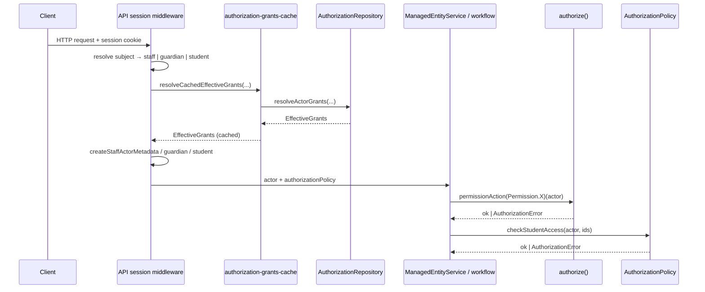

# Authorization model

Edaya Core uses a **two-layer** authorization model. Every interactive request carries an `ActorMetadata` value with **preloaded effective grants**. Services enforce access in two steps:

1. **Capability layer** — synchronous `authorize()` checks that the actor holds the required `Permission` and that their scope grants cover the requested scope.
2. **Resource layer** — asynchronous `AuthorizationPolicy` resolvers that verify the actor’s relationship to specific entities (students, class groups, sessions, fees, etc.) after those entities have been loaded.

Grant resolution happens **once per session** in the API middleware and is cached. The core engine never hits the database during `authorize()`.

All public symbols are re-exported from `@edaya/core` via `authorization/index.ts`.

---

## End-to-end request flow



**Takeaway:** middleware assembles the actor; workflows call `authorize()` for coarse gates and policy resolvers for fine-grained entity checks.

---

## Core concepts

### Permission

An atomic business capability (`Permission` enum in `permissions/permission.ts`). Examples: `ATTENDANCE_RECORD`, `PAYMENT_READ`, `STUDENT_UPDATE`.

Each permission has metadata in `permissionDefinitions` (`permissions/permission-definitions.ts`):

| Field | Purpose |
|-------|---------|
| `scope` | Optional `ScopeType` grain for path-based grants (`class_group`, `class_subject`, `activity`, `student`, …). Omitted = tenant-wide. |
| `allowedScopes` | Legacy `ScopeType` values accepted on `AuthorizationRequest` (being phased out in favour of path matching). |

Permission labels live in client i18n (keyed by `Permission` enum value), not in core.

Resolver permission sets live in `policy/resolvers/permission-sets.ts` (replaces the old `permissions/groups.ts` buckets).

### ScopeType and `scopeIds`

Staff grants are stored on `StaffPermissionAssignment` rows:

| Field | Purpose |
|-------|---------|
| `permission` | Which capability is granted |
| `scopeIds` | Opaque path string (grammar §3 in sprint plan); empty when permission is tenant-wide |
| `academicYearId` | Year filter at resolution time (not encoded in `scopeIds`) |
| `sourceStaffAssignmentId` | When set, row is synced from a `StaffAssignment` and is read-only in admin UI |

**Path grammar** (segment order per `ScopeType`):

- `class_group` → `{classGroupId}`
- `class_subject` → `{classGroupId}:{classSubjectId}` or `{classGroupId}:*` wildcard
- `activity` → `{activityId}` or `{classGroupId}:{activityId}`
- `student` → `{studentId}`

Helpers: `parseScopeIds` / `serializeScopeIds`, `scopePathCovers`, `resolveResourcePath` family in `scope/`.

### ScopeGrant (legacy bridge)

```ts
interface ScopeGrant {
  permission: Permission
  scopeType: ScopeType
  scopeEntityIds: readonly string[]
}
```

`EffectiveGrants.scopeGrants` is still populated for API backward compatibility. New resolution prefers `scopeIdsByPermission` and path matching via `scopePathCovers`.

### EffectiveGrants

```ts
interface EffectiveGrants {
  permissions: ReadonlySet<Permission>
  scopeGrants: readonly ScopeGrant[]           // legacy API shape
  scopeIdsByPermission?: Partial<Record<Permission, string>>  // merged paths per permission
  isElevated: boolean                          // school owner / elevated service account
  expiresAt?: Date                             // earliest assignment expiry; bounds API cache TTL
}
```

Attached to every interactive actor as `actor.effectiveGrants`. **Must be supplied at actor construction** — the engine does not synthesize default grants.

### ActorMetadata

| Kind | Use case | Key fields |
|------|----------|------------|
| `staff` | School employees | `staffMemberId`, `effectiveGrants`, `assuranceLevel` |
| `guardian` | Parent portal | `guardianId`, `effectiveGrants` |
| `student` | Student portal | `studentId`, `effectiveGrants` |
| `system` | Background jobs, migrations | `systemId`, `reason` — bypasses grant checks |

Factory functions in `model/actor.ts` produce frozen, validated objects.

**Assurance levels** (`ActorAssuranceLevel`: `standard` · `verified` · `strong`) gate sensitive permissions independently of grants. See `permissions/permission-assurance.ts`.

### AuthorizationRequest

```ts
interface AuthorizationRequest {
  schoolId: string
  permission: Permission
  scopeType?: ScopeType
  scopeEntityId?: string
}
```

Passed to `authorize()`. When `scopeIdsByPermission` is present on grants, `scopeGrantCovers` delegates to `scopePathCovers` for path-based matching.

---

## Capability layer: `authorize()`

Entry point: `engine/authorize.ts`.

Checks performed (in order):

1. **School match** — `actor.schoolId === request.schoolId`.
2. **Scope compatibility** — legacy `scopeType` / `scopeEntityId` validation against `permissionDefinitions`.
3. **Grants** (skipped for `system` actors):
   - Interactive actor required.
   - `assertPermissionAssurance(assuranceLevel, permission)`.
   - `permissions` set must contain `request.permission`.
   - `scopeGrantCovers(...)` — prefers `scopeIdsByPermission` + `scopePathCovers` when available.

Throws `AuthorizationError` with code `AuthorizationErrorCode.Forbidden`.

### Helpers used in entity configs and resolvers

| Helper | Module | Role |
|--------|--------|------|
| `permissionAction(permission, scope?)` | `shared/entity/authorization.ts` | Returns `(actor) => authorize(...)` for entity gates |
| `anyPermissionAction(permissions, scope?)` | same | Succeeds if **any** listed permission passes |
| `actorHasAnyPermission(actor, permissions)` | `grants/actor-grant-checks.ts` | Non-throwing |
| `actorGrantCoversResourcePath(actor, permission, path)` | same | Path-based grant check |
| `actorGrantCoversAnyResourcePath(actor, permissions, path)` | same | Any permission + path |
| `actorHasSchoolWideGrant(actor, permissions)` | same | Elevated or tenant-wide / legacy school scope |

---

## Grant resolution

Resolution lives in `resolution/` and is exposed through `SchoolRepositories.authorization`.

### Staff (`resolveEffectiveGrants`)

1. Load active `StaffMember` for the school.
2. **School owner** or **elevated service account** → `isElevated: true`, all permissions except `PLATFORM_REGISTER_SCHOOL`.
3. Resolve `academicYearId` from request header or fall back to the school’s active academic year.
4. Load active `StaffPermissionAssignment` rows for `(staffId, schoolId, academicYearId)`.
5. Merge rows per permission (`scopeIds` joined with `;`); manual and synced rows stay separate in DB but merge at resolution.
6. Build `scopeIdsByPermission`, `permissions` set, legacy `scopeGrants` bridge, and `expiresAt`.

Throws `AuthorizationError` if no valid grants can be resolved.

**StaffAssignment sync:** when a `StaffAssignment` carries `permissions[]`, a workflow creates/updates linked `StaffPermissionAssignment` rows (`sourceStaffAssignmentId` set). Placement-only assignments (`permissions: []`) sync nothing.

### Guardian / student portals

`resolveGuardianGrants` / `resolveStudentGrants` (`resolution/resolve-portal-grants.ts`):

- Fixed read-only permission sets from `grants/portal-permission-sets.ts`.
- Scope grants built from linked students and active class enrollments (`grants/enrollment-scope.ts`).

### Dispatcher

`resolveActorGrants({ actorId, actorType, schoolId, repositories, academicYearId? })` routes to staff, guardian, or student resolution.

---

## Resource layer: `AuthorizationPolicy`

Interface: `policy/types.ts`. Factory: `createRepositoryAuthorizationPolicy()`.

Resolvers combine preloaded grants with live repository relationships:

| Resolver | Typical use |
|----------|-------------|
| `checkStudentAccess` | Student records; direct student paths or class-group teaching scope |
| `checkGuardianAccess` | Guardian records; self-access for portal actors |
| `checkClassGroupAccess` | Class-scoped resources |
| `checkAssessmentAccess` | Assessments (class-subject path) |
| `checkSessionAccess` / `checkAttendanceAccess` | Timetable and attendance |
| `checkFeeAccess` / `checkStudentFeeAccess` | Finance entities |

Implementations in `policy/resolvers/` use `actorGrantCoversAnyResourcePath` and `resolveResourcePath` helpers before falling back to enrollment / assignment graph lookups.

**System actors** short-circuit all resolvers (allowed).

---

## Admin APIs

| Endpoint | Purpose |
|----------|---------|
| `GET authorization/permission-catalog` | `{ permission, scope? }[]` for UI pickers |
| `POST authorization/scope/render` | Human labels for `scopeIds` paths |
| `staffPermissionAssignments` entity | CRUD for manual grants |
| `GET authorization/effective-grants` | Current actor grants (`scopeIdsByPermission` + legacy `scopeGrants`) |

---

## Entity configuration pattern

```ts
const authorization = {
  read: read(
    permissionAction(Permission.STUDENT_READ),
    (actor, entities) => policy.checkStudentAccess(actor, ids),
  ),
  write: write(
    permissionAction(Permission.STUDENT_UPDATE),
    authorizeExistingById(readAccess),
    authorizeDeleteByReadAccess(readAccess),
  ),
}
```

Workflows receive `{ actor, authorizationPolicy }` and pass them into managed entity services.

---

## API integration

| Location | Responsibility |
|----------|----------------|
| `apps/api/src/http/dependencies/session-actor.ts` | Session → identity → cached grants → `ActorMetadata` |
| `apps/api/src/lib/authorization/grants-cache/` | In-memory cache; TTL capped by `grants.expiresAt` |
| `invalidateEffectiveGrantsCacheForActor()` | Call when permission assignments change |

Staff requests should send `X-Academic-Year-Id` so grants resolve for the correct year. When omitted, resolution falls back to the active academic year.

---

## Package layout

```
authorization/
├── model/           Actor types, EffectiveGrants, ScopeGrant, errors
├── permissions/     Permission enum, definitions, assurance, catalog
├── scope/           scopeIds grammar, path matching, resolveResourcePath
├── grants/          Scope helpers, portal sets, actor grant checks
├── resolution/      resolve* functions, AuthorizationRepository
├── engine/          authorize() — synchronous capability gate
└── policy/          AuthorizationPolicy factory and entity resolvers
```

---

## Adding a new permission

1. Add enum value to `permissions/permission.ts`.
2. Add `scope` and `allowedScopes` in `permissions/build-permission-definitions.ts`.
3. If assurance-sensitive, add to `PERMISSION_ASSURANCE`.
4. Add to portal sets or code presets in seeding if needed.
5. Add to `policy/resolvers/permission-sets.ts` when resolvers should recognize it.
6. Wire entity config: `permissionAction(...)` and optional policy resolver.
7. Add i18n keys in `edaya_web` (`permission.{ENUM}`) and regenerate OpenAPI if exposed in admin UI.

---

## Testing

| Area | Location |
|------|----------|
| `authorize()` and assurance | `tests/unit/auth/permission-authorization.test.ts` |
| Grant resolution | `tests/unit/auth/effective-grants.test.ts` |
| Policy resolvers | `tests/unit/auth/repository-authorization-policy.test.ts` |
| Portal grants | `tests/unit/auth/portal-permission-policy.test.ts` |
| Scope path matching | `tests/unit/auth/scope-path-covers.test.ts` |

Integration tests under `tooling/integration-tests/src/auth/` exercise persistence-backed resolution.

---

## Design principles

1. **One path for all actors** — staff, guardian, and student all use `authorize()` with preloaded grants.
2. **Fail closed** — missing grants, scope mismatch, or failed assurance → `AuthorizationError`.
3. **Separate capability from relationship** — holding `STUDENT_READ` at school scope does not automatically grant every student; `checkStudentAccess` enforces enrollment and teaching relationships.
4. **Elevated staff** — school owners bypass scope checks via `isElevated`.
5. **No DB in the hot path** — `authorize()` is synchronous; only resolvers and resolution touch repositories.

---

## Related documentation

- `docs/sprints/authorization-model-simplification-plan.md` — migration plan and path grammar.
- `domains/README.md` — how entity configs attach authorization to managed entities.
