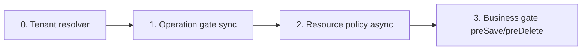
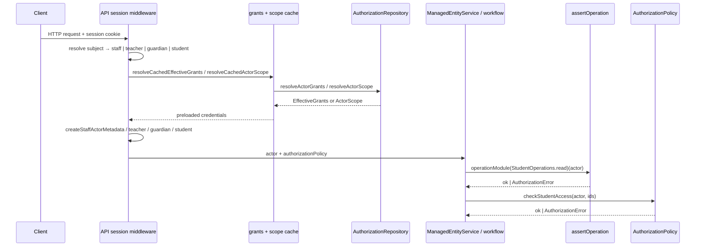

# Authorization model

Edaya Core uses a **four-layer** authorization pipeline for managed entities. Every interactive request carries an `ActorMetadata` value:

- **Staff** — preloaded `effectiveGrants` (permission + scope paths).
- **Teacher** — preloaded `teacherScope` (teaching + homeroom assignments).
- **Guardian** — preloaded `guardianScope` (linked students and enrollments).
- **Student** — preloaded `studentScope` (self + class enrollments).

Grant and scope resolution happens **once per session** in the API middleware. The core engine never hits the database during the synchronous operation gate.

All public symbols are re-exported from `@edaya/core` via `authorization/index.ts`.

---

## Enforcement pipeline

Every managed-entity read/write runs through **four layers in order**:



| Layer | Name | Sync/async | Declared in entity config | Examples |
|-------|------|------------|---------------------------|----------|
| **0** | Tenant | Sync (before auth) | `tenant:` resolver | `schoolId` match, indirect tenant via enrollment |
| **1** | Operation gate | Sync | `read.checkModule` / `write.checkModule` via `operationModule()` | `GradeOperations.input`, `StudentOperations.update` |
| **2** | Resource policy | Async | `read.checkAccess` / `write.authorizeSave` / `authorizeDelete` via `resourceGate*` | `policy.checkStudentAccess`, `policy.checkAssessmentAccess` |
| **3** | Business gate | Async | `gates.preSave` / `gates.preDelete` | Published report card immutability, enrollment status rules |

**Rules**

- Layer 1 answers: “May this **actor kind** perform this **operation** (optionally on a target)?”
- Layer 2 answers: “May this actor reach **this specific resource** (relationship graph)?”
- Layer 3 answers: “Is this **mutation valid** regardless of who is asking?” — no `actor` branching for authorization.
- Do not call `authorize()` or `assertCapability()` from business gates or resource gates.
- Do not re-run the operation in layer 2 — `checkModule` already ran in `write.checkModule` / `read.checkModule`.

**Actor switches live in exactly two places:** `assertOperation()` (layer 1) and `policy/compose.ts` (layer 2). Not in `src/domain/**`.

---

## End-to-end request flow



**Takeaway:** middleware assembles the actor; entity configs declare operations (layer 1) and policy resolvers (layer 2).

---

## Core concepts

### Operation

An **operation** is the vocabulary entity configs and workflows use for authorization. Each operation has a stable string `id` (e.g. `students.directory.read`) and per-kind rules:

| Actor kind | Rule shape | Enforcement |
|------------|------------|-------------|
| `staff` | `StaffOperationRule` — `permission` + optional `scopeFrom` | `authorize(Permission)` |
| `teacher` | `TeacherOperationRule` — teaching/homeroom capability + target | `assertTeachingCapability` / `assertHomeroomCapability` |
| `guardian` | `GuardianOperationRule` — guardian capability + target | `assertGuardianCapability` |
| `student` | `StudentOperationRule` — student capability + target | `assertStudentCapability` |

Operations are defined in `operations/` via `defineOperationFamily()` and registered at module load. `Permission` is a **staff implementation detail** inside the operation catalog — entity configs do not call `permissionAction()`.

`OperationContext` carries optional `studentId`, `classGroupId`, `classSubjectId` for scoped checks. `requiresContext` on an operation definition validates that the right keys are present in `full` mode.

### Permission (staff only)

An atomic business capability (`Permission` enum in `permissions/permission.ts`). Examples: `ATTENDANCE_RECORD`, `PAYMENT_READ`, `STUDENT_UPDATE`.

Each permission has metadata in `permissionDefinitions` (`permissions/permission-definitions.ts`):

| Field | Purpose |
|-------|---------|
| `scope` | Optional `ScopeType` grain for path-based grants (`class_group`, `class_subject`, `activity`, `student`, …). Omitted = tenant-wide. |
| `allowedScopes` | Legacy `ScopeType` values accepted on `AuthorizationRequest` (being phased out in favour of path matching). |

Permission labels live in client i18n (keyed by `Permission` enum value), not in core.

Resolver permission sets live in `policy/resolvers/permission-sets.ts`.

### ScopeType and `scopeIds`

Staff grants are stored on `StaffPermissionAssignment` rows:

| Field | Purpose |
|-------|---------|
| `permission` | Which capability is granted |
| `scopeIds` | Opaque path string (grammar §3 in sprint plan); empty when permission is tenant-wide |
| `academicYearId` | Year filter at resolution time (not encoded in `scopeIds`) |
| `sourceStaffAssignmentId` | When set, row is synced from a `StaffAssignment` and is read-only in admin UI |

**Path grammar** (segment order per `ScopeType`):

- `class_group` → `{classGroupId}`
- `class_subject` → `{classGroupId}:{classSubjectId}` or `{classGroupId}:*` wildcard
- `activity` → `{activityId}` or `{classGroupId}:{activityId}`
- `student` → `{studentId}`

Helpers: `parseScopeIds` / `serializeScopeIds`, `scopePathCovers`, `resolveResourcePath` family in `scope/`.

### EffectiveGrants

```ts
interface EffectiveGrants {
  permissions: ReadonlySet<Permission>
  scopeGrants: readonly ScopeGrant[] // legacy API pass-through (empty for staff); do not derive from scopeIdsByPermission
  scopeIdsByPermission?: Partial<Record<Permission, string>> // merged paths per permission — staff/web/mobile clients
  isElevated: boolean // school owner / elevated service account
  expiresAt?: Date // earliest assignment expiry; bounds API cache TTL
}
```

Attached to every staff actor as `actor.effectiveGrants`. **Must be supplied at actor construction** — the engine does not synthesize default grants.

### ActorMetadata

| Kind | Use case | Key fields |
|------|----------|------------|
| `staff` | School employees | `staffMemberId`, `effectiveGrants`, `assuranceLevel` |
| `teacher` | Teacher portal | `teacherId`, `teacherScope` |
| `guardian` | Parent portal | `guardianId`, `guardianScope` |
| `student` | Student portal | `studentId`, `studentScope` |
| `system` | Background jobs, migrations | `systemId`, `reason` — bypasses grant checks |

Factory functions in `model/actor.ts` produce frozen, validated objects.

**Assurance levels** (`ActorAssuranceLevel`: `standard` · `verified` · `strong`) gate sensitive staff permissions independently of grants. See `permissions/permission-assurance.ts`.

---

## Layer 1: Operation gate

Entry points: `gates/operation-module.ts`.

| Helper | Role |
|--------|------|
| `operationModule(operation, context?)` | Returns `(actor) => void \| Promise<void>` for entity `checkModule` |
| `anyOperationModule(operations, context?)` | Succeeds if **any** listed operation passes |
| `authorizeSaveWithOperation(operation, resolveContext, authorizeSave)` | Layer 1 + layer 2 for writes with dynamic operation/context |
| `authorizeDeleteWithOperation(...)` | Same for deletes |
| `resourceGate(policy.checkX)` | Wraps a policy resolver for layer 2 |

`assertOperation(actor, operation, context, mode)` in `operations/assert-operation.ts` dispatches by `actor.kind`:

- `staff` → `authorize()` with permission from operation definition
- `teacher` → teaching/homeroom capability assertions
- `guardian` / `student` → link-scope capability assertions
- `system` → allowed

`mode` is `module` (layer 1 only) or `full` (layer 1 + context validation).

---

## Grant and scope resolution

Resolution lives in `resolution/` and is exposed through `SchoolRepositories.authorization`.

### Staff (`resolveEffectiveGrants`)

1. Load active `StaffMember` for the school.
2. **School owner** or **elevated service account** → `isElevated: true`, all permissions except `PLATFORM_REGISTER_SCHOOL`.
3. Resolve `academicYearId` from request header or fall back to the school’s active academic year.
4. Load active `StaffPermissionAssignment` rows for `(staffId, schoolId, academicYearId)`.
5. Merge rows per permission (`scopeIds` joined with `;`); manual and synced rows stay separate in DB but merge at resolution.
6. Build `scopeIdsByPermission`, `permissions` set, legacy `scopeGrants` bridge, and `expiresAt`.

### Portal actors

`resolveTeacherScope`, `resolveGuardianScope`, `resolveStudentScope` preload relationship-native scopes used by operation assertions and policy strategies.

### Dispatcher

`resolveActorGrants({ actorId, actorType, schoolId, repositories, academicYearId? })` routes to staff, guardian, or student grant resolution.

---

## Layer 2: `AuthorizationPolicy`

Interface: `policy/types.ts`. Factory: `createRepositoryAuthorizationPolicy()`.

`policy/compose.ts` dispatches by `actor.kind` to focused strategy files under `policy/strategies/`. Resolvers combine preloaded credentials with live repository relationships:

| Resolver | Typical use |
|----------|-------------|
| `checkStudentAccess` | Student records; strategies per actor kind |
| `checkGuardianAccess` | Guardian records; self-access for portal actors |
| `checkTeacherAccess` | Teacher records |
| `checkStaffMemberReadAccess` | Staff directory; self-read for staff actors |
| `checkStaffAssignmentAccess` | Staff assignment rows |
| `checkTeacherAssignmentAccess` | Teacher assignment rows |
| `checkClassGroupAccess` | Class-scoped resources |
| `checkAssessmentAccess` | Assessments (class-subject path) |
| `checkReportCardResultAccess` | Report cards and results |
| `checkLessonSessionAccess` / `checkAttendanceRecordAccess` | Timetable and attendance |
| `checkFeeAccess` / `checkStudentFeeAccess` | Finance entities |
| `checkAttachmentAccess` | File attachments |

**System actors** short-circuit all resolvers (allowed).

---

## Admin APIs

| Endpoint | Purpose |
|----------|---------|
| `GET authorization/permission-catalog` | `{ permission, scope? }[]` for UI pickers |
| `POST authorization/scope/render` | Human labels for `scopeIds` paths |
| `staffPermissionAssignments` entity | CRUD for manual grants |
| `GET authorization/effective-grants` | Current actor grants (`scopeIdsByPermission` + legacy `scopeGrants`) |

---

## Entity configuration pattern

```ts
import { StudentOperations } from '../../capabilities/authorization/operations/students'
import { operationModule, resourceGate } from '../entity-config/authorization'

const readAccess = resourceGate(
  (actor, entities) => policy.checkStudentAccess(actor, entities.map(e => e.id)),
)

const authorization = {
  read: read(
    operationModule(StudentOperations.directoryRead),
    readAccess,
  ),
  write: write(
    operationModule(StudentOperations.update),
    authorizeExistingById(readAccess),
    authorizeDeleteByReadAccess(readAccess),
  ),
}
```

Workflows receive `{ actor, authorizationPolicy }` and pass them into managed entity services. Workflows that gate ad-hoc actions call `operationModule(SomeOperations.action)(actor)` directly.

---

## Auth cache lifecycle

Grant and scope caches are invalidated from **entity `postSave` / `postDelete` hooks** wired in `createCoreEntityServices()` via `withAuthCacheLifecycleHooks()`.

| Module | Role |
|--------|------|
| `lifecycle/entity-events.ts` | Maps entity keys + saved/deleted rows → `AuthCacheInvalidationEvent[]` |
| `lifecycle/invalidation-registry.ts` | Forwards events to `AuthCacheInvalidationPort` |
| `lifecycle/auth-cache-hooks.ts` | Chains invalidation after existing entity hooks |
| `ports/gateways/auth-cache-invalidation.ts` | Port implemented by API runtime (`apiAuthCacheInvalidationPort`) |

Entities covered: `staffPermissionAssignments`, `staffMembers`, `staffAssignments`, `guardianLinks`, `enrollments`, `students`, `guardians`, `teachers`, `teacherAssignments`.

Pass `authCacheInvalidation` in `ServiceArgs` (defaults to no-op in tests). The API wires `apiAuthCacheInvalidationPort` in `buildSchoolApplication()`.

---

## API integration

| Location | Responsibility |
|----------|----------------|
| `apps/api/src/http/dependencies/session-actor.ts` | Session → identity → cached grants/scope → `ActorMetadata` |
| `apps/api/src/lib/authorization/grants-cache/` | In-memory cache; TTL capped by `grants.expiresAt` |
| `invalidateEffectiveGrantsCacheForActor()` | Call when permission assignments change (via `AuthCacheInvalidationPort` in API runtime) |

Staff requests should send `X-Academic-Year-Id` so grants resolve for the correct year. Portal requests send `X-Actor-Kind` and `X-Actor-Id` for multi-profile sessions.

---

## Package layout

```
authorization/
├── model/           Actor types, EffectiveGrants, ScopeGrant, errors
├── permissions/     Permission enum, definitions, assurance, catalog
├── capabilities/    Teaching, homeroom, guardian, student capability enums + assert*
├── scope/           scopeIds grammar, path matching, resolveResourcePath
├── grants/          Scope helpers, portal sets, actor grant checks
├── resolution/      resolve* functions, AuthorizationRepository
├── operations/      Operation catalog (defineOperationFamily, assertOperation)
├── gates/           operationModule, resourceGate*, authorizeSaveWithOperation
├── engine/          authorize() — staff permission gate (used inside assertOperation)
└── policy/          compose, strategies, repository-policy factory
```

---

## Adding a new operation

Use this when wiring authorization on a new entity or workflow action. Adding a new **staff permission** to the admin catalog is a separate step (enum + definitions + i18n).

1. **Define the operation** in the appropriate `operations/*.ts` file:

```ts
export const MyFeatureOperations = defineOperationFamily({
  read: {
    id: 'my-feature.read',
    staff: { permission: Permission.MY_FEATURE_READ, scopeFrom: 'classGroup' },
    teacher: { capability: TeachingCapability.ReadSubjectRoster, target: 'classSubject' },
    guardian: { capability: GuardianCapability.ReadStudentDetail, target: 'student' },
    requiresContext: ['classSubjectId'], // when scoped
  },
})
```

2. **Wire entity config** — layer 1 via `operationModule()`, layer 2 via `resourceGate()` or an existing policy resolver.
3. **Add policy strategy** if layer 2 needs new relationship logic — add a strategy under `policy/strategies/` and register in `compose.ts`; do not branch on `actor.kind` in `src/domain/**`.
4. **Add operation matrix tests** in `tests/unit/auth/operations/` using `describeOperationMatrix`.
5. **Add policy tests** in `tests/unit/auth/policy/` or extend `repository-authorization-policy.test.ts`.
6. **Run static guards** — `authorization-migration-coverage.test.ts` enforces zero `permissionAction` and zero `actor.kind` in domain code.

For staff-only admin permissions (no portal actor): add enum value, `permissionDefinitions`, assurance if needed, seed presets, and i18n in `edaya_web`.

---

## Testing

| Area | Location |
|------|----------|
| Operation matrix | `tests/unit/auth/operations/*.test.ts` |
| `authorize()` and assurance | `tests/unit/auth/permission-authorization.test.ts` |
| Grant resolution | `tests/unit/auth/effective-grants.test.ts` |
| Policy resolvers | `tests/unit/auth/repository-authorization-policy.test.ts` |
| Portal grants | `tests/unit/auth/portal-permission-policy.test.ts` |
| Scope path matching | `tests/unit/auth/scope-path-covers.test.ts` |
| Migration guards | `tests/unit/auth/authorization-migration-coverage.test.ts` |

Integration tests under `tooling/integration-tests/src/auth/` exercise persistence-backed resolution.

Use `createRepositoryAuthorizationPolicy({ repositories })` in workflow tests — empty `{} as AuthorizationPolicy` mocks break when entity configs call policy resolvers during saves.

---

## Design principles

1. **Entity configs speak Operations, not Permissions** — `Permission` is staff implementation detail inside the operation catalog.
2. **Actor switches live in exactly two places** — `assertOperation()` (layer 1) and `policy/compose.ts` (layer 2). Not in `src/domain/**`.
3. **Separate capability from relationship** — passing layer 1 does not automatically grant every resource; layer 2 enforces enrollment and teaching relationships.
4. **Fail closed** — missing grants, scope mismatch, failed assurance, or failed capability → `AuthorizationError`.
5. **Elevated staff** — school owners bypass scope checks via `isElevated`.
6. **No DB in the hot path** — layer 1 (`assertOperation`) is synchronous; only layer 2 resolvers and session resolution touch repositories.
7. **Business gates stay auth-free** — `preSave` / `preDelete` immutability rules are layer 3 only.

---

## Related documentation

- [authorization-operations-plan.md](../../../../docs/sprints/authorization-operations-plan.md) — operations migration sprint (G0–G6).
- [relationship-native-auth-plan.md](../../../../docs/sprints/relationship-native-auth-plan.md) — portal scope resolution (Fold F).
- [authorization-model-simplification-plan.md](../../../../docs/sprints/authorization-model-simplification-plan.md) — path grammar and grant model.
- [domains/README.md](../../../domains/README.md) — how entity configs attach authorization to managed entities.
