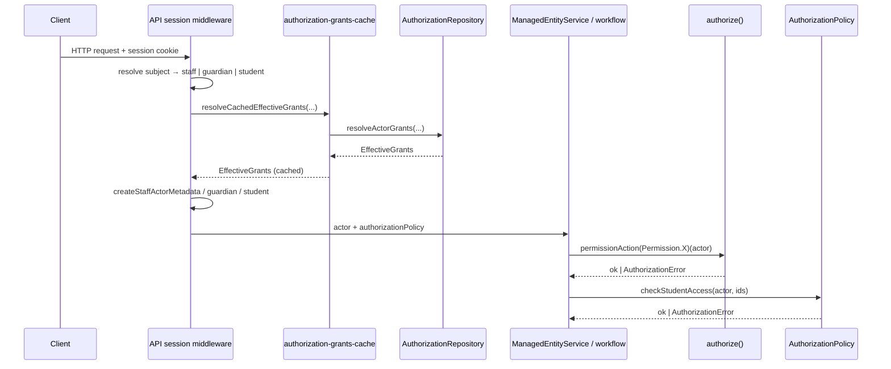

# Authorization model

Edaya Core uses a **two-layer** authorization model. Every interactive request carries an `ActorMetadata` value with **preloaded effective grants**. Services then enforce access in two distinct steps:

1. **Capability layer** — synchronous `authorize()` checks that the actor holds the required `Permission` and that their scope grants cover the requested scope.
2. **Resource layer** — asynchronous `AuthorizationPolicy` resolvers that verify the actor’s relationship to specific entities (students, class groups, sessions, fees, etc.) after those entities have been loaded.

Grant resolution (turning database roles, assignments, and portal links into `EffectiveGrants`) happens **once per session** in the API middleware and is cached. The core engine never hits the database during `authorize()`.

All public symbols are re-exported from `@edaya/core` via `authorization/index.ts`.

---

## End-to-end request flow



**Takeaway:** middleware assembles the actor; workflows call `authorize()` for coarse gates and policy resolvers for fine-grained entity checks.

---

## Core concepts

### Permission

An atomic business capability (`Permission` enum in `permissions/permission.ts`). Examples: `ATTENDANCE_RECORD`, `PAYMENT_READ`, `STUDENT_UPDATE`.

Each permission has metadata in `permissionDefinitions` (`permissions/permission-definitions.ts`):

| Field | Purpose |
|-------|---------|
| `label` / `description` | UI and admin tooling |
| `allowedScopes` | Which `ScopeType` values may appear on an `AuthorizationRequest` for this permission |
| `defaultScope` | Typical scope when assigning the permission to a role |

Permissions are grouped for reuse in `permissions/groups.ts` (assignment-scoped, resolver, finance, etc.). **Add new groups there** instead of duplicating permission lists across resolvers.

### ScopeType

Where a permission applies (`permissions/scope-type.ts`):

`platform` · `school` · `academic_year` · `class_group` · `subject` · `course_assignment` · `session` · `student` · `student_group`

`course_assignment` maps to class-subject / teaching assignments (`StaffAssignment.classSubjectId`).

### ScopeGrant

```ts
interface ScopeGrant {
  permission: Permission
  scopeType: ScopeType
  scopeEntityIds: readonly string[]
}
```

A scope grant says: “this actor may exercise `permission` within `scopeType` for these entity IDs.”

Multiple grants are merged by `(permission, scopeType)` via `mergeScopeGrants()` in `grants/scope-grant-covers.ts`.

### EffectiveGrants

```ts
interface EffectiveGrants {
  permissions: ReadonlySet<Permission>
  scopeGrants: readonly ScopeGrant[]
  isElevated: boolean // school owner / principal: school-wide, no per-entity scopes
  expiresAt?: Date // earliest assignment expiry; bounds API cache TTL
}
```

Attached to every interactive actor as `actor.effectiveGrants`. **Must be supplied at actor construction** — the engine does not synthesize default grants.

### ActorMetadata

| Kind | Use case | Key fields |
|------|----------|------------|
| `staff` | School employees | `staffMemberId`, `effectiveGrants`, `assuranceLevel` |
| `guardian` | Parent portal | `guardianId`, `effectiveGrants` |
| `student` | Student portal | `studentId`, `effectiveGrants` |
| `system` | Background jobs, migrations | `systemId`, `reason` — bypasses grant checks |

Factory functions in `model/actor.ts` (`createStaffActorMetadata`, etc.) produce frozen, validated objects. `resolveAuditActorId(actor)` returns the ID used in audit trails.

**Assurance levels** (`ActorAssuranceLevel`: `standard` · `verified` · `strong`) gate sensitive permissions independently of grants. See `permissions/permission-assurance.ts`.

### AuthorizationRequest

```ts
interface AuthorizationRequest {
  schoolId: string
  permission: Permission
  scopeType?: ScopeType
  scopeEntityId?: string
}
```

Passed to `authorize()`. `scopeType` / `scopeEntityId` are optional; when omitted, holding the permission (with any scope) is sufficient. When provided, `scopeGrantCovers()` must match.

---

## Capability layer: `authorize()`

Entry point: `engine/authorize.ts`.

```ts
authorize({ actor, request })
```

Checks performed (in order):

1. **School match** — `actor.schoolId === request.schoolId` (system actors included).
2. **Scope compatibility** — `request.scopeType` must be listed in `permissionDefinitions[permission].allowedScopes`; `scopeEntityId` requires `scopeType`.
3. **Grants** (skipped for `system` actors):
   - Actor must be interactive (`staff` | `guardian` | `student`).
   - `assertPermissionAssurance(assuranceLevel, permission)`.
   - `permissions` set must contain `request.permission`.
   - `scopeGrantCovers(scopeGrants, { permission, schoolId, scopeType, scopeEntityId, isElevated })`.

`scopeGrantCovers` rules (`grants/scope-grant-covers.ts`):

- **`isElevated`** → always allowed (school-wide principal / owner).
- **No `scopeType` on request** → allowed if permission is present.
- **School-scoped grant** for the permission → allowed for any entity in that school.
- Otherwise → must match `(scopeType, scopeEntityId)` on a grant.

Throws `AuthorizationError` with code `AuthorizationErrorCode.Forbidden`.

### Helpers used in entity configs and resolvers

| Helper | Module | Role |
|--------|--------|------|
| `permissionAction(permission, scope?)` | `shared/entity/authorization.ts` | Returns `(actor) => authorize(...)` for entity read/write gates |
| `anyPermissionAction(permissions, scope?)` | same | Succeeds if **any** listed permission passes |
| `actorHasAnyPermission(actor, permissions)` | `grants/actor-grant-checks.ts` | Non-throwing; used in resolvers |
| `actorGrantCoversAny(actor, permissions, scopeType, id)` | same | Permission + scope coverage for one entity |

---

## Grant resolution

Resolution lives in `resolution/` and is exposed through `SchoolRepositories.authorization` (`AuthorizationRepository` interface).

### Staff (`resolveEffectiveGrants`)

1. Load active `StaffMember` for the school.
2. **School owner** (`school.ownerSubjectId` matches staff `subjectId`) → `isElevated: true`, all permissions except `PLATFORM_REGISTER_SCHOOL`, empty scope grants.
3. Load active `StaffRoleAssignment` rows (optionally filtered by `academicYearId` and validity window).
4. Union permissions from linked active `AccessRole` records.
5. Build scope grants from:
   - explicit `assignment.scopeGrants` on role assignments,
   - `scopeGrantsFromStaffAssignments()` (class group / course / session from `StaffAssignment` rows),
   - auto **school-scoped** grants for permissions **not** in `ASSIGNMENT_SCOPED_PERMISSION_SET`.
6. Set `expiresAt` to the earliest `endsAt` among active assignments (cache bound).

Throws `AuthorizationError` if no valid grants can be resolved.

### Guardian / student portals

`resolveGuardianGrants` / `resolveStudentGrants` (`resolution/resolve-portal-grants.ts`):

- Fixed read-only permission sets: `GUARDIAN_PORTAL_PERMISSIONS`, `STUDENT_PORTAL_PERMISSIONS` (`grants/portal-permission-sets.ts`).
- Scope grants built via `buildPortalScopeGrants()` from linked students and active class enrollments (`grants/enrollment-scope.ts`).

### Dispatcher

`resolveActorGrants({ actorId, actorType, schoolId, repositories })` routes to staff, guardian, or student resolution.

`DefaultAuthorizationRepository` wraps these functions for injection into `SchoolRepositories` (e.g. Postgres adaptor).

---

## Resource layer: `AuthorizationPolicy`

Interface: `policy/types.ts`. Factory: `createRepositoryAuthorizationPolicy()` in `policy/repository-policy.ts`.

Resolvers run **after** entities are known. They combine preloaded grants with live repository relationships:

| Resolver | Typical use |
|----------|-------------|
| `checkStudentAccess` | Student records, enrollments, indirect class-group teaching access |
| `checkGuardianAccess` | Guardian records; self-access for portal actors |
| `checkClassGroupAccess` | Class-scoped resources |
| `checkAssessmentAccess` | Assessments and academic configuration |
| `checkReportCardResultAccess` | Published report cards |
| `checkSessionAccess` / `checkAttendanceAccess` | Timetable and attendance |
| `checkFeeAccess` / `checkStudentFeeAccess` | Finance entities |
| `checkStudentNoteAccess` / `checkStudentHealthAccess` | Sensitive student data |

Resolver implementations live in `policy/resolvers/` (`student.ts`, `academic.ts`, `scheduling.ts`, `finance.ts`). They use permission groups from `permissions/groups.ts` and `actorGrantCoversAny()` before falling back to enrollment / assignment graph lookups.

**System actors** short-circuit all resolvers (allowed).

---

## Entity configuration pattern

Domain entity configs (`domains/*/foo.ts`) wire authorization through `shared/entity/authorization.ts`:

```ts
const authorization = {
  read: read(
    permissionAction(Permission.STUDENT_READ), // capability gate (sync)
    (actor, entities) => policy.checkStudentAccess(actor, ids), // resource gate (async)
  ),
  write: write(
    permissionAction(Permission.STUDENT_UPDATE),
    authorizeExistingById(readAccess),
    authorizeDeleteByReadAccess(readAccess),
  ),
}
```

- **`checkModule`** (historical name) → capability check via `permissionAction` / `anyPermissionAction`.
- **`checkAccess` / `authorizeSave` / `authorizeDelete`** → resource checks, often delegating to `AuthorizationPolicy`.

Some entities use `noopReadAccess` / `noopSaveAccess` when capability checks alone are sufficient (e.g. school-wide configuration entities).

Workflows receive `{ actor, authorizationPolicy }` and pass them into managed entity services.

---

## API integration

| Location | Responsibility |
|----------|----------------|
| `apps/api/src/middlewares/dependencies/actor.ts` | Session → identity → cached grants → `ActorMetadata` on request context |
| `apps/api/src/lib/authorization-grants-cache.ts` | In-memory cache keyed by session; TTL capped by `grants.expiresAt` |
| `invalidateEffectiveGrantsCacheForActor()` | Call when roles or assignments change |

Middleware requires exactly one identity per auth subject (staff **xor** guardian **xor** student). Grants are resolved via `repositories.authorization.resolveActorGrants()`.

---

## Package layout

```
authorization/
├── model/           Actor types, EffectiveGrants, ScopeGrant, errors, request
├── permissions/     Permission enum, definitions, assurance, groups
├── grants/          Scope helpers, portal sets, assignment → scope mapping
├── resolution/      resolve* functions, AuthorizationRepository, DefaultAuthorizationRepository
├── engine/          authorize() — synchronous capability gate
└── policy/          AuthorizationPolicy factory and entity resolvers
```

**Dependency direction:** `engine` and `policy` depend on `model`, `permissions`, and `grants`. `resolution` depends on `ports/school-repositories` (type-only for repository interfaces) and domain data via repositories. `authorization/` does not depend on `ports/authorization-repository` (removed); the port surface is the `SchoolRepositories.authorization` slot.

---

## Adding a new permission

1. Add enum value to `permissions/permission.ts`.
2. Add definition (label, `allowedScopes`, `defaultScope`) in `permissions/build-permission-definitions.ts` / generated `permission-definitions.ts`.
3. If assurance-sensitive, add to `PERMISSION_ASSURANCE` in `permissions/permission-assurance.ts`.
4. Assign to role templates in `grants/system-role-permissions.ts` and/or portal sets if needed.
5. Add to relevant group in `permissions/groups.ts` if resolvers should recognize it.
6. Wire entity config: `permissionAction(Permission.YOUR_PERMISSION)` and optional policy resolver.
7. Extend API Zod schemas if the permission is exposed in access-control admin UI.

---

## Adding a resource check

1. Add method to `AuthorizationPolicy` in `policy/types.ts`.
2. Implement resolver in `policy/resolvers/` (reuse `actorGrantCoversAny`, batch `findByIds`, enrollment helpers).
3. Register in `createRepositoryAuthorizationPolicy()`.
4. Call from entity config `checkAccess` / `authorizeSave` / workflow.
5. Add unit tests under `packages/core/tests/unit/auth/`.

---

## Testing

| Area | Location |
|------|----------|
| `authorize()` and assurance | `tests/unit/auth/permission-authorization.test.ts` |
| Grant resolution | `tests/unit/auth/effective-grants.test.ts` |
| Policy resolvers | `tests/unit/auth/repository-authorization-policy.test.ts` |
| Portal grants | `tests/unit/auth/portal-permission-policy.test.ts` |
| Actor factories | `tests/unit/auth/actor-metadata.test.ts` |
| Test grant fixtures | `tests/support/effective-grants.ts` |

Integration tests under `packages/integration-tests/src/auth/` exercise persistence-backed resolution and concurrency.

---

## Design principles

1. **One path for all actors** — staff, guardian, and student all use `authorize()` with preloaded grants; differences are only in how grants are resolved.
2. **Fail closed** — missing grants, scope mismatch, or failed assurance → `AuthorizationError`.
3. **Separate capability from relationship** — holding `STUDENT_READ` at school scope does not automatically grant access to every student; `checkStudentAccess` enforces enrollment and teaching relationships.
4. **Elevated staff** — school owners bypass scope checks but still go through resolvers that explicitly allow elevated paths where needed.
5. **No DB in the hot path** — `authorize()` is synchronous and grant-backed; only resolvers and resolution touch repositories.

---

## Related documentation

- `sprints/done/authorization-cleanup-plan.md` — phased refactor history and performance notes.
- `domains/README.md` — how entity configs attach authorization to managed entities.
