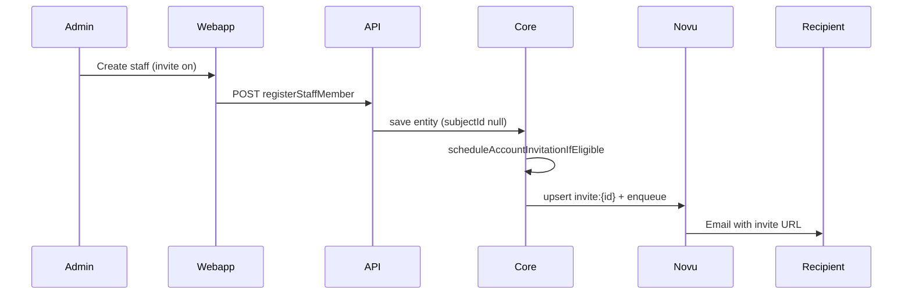
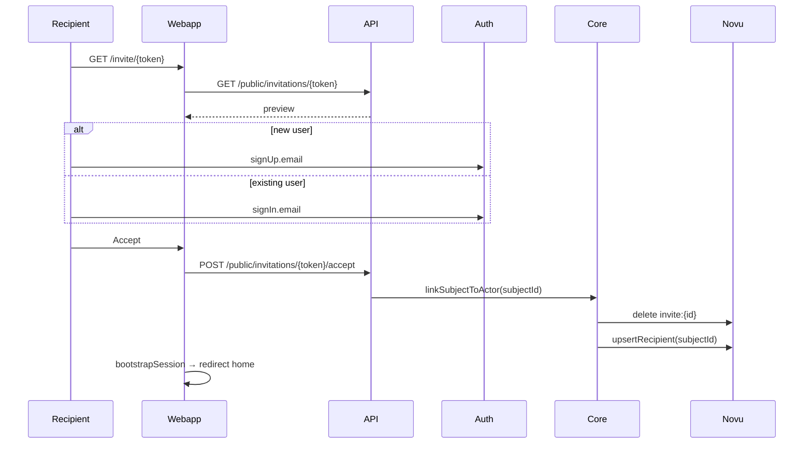
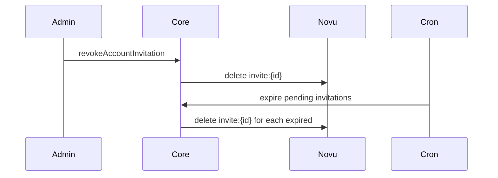

# Account Invitation & Linking — Sprint Plan

> **Status:** Not started  
> **Created:** 2026-06-24  
> **Scope:** End-to-end invitation flow to link Better Auth user accounts to school **staff**, **guardians**, and **students**  
> **Depends on:** Better Auth integration (done), `linkActorSubject` command (done), notification gateway + Novu email bridge (Phase 6, largely done)  
> **Unblocks:** Notifications for unlinked students/guardians (notifications-plan Appendix C #11), guardian/student self-service login, inbox delivery for all actor kinds

---

## 1. Problem and goal

Today a school admin can create staff, guardians, and students in the domain, but **linking** those records to a real login (`subjectId` = Better Auth `user.id`) is a manual, privileged step (`linkActorSubject` with `ACCESS_CONTROL_ASSIGN`). Dev seed bypasses this by signing up users and patching `subjectId` directly.

**Goal:** a productized invitation flow:

1. Admin creates (or selects) a staff member / guardian / student.
2. System generates a **scoped, time-limited invitation link** (`kind`: `staff` | `guardian` | `student`).
3. System sends the link to the **connection contact** (email or phone).
4. Recipient opens the link, authenticates (sign-up or sign-in), and the system **links their account** to the target entity.
5. Subsequent logins resolve to the correct actor via existing `session-actor` logic.

**Delivery model (locked):** invite email/SMS uses a **transient Novu subscriber** (`invite:{invitationId}`) with the invited contact info. **Permanent** Novu subscribers (`subscriberId` = auth `user.id`) are created only **after accept**. Transient subscribers are deleted on accept, revoke, or expiry cleanup.

**Auto-invite on create (in scope):** when an admin registers a new staff member, guardian, or student, the system **automatically sends an invitation** after save — unless the entity already has a `subjectId`, the admin opts out, or no deliverable email can be resolved. Manual send/resend/revoke from the entity drawer remains available for retries and late invites.

---

## 2. Current foundation (reuse, do not rebuild)

| Capability | Location | Notes |
|------------|----------|-------|
| Optional `subjectId` on actors | `StaffMember`, `Guardian`, `Student` domain schemas | Already persisted in Postgres |
| Admin linking command | `AccessControlServiceWorkflow.linkActorSubject` | Requires `ACCESS_CONTROL_ASSIGN`; sets `subjectId`, upserts Novu subscriber |
| Subject uniqueness | `assertSubjectUnlinked`, `assertSubjectIdAvailable` | One auth account → at most one actor per school; one actor → one auth account |
| Session → actor resolution | `apps/api/src/http/dependencies/session-actor.ts` | Exactly one of staff/guardian/student per `subjectId` |
| Notification contact resolution | `resolve-notification-contact.ts`, `notificationEmail` / `notificationPhone` columns | Staff/guardian have contact fields; **students do not** |
| Outbound email path | Novu workflow → `apps/novu-email-bridge` → Cloudflare Email Sending | Use for invitation delivery |
| Auth | Better Auth email/password in `apps/api` | No public sign-up UI yet (demo login only) |
| Novu enqueue (operational) | `buildNovuSubscriberIds` requires `subjectId` | Invite path is the **only** exception — transient subscriber |

**Key constraint:** `linkActorSubject` is **authenticated + permissioned**. The accept path must be a **separate, token-gated** operation that performs the same linking rules without granting the caller `ACCESS_CONTROL_ASSIGN`.

---

## 3. Outcomes

| # | Outcome | Acceptance |
|---|---------|------------|
| O1 | `AccountInvitation` persisted with scoped target + delivery contact + lifecycle | Migration + entity store + tests |
| O2 | Admin can **send** (and **resend** / **revoke**) invitations for staff, guardian, student | Core command + API route + permission |
| O3 | Invitation delivered by email (SMS deferred) | Novu `account_invitation` workflow + bridge smoke test |
| O4 | Public accept URL completes linking for all three kinds | Integration test: token → sign-up → linked `subjectId` → session resolves |
| O5 | Webapp admin UX: send/resend from entity drawer; linked vs pending state visible | Staff, guardian, student detail drawers |
| O6 | Webapp accept UX: `/invite/[token]` with sign-up/sign-in + success/error states | E2E manual test checklist |
| O7 | Idempotent, safe token handling | Hashed token at rest, single-use, expiry, constant-time verify |
| O8 | **Auto-invite on create** for `registerStaffMember`, `registerGuardian`, `registerStudent` | Post-save hook sends invite when eligible; opt-out flag; tests for skip paths |
| O9 | **Transient Novu subscriber** lifecycle | Created on send; deleted on accept / revoke / expiry cron |

### Success metrics

| Metric | Target |
|--------|--------|
| Core unit + workflow tests | ≥ 25 new tests, all green |
| Integration test | Happy path staff + guardian + student accept; auto-invite on create for staff + guardian |
| `bun run verify` | Green |
| Manual smoke | Create staff with email → invite received → accept → login works |

---

## 4. Guardrails and non-goals

### Guardrails

- Ports-and-adapters: invitation **domain + commands** in `@edaya/core`; token hashing and Better Auth sign-up stay in `apps/api` adapters.
- Reuse linking invariants from `linkActorSubject` (extract shared private helper — do not duplicate business rules).
- Invitation send is **non-blocking** for both explicit send and auto-invite-on-create (enqueue via `NotificationGatewayPort`, same pattern as other notifications). A failed invite must **not** roll back entity creation.
- Never expose raw invitation tokens in list APIs or entity reads — only at creation/resend time.
- Accept route is **unauthenticated** for token *preview*; **authenticated** for *accept* (session required to know `subjectId`).
- **Entity `subjectId` is set only at accept** — not at invite send. Unlinked entities stay out of operational notification resolvers (existing behavior).

### Non-goals (this sprint)

- SMS / WhatsApp invitation delivery (design transient subscriber for phone; ship email only)
- OAuth / social sign-in on accept page
- Email verification gate before linking (Better Auth verification is a separate sprint)
- Better Auth Anonymous plugin
- Bulk invite CSV import
- Student age gate / guardian-consent legal workflow
- Cross-school invitations (one token → one school + one entity)
- Replacing `linkActorSubject` admin command (keep for support overrides)

---

## 5. Domain model

### 5.1 `AccountInvitation`

New managed entity in `@edaya/core` (suggested table `account_invitations`).

| Field | Type | Notes |
|-------|------|-------|
| `id` | string | Primary key; also used in transient Novu id `invite:{id}` |
| `schoolId` | string | Tenant scope |
| `kind` | `'staff' \| 'guardian' \| 'student'` | Discriminator |
| `targetId` | string | `staffMemberId` / `guardianId` / `studentId` |
| `contactChannel` | `'email' \| 'phone'` | MVP: `'email'` only |
| `contactValue` | string | Normalized email (lowercase trim) or E.164 phone |
| `tokenHash` | string | SHA-256 of opaque token; never store raw token |
| `status` | `'pending' \| 'accepted' \| 'revoked' \| 'expired'` | |
| `expiresAt` | timestamp | Default **7 days** from creation |
| `acceptedAt` | timestamp? | Set on accept |
| `acceptedSubjectId` | string? | Audit — auth user id after link |
| `createdByStaffId` | string | Admin who sent |
| `createdAt` | timestamp | |
| `lastSentAt` | timestamp? | Resend tracking |

**Indexes:** `(schoolId, targetId, kind)` where `status = pending` (at most one active invite per target — enforce in workflow).

**Transient Novu subscriber id (derived, not stored):** `invite:{invitation.id}`

### 5.2 Contact resolution for send

| Kind | Primary contact | Fallback |
|------|-----------------|----------|
| Staff | `notificationEmail` | `email` |
| Guardian | `notificationEmail` | primary email contact method, `email` |
| Student | `inviteEmail` on create command (auto-invite) or manual send modal | No email on `Student` entity — contact lives on invitation row and create/send payloads |

Future: add `notificationEmail` / `notificationPhone` to `Student` if product wants parity with staff/guardian and to avoid re-entering email on resend.

### 5.3 Invitation URL shape

```
https://{webapp}/invite/{opaqueToken}
```

Optional query `?lang=fr` for i18n. Token: `randomUUID()` + 32 bytes base64url (128+ bits entropy).

---

## 6. Architecture

### 6.1 Pre-account delivery — transient Novu subscriber

Operational notifications require a linked auth account (`subjectId`). Invites are **pre-account** — the recipient has no auth user yet.

```text
┌─────────────────────────────────────────────────────────────────────────┐
│ INVITE SEND (pre-account)                                                │
│  1. Persist AccountInvitation (contactValue = email/phone)               │
│  2. Upsert transient Novu subscriber:                                    │
│       subscriberId = invite:{invitationId}                               │
│       email / phone = contactValue                                       │
│       data = { schoolId, kind, targetId, invitationId }                  │
│  3. enqueue account_invitation → to: invite:{invitationId}               │
│  Entity subjectId remains NULL                                           │
└─────────────────────────────────────────────────────────────────────────┘

┌─────────────────────────────────────────────────────────────────────────┐
│ ACCEPT (post-account)                                                    │
│  1. Validate token + session email matches contactValue                  │
│  2. linkSubjectToActor(session.user.id → entity)                       │
│  3. scheduleNotificationRecipientUpsert (permanent subjectId)            │
│  4. delete Novu subscriber invite:{invitationId}                         │
│  5. Mark invitation accepted                                             │
└─────────────────────────────────────────────────────────────────────────┘

┌─────────────────────────────────────────────────────────────────────────┐
│ OPERATIONAL NOTIFICATIONS (unchanged)                                      │
│  subscriberId = subjectId (auth user.id)                                 │
│  Skips entities without subjectId (existing resolvers)                   │
└─────────────────────────────────────────────────────────────────────────┘
```

| Phase | Novu subscriber | Auth user | Entity `subjectId` |
|-------|-------------------|-----------|-------------------|
| After invite send | `invite:{invitationId}` (transient) | None | `null` |
| After accept | Deleted | Created / signed in | Set to `user.id` |
| Ongoing | `subjectId` (permanent) | Exists | Set |

### 6.2 System flow

```text
┌─────────────────────────────────────────────────────────────────────────┐
│ Admin (webapp) — create OR manual send                                   │
│  Create modal → registerStaffMember / registerGuardian / registerStudent │
│    (sendAccountInvitation: true by default)                              │
│  — or — drawer → "Send account invitation"                             │
│    → POST /core/commands/send-account-invitation                         │
└───────────────────────────────┬─────────────────────────────────────────┘
                                │
                                ▼
┌─────────────────────────────────────────────────────────────────────────┐
│ @edaya/core — AccountInvitationWorkflow                                  │
│  1. Verify target exists, unlinked (no subjectId), caller permission     │
│  2. Revoke prior pending invite (+ delete prior transient subscriber)    │
│  3. Persist AccountInvitation (tokenHash)                                │
│  4. InvitationDeliveryPort.deliver(invitation) — see §6.3                │
└───────────────────────────────┬─────────────────────────────────────────┘
                                │
                                ▼
┌─────────────────────────────────────────────────────────────────────────┐
│ package/adaptor-novu — transient subscriber + trigger                      │
│  upsert invite:{id} → enqueue account_invitation                         │
│  Novu → novu-email-bridge → Cloudflare Email Sending                     │
└───────────────────────────────┬─────────────────────────────────────────┘
                                │
                                ▼
┌─────────────────────────────────────────────────────────────────────────┐
│ Recipient → GET /public/invitations/:token (preview, no auth)           │
│          → sign-up / sign-in (Better Auth)                               │
│          → POST /public/invitations/:token/accept (session cookie)       │
│               → acceptAccountInvitation → linkSubjectToActor             │
│               → delete transient subscriber + upsert permanent subscriber  │
└─────────────────────────────────────────────────────────────────────────┘
```

### 6.3 Adapter changes (`package/adaptor-novu`)

Extend Novu adapter with invite-specific helpers (keep scoped to `eventKey === 'account_invitation'`):

```typescript
// Transient subscriber — NOT subjectId
const transientSubscriberId = `invite:${invitationId}`

await subscriberClient.upsert(transientSubscriberId, schoolId, {
  email: contactValue,  // or phone for SMS later
  displayName: inviteeName,
  // no auth subjectId on profile.recipient
})

await client.trigger({
  workflowId: 'account_invitation',
  to: transientSubscriberId,
  transactionId: invitationId,
  context: { tenant: schoolId },
  payload: { inviteUrl, schoolName, actorKind, expiresAt, ... },
})
```

**Port option A (recommended):** add `InvitationDeliveryPort` in `@edaya/core` with `deliver` / `revokeDelivery` — implemented only in `adaptor-novu`. Keeps transient subscriber logic out of domain workflows.

**Port option B:** extend `NotificationGatewayPort` with optional `transientRecipient` on `NotificationEnqueueInput` for `account_invitation` only. Document in port JSDoc that this is invite-only.

Either way, **do not** relax `buildNovuSubscriberIds` for general enqueues — operational notifications must still require `subjectId`.

### 6.4 Transient subscriber cleanup

| Event | Action |
|-------|--------|
| Accept | `subscribers.delete('invite:{id}')` then `upsertRecipient(permanent)` |
| Resend | Delete old transient subscriber; create new one for new invitation id |
| Revoke | Delete transient subscriber |
| Expiry cron | Mark expired + delete orphan transient subscribers |

Cron may also sweep Novu for `invite:*` subscribers older than TTL if DB row was lost (optional ops task).

### 6.5 Login-time subscriber backfill (optional, recommended)

On successful session bootstrap when actor has `subjectId`:

```text
scheduleNotificationRecipientUpsert(profile)
```

Idempotent; covers users linked before Novu sync or failed upserts. Independent of invite flow.

### 6.6 Shared linking core

Extract from `AccessControlServiceWorkflow.linkActorSubject`:

```typescript
// package/domain-core/src/services/account-linking/link-subject-to-actor.ts
linkSubjectToActor(repositories, { subjectId, staffMemberId? | guardianId? | studentId? })
```

Both `linkActorSubject` (admin) and `acceptAccountInvitation` (token) call this. Keeps conflict checks (`SUBJECT_ID_ALREADY_LINKED`, `ACTOR_SUBJECT_ALREADY_LINKED`) in one place.

### 6.7 Auto-invite on create

Hook into existing register workflows **after** entity save succeeds:

| Workflow | File | Trigger |
|----------|------|---------|
| `registerStaffMember` | `setup.ts` | Post-save |
| `registerGuardian` | `student.ts` | Post-save |
| `registerStudent` | `student.ts` | Post-save |

Shared helper:

```typescript
// scheduleAccountInvitationIfEligible(baseService, input)
// Returns immediately; runs send logic async (like scheduleNotificationRecipientUpsert).
```

**Eligibility (all must pass):**

| Check | Action if fails |
|-------|-----------------|
| `sendAccountInvitation !== false` on command input | Skip silently |
| Target has no `subjectId` | Skip (already linked — e.g. school owner bootstrap) |
| Caller has `ACCESS_CONTROL_ASSIGN` | Skip silently |
| Resolvable email contact (see § 5.2) | Skip silently for staff/guardian; **validation error** for student when auto-invite on |
| `ACCOUNT_INVITATIONS_ENABLED` (runtime flag) | Skip silently |

**Command input extensions:**

| Command | New optional fields | Default |
|---------|---------------------|---------|
| `registerStaffMember` | `sendAccountInvitation?: boolean` | `true` |
| `registerGuardian` | `sendAccountInvitation?: boolean` | `true` |
| `registerStudent` | `sendAccountInvitation?: boolean`, `inviteEmail?: string` | `true`; `inviteEmail` required when auto-invite on |

**Seeding:** pass `sendAccountInvitation: false` in dev/HTTP seed.

### 6.8 Public API routes (apps/api)

| Method | Path | Auth | Purpose |
|--------|------|------|---------|
| `GET` | `/public/invitations/:token` | None | Preview: school name, invitee name, kind, expiry, status |
| `POST` | `/public/invitations/:token/accept` | Session | Link session user to target; idempotent if already linked |

Validation on accept:

- Token valid, pending, not expired.
- Session email **must match** `contactValue` (hard).
- Session `user.id` passes `assertSubjectIdAvailable`.
- Target still unlinked (`subjectId` null).

### 6.9 Commands (school API)

| Command | Permission | Input |
|---------|------------|-------|
| `sendAccountInvitation` | `ACCESS_CONTROL_ASSIGN` | `{ kind, targetId, contactChannel?, contactValue? }` |
| `resendAccountInvitation` | `ACCESS_CONTROL_ASSIGN` | `{ invitationId }` |
| `revokeAccountInvitation` | `ACCESS_CONTROL_ASSIGN` | `{ invitationId }` |

### 6.10 Notification event

| Field | Value |
|-------|-------|
| `eventKey` | `account_invitation` |
| `kind` | `event` |
| Payload | `inviteUrl`, `schoolName`, `recipientDisplayName`, `actorKind`, `expiresAt` |
| Delivery target | Transient subscriber `invite:{invitationId}` |

No `MessageDelivery` row required for invite itself (invitation table is audit source). Optional later if invite delivery status tracking is needed.

### 6.11 Expiry job

- Mark `pending` invitations with `expiresAt < now()` as `expired`.
- Delete corresponding transient Novu subscribers.

---

## 7. Webapp UX

### 7.1 Admin — entity drawers

| Screen | New UI |
|--------|--------|
| `StaffTabs.svelte` | Account section: **Linked** / **Not linked** / **Invite pending**. Actions: Send / Resend / Revoke |
| `GuardianDetail.svelte` (or tabs) | Same |
| `StudentProfileTab.svelte` | Same; manual send requires email |

**Create modals:** checkbox "Send account invitation" (default **on**); student invite email when checked.

### 7.2 Public accept page

Route: `apps/webapp/src/routes/invite/[token]/+page.svelte`

States:

1. **Loading** — `GET /public/invitations/:token`
2. **Invalid / expired / revoked** — error + support hint
3. **Already accepted** — success + link to login
4. **Ready** — school + role + invitee name
5. **Auth** — sign-up (prefilled email) or sign-in if account exists
6. **Accepting** — `POST .../accept` → `bootstrapSession()` → redirect home

### 7.3 Login page evolution (minimal)

Keep demo login for dev. Add real email/password sign-in on accept page (required for production). Optional real login form on `/login`.

---

## 8. Phased delivery

Estimates assume one developer familiar with the codebase. **Total ~9 days**.

### Phase 0 — Design lock (0.5 day)

- [ ] Resolve open questions (§ 10)
- [ ] Spike transient subscriber in `scripts/novu-e2e-smoke.ts`: upsert `invite:{id}` → trigger → delete
- [ ] Choose port shape: `InvitationDeliveryPort` vs extended `NotificationEnqueueInput` (§6.3)
- [ ] Lock auto-invite defaults and student `inviteEmail` requirement

**Done when:** spike sends one test invite email via transient subscriber; decision recorded in this doc.

---

### Phase 1 — Domain + persistence (1.5 days)

- [ ] `AccountInvitation` domain entity + Zod schemas
- [ ] Postgres migration `0018_account_invitations.sql` + store in `entity-stores.ts`
- [ ] Extract `linkSubjectToActor`; refactor `linkActorSubject`
- [ ] `acceptAccountInvitation` workflow (token verify, link, mark accepted, revoke transient + upsert permanent)
- [ ] Unit tests: token lifecycle, conflict rules, expired/revoked/already-linked

**Done when:** core tests pass without API/webapp.

---

### Phase 2 — Send commands + auto-invite hooks (2 days)

- [ ] `sendAccountInvitation`, `resendAccountInvitation`, `revokeAccountInvitation` workflows
- [ ] `InvitationDeliveryPort` + Novu adapter (transient upsert, trigger, delete)
- [ ] `scheduleAccountInvitationIfEligible` + post-save hooks on `register*`
- [ ] Extend register command schemas; command registry + OpenAPI
- [ ] Notification handler `account-invitation.ts`
- [ ] Configure Novu `account_invitation` workflow in dashboard
- [ ] Unit + integration tests for send/resend/revoke + auto-invite paths
- [ ] Seeding: `sendAccountInvitation: false`

**Done when:** register staff with email auto-sends invite via transient subscriber; email smoke in staging.

---

### Phase 3 — Public accept API (1 day)

- [ ] `apps/api/src/routes/public-invitations.routes.ts`
- [ ] Token lookup by hash; constant-time comparison
- [ ] Accept endpoint + transient subscriber cleanup + permanent upsert
- [ ] Integration tests: sign-up → accept → grants; sign-in (existing user) → accept

**Done when:** accept sets `subjectId` and `/core/authorization/effective-grants` resolves actor.

---

### Phase 4 — Webapp admin UX (2 days)

- [ ] Mutations: send / resend / revoke
- [ ] Account linking section on staff, guardian, student drawers
- [ ] Create modals with invite checkbox + student email field
- [ ] Toast + query invalidation

**Done when:** full admin UX works from UI.

---

### Phase 5 — Webapp accept page + auth forms (1.5 days)

- [ ] `/invite/[token]` page (all states)
- [ ] Sign-up / sign-in on accept page (Better Auth client)
- [ ] Post-accept redirect + session bootstrap

**Done when:** manual browser E2E completes without seed hacks.

---

### Phase 6 — Hardening + ops (1 day)

- [ ] Cron: expire invitations + delete transient subscribers
- [ ] Rate limit public routes
- [ ] Login-time `scheduleNotificationRecipientUpsert` backfill (optional)
- [ ] Update `docs/local-dev.md`
- [ ] Dev seed: leave one unlinked staff/guardian for manual testing

**Done when:** `bun run verify` green.

---

## 9. Test plan

### Automated

| Layer | Cases |
|-------|-------|
| Domain | Create invite, resend revokes old token + old transient id, accept happy path, double accept idempotent, wrong email rejected, expired token |
| Auto-invite | Staff/guardian create → invite; opt-out skips; no email skips; `subjectId` set skips; student without `inviteEmail` rejects |
| Novu adapter | Transient upsert/trigger/delete; resend replaces subscriber id |
| API | Preview 404 for bad token; accept 401 without session; accept 200 with session |
| Integration | Staff/guardian/student: invite → sign-up → accept → protected route |

### Manual checklist

- [ ] Create staff with email → invitation arrives (auto-invite)
- [ ] Create with invite unchecked → no email
- [ ] Manual resend to real inbox
- [ ] Accept on mobile
- [ ] Sign-up with matching email succeeds; mismatch fails
- [ ] Resend invalidates previous link
- [ ] Revoke + expiry delete transient subscriber (verify in Novu dashboard or logs)
- [ ] French locale on accept page

---

## 10. Open questions

| # | Question | Recommendation |
|---|----------|----------------|
| 1 | Accept email must match `contactValue`? | **Yes (hard)** |
| 2 | User already linked to different actor in school? | **No** — `SUBJECT_ID_ALREADY_LINKED` |
| 3 | Student contact storage? | **Defer** — `inviteEmail` on commands + invitation row |
| 4 | Novu subscriber before link? | **Transient only** — `invite:{invitationId}`; permanent `subjectId` after accept |
| 5 | Permission for send? | **`ACCESS_CONTROL_ASSIGN`** |
| 6 | Invitation TTL? | **7 days** default |
| 7 | Multiple pending invites per target? | **No** — revoke previous on send/resend |
| 8 | Auto-invite default? | **`sendAccountInvitation: true`** |
| 9 | Auto-invite without assign permission? | **Skip silently** |
| 10 | `InvitationDeliveryPort` vs extend enqueue input? | **Decide in Phase 0 spike** |

---

## 11. File touch list (reference)

| Area | Files |
|------|-------|
| Domain | `package/domain-core/src/domains/access/account-invitation.ts` (new) |
| Port | `package/domain-core/src/ports/invitation-delivery.ts` (new, optional) |
| Linking | `package/domain-core/src/services/account-linking/link-subject-to-actor.ts` (new) |
| Workflows | `account-invitation.ts`; hooks in `setup.ts`, `student.ts` |
| Novu adapter | `package/adaptor-novu/src/invitation-delivery.ts` (transient subscriber) |
| Notifications | `handlers/account-invitation.ts`, `register-workflow-notification-handlers.ts` |
| Postgres | `drizzle/0018_account_invitations.sql`, `entity-stores.ts` |
| API commands | `schemas/commands.ts`, `registry.ts`, `command-responses.ts` |
| API public | `routes/public-invitations.routes.ts` |
| Cron | `cron/jobs/expire-account-invitations.ts` |
| Seeding | `testing/seeding/**` — `sendAccountInvitation: false` |
| Webapp | drawers, `invite/[token]/+page.svelte`, mutations, i18n |
| Tests | `account-invitation*.test.ts`, `adaptor-novu` transient subscriber tests |

---

## 12. Relationship to notifications sprint

Completing this sprint closes **notifications-plan Appendix C #11**.

- **Before accept:** entity has no `subjectId` → operational resolvers skip (existing behavior).
- **Invite delivery:** transient Novu subscriber only — separate from permanent subscriber model.
- **After accept:** `subjectId` set → `scheduleNotificationRecipientUpsert` → announcements, events, inbox work unchanged.

Permanent rule unchanged: **`subscriberId` = auth `user.id`** for all operational notifications.

---

## 13. Rollout

1. Deploy migration + API with `ACCOUNT_INVITATIONS_ENABLED` flag.
2. Configure Novu `account_invitation` workflow in staging.
3. QA admin UX + accept flow.
4. Enable public `/invite` route.
5. Production after smoke test.

---

## Appendix A — Sequence diagrams

### A.1 Auto-invite on create



### A.2 Accept flow



### A.3 Revoke / expiry cleanup


