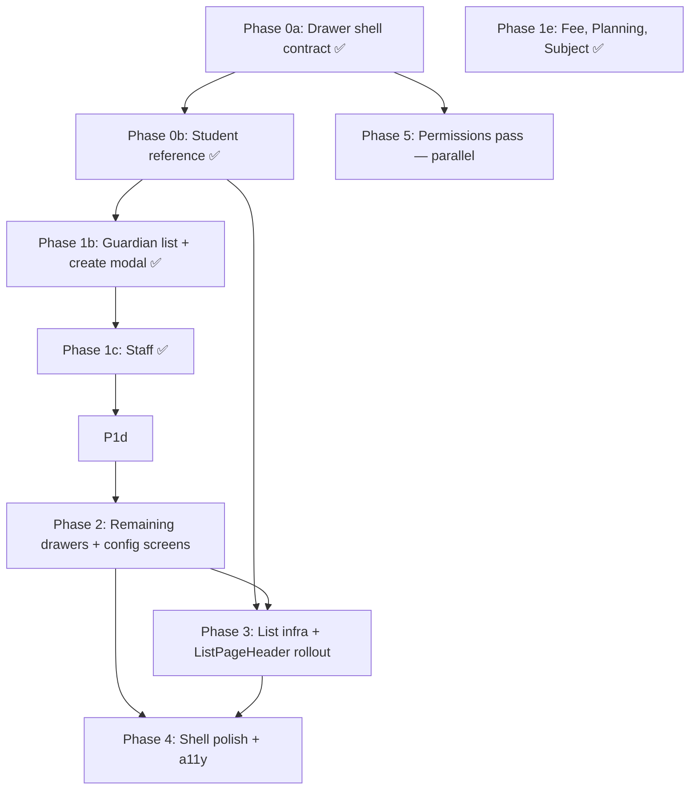

# App Shell Gap Closure Plan

Living plan to align `apps/webapp` with:

- [`specs/app-shell-spec.md`](../specs/app-shell-spec.md) — interaction and layout patterns
- [`specs/design-language-spec.md`](../specs/design-language-spec.md) — visual design tokens, typography, and component styling

**Related docs**

- [App Shell Architecture Spec](../specs/app-shell-spec.md) — target UX rules
- [Design Language Spec](../specs/design-language-spec.md) — target visual rules
- [Webapp mock → API migration plan](./done/webapp-mock-migration-plan.md) — read/write API wiring (coupled with mutation work below)
- Cursor rule: `.cursor/rules/app-shell.mdc`

**Last updated:** 2026-06-17 (Phase 1e checkpoint — review with domain owner before Phase 2)

### Progress tracker

Check boxes when a phase (or sub-phase) exit criteria are met. Entity-level boxes live in [§5](#5-phased-closure-plan).

- [x] **Phase 0a** — Shared foundations (drawer shell contract)
- [x] **Phase 0b** — Student reference migration (drawer)
- [x] **Phase 1** — High-traffic entity migration
  - [x] 1a Student (drawer)
  - [x] 1b Guardian
  - [x] 1c Staff
  - [x] 1d Evaluation
  - [x] 1e Fee, Planning, Subject
- [ ] **Phase 2** — Remaining drawers + config screens
- [ ] **Phase 3** — List infrastructure + visual rollout
- [ ] **Phase 4** — Shell polish + accessibility
- [ ] **Phase 5** — Permissions pass

---

## 1. Executive summary

The **infrastructure layer is largely spec-aligned**; the **interaction layer is mid-migration**; the **visual layer is partially aligned but inconsistently applied**. Shell framing, URL-backed drawers, design tokens, and list-page scaffolding exist. The main interaction drift is that **3 of 15 drawer kinds** still mount editable `*Form.svelte` bodies. The main visual drift is that **only four list views** use the shared `ListPageHeader` primitive — the other ~19 views hand-roll headers with uneven toolbar completeness.

| Spec area | Maturity | Blocker |
|-----------|----------|---------|
| Shell layout | ~80% | Mobile sidebar, user dropdown |
| Design tokens / typography | ~85% | Tokens exist; per-screen application uneven |
| URL-backed detail routes | ~90% | Filter params not in URL |
| List page template (interaction) | ~55% | Inert CTAs, no More menu, URL filters, infinite loading |
| List page template (visual) | ~40% | `ListPageHeader` on 4/23 views |
| Detail drawer (interaction) | ~65% | 3 `*Form` bodies remain; some partial entities |
| Detail drawer (visual) | ~80% | Drawer shell matches design spec; tab/field styling mostly OK |
| Mutation modals | ~40% | Naming drift (`*Form` vs `*FormModal`); inert list CTAs |
| Sub-collection tabs | ~80% | Staff permissions read-only; evaluation gradebook done |
| Toasts | ~55% | `runMutation` success path exists; not universal |
| Permissions | ~25% | `PermissionGate` on student/guardian/staff write actions |

**Redesign scope:** conformance is not a single visual reskin — it is a **paired migration**: every screen must adopt the interaction contract (read-only drawer, modal mutations, `DataState`) **and** the visual contract (`ListPageHeader`, pill toolbars, `rounded-2xl` collections, `ui-tones` badges) together per entity.

---

## 2. What's already aligned

Keep and extend these patterns — they are the foundation every migration should copy.

### Shell (app-shell §1 · design-language §4.1, §9.2)

- `(app)/+layout.svelte` — sidebar, header selectors (school, year/period, language), body, lazy `DetailDrawer`, `ToastHost`
- `AppSidebar.svelte` — module groups, contextual class picker, count badges, frosted card chrome
- `AcademicHeader.svelte`, `SchoolSelector.svelte`, `LanguageSelector.svelte` — pill selector family
- Global academic context drives data across views
- `app.css` + `tailwind.config.ts` + `ui-tones.ts` — semantic token system in place

### URL-backed drawers (app-shell §2.4, §3.2)

- 20 routes use `[[id]]` / `[[role]]` / `[[level]]` optional segments
- `detail-routes.ts`, `detail-hrefs.ts`, layout URL sync
- Row click → navigate → drawer open; close → list URL

### Drawer visual shell (design-language §9.3)

- `DetailDrawer.svelte` — kind badge, ghost close circle, `shadow-panel`, `md:w-1/2`, `motion-safe:` animations
- `DrawerField`, `DrawerActionBar`, `DrawerEmptyState` — read-only field pattern
- `drawer-constants.ts` — status → tone mapping

### List data states (app-shell §6.2 · design-language §9.1)

- `PageQuery` + `DataState` on 19 `[[id]]` routes + `finance/payment`
- `DataState` uses spec-aligned destructive/empty surfaces (`rounded-2xl`, `shadow-soft`)

### Spec-aligned exemplars

| Pattern | Reference file |
|---------|----------------|
| List header + toolbar (interaction + visual) | `SchoolStudentsView.svelte`, `GuardiansView.svelte`, `StaffView.svelte` |
| Action → modal → mutation | `ChangeClassButton.svelte` |
| Sub-collection `+ Add` → picker modal | `ActivityDetail.svelte` |
| Read-only drawer + publish action | `ReportCardDefinitionDetail.svelte`, `BillingDetail.svelte` |
| Complex tabbed entity (interaction) | `StudentTabs.svelte` |
| Read-only guardian + edit modal | `GuardianDetail.svelte`, `GuardianEditModal.svelte` |
| Read-only staff + create modal + status toggle | `StaffTabs.svelte`, `StaffCreateModal.svelte` |
| Matrix layout variant | `RolesMatrixView.svelte` |
| Calendar layout variant | `SchoolCalendarView.svelte` |
| Finance dashboard variant | `FinanceView.svelte` (KPI tiles + table) |

---

## 3. Gap map by spec section

### §1 Shell layout (app-shell)

| Gap | Current | Target |
|-----|---------|--------|
| User menu | Avatar + logout only | Dropdown: profile, preferences, sign out |
| Mobile sidebar | Fixed `w-64` always | Hamburger + overlay on small screens |
| Mobile drawer | `w-full md:w-1/2` implemented | Verify full-screen sheet UX on `< md` |
| Module body padding | `px-8 py-8` in module layouts | Align to spec `p-6` or document intentional deviation |
| Config routes without data shell | `academic`, `classes`, `grade-scales`, `report-cards/[[id]]` mount views directly | Wrap in `PageQuery` / `DataState` |

### §2 List page template (app-shell)

| Gap | Current | Target |
|-----|---------|--------|
| Shared header primitive | `ListPageHeader` on `SchoolStudentsView`, `GuardiansView`, `StaffView`, `EvaluationsView` (4/23 views) | All list routes use `ListPageHeader` snippet slots |
| Primary CTAs | `+ Add` buttons on students, guardians, evaluations, etc. have **no `onclick`** | Wire to `*FormModal` create flows |
| More menu | `MoreHorizontal` icon in `SchoolStudentsView` is decorative | Export, bulk, view toggle, column settings |
| Search / filters | ~6 views have pill search; most lack filter slots | Pill search + `FilterSelect` / segmented status per entity |
| Infinite loading | None | Cursor-based infinite scroll on large lists (see [§4](#4-infinite-loading)) |
| Bulk selection | None | Checkbox column + floating action bar |
| URL filter persistence | Local `$state` only | `?class=6a&status=active&q=…` in query params |
| Sort | None on tables | Column header or sort dropdown |
| Double loading | `PageQuery` then `DataState` | Single loading surface per route |
| Collection wrappers | Most table views use `rounded-2xl border bg-card shadow-soft`; card-list views (`EvaluationsView`, `HomeworkView`, `PlanningView` timetable, `ReportCardDefinitionsView`) use alternate layouts | Standardize per view type (table wrapper vs card stack per design-language §10.3) |

### §3 Detail drawer — interaction (app-shell · highest priority)

**Shell contract (Phase 0a):** see [Phase 0a checklist](#phase-0a--shared-foundations-drawer-shell-contract) — all tasks checked.

**Remaining body violations — 5 `*Form.svelte` imports in `DetailDrawer.svelte`:**

`subject`, `planning`, `evaluation`, `fee`, `schoolYearEvent`

**Entity conformance snapshot:**

| Entity | Drawer body today | Interaction status | Visual status | Priority |
|--------|-------------------|-------------------|---------------|----------|
| Student | `StudentTabs` | Done — read-only profile, modal mutations | Done — `DrawerField`, segmented tabs, `PermissionGate` | — |
| Guardian | `GuardianDetail` | Done — read-only + `GuardianEditModal` | Done — `DrawerField`, action bar | — |
| Activity | `ActivityDetail` | Done — enrollment modal | Done | — |
| Level | `LevelDetail` | Done | Done | — |
| Report card def/result | `*Detail` | Done | Done | — |
| Billing | `BillingDetail` | Mostly OK — payment needs modal | OK | P2 |
| Deadline | `DeadlineDetail` | Partial — read-only list + inline edit | OK | P2 |
| Incident | `IncidentDetail` | Violates — textarea/inputs | Partial | P1 |
| Role | `RoleDetail` | Partial — inline toggles, no persist | OK (matrix variant) | P2 |
| Subject | `SubjectTabs` | Done — read-only tabs + `SubjectFormModal` | Done | — |
| Staff | `StaffTabs` | Done — read-only profile + permissions list; `isActive` toggle | Done | — |
| Evaluation | `EvaluationDetail` | Done — read-only header + gradebook; `EvaluationGradeEntryModal` per row | Done — KPI tiles, read-only fields | — |
| Fee | `FeeDetail` | Done — read-only + `FeeFormModal` | Done | — |
| Planning | `PlanningDetail` | Done — read-only + `PlanningFormModal` | Done — timetable variant | — |
| School year event | `SchoolYearEventForm` | Violates (also used from calendar drawer) | Form styling in drawer | P1 |

### §4 Sub-collection tabs (app-shell)

| Gap | Location |
|-----|----------|
| Staff permissions inline | Done — `StaffPermissionsList` read-only in drawer tab |
| Evaluation gradebook | Done — read-only list + `EvaluationGradeEntryModal` per student |
| Inert list create CTAs | All modules — primary `+ Add` not wired |
| Empty tab CTAs | Audit remaining tabs for empty state + `+ Add` when user can create |

### §5 Mutation modals (app-shell)

| Gap | Current | Target |
|-----|---------|--------|
| Naming | `*Form.svelte` reused in drawer | `*Detail`/`*Tabs` in drawer; `*FormModal.svelte` for create/edit |
| Create from list | Inert `Button` + `Plus` on most views | `FormModal` from `ListPageHeader` `primary` slot |
| Delete | Mostly absent | `ConfirmModal` per entity |
| Post-save refresh | Inconsistent | Modal closes → list + drawer tab refetch → toast |
| `runMutation` | `successMessage` + `onSuccess` available | Adopt on every write path |

### §6 Cross-cutting (app-shell)

| Concern | Gap |
|---------|-----|
| **Toasts** | Student/guardian/report-card paths wired; staff/fee/evaluation drawer saves silent |
| **Permissions** | `PermissionGate` on `StudentTabs` + `GuardianDetail` only; list CTAs ungated |
| **Global context** | Academic context wired; drawer data sometimes stale after mutation |
| **Accessibility** | Escape on drawer works; focus trap only in dialog primitives; no `aria-live` on tab loading |
| **Responsive** | Drawer responsive; sidebar still desktop-only |

### Design language gaps (design-language-spec)

Visual tokens exist globally; **screen-level application is the gap**.

| Area | Current | Target (design-language §) |
|------|---------|---------------------------|
| **List page header** | 22 hand-rolled headers duplicating eyebrow + `font-display text-2xl` | `ListPageHeader` with `search` / `filters` / `more` / `primary` slots (§10.1) |
| **Toolbar pill shape** | Primary CTAs use `rounded-full`; many views lack search/filter pills | All toolbar controls pill-shaped (§5, §10.9) |
| **Page enter motion** | `animate-fade-in` on ~20 views; missing on some | All top-level `*View` wrappers (§7) |
| **Table container** | ~15 views use `rounded-2xl border bg-card shadow-soft` | All table collections (§10.3) |
| **Card-list collections** | `EvaluationsView`, `HomeworkView` use `space-y-3` card buttons — acceptable variant but inconsistent selected state | Use `ROW_ACTIVE` / `border-primary/40 bg-primary/5` consistently (§2.3, §10.3) |
| **Eyebrow typography** | Most views use `font-mono text-xs`; spec prefers `text-[10px]` | Normalize to spec scale (§3.2) |
| **Badge tones** | `drawer-constants.ts` + `ui-tones.ts` exist | Audit views for bespoke badge colors; import `BADGE_*` presets (§2.3, §11) |
| **Stat / KPI tiles** | `FinanceView`, `PaymentsView`, `EvaluationsView` use mixed tile styles | Standardize on §10.4 pattern |
| **Timetable grid** | `PlanningView` — approved layout variant; subject cells use hash-based tones | Document as variant; ensure cell selection uses `ROW_ACTIVE` |
| **Dark mode** | `darkMode: ['class']` configured, no tokens | Do not add `dark:` variants until palette defined (§14) |
| **i18n** | Generally good | No hard-coded French in new components (§16) |

---

## 4. Infinite loading

**Design decision:** scalable collections use **infinite scroll** — not page numbers or explicit "Load more" buttons. Aligns with app-shell §2.3 ("pagination or infinite scroll"); this project standardizes on infinite loading.

| Aspect | Rule |
|--------|------|
| **Trigger** | Sentinel element at list bottom (`IntersectionObserver`); fetch next page when visible |
| **Cursor** | Server returns `nextCursor` (or equivalent); client appends rows, never replaces on scroll |
| **Page size** | Fixed batch (e.g. 50); tune per entity density |
| **Initial load** | First page via existing `PageQuery` / route loader |
| **Subsequent pages** | Client-side fetch (remote or BFF) with cursor + current filters |
| **Filter/search change** | Reset list to page 1; clear cursor; refetch from top |
| **Loading UX** | Skeleton rows or inline spinner at bottom — no full-page overlay on append |
| **End of list** | Subtle "no more results" or simply stop observing sentinel |
| **Drawer open** | Scroll position and loaded pages preserved (list stays in context behind drawer) |
| **URL** | Filters in query params; cursor stays in memory only (not shareable deep-link state) |
| **Accessibility** | `aria-busy` on collection while appending; announce new batch count via `aria-live` region |

**Shared primitive:** `useInfiniteList` (or `InfiniteList.svelte` wrapper) — cursor state, observer lifecycle, reset on filter change. Reuse across all scalable collections in Phase 3 rollout.

---

## 5. Phased closure plan

Each entity phase delivers **both** interaction conformance and visual conformance. Do not migrate drawer interaction on a screen that still uses a hand-rolled list header — migrate the full route in one pass.

**How to use checkboxes:** tick a task when shipped and verified. Tick a **phase header** when all its tasks (and entity sub-phases) are done. Update the [Progress tracker](#progress-tracker) at the top in the same commit.

### Per-entity checklist template

Copy this block under each sprint; check items as they land.

- [ ] Drawer body is `*Detail` or `*Tabs` — no inputs on load
- [ ] Footer has entity actions + Close — no Save
- [ ] Create modal from list primary CTA (`ListPageHeader` `primary` slot)
- [ ] Edit modal from drawer action button
- [ ] Delete confirm modal where applicable
- [ ] Sub-collection `+ Add` / row Edit → modals
- [ ] Toast on every mutation
- [ ] `PermissionGate` on all write actions
- [ ] Drawer refreshes after modal success
- [ ] List view uses `ListPageHeader` (not hand-rolled header)
- [ ] Collection uses spec container pattern (table wrapper or card stack)
- [ ] Toolbar controls are pill-shaped; badges use `ui-tones`

---

### Phase 0a — Shared foundations (drawer shell contract)

- [x] **Phase 0a complete**

**Tasks**

- [x] `DetailDrawer` shell refactor — Close-only footer, responsive width, Escape, reduced motion
- [x] Shared modal primitives — `FormModal`, `ConfirmModal`, `PickerModal`, `DrawerActionBar`
- [x] `runMutation` enhancement — `successMessage`, `onSuccess`, `refresh: false` guidance
- [x] `PermissionGate` component — hide/disable + tooltip
- [x] `ListPageHeader` primitive — reference on `SchoolStudentsView`

**Exit criteria:** Drawer shell has no global Save; primitives have documented usage paths.

---

### Phase 0b — Student reference migration

- [x] **Phase 0b complete** (drawer scope; list items deferred to Phase 3)

**Tasks**

- [x] Profile tab → read-only `DrawerField` rows
- [x] `StudentProfileEditModal` for profile fields
- [x] Guardian link modal (`StudentGuardianLinkModal`)
- [x] Pedagogical notes add/edit modals
- [x] Grade entry modal
- [x] Absence declaration modal
- [x] Incident logging modal
- [x] `ChangeClassButton` — reference action → modal → mutation
- [x] `PermissionGate` on student write actions

**Deferred to Phase 3 (do not tick 0b for these)**

- [ ] List primary CTA → create modal
- [ ] URL-persisted filters
- [ ] More menu wired (export, view toggle)

**Exit criteria:** Student drawer is fully read-only + modal mutations end-to-end.

---

### Phase 1 — Drawer migration: high-traffic entities (2–3 sprints)

- [ ] **Phase 1 complete**

Migrate in traffic order. Per entity: read-only `Detail`/`Tabs` → footer actions → modals → remove `Form` from drawer + `ListPageHeader` on the paired list view.

#### Sprint 1a — Student

- [x] **1a complete** (drawer); list finish tracked under Phase 3

Student checklist

- [x] Drawer body read-only (`StudentTabs`)
- [x] Entity actions + Close (no Save)
- [ ] Create modal from list CTA → Phase 3
- [x] Edit modal(s) from drawer actions
- [ ] Delete confirm modal (if applicable)
- [x] Sub-collection `+ Add` / Edit → modals
- [x] Toast on mutations
- [x] `PermissionGate` on write actions
- [x] Drawer refreshes after modal success
- [x] `ListPageHeader` on `SchoolStudentsView`
- [x] Collection wrapper (`rounded-2xl` table)
- [x] Pill toolbar controls

#### Sprint 1b — Guardian

- [x] **1b complete**

Guardian checklist

- [x] Drawer body read-only (`GuardianDetail`)
- [x] Entity actions + Close
- [x] Create modal from list CTA (`GuardianCreateModal`)
- [x] Edit modal (`GuardianEditModal`)
- [ ] Delete confirm modal (deferred — no delete API wired)
- [x] Sub-collection modals (N/A)
- [x] Toast on create + edit mutations
- [x] `PermissionGate` on create CTA + drawer edit action
- [x] Drawer refreshes after edit; list refreshes after create (`runMutation`)
- [x] `GuardiansView` → `ListPageHeader`
- [x] Collection wrapper (table)
- [x] Pill toolbar on migrated header

**Tasks**

- [x] `GuardianDetail` + `GuardianEditModal` (drawer)
- [x] Migrate `GuardiansView` → `ListPageHeader`
- [x] Wire list primary CTA → `GuardianCreateModal`
- [x] `registerGuardianMutation` in `people.mutations.ts`

#### Sprint 1c — Staff

- [x] **1c complete**

Staff checklist

- [x] Drawer body read-only (`StaffTabs` — replaced `StaffForm`)
- [x] Permissions tab as read-only sub-collection (`StaffPermissionsList`)
- [x] Profile edit — inline `isActive` toggle only (Pattern B); no `StaffEditModal` until profile update API exists
- [x] Create modal from list CTA (`StaffCreateModal`)
- [ ] Delete confirm modal (deferred — no delete API wired)
- [x] Toast + `PermissionGate` on create and status toggle
- [x] `StaffView` → `ListPageHeader` (replaced `PeopleView`)
- [x] `staff.mutations.ts`

**Tasks**

- [x] `StaffTabs` + `StaffPermissionsList` (drawer)
- [x] `StaffCreateModal` + `registerStaffMemberMutation`
- [x] `updateStaffMemberStatusMutation` for active toggle
- [x] Migrate route to `StaffView` with `ListPageHeader`
- [x] Remove `StaffForm`, `StaffPermissionsBlock`, `PeopleView`

#### Sprint 1d — Evaluation

- [x] **1d complete**

Evaluation checklist

- [x] Read-only evaluation header in drawer
- [x] Gradebook as read-only sub-list (remove inline inputs from `EvaluationForm`)
- [x] `EvaluationGradeEntryModal` (per student)
- [x] `EvaluationCreateModal` from `EvaluationsView` CTA
- [x] Card-list selection tones + KPI tiles normalized
- [x] `evaluation.mutations.ts`

#### Sprint 1e — Fee, Planning, Subject

- [x] **1e complete**

Fee checklist

- [x] `FeeDetail` + `FeeFormModal` (remove `FeeForm` from drawer)
- [x] List CTA + `ListPageHeader` on finance fees tab
- [x] `fee.mutations.ts`

Planning checklist

- [x] `PlanningDetail` + `PlanningFormModal` (remove `PlanningForm` from drawer)
- [x] Timetable variant preserved; cell selection uses `ROW_ACTIVE`
- [x] `planning.mutations.ts`

Subject checklist

- [x] Rename `SubjectForm` → `SubjectTabs`; chapters tab read-only sub-list
- [x] `SubjectFormModal` for edits
- [x] `ListPageHeader` on `SubjectsView` / `ConfigSubjectsView` as applicable

#### Checkpoint Phase 1e — revue collègue (règles métier)

> **Objectif :** valider avec le propriétaire domaine (`packages/core`) que la migration app-shell **n’a pas contourné** les règles métier finance / emploi du temps / matières. Phase 1e est **UI + câblage API** ; ce checkpoint liste tout ce qui touche au domaine.
>
> **Statut :** livré côté UI, **revue métier en attente** avant de considérer 1e définitivement clos pour la prod.

##### Livré (interaction + visuel)

| Entité | Drawer read-only | Modal mutation | Liste `ListPageHeader` | Module mutations |
|--------|------------------|----------------|------------------------|------------------|
| **Fee** | `FeeDetail.svelte` | `FeeFormModal.svelte` | `FinanceView` (onglet frais) | `fee.mutations.ts` |
| **Planning** | `PlanningDetail.svelte` | `PlanningFormModal.svelte` | `PlanningView.svelte` | `planning.mutations.ts` |
| **Subject** | `SubjectTabs.svelte` (ex-corps drawer) | `SubjectFormModal.svelte` | `SubjectsView`, `ConfigSubjectsView` | `subject.mutations.ts` |

- `DetailDrawer.svelte` : kinds `fee`, `planning`, `subject` pointent vers les composants read-only ci-dessus (plus de `*Form` dans le drawer).
- Toasts succès/erreur via `runMutation` ; `FeeFormModal` : `try/finally` sur `busy`.
- i18n : clés `fee.*`, `planning.*`, `subjects.*` (+ `fee.permissionConfigure`).
- `PermissionGate` sur frais uniquement (`FINANCIAL_CONFIG_CONFIGURE`) — création liste + bouton Modifier drawer.

##### Fichiers créés / modifiés (inventaire)

**Webapp — nouveaux**

- `apps/webapp/src/lib/components/school/finance/FeeDetail.svelte`
- `apps/webapp/src/lib/components/school/finance/FeeFormModal.svelte`
- `apps/webapp/src/lib/components/school/scheduling/PlanningDetail.svelte`
- `apps/webapp/src/lib/components/school/scheduling/PlanningFormModal.svelte`
- `apps/webapp/src/lib/components/school/academics/SubjectTabs.svelte`
- `apps/webapp/src/lib/components/school/academics/SubjectFormModal.svelte`
- `apps/webapp/src/lib/api/mutations/fee.mutations.ts`
- `apps/webapp/src/lib/api/mutations/planning.mutations.ts`
- `apps/webapp/src/lib/api/mutations/subject.mutations.ts`

**Webapp — modifiés**

- `DetailDrawer.svelte`, `FinanceView.svelte`, `PlanningView.svelte`, `SubjectsView.svelte`, `ConfigSubjectsView.svelte`
- `apps/webapp/src/lib/i18n/dictionaries.ts`

**API — modifié (hors webapp, impact auth métier)**

- `apps/api/src/http/dependencies/session-actor.ts` — en **non-production**, comptes staff `isElevated` passent de `standard` → `verified` pour débloquer `FINANCIAL_CONFIG_CONFIGURE` en dev (step-up auth pas encore implémenté).

**Fichiers legacy encore présents (non branchés au drawer)**

- `FeeForm.svelte`, `PlanningForm.svelte`, `SubjectForm.svelte` — orphelins ; suppression possible après revue.

##### Chemins d’écriture API — ce que fait chaque mutation

| Action UI | Endpoint réel | Remarque domaine |
|-----------|---------------|------------------|
| Créer frais | `commands.createFee` | Chemin commande domaine ✅ |
| Modifier frais | `entities.fees.get` + `entities.fees.save` | **Pas de commande `updateFee`** — save direct autorisé sur l’entité `Fee` (`allowDirectSave: true`) |
| Créer séance | `commands.createSession` | Chemin commande domaine ✅ |
| Modifier séance | `entities.sessions.one` + `entities.sessions.save` | Save direct ; même pattern fragile que frais (spread entité API) |
| Créer matière (classe) | `entities.subjects.save` puis `commands.offerSubjectToClass` | Deux étapes ; IDs générés côté client |
| Modifier matière | `entities.classSubjects.one` → `entities.subjects.one` → `entities.subjects.save` | Met à jour l’entité **Subject globale** (pas seulement l’offre classe) |

##### Points à valider avec le collègue (règles métier)

**Frais (`packages/core/src/domains/finances/fee.ts`)**

- [ ] **Création via commande** — OK métier ? (`createFee` workflow + `FINANCIAL_CONFIG_CONFIGURE` + assurance `verified`).
- [ ] **Édition via `entities.fees.save`** — acceptable ou faut-il une commande dédiée (ex. interdire changement de montant si `studentFees` existants) ?
- [ ] **Champs modifiables en UI** : nom, catégorie, montant seulement. **Période / échéancier non éditables** après création — installments repris tels quels du `GET`.
- [ ] **Mapping catégorie UI → API** : `Tuition→tuition`, `Transport→transport`, `Materials→uniform`, `Meals/Activities→other` — perte de sémantique « repas » vs « activités ».
- [ ] **Installments à la création** : `Year` → 3 tranches 33.33 / 33.33 / 33.34 ; `Term` → 100 % ; `Month` → `[]` (pas d’échéancier).
- [ ] **Devise** : création forcée `XOF` ; édition conserve la devise existante (`feeSavePayload` / `feeCurrency`).
- [ ] **IDs client** : `fee-${Date.now().toString(36)}` (pas UUID) — aligné fixtures seed (`f1`, `f2`…) mais différent du filtre `fees/one` (UUID) ; d’où usage de `fees.get(id)`.
- [ ] **Gate `validateFeeSave`** : vérifie cohérence `schoolId` / `academicYearId` — toujours exécuté sur save direct.
- [ ] **Bypass dev assurance** (`session-actor.ts`) — à retirer ou remplacer par vrai step-up avant prod.

**Planning / sessions**

- [ ] **Édition session** : save direct sur `Session` — règles d’assignation staff / ressources / chevauchements respectées par le domaine ?
- [ ] **IDs client** : `sess-${Date.now().toString(36)}`.
- [ ] **Horaires** : conversion jour UI (`Mon`…) + heure locale → ISO via semaine de référence fixe `2026-01-05` (lundi).
- [ ] **Même risque technique que frais (avant fix)** : `sessions.one({ id })` peut échouer si l’ID n’est pas UUID — à tester / aligner sur `sessions.get(id)` si besoin.

**Matières**

- [ ] **Édition d’un `Subject` global** depuis le drawer classe — impact sur toutes les classes qui partagent le même `subjectId` ?
- [ ] **Création** : `subjects.save` direct (pas `registerSubject` command) puis `offerSubjectToClass` — ordre et atomicité OK ?
- [ ] **Champs modifiables** : nom, catégorie, couleur — description / heures / enseignant affichés read-only dans `SubjectTabs` (données dérivées UI, pas persistées ici).
- [ ] **PermissionGate absent** sur matières / planning — création toujours visible (Phase 5).

**Hors périmètre 1e (inchangé)**

- `student-fees`, `payments` : `allowDirectSave: false` — toujours commandes domaine.
- Facturation (`BillingDetail`) : read-only, pas de mutation paiement dans 1e.

##### Correctifs post-livraison (frais — testés manuellement ✅)

1. `updateFeeMutation` : `fees.one` → `fees.get` (422 : filtre OpenAPI attend UUID, IDs réels `f1` / `fee-xxx`).
2. `feeSavePayload` : reconstruction explicite du corps `save` (`currency`, `defaultAmount` entier, `installments`, etc.) — évite 422 après spread `{ ...existing }`.
3. `runMutation` englobe GET + save ; toast d’erreur au lieu de modal bloquée.

##### Scénarios de test manuel (parcours collègue)

| Route | Créer | Drawer read-only | Modifier | Permission / auth |
|-------|-------|------------------|----------|-------------------|
| `/finance/fees` | + Nouveau frais | champs + « appliqué à N élèves » | Modifier (modal) | `FINANCIAL_CONFIG_CONFIGURE` + session dev elevated |
| `/classes/{id}/timetable` | + Nouvelle séance | grille + détail séance | Modifier (modal) | — |
| `/classes/{id}/subjects` | + Nouvelle matière | onglets chapitres / cahier | Modifier (modal) | — |
| `/configuration/subjects` | — (liste config) | même drawer `SubjectTabs` | via drawer | — |

##### Décision attendue après revue

- [ ] **Approuvé** — 1e clos métier + UI ; on enchaîne Phase 2.
- [ ] **Ajustements domaine requis** — lister commandes manquantes (`updateFee`, etc.) avant prod.
- [ ] **Dette acceptée** — documenter écarts (save direct, mapping catégories, bypass dev) avec ticket de suivi.

---

### Phase 2 — Remaining drawer entities + config screens (1–2 sprints)

- [ ] **Phase 2 complete**

- [ ] **School year event** — `SchoolYearEventDetail` + modal; calendar drawer fixed; `SchoolCalendarView` header
- [ ] **Incident** — read-only `IncidentDetail` + edit modal; `SchoolEventsView` → `ListPageHeader`
- [ ] **Deadline** — read-only fields; attach file → modal; `HomeworkView` selection tones
- [ ] **Billing** — "Record payment" → form modal; `FinanceView` KPI tile normalization
- [ ] **Role** — read-only matrix in drawer; boolean toggles with API + toast (Pattern B); badge tone audit on `RolesMatrixView`
- [ ] **`AcademicAdminView`** — inline creates → modals; route wrapped in `PageQuery`/`DataState`
- [ ] **`ClassGroupsView`** — inline create → modal
- [ ] **`GradeScalesView`** — inline create → modal; `ListPageHeader` + table wrapper
- [ ] **`ReportCardDefinitionsView`** — `PageQuery`/`DataState` on route; card list selection tones
- [ ] **`incident.mutations.ts`** (and any remaining API modules for Phase 2 entities)

---

### Phase 3 — List infrastructure + visual rollout (1–2 sprints)

- [ ] **Phase 3 complete**

Target `SchoolStudentsView` as the gold-standard list (interaction + visual), then roll out.

**Infrastructure**

- [ ] Shared `useInfiniteList` / `InfiniteList.svelte` primitive
- [ ] URL filter sync — `class`, `status`, `q` in search params; preserve on drawer open/close
- [ ] Infinite loading on school students (see [§4](#4-infinite-loading))
- [ ] More menu — export stub, view toggle, column visibility; remove decorative icons
- [ ] Eliminate double loading — `PageQuery` owns initial load; `DataState` for empty/error/ready only
- [ ] Badge / tone audit — `drawer-constants` / `ui-tones` across views

**Wire create modals (inert `+ Add` today)**

- [ ] Students — `SchoolStudentsView` + class-scoped `StudentsView`
- [ ] Guardians
- [ ] Staff (`PeopleView`)
- [ ] Evaluations, subjects, activities, events (remaining modules)

**`ListPageHeader` rollout** — tick when migrated:

- [ ] `StudentsView`
- [x] `GuardiansView`
- [ ] `ActivitiesView`
- [ ] `SchoolEventsView`
- [ ] `SchoolCalendarView`
- [ ] `SubjectsView`
- [ ] `ConfigSubjectsView`
- [ ] `PlanningView`
- [ ] `TeachingLogView`
- [ ] `HomeworkView`
- [ ] `EvaluationsView`
- [ ] `ClassReportCardsView`
- [ ] `FinanceView`
- [ ] `PaymentsView`
- [x] `StaffView`
- [ ] `RolesMatrixView`
- [ ] `GradeScalesView`
- [ ] `ClassGroupsView`
- [ ] `AcademicAdminView`
- [ ] `ReportCardDefinitionsView`
- [ ] `ResourcesView`
- [ ] `EducatorDashboardView` (dashboard variant — partial header slots)

---

### Phase 4 — Shell polish + accessibility (1 sprint)

- [ ] **Phase 4 complete**

- [ ] Mobile hamburger sidebar
- [ ] User menu dropdown (profile stub, sign out)
- [ ] Module layout padding — align to `p-6` or document `px-8 py-8` as intentional
- [ ] Full-screen drawer UX verified on `< md`
- [ ] Focus trap audit on all modals
- [ ] `aria-live` on drawer tab loading and infinite-scroll append
- [ ] Keyboard — tab strip navigation; list row focus

---

### Phase 5 — Permissions pass (parallel with Phases 1–3)

- [ ] **Phase 5 complete**

Map each write action to a grant in `permissions.ts`; apply `PermissionGate` to every CTA from Phases 1–3. Denied actions: disabled + tooltip (e.g. "Requires director role").

- [ ] Student — `STUDENT_CREATE`, `STUDENT_UPDATE`, `ENROLLMENT_UPDATE`
- [ ] Guardian — create/update gates
- [ ] Grades — `canEditGrades()` on all grade entry paths
- [ ] Finance — `PAYMENT_RECORD`, `PAYMENT_CANCEL`, `PAYMENT_REVERSE`, `FINANCIAL_CONFIG_UPDATE`
- [ ] Staff / roles — `STAFF_UPDATE`, `ACCESS_CONTROL_CONFIGURE`, `ACCESS_CONTROL_ASSIGN`
- [ ] School life — `canEditSchoolLife()` on incidents, events
- [ ] List primary CTAs gated (not only drawer actions)

---

## 6. API write path dependency

UI conformance and API migration are coupled. From [webapp-mock-migration-plan.md](./done/webapp-mock-migration-plan.md):

- Read paths are largely wired; **write flows are still mock/local for most entities**
- Mutation modules exist for: `student`, `academic`, `report-cards`, `run-mutation`
- Drawer forms currently have no real save path anyway

**Recommendation:** Continue drawer read-only + modal UI migration **in parallel** with API command endpoints. For entities without API writes yet:

- Production path: hide or disable edit CTAs until a real command exists
- Demo-only local optimistic updates must be isolated and clearly labeled
- Never show a success toast for a mutation that did not persist
- Do not block drawer read-only migration on API — that is pure UI

**Mutation module backlog** — tick when the module ships and is wired to modals:

- [x] `student.mutations.ts` (existing)
- [x] `academic.mutations.ts` (existing)
- [x] `report-cards.mutations.ts` (existing)
- [x] `run-mutation.ts` (shared helper)
- [x] `guardian.mutations.ts` — `registerGuardianMutation` + `updateGuardianContactMutation` in `people.mutations.ts`
- [x] `staff.mutations.ts` — `registerStaffMemberMutation`, `updateStaffMemberStatusMutation`
- [x] `evaluation.mutations.ts`
- [x] `fee.mutations.ts`
- [x] `planning.mutations.ts`
- [ ] `incident.mutations.ts`

---

## 7. Entity inventory

Tracking board. Status reflects **current** state as of 2026-06-17.

| Entity | List `ListPageHeader` | List CTA wired | Drawer read-only | Edit modal | Sub-collection modals | Toasts | Permissions |
|--------|----------------------|----------------|------------------|------------|----------------------|--------|-------------|
| Student | ✅ | ❌ | ✅ | ✅ | ✅ | ✅ | ⚠️ |
| Guardian | ✅ | ✅ | ✅ | ✅ | — | ✅ | ⚠️ |
| Staff | ✅ | ✅ | ✅ | ⚠️ toggle only | ✅ read-only | ✅ | ⚠️ |
| Evaluation | ✅ | ✅ | ✅ | ⚠️ grade modal only | ✅ per-row | ✅ | ⚠️ |
| Fee | ✅ | ✅ | ✅ | ✅ | — | ✅ | ❌ |
| Subject | ✅ | ✅ | ✅ | ✅ | — read-only chapters | ✅ | ❌ |
| Planning | ✅ | ✅ | ✅ | ✅ | — | ✅ | ❌ |
| Billing | — | — | ✅ | ❌ | — | ❌ | ❌ |
| School year event | ❌ | ❌ | ❌ | ❌ | — | ❌ | ❌ |
| Incident | ❌ | ❌ | ❌ | ❌ | — | ❌ | ❌ |
| Deadline | ❌ | ❌ | ⚠️ | ❌ | — | ❌ | ❌ |
| Activity | ❌ | ❌ | ✅ | ✅ | ✅ | ❌ | ❌ |
| Role | ❌ | — | ⚠️ | ❌ | — | ❌ | ❌ |
| Level | — | — | ✅ | — | — | — | — |
| Report card def/result | ❌ | ❌ | ✅ | ✅ | — | ✅ | ❌ |
| Class groups | ❌ | ⚠️ inline | — | ❌ | — | ✅ | ❌ |
| Grade scales | ❌ | ⚠️ inline | — | ❌ | — | ✅ | ❌ |
| Academic years | ❌ | ⚠️ inline | — | ❌ | — | ✅ | ❌ |

Legend: ✅ done · ⚠️ partial · ❌ missing · — N/A

---

## 8. Execution order

**Fastest visible win:** Phase 1b Guardian — drawer is done; migrating `GuardiansView` to `ListPageHeader` + wiring create modal gives a second full reference route.

**Highest risk if skipped:** Migrating drawer interaction without list visual conformance — users see modern drawer on one screen and hand-rolled legacy header on the list behind it (mixed pattern + inconsistent brand feel).

---

## 9. Success metrics

The gap is closed when every box below is checked.

### Interaction (app-shell-spec)

- [ ] Zero `*Form.svelte` imports in `DetailDrawer.svelte`
- [x] No global Save/Cancel on drawer shell
- [ ] Every list primary CTA opens a create modal
- [ ] Every sub-collection `+ Add` / Edit opens a modal
- [ ] `runMutation` (or equivalent) backs every write with success + error toast
- [ ] Every write action has a `PermissionGate`
- [ ] `SchoolStudentsView` has URL-persisted filters + cursor-based infinite loading
- [ ] Drawer + sidebar are responsive per spec §6.5

### Visual (design-language-spec)

- [ ] Every `*View.svelte` list route uses `ListPageHeader` (or documented layout variant with equivalent slots)
- [ ] All table collections use `rounded-2xl border border-border bg-card shadow-soft`
- [ ] All toolbar controls use pill shape (`rounded-full`)
- [ ] All top-level views wrap content in `animate-fade-in`
- [ ] Status chips and badges import from `ui-tones` / `drawer-constants` — no bespoke per-screen colors
- [ ] No hard-coded hex in components; semantic tokens only

---

## 10. File quick-reference

| Role | Good examples | Violation examples |
|------|---------------|-------------------|
| Layout / shell | `(app)/+layout.svelte`, `AppSidebar.svelte`, `AcademicHeader.svelte` | Fixed desktop-only sidebar |
| Design tokens | `app.css`, `ui-tones.ts`, `drawer-constants.ts` | Bespoke badge colors in views |
| Routing | `detail-routes.ts`, `detail-hrefs.ts`, `school/students/[[id]]/+page.svelte` | `configuration/report-cards/[[id]]/+page.svelte` (no DataState) |
| List + states | `PageQuery.svelte`, `DataState.svelte`, `SchoolStudentsView.svelte` | Hand-rolled headers in remaining ~19 views |
| List header | `ListPageHeader.svelte` | Duplicated `mb-5 flex …` blocks in ~19 views |
| Drawer shell | `DetailDrawer.svelte` (Close-only, responsive) | — |
| Drawer body | `StudentTabs.svelte`, `GuardianDetail.svelte`, `StaffTabs.svelte`, `EvaluationDetail.svelte`, `FeeDetail.svelte`, `PlanningDetail.svelte`, `SubjectTabs.svelte`, `ActivityDetail.svelte` | `SchoolYearEventForm.svelte`, `IncidentDetail.svelte` (partial) |
| Modal mutations | `GuardianCreateModal.svelte`, `EvaluationCreateModal.svelte`, `FeeFormModal.svelte`, `PlanningFormModal.svelte`, `SubjectFormModal.svelte` | Inert `+ Add` buttons in remaining list views |
| Complex tabs | `StudentTabs.svelte`, `StudentReportCardPanel.svelte` | `StaffForm.svelte` permissions block |
| Permissions | `PermissionGate.svelte`, `permissions.ts` | Ungated list CTAs and drawer actions |
| Layout variants | `RolesMatrixView.svelte`, `SchoolCalendarView.svelte`, `FinanceView.svelte`, `PlanningView.svelte` | — |

---

## 11. Per-route migration index

Quick lookup for redesign work. **D** = drawer interaction · **L** = list visual/interaction · **M** = modals/mutations.

| Route | View component | D | L | M | Notes |
|-------|----------------|---|---|---|-------|
| `/school/students/[[id]]` | `SchoolStudentsView` | ✅ | ⚠️ CTA/More | ⚠️ create | Gold standard; finish Phase 3 |
| `/school/guardians/[[id]]` | `GuardiansView` | ✅ | ✅ | ✅ | Second full reference route |
| `/school/calendar/[[id]]` | `SchoolCalendarView` | ❌ event form | ❌ | ❌ | Calendar variant |
| `/school/activities/[[id]]` | `ActivitiesView` | ✅ | ❌ | ⚠️ | |
| `/school/events/[[id]]` | `SchoolEventsView` | ❌ | ❌ | ❌ | |
| `/classes/…/students/[[id]]` | `StudentsView` | ✅ | ❌ | ⚠️ | Class-scoped cards |
| `/classes/…/subjects/[[id]]` | `SubjectsView` | ✅ | ✅ | ✅ | |
| `/classes/…/timetable/[[id]]` | `PlanningView` | ✅ | ✅ | ✅ | Timetable variant |
| `/classes/…/teaching/[[id]]` | `TeachingLogView` | ⚠️ | ❌ | ❌ | |
| `/classes/…/homework/[[id]]` | `HomeworkView` | ⚠️ | ❌ | ❌ | Card-list variant |
| `/classes/…/evaluations/[[id]]` | `EvaluationsView` | ✅ | ✅ | ✅ | Card-list variant; fourth reference route |
| `/classes/…/report-cards/[[id]]` | `ClassReportCardsView` | ✅ | ❌ | ⚠️ | |
| `/finance/billing/[[id]]` | `FinanceView` | ⚠️ | ⚠️ KPI | ❌ | Dashboard + table variant |
| `/finance/fees/[[id]]` | `FinanceView` | ✅ | ✅ | ✅ | Fees tab; `ListPageHeader` |
| `/finance/payment` | `PaymentsView` | — | ❌ | — | No drawer |
| `/configuration/academic` | `AcademicAdminView` | — | ❌ | ⚠️ inline | No DataState |
| `/configuration/classes` | `ClassGroupsView` | — | ❌ | ⚠️ inline | |
| `/configuration/subjects/[[id]]` | `ConfigSubjectsView` | ✅ | ✅ | ⚠️ create class-scoped | `ListPageHeader` |
| `/configuration/staff/[[id]]` | `StaffView` | ✅ | ✅ | ✅ | Third full reference route |
| `/configuration/roles/[[role]]` | `RolesMatrixView` | ⚠️ | ⚠️ | ❌ | Matrix variant |
| `/configuration/grade-scales` | `GradeScalesView` | — | ❌ | ⚠️ inline | |
| `/configuration/report-cards/[[id]]` | `ReportCardDefinitionsView` | ✅ | ❌ | ⚠️ | No DataState |
