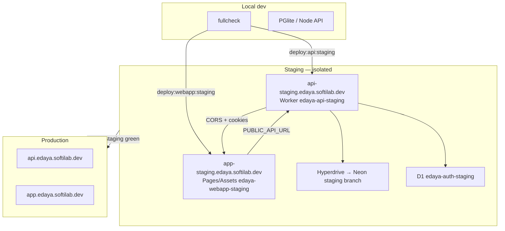

# Staging environment and deploy verification

**Status: in progress** (Phases 1–3 code landed; Cloudflare/Neon resource IDs must be provisioned before first deploy).

**Runbook:** [docs/deploy-staging.md](../docs/deploy-staging.md)

**Related docs:** [API runtimes](../docs/api-runtimes.md), [Local dev](../docs/local-dev.md), [API folder structure](../docs/api-folder-structure.md), [Service accounts plan](./service-accounts-plan.md).

**Last updated:** 2026-06-14

---

## Completion summary

| Area | Status |
|------|--------|
| Production Worker + webapp deploy (`env.production`) | Done |
| Local verification (`fullcheck`, PGlite harness, service-account tests) | Done |
| Remote seed hook (`seed:remote` + `SEED_API_URL`) | Done |
| Remote integration tests (`test:remote`) | Done |
| Simulated staging CORS/cookie tests (`test-staging-cors-auth.test.ts`) | Done |
| `[env.staging]` in API + webapp wrangler | Done |
| Staging deploy scripts (`deploy:api:staging`, `deploy:webapp:staging`) | Done |
| Staging migration scripts (`db:migrate:staging`, `db:migrate:auth:staging`) | Done |
| `smoke:staging` HTTP verification script | Done |
| Runbook (`docs/deploy-staging.md`) | Done |
| `openapi:check` in `fullcheck` | Done |
| Cloudflare Hyperdrive staging config | **Create via wrangler** — see [deploy-staging.md](../docs/deploy-staging.md) |
| Neon staging branch | Done (`staging` on project `calm-brook-83532792`) |
| Staging D1 auth DB + migrations | Done (`2e55cf53-1b89-453f-ac17-3aab83fd8488`) |
| First live staging deploy + smoke green | **Pending** — Hyperdrive ID + `BETTER_AUTH_SECRET` |

---

## 1. Goals and non-goals

### Goals

| # | Outcome |
|---|---------|
| G1 | Staging is **fully isolated** from production (Postgres, Hyperdrive, D1, domains, secrets) |
| G2 | Deploy to staging with one command per app (`deploy:api:staging`, `deploy:webapp:staging`) |
| G3 | Repeatable post-deploy verification via `smoke:staging` against real URLs |
| G4 | Staging proves the paths local tests cannot: Worker bindings, remote migrations, cross-subdomain auth, service-account HTTP |
| G5 | Feature shipping gate: `fullcheck` locally → deploy staging → `smoke:staging` green → promote to production |
| G6 | Bootstrap path documented: first deploy → `seed:init` → store `SERVICE_ACCOUNT_API_KEY` in Wrangler secrets |

### Non-goals (this iteration)

- Production CI/CD automation (GitHub Actions deploy on merge) — document manual flow first
- Preview/ephemeral per-PR environments
- Browser automation (Playwright) in CI — manual browser check for Tier 2 initially
- Safari cross-subdomain cookie verification in automated smoke — keep manual until Tier 1 is stable
- Staging data refresh / anonymized prod snapshots
- Separate staging for billing/platform integrations

### Locked decisions

| Topic | Decision |
|-------|----------|
| **Domain pattern** | `api-staging.edaya.softilab.dev` + `app-staging.edaya.softilab.dev` |
| **Cookie domain** | `COOKIE_DOMAIN=softilab.dev` (same parent as production) |
| **School DB** | Neon **branch** dedicated to staging; Hyperdrive config points at that branch only |
| **Auth DB** | Separate D1 database (`edaya-auth-staging` or similar) |
| **Secrets** | Wrangler secrets only — never committed (`.dev.vars` / dashboard) |
| **Webapp API URL** | `PUBLIC_API_URL` baked at **build time** per environment |
| **Service account key** | Optional Wrangler secret after bootstrap; seeding uses Bearer on `/core/*` |

---

## 2. Current state

### What works today

```
Developer machine
  └─ bun run fullcheck
       ├─ lint, check, build, check:boundaries
       └─ unit + integration tests (PGlite / in-process)

Optional remote hooks (env-driven, no staging target yet)
  └─ SEED_API_URL=… bun seed:remote
  └─ bun test:remote   # real Postgres integration tests, not deployed Worker smoke

Production deploy (only environment defined)
  └─ bun run deploy:api      → wrangler deploy --env production
  └─ bun run deploy:webapp   → build + wrangler deploy --env production
```

### Gaps

| Gap | Risk |
|-----|------|
| `[env.production]` only in `apps/api/wrangler.toml` and `apps/webapp/wrangler.toml` | Every deploy is prod-first integration |
| Default wrangler block shares prod Hyperdrive + D1 IDs | Easy to misconfigure a second env |
| `test-staging-cors-auth.test.ts` simulates staging hostnames locally | Does not prove live Cloudflare + DNS + cookies |
| No `smoke:staging` | No single “did the deploy work?” command |
| `openapi:check` not in `fullcheck` | OpenAPI drift can slip through |
| Webapp build requires correct `PUBLIC_API_URL` | Staging deploy easy to misbuild |

---

## 3. Target architecture



**Auth flow on staging (same as production):**

```
Browser (app-staging…)
  └─ Better Auth → api-staging…/auth/*
       └─ session cookie on .softilab.dev
            └─ credentialed fetch → api-staging…/core/*
                 └─ StaffActorMetadata + effectiveGrants

Seeding / automation
  └─ Authorization: Bearer sk_live_…
       └─ api-staging…/core/commands/* · /core/entities/*
            └─ Service staff actor + grants
```

---

## 4. Staging resources checklist

Create these **before** first staging deploy. Do not reuse production IDs.

| Resource | Staging value (example) | Notes |
|----------|-------------------------|-------|
| Neon branch | `staging` branch off main | School schema via `@edaya/neon-migrations` |
| Hyperdrive config | New config ID → staging Neon branch | Separate binding in `[env.staging]` |
| D1 database | `edaya-auth-staging` | New `database_id`; run `db:migrate:auth:remote` against staging |
| API Worker | `edaya-api-staging` | `[env.staging]` in `apps/api/wrangler.toml` |
| Webapp assets | `edaya-webapp-staging` | `[env.staging]` in `apps/webapp/wrangler.toml` |
| API custom domain | `api-staging.edaya.softilab.dev` | `[[env.staging.routes]]` |
| Webapp custom domain | `app-staging.edaya.softilab.dev` | `[[env.staging.routes]]` |
| Wrangler secret | `BETTER_AUTH_SECRET` | Unique per environment |
| Wrangler secret (post-bootstrap) | `SERVICE_ACCOUNT_API_KEY` | From `seed:init` output |

### Staging `[vars]` (API)

| Variable | Example |
|----------|---------|
| `NODE_ENV` | `production` |
| `RUNTIME` | `worker` |
| `LOG_LEVEL` | `info` |
| `BETTER_AUTH_URL` | `https://api-staging.edaya.softilab.dev` |
| `TRUSTED_ORIGINS` | `https://app-staging.edaya.softilab.dev` |
| `COOKIE_DOMAIN` | `softilab.dev` |
| `ALLOW_PUBLIC_SCHOOL_REGISTRATION` | `true` (match prod unless intentionally locked down) |

### Webapp build (staging)

```sh
PUBLIC_API_URL=https://api-staging.edaya.softilab.dev bun run build
wrangler deploy --env staging
```

---

## 5. Implementation phases

### Phase 1 — Infra and deploy scripts

- [x] Create D1 database for staging auth (`edaya-auth-staging`, migrations applied)
- [x] Create Neon staging branch (`staging`)
- [ ] Create Cloudflare Hyperdrive config for staging branch (requires `STAGING_DATABASE_URL` locally)
- [x] Add `[env.staging]` to `apps/api/wrangler.toml` (Worker name, vars, Hyperdrive, D1, routes)
- [x] Add `[env.staging]` to `apps/webapp/wrangler.toml` (Worker name, routes)
- [x] Add root scripts:
  - `deploy:api:staging` → `wrangler deploy --env staging`
  - `deploy:webapp:staging` → build with staging `PUBLIC_API_URL` + deploy
- [x] Add `db:migrate:staging` (`STAGING_DATABASE_URL`) and `db:migrate:auth:staging`
- [x] Document Wrangler secret setup for staging (`BETTER_AUTH_SECRET`)
- [x] Update `docs/api-runtimes.md`, `docs/local-dev.md`, and `docs/deploy-staging.md`

**Exit criteria:** API Worker serves `/doc` on staging domain; webapp loads and points at staging API.

### Phase 2 — Bootstrap and remote seed

- [ ] First-time staging bootstrap runbook (ops — follow [deploy-staging.md](../docs/deploy-staging.md)):
  1. Apply school migrations to Neon staging branch
  2. Apply D1 auth migrations (`bun db:migrate:auth:staging`)
  3. Deploy API + set `BETTER_AUTH_SECRET`
  4. Deploy webapp
  5. Run `SEED_API_URL=https://api-staging… bun seed:init` (director session bootstrap)
  6. Store printed `SERVICE_ACCOUNT_API_KEY` as Wrangler secret
  7. Run `SEED_API_URL=… SERVICE_ACCOUNT_API_KEY=… bun seed:remote`
- [ ] Verify `seed:smoke` passes against staging URL
- [x] Document env file example: `testing/seeding/.env.staging.example` (URLs only, no secrets)

**Exit criteria:** Demo school seeded; director can sign in; service account can call `/core/entities/…`.

### Phase 3 — `smoke:staging` script

Add `@edaya/smoke-staging` package (`testing/smoke-staging/`).

- [x] Implement Tier 1 checks S1–S8 in `@edaya/smoke-staging`
- [ ] Exit criteria: passes consistently after staging deploy (pending live infra)

| # | Check | How |
|---|-------|-----|
| S1 | API health | `GET /` returns 200 + `{ message: "Edaya Core API" }` |
| S2 | OpenAPI / docs | `GET /doc` or `/reference` returns 200 |
| S3 | CORS allow | `OPTIONS` from trusted origin → 204 + `access-control-allow-origin` |
| S4 | CORS deny | `OPTIONS` from unknown origin → no allow header / rejected |
| S5 | Auth sign-in | `POST /auth/sign-in/email` with fixture user → session cookie |
| S6 | Effective grants | `GET /core/authorization/effective-grants` with cookie → 200 staff actor |
| S7 | Service account | `POST /core/entities/schools/list` with Bearer key → 200 |
| S8 | Hyperdrive path | Entity list returns seeded school (proves Postgres reachable) |

**Tier 2 — manual or follow-up automation:**

| # | Check | How |
|---|-------|-----|
| M1 | Browser login | Sign in on `app-staging…`, land in app shell |
| M2 | Demo data visible | Students/staff lists load after login |
| M3 | Safari cookies | Cross-subdomain session persists (manual) |
| M4 | Full seed idempotency | Re-run `seed:remote` without destructive side effects |

Root script:

```sh
bun run smoke:staging   # reads STAGING_API_URL, STAGING_APP_ORIGIN, optional SERVICE_ACCOUNT_API_KEY
```

**Exit criteria:** `smoke:staging` passes consistently after staging deploy; documented in README.

### Phase 4 — Shipping gate (process, optional CI)

- [x] Add `openapi:check` to `fullcheck`
- [x] Document promotion checklist in `docs/deploy-staging.md`
- [ ] (Optional) GitHub Action: `fullcheck` on PR; manual workflow for staging deploy + smoke

---

## 6. Verification checklists

### Local (every PR / before any deploy)

```sh
bun run check
bun run test
bun run build
bun run openapi:check
bun run check:boundaries
# or combined:
bun run fullcheck   # consider adding openapi:check here
```

### Staging deploy (after infra exists)

```sh
# 1. Migrate remote data stores
bun run db:migrate              # DATABASE_URL = Neon staging branch
bun run db:migrate:auth:remote  # wrangler D1 target = staging DB

# 2. Deploy apps
bun run deploy:api:staging
bun run deploy:webapp:staging

# 3. Seed (if needed)
SEED_API_URL=https://api-staging.edaya.softilab.dev bun seed:remote

# 4. Verify
bun run smoke:staging
bun run test:remote             # optional; Postgres correctness, separate concern
```

### Production promotion (after staging green)

```sh
bun run fullcheck
bun run deploy:api
bun run deploy:webapp
# optional: smoke against production with read-only checks only
```

---

## 7. `smoke:staging` design sketch

**Location:** `testing/smoke-staging/` (new package) or `testing/seeding/scripts/smoke-staging.ts`.

**Env vars:**

| Variable | Required | Purpose |
|----------|----------|---------|
| `STAGING_API_URL` | yes | e.g. `https://api-staging.edaya.softilab.dev` |
| `STAGING_APP_ORIGIN` | yes | e.g. `https://app-staging.edaya.softilab.dev` |
| `SMOKE_STAFF_EMAIL` | no | defaults to `MINIMAL_AUTH_FIXTURE_STAFF_EMAIL` |
| `SMOKE_STAFF_PASSWORD` | no | defaults to `DEV_AUTH_PASSWORD` |
| `SERVICE_ACCOUNT_API_KEY` | no | skips S7 if unset |

**Output:** exit 0 on all Tier 1 passes; print failing step + HTTP status/body snippet on failure.

**Reuse:** `@edaya/seeding` HTTP client (`signInViaHttp`, `postEntityList`), patterns from `run-http-dev-seeds.ts` smoke scope.

---

## 8. Risks and mitigations

| Risk | Mitigation |
|------|------------|
| Staging shares prod Hyperdrive/D1 by copy-paste | Code review checklist; distinct IDs in wrangler; never reuse prod `database_id` |
| Webapp built with wrong `PUBLIC_API_URL` | `deploy:webapp:staging` script sets env inline; document loudly |
| Forgotten D1 migration on staging | Include in deploy runbook; smoke S5 fails early |
| `SERVICE_ACCOUNT_API_KEY` chicken-and-egg | Document `seed:init` session bootstrap; smoke S7 optional until key exists |
| Staging becomes stale / broken silently | Run `smoke:staging` on every staging deploy; optional weekly cron |
| `test:remote` confused with staging smoke | Keep separate names and docs |
| Cookie issues only visible in Safari | Tier 2 manual checklist item |

---

## 9. Success criteria

- [ ] Staging API and webapp deploy independently of production
- [ ] Staging uses separate Neon branch, Hyperdrive config, D1 database, and domains
- [ ] `bun run smoke:staging` passes after a fresh staging deploy + seed
- [ ] Tier 1 smoke proves: health, docs, CORS, sign-in, effective-grants, service-account entity call
- [ ] `seed:remote` works against staging with `SEED_API_URL`
- [ ] Team can ship a feature slice with: local `fullcheck` → staging deploy → `smoke:staging` → prod
- [ ] Runbook documented; no secrets in repo

---

## 10. File touch map (anticipated)

```
apps/api/
  wrangler.toml                          # [env.staging]
  package.json                           # deploy:worker:staging

apps/webapp/
  wrangler.toml                          # [env.staging]
  package.json                           # deploy:staging with PUBLIC_API_URL

package.json                             # deploy:api:staging, deploy:webapp:staging, smoke:staging

testing/smoke-staging/                   # new (or testing/seeding/scripts/smoke-staging.ts)
  src/run-smoke-staging.ts
  package.json

testing/seeding/
  .env.staging.example                   # STAGING_API_URL, no secrets

docs/
  deploy-staging.md                      # runbook (new)
  api-runtimes.md                        # staging section
  local-dev.md                           # link to staging

integrations/betterauth-d1-migrations/
  scripts/migrate.ts                     # may need --env staging flag docs

integrations/neon-migrations/
  README or docs                       # staging DATABASE_URL usage
```

---

## 11. Relationship to other work

| Workstream | Dependency |
|------------|------------|
| Service accounts | Staging smoke should include Bearer auth (S7) — infra ready |
| App shell feature slices | Staging webapp needed to validate UI against real API |
| Webapp admin UI for service accounts | Can ship to staging first once env exists |
| Production CI/CD | Blocked on staging proving the deploy + smoke pattern |

**Recommended order:** Complete Phase 1–3 of this plan **before** treating production deploy as the default validation path for auth, seeding, or cross-domain features.
