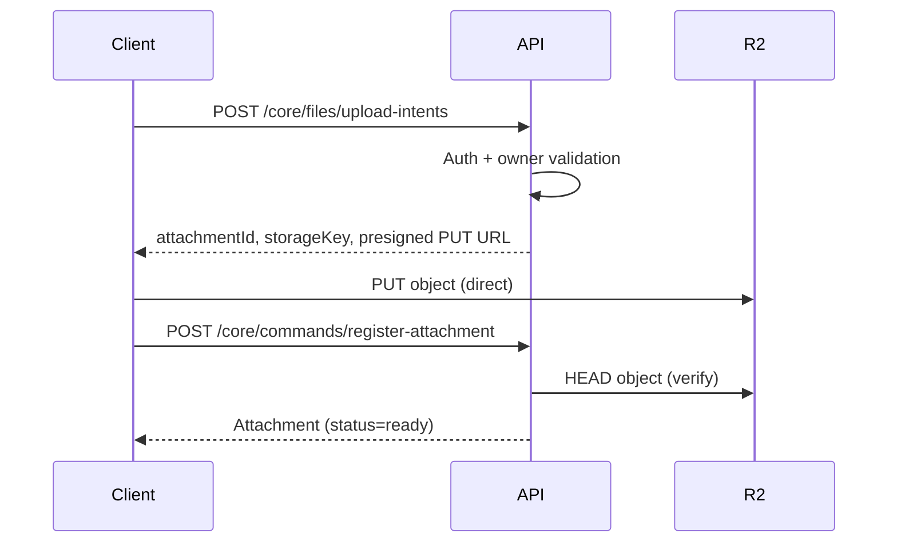

# File Storage (R2) — Sprint Plan

> **Status:** Phase 1 **foundation implemented** — port, adapter, migration, API routes; client UI + generated PDFs pending  
> **Created:** 2026-06-27  
> **Last updated:** 2026-06-27 (S3 API–only access; no Worker R2 bindings)  
> **Scope:** R2-backed object storage for user uploads and server-generated documents (signed report cards, incident reports)  
> **Related domain:** `package/domain-core/src/domains/school/attachment.ts` (`Attachment`, `AttachmentOwnerKind`)

Separate **R2 buckets per environment** (dev local uses in-memory adapter; staging and production each get a dedicated bucket).

---

## 1. Outcomes

| # | Outcome | Phase | Status |
|---|---------|-------|--------|
| 1 | `FileStoragePort` in `@edaya/core` | 1 | Done |
| 2 | In-memory / local dev / no-op adapters in `@edaya/adaptor-file` | 1 | Done |
| 3 | `@edaya/adaptor-r2` (S3-compatible R2 client) | 1 | Done |
| 4 | Attachment schema: `storageKey`, `status`, `checksum`; nullable `fileUrl` | 1 | Done |
| 5 | Gateway wired through `ServiceArgs` → `BaseSchoolService` | 1 | Done |
| 6 | `POST /core/files/upload-intents` (presigned PUT) | 1 | Done |
| 7 | `GET /core/files/{attachmentId}/download-url` (presigned GET) | 1 | Done |
| 8 | `registerAttachment` verifies object exists; `removeAttachment` deletes object | 1 | Done |
| 9 | R2 bucket names + S3 API secrets per env | 1 | Done |
| 10 | Webapp upload UI (presigned flow) | 2 | Pending |
| 11 | Mobile guardian upload UI | 2 | Pending |
| 12 | Generated PDF: report card on publish | 3 | Pending |
| 13 | Generated PDF: incident report | 3 | Pending |
| 14 | Orphan `pending_upload` cleanup cron | 4 | Pending |

---

## 2. Architecture

### 2.1 Module layout

```text
package/domain-core/src/
  ports/file-storage.ts              # Port interface
  storage/
    build-storage-key.ts             # Key layout helper
    sanitize-file-name.ts
    upload-policy.ts                 # MIME + size limits per owner kind

package/adaptor-file/
  src/in-memory-file-storage.ts    # Test / worker dev fallback
  src/local-dev-file-storage.ts    # Node dev filesystem + signed URLs
  src/no-op-file-storage.ts

package/adaptor-r2/
  src/r2-file-storage.ts             # S3-compatible R2 implementation
  src/create-from-env.ts

apps/api/src/
  runtime/shared/resolve-file-storage.ts
  routes/file-storage.routes.ts
  wrangler.toml                      # R2_BUCKET_NAME per env; S3 API secrets via wrangler
```

### 2.1.2 Local dev storage (Node, no R2)

When `RUNTIME=node`, `NODE_ENV=development`, and R2 env vars are **unset**, `resolveFileStorage()` uses `createLocalDevFileStorage()`:

- Files on disk under `.data/file-storage/` (gitignored)
- Presigned URLs point at `PUT/GET /core/dev/files/*` on the API (HMAC signed with `BETTER_AUTH_SECRET`)
- Full upload/download flow works offline without Cloudflare

`wrangler dev` without R2 still uses in-memory storage. Use R2 dev bucket or Node `bun dev` for realistic file flows.

### 2.1.1 Access model (S3 API only)

`@edaya/adaptor-r2` uses the **R2 S3-compatible endpoint** for all operations (put, head, delete, presigned upload/download). We do **not** use `[[r2_buckets]]` Worker bindings — one code path for Node and Worker, and bindings cannot mint presigned URLs anyway.

| Config | Where | Purpose |
|--------|-------|---------|
| `R2_BUCKET_NAME` | `wrangler.toml` `[vars]` per env | Non-secret bucket name |
| `R2_ACCOUNT_ID`, `R2_ACCESS_KEY_ID`, `R2_SECRET_ACCESS_KEY` | `.dev.vars` / `wrangler secret put` | S3 API + presigning |

Local Node (`bun dev`) without secrets → in-memory adapter. Worker / Node with secrets → real R2.

### 2.2 Object key layout

```
{schoolId}/{purpose}/{ownerKind}/{ownerId}/{attachmentId}/{safeFileName}
```

| Purpose | Prefix | Examples |
|---------|--------|----------|
| User upload | `uploads` | Profile photo, incident evidence |
| Generated report card | `generated/report-card` | Signed PDF after publish |
| Generated incident report | `generated/incident-report` | Signed PDF |

### 2.3 Upload flow (user files)



### 2.4 Download flow

1. Client requests `GET /core/files/{attachmentId}/download-url`
2. API checks `ATTACHMENT_READ` + owner access
3. API returns short-lived presigned GET URL

### 2.5 Generated documents (Phase 3)

Server workflow generates PDF bytes → `fileStorage.putObject()` → `registerAttachment` with `ownerKind: report_card | incident`.

---

## 3. R2 infrastructure (per env)

| Environment | Bucket |
|-------------|--------|
| Local worker dev | `edaya-files-dev` |
| Staging | `edaya-files-staging` |
| Production | `edaya-files-production` |

**Secrets** (`.dev.vars` for `wrangler dev`, `wrangler secret put` for deployed workers):

- `R2_ACCOUNT_ID`
- `R2_ACCESS_KEY_ID`
- `R2_SECRET_ACCESS_KEY`

`R2_BUCKET_NAME` can be a `[vars]` entry per env (non-secret).

**Node local dev:** same env vars, or in-memory adapter when unset.

Create buckets:

```sh
cd apps/api
bunx wrangler r2 bucket create edaya-files-dev
bunx wrangler r2 bucket create edaya-files-staging
bunx wrangler r2 bucket create edaya-files-production
```

---

## 4. Guardrails

- Private buckets only — no public URLs stored in Postgres
- Server builds all `storageKey` values; clients never choose paths
- Presigned PUT enforces `Content-Type` and declared `sizeBytes`
- `registerAttachment` rejects external `fileUrl` when R2 is configured
- `removeAttachment` deletes the R2 object when `storageKey` is set
- Ports-and-adapters: `@edaya/core` never imports `@edaya/adaptor-file` or `@edaya/adaptor-r2`

---

## 5. Attachment schema evolution

| Field | Type | Notes |
|-------|------|-------|
| `storageKey` | `text` nullable | Canonical R2 object path |
| `status` | `text` not null default `ready` | `pending_upload` \| `ready` \| `failed` |
| `checksum` | `text` nullable | SHA-256 (Phase 3+) |
| `fileUrl` | `text` nullable | Legacy / resolved at read time only |

Validation: at least one of `storageKey` or `fileUrl` must be non-blank.

---

## 6. Phase checklist

### Phase 1 — Foundation (current)

- [x] Plan document
- [x] Port + adapters
- [x] Schema migration (`0021_attachment_storage.sql`)
- [x] API routes + workflow updates
- [x] Wrangler `R2_BUCKET_NAME` vars + env schema (S3 API secrets)
- [x] Core tests green (531 pass)

### Phase 2 — Client upload

- [ ] Webapp presigned upload component
- [ ] Mobile guardian upload
- [ ] OpenAPI client regen

### Phase 3 — Generated documents

- [ ] PDF generation service (report card)
- [ ] Hook into `publishReportCardResult`
- [ ] Incident report PDF + attachment

### Phase 4 — Ops

- [ ] Lifecycle rule / cron for stale `pending_upload` keys
- [ ] Staging deploy runbook update (`docs/deploy-staging.md`)

---

## 7. Test plan

| Area | Test |
|------|------|
| Core | `buildStorageKey`, in-memory adapter, attachment validation |
| Adaptor | Presign + put/head/delete against in-memory or mocked S3 |
| `@edaya/adaptor-r2` integration | `bun run test:integration` in `package/adaptor-r2` with R2 env vars set |
| API | Upload intent auth gate, download URL permission |
| Integration | Register attachment after in-memory put |

---

## 8. Related docs

- [integrations-restructure.md](../docs/integrations-restructure.md) — package boundaries
- [api-runtimes.md](../docs/api-runtimes.md) — Worker env / secrets
- [deploy-staging.md](../docs/deploy-staging.md) — staging infra
