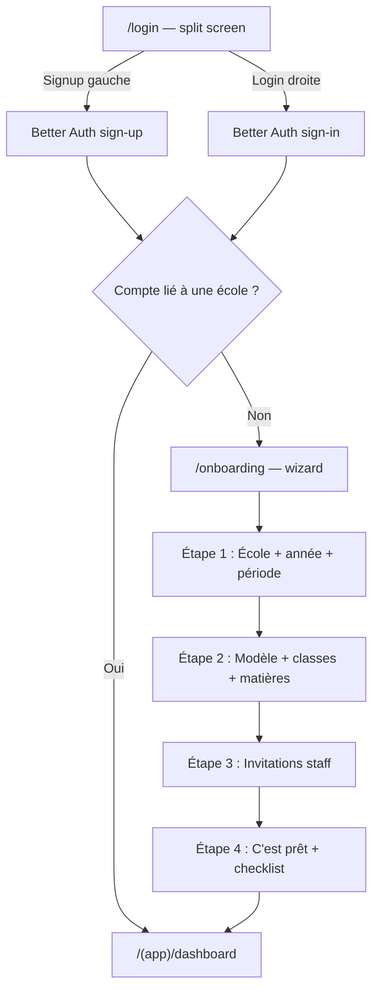

# School Onboarding — Sprint Plan

> **Status:** Not started  
> **Created:** 2026-06-28  
> **Scope:** Inscription publique, écran auth split login/signup, assistant de configuration école (remplace le seeding manuel pour les nouveaux comptes)  
> **Depends on:** Better Auth (done), `POST /core/onboarding/register-school` (done), invitations staff (Phase 5 webapp — en cours), `@edaya/dev-fixtures` (templates collège/lycée)  
> **Related docs:** [`specs/design-language-spec.md`](../specs/design-language-spec.md), [`docs/local-dev.md`](../docs/local-dev.md), [`sprints/done/account-invitation-plan.md`](./done/account-invitation-plan.md)

---

## Progress tracker

Cocher quand la phase (ou sous-phase) est terminée et mergée.

- [ ] **Phase 0** — Livraison email auth (OTP / vérification) *(en pause — à reprendre)*
- [x] **Phase 1** — Écran auth split (login à droite · signup à gauche)
- [ ] **Phase 2** — Inscription + redirection compte non lié
- [ ] **Phase 3** — Shell assistant + barre de progression
- [ ] **Phase 4** — Étape 1 : identité école + année / période
- [ ] **Phase 5** — Étape 2 : modèle établissement + classes + curriculum
- [ ] **Phase 6** — Étape 3 : invitations staff
- [ ] **Phase 7** — Étape 4 : sortie assistant + checklist
- [ ] **Phase 8** — Cutover dev (seeding optionnel vs assistant)

---

## 1. Problème et objectif

### Situation actuelle

| Flux | Comportement |
|------|--------------|
| **Login** | `/login` — connexion uniquement ; comptes démo via fixtures |
| **Seeding dev** | `bun seed:init` crée users Better Auth + école via fixtures + charge ~toutes les entités demo |
| **Nouveau compte réel** | Possible via Better Auth, mais pas d’UI signup ; OTP loggé en console en dev, pas d’email réel |
| **École vide** | `register-school` API existe ; session `/core/*` renvoie 401 tant que le compte n’est pas lié à un acteur |

### Objectif produit

1. **Page login redesignée** — layout split inspiré de la capture fournie, adapté à la charte EDAYA (teal institutionnel, pas le bleu générique) :
   - **Gauche** : panneau « Créer un compte » (nom, email, mot de passe, confirmation)
   - **Droite** : login actuel (`LoginPanelHost` — mot de passe + OTP email)
   - Lien croisé : « Déjà un compte ? » / « Pas encore de compte ? »

2. **Assistant post-inscription** — wizard 4 étapes avec barre de progression pour configurer une école **sans** `bun seed:init`.

3. **Cutover personnel** — tu peux `rm -rf .data`, créer ton compte avec un **email réel**, recevoir le courriel, et peupler l’école via l’assistant.

### Non-objectifs (v1)

- OAuth / Google / Facebook (comme la capture — hors scope)
- Multi-établissement par compte (1 compte = 1 école en v1)
- Import CSV élèves dans l’assistant (étape 4 manuelle)
- Population demo (élèves, notes, absences) — reste dans `bun seed` pour les démos

---

## 2. Parcours utilisateur cible



---

## 3. Fondation existante (réutiliser)

| Capacité | Emplacement | Notes |
|----------|-------------|-------|
| Sign-up email/password | Better Auth + `/invite/[token]` | Pattern signup déjà prouvé |
| OTP email | `emailOTP` plugin + `LoginEmailOtpPanel` | Mailer dev = log console seulement |
| Register school + owner | `registerSchoolWithOwner` | Feature flag `ALLOW_PUBLIC_SCHOOL_REGISTRATION` |
| Session non liée | `bootstrapSession` → 401 → `session: null` | Hook pour redirect onboarding |
| Structure scolaire | `SetupServiceWorkflow` | `createAcademicYear`, `createAcademicPeriod`, `createClassGroup`, `registerStaffMember` |
| Templates niveaux FR | `SEED_GRADE_LEVELS` dans `@edaya/dev-fixtures` | 6e → Terminale, cycles collège/lycée |
| Curriculum seed | `CurriculumSeedPort` | Matières, chapitres, class subjects |
| Invitations | `AccountInvitationServiceWorkflow` + Novu | Email staff via workflow `account_invitation` |

---

## 4. Architecture UI

### 4.1 Layout auth split (`AuthSplitShell`)

Remplacer le layout centré unique de `AuthScreenShell` par un shell ** deux colonnes ** sur `md+` ; empilé sur mobile (signup au-dessus, login en dessous).

```
┌─────────────────────────────┬─────────────────────────────┐
│  Panneau gauche (primary)   │  Panneau droit (card)       │
│  ─────────────────────      │  ─────────────────────      │
│  Titre accroche             │  EDAYA logo + « Connexion » │
│  Texte valeur produit       │  LoginMethodPicker          │
│  [Créer mon compte] CTA     │  LoginPasswordPanel / OTP   │
│  ─ ou formulaire signup ─   │  Lien → basculer panneau    │
│  Nom · Email · MDP · Conf.  │                             │
│  [S'inscrire]               │                             │
└─────────────────────────────┴─────────────────────────────┘
```

**Design (design-language-spec) :**

- Panneau gauche : `bg-primary text-primary-foreground`, typo `font-display`, CTA `rounded-full` ou `rounded-xl`
- Panneau droit : `bg-background`, carte login existante (`rounded-2xl border shadow-soft`)
- Pas de couleur bleue générique — teal EDAYA (`--primary`)

**Fichiers clés :**

- `apps/webapp/src/lib/components/auth/AuthSplitShell.svelte` (nouveau)
- `apps/webapp/src/lib/components/auth/signup/SignupPanel.svelte` (nouveau)
- `apps/webapp/src/routes/login/+page.svelte` — migrer vers split shell

### 4.2 Layout assistant (`OnboardingShell`)

Hors app shell (pas de sidebar). Header minimal : logo EDAYA + `LanguageSelector` + email connecté + déconnexion.

- **Stepper** horizontal : 4 étapes, état `completed | active | upcoming`
- Corps : formulaire pleine largeur (`max-w-2xl` centré)
- Footer sticky : `Précédent` · `Passer` (si optionnel) · `Continuer`

Route : `apps/webapp/src/routes/onboarding/+layout.svelte` + sous-routes ou query `?step=1..4`.

---

## 5. Phases détaillées

---

### Phase 0 — Livraison email auth

**Effort estimé :** 4–8 h  
**PR suggérée :** `feature/auth-email-delivery`  
**Bloquant pour :** inscription avec email réel

**Problème :** `createAuthOtpMailer` log l’OTP en dev et warn en production — aucun email réel n’est envoyé.

#### 0.1 Brancher le mailer auth sur Novu (ou SMTP)

- [ ] Créer `AuthEmailDeliveryPort` dans `@edaya/adaptor-novu` (`auth-email-delivery.ts`)
- [ ] Implémenter envoi via Novu workflows `auth.otp` + `auth.email_verification`
- [ ] Fallback dev sans Novu : conserver le log console
- [ ] Documenter dans `docs/local-dev.md` : variables requises pour recevoir un OTP réel

#### 0.2 Vérification email signup (si password)

- [ ] Activer `emailVerification` Better Auth quand Novu est configuré
- [ ] Email de vérification via le même canal Novu
- [x] UI : état « Vérifiez votre boîte mail » après signup (Phase 1 — `SignupPanel`)

#### 0.3 Test manuel (critère de done)

- [ ] S’inscrire avec une adresse email personnelle → recevoir le mail (OTP ou lien de vérification)
- [ ] Se connecter avec ce compte → session Better Auth OK, `/core/*` encore 401 (non lié)

**Fichiers clés :** `apps/api/src/runtime/shared/adapters/auth-otp-mailer.ts`, `better-auth.ts`, Novu bootstrap scripts

---

### Phase 1 — Écran auth split

**Effort estimé :** 6–10 h  
**PR suggérée :** `feature/auth-split-login-signup`

#### 1.1 `AuthSplitShell`

- [x] Composant deux colonnes responsive (capture → charte EDAYA)
- [x] Conserver header langue
- [x] Mobile : tabs « Connexion » / « Créer un compte »

#### 1.2 `SignupPanel`

- [x] Champs : nom complet, email, mot de passe, confirmation mot de passe
- [x] Validation client (email format, MDP ≥ 8 car., match confirmation)
- [x] Appel `authClient.signUp.email` (pattern `/invite/[token]`)
- [x] Gestion compte existant → basculer panneau droit + pré-remplir email
- [x] i18n FR/EN

#### 1.3 Intégration page login

- [x] Refactor `login/+page.svelte` : gauche signup, droite `LoginPanelHost` inchangé
- [x] Lien « Déjà un compte ? Se connecter » / « Créer un compte »
- [x] Demo link footer conservé si `isDemoLoginEnabled()`

**Done when :** split screen visible ; signup crée un user Better Auth ; login droit fonctionne toujours.

---

### Phase 2 — Redirection compte non lié

**Effort estimé :** 3–5 h  
**PR suggérée :** `feature/onboarding-auth-redirect`

#### 2.1 Guard de navigation post-auth

- [ ] Nouveau helper `resolvePostAuthPath()` :
  - session `/core/authorization/effective-grants` OK → dashboard (directeur) ou route métier
  - Better Auth OK mais 401 core → `/onboarding`
- [ ] Mettre à jour `completeAuthSignIn`, `redirectPathIfLoggedIn`, signup success handler

#### 2.2 Route guard onboarding

- [ ] `(app)` layout : si user connecté sans acteur → redirect `/onboarding`
- [ ] `/onboarding` : si user déjà lié → redirect dashboard
- [ ] Route publique onboarding (hors `(app)` shell)

#### 2.3 Feature flag

- [ ] Exposer côté webapp si registration publique activée (aligné `ALLOW_PUBLIC_SCHOOL_REGISTRATION`)
- [ ] Masquer signup si désactivé (prod sans flag)

**Fichiers clés :** `complete-sign-in.ts`, `bootstrap.ts`, `routes/onboarding/+layout.ts`

---

### Phase 3 — Shell assistant + progression

**Effort estimé :** 4–6 h  
**PR suggérée :** `feature/onboarding-shell`

- [ ] `OnboardingShell.svelte` + `OnboardingStepper.svelte`
- [ ] Store ou URL `step` (1–4) avec validation avant avance
- [ ] Persistance brouillon local (`sessionStorage`) — reprise si refresh
- [ ] *(Optionnel v1.1)* API `GET/PATCH /core/onboarding/draft` pour reprise cross-device

**Done when :** navigation 1→4 avec stepper visuel ; données brouillon survivent au refresh.

---

### Phase 4 — Étape 1 : Identité école

**Effort estimé :** 6–8 h  
**PR suggérée :** `feature/onboarding-step-school`

**Formulaire :**

| Champ | Détail |
|-------|--------|
| Nom établissement | requis |
| Ville, pays | requis |
| Fuseau horaire | select IANA, défaut navigateur |
| Année scolaire | ex. « 2025–2026 » + dates début/fin |
| Période active | ex. « Trimestre 1 » + dates ; type `trimester` |

**Actions API (fin d’étape) :**

1. `POST /core/onboarding/register-school` — crée école + owner staff + lie `subjectId`
2. `createAcademicYear` — commande core
3. `createAcademicPeriod` + `publishAcademicPeriod`

- [ ] UI formulaire + validation
- [ ] Mutations séquentielles avec toast erreur
- [ ] Après succès : `bootstrapSession()` → session staff directeur active
- [ ] Tests intégration : register-school + year + period

**Note :** étendre le payload `register-school` si besoin (owner name déjà supporté).

---

### Phase 5 — Étape 2 : Modèle + classes + curriculum

**Effort estimé :** 12–16 h  
**PR suggérée :** `feature/onboarding-step-structure`

**Cœur produit — remplace la partie structure du seeding.**

#### 5.1 Package templates onboarding

Extraire de `@edaya/dev-fixtures` vers `package/onboarding-templates/` (ou dossier dédié) :

- [ ] Modèles **Collège** (6e–3e) et **Lycée** (2nde, 1ère, Terminale)
- [ ] Par niveau : matières par défaut + chapitres (`Subject` / `SubjectMatter`)
- [ ] Mapping niveau → `GradeLevel` records

#### 5.2 UI sélection modèle

- [ ] Cases à cocher Collège / Lycée (multi-sélection)
- [ ] Pour chaque niveau coché :
  - nombre de classes (stepper 1–n)
  - capacité max par classe (défaut 30)
  - preview noms générés (`6e A`, `6e B`, …)
- [ ] Récapitulatif avant validation

#### 5.3 API batch structure

Option A (recommandée v1) : **endpoint dédié** orchestré côté API

- [ ] `POST /core/onboarding/apply-structure-template`
- [ ] Body : `{ models: ['college','lycee'], levels: [{ gradeLevelId, classCount, capacity }] }`
- [ ] Serveur : crée `GradeLevel`, `ClassGroup`, `Subject`, `SubjectMatter`, `ClassSubject`, liens chapitres — en une transaction

Option B : enchaîner les commandes existantes depuis le client (plus de requêtes, plus fragile).

- [ ] Implémenter Option A
- [ ] Tests : 2 classes 6e + 1 Terminale → entités attendues en DB

#### 5.4 Fichiers clés

- `testing/dev-fixtures/src/dataset.ts` (source templates)
- `package/domain-core/.../setup.ts`, curriculum workflows
- Nouveau handler onboarding routes

---

### Phase 6 — Étape 3 : Invitations staff

**Effort estimé :** 6–8 h  
**PR suggérée :** `feature/onboarding-step-staff-invites`  
**Depends on :** Phase 5 webapp (invitations) + Novu email configuré

**Formulaire répétable :**

| Champ | Détail |
|-------|--------|
| Email | requis |
| Profil / rôle | select prédéfini (Directeur adj., CPE, Professeur, Secrétaire, …) → map permissions |

- [ ] Lignes add/remove (pattern liste modale app-shell)
- [ ] `registerStaffMember` + `sendAccountInvitation: true` par ligne
- [ ] Bouton « Passer cette étape » (0 invitation OK)
- [ ] Réutiliser templates Novu `account_invitation`

**Done when :** invitations envoyées par email réel ; staff visible dans menu École après onboarding complet.

---

### Phase 7 — Étape 4 : Sortie + checklist

**Effort estimé :** 4–6 h  
**PR suggérée :** `feature/onboarding-completion`

- [ ] Écran succès : « Votre école est prête »
- [ ] Checklist liens profonds (non bloquants) :
  - Affiner matières / chapitres → Configuration
  - Ajouter élèves → École / Élèves
  - Emplois du temps → Planning
  - Facturation → Finance
- [ ] CTA principal → `/(app)/dashboard`
- [ ] Marquer onboarding terminé (flag local + option API `onboardingCompletedAt` sur school)

---

### Phase 8 — Cutover dev (seeding vs assistant)

**Effort estimé :** 2–4 h  
**PR suggérée :** `chore/onboarding-dev-docs`

**Objectif :** permettre de travailler **sans** `bun seed:init` pour ton compte personnel.

- [ ] Documenter flux « fresh `.data` + onboarding » dans `docs/local-dev.md`
- [ ] Garder `bun seed:init` pour démo CI et tests d’intégration seed
- [ ] `bootstrapHttpCoreSession` (seeding) : ne plus être le chemin par défaut pour nouveaux devs — note dans README
- [ ] Script smoke `bun seed:smoke` : accepter compte onboarding (pas seulement fixtures)
- [ ] *(Optionnel)* flag `.env` `SKIP_DEMO_SEED=true` pour `bun dev` sans auto-attente seed

**Critère personnel (ton test) :**

```sh
# 1. Stop bun dev
rm -rf .data
bun dev
# 2. Ouvrir /login → signup gauche avec ton email réel
# 3. Recevoir mail → vérifier / OTP
# 4. Compléter wizard 4 étapes
# 5. Arriver sur dashboard avec TA école (pas sch-edaya-central)
```

---

## 6. Décisions produit à trancher

| # | Question | Recommandation v1 |
|---|----------|-------------------|
| D1 | Signup : mot de passe ou OTP uniquement ? | **Mot de passe** pour owner (pattern invite) ; OTP reste pour login rapide |
| D2 | Vérification email obligatoire avant wizard ? | **Oui** — évite comptes jetables |
| D3 | Étape 3 staff obligatoire ? | **Non** — skippable |
| D4 | Templates pédagogiques | Générique EDAYA (fixtures) ; référentiel officiel FR en v2 |
| D5 | « AO » / filières pro | Hors v1 |
| D6 | Endpoint batch structure vs commandes client | **Endpoint batch** |

---

## 7. Matrice effort / dépendances

```text
Phase 0 (email) ──► Phase 1 (split UI) ──► Phase 2 (redirect)
                                              │
                                              ▼
                                    Phase 3 (shell)
                                              │
                         ┌────────────────────┼────────────────────┐
                         ▼                    ▼                    ▼
                   Phase 4 (école)      Phase 5 (structure)   Phase 6 (staff)
                         │                    │                    │
                         └────────────────────┴────────────────────┘
                                              │
                                              ▼
                                    Phase 7 (completion)
                                              │
                                              ▼
                                    Phase 8 (cutover docs)
```

| Phase | Effort | PRs | Bloqué par |
|-------|--------|-----|------------|
| 0 | 4–8 h | 1 | Novu SMTP configuré |
| 1 | 6–10 h | 1 | — |
| 2 | 3–5 h | 1 | 1 |
| 3 | 4–6 h | 1 | 2 |
| 4 | 6–8 h | 1 | 3 |
| 5 | 12–16 h | 1–2 | 4 |
| 6 | 6–8 h | 1 | 5, Novu invite |
| 7 | 4–6 h | 1 | 6 |
| 8 | 2–4 h | 1 | 7 |
| **Total** | **~47–71 h** | **9–10 PRs** | |

---

## 8. Tests

| Niveau | Couverture |
|--------|------------|
| **Unit** | Templates structure, génération noms classes, validation formulaires |
| **Integration** | `register-school` → year → period ; batch structure ; invitation send |
| **E2E manuel** | Signup email réel → wizard complet → dashboard |
| **Régression** | `bun seed:init` + demo login inchangés ; tests seed existants verts |

---

## 9. Checklist ops (avant ton test email réel)

- [ ] Novu : workflow `auth.otp` + workflow `account_invitation` actifs
- [ ] Novu : intégration email (SMTP Cloudflare ou autre) configurée
- [ ] `ALLOW_PUBLIC_SCHOOL_REGISTRATION=true` dans `apps/api/.dev.vars`
- [ ] `WEBAPP_ORIGIN` / CORS alignés sur ton port local
- [ ] API redémarrée après changement secrets Novu

---

## 10. Prochaine PR recommandée

**Phase 0 + Phase 1 en parallèle partiel** — sans email réel, tu ne peux pas valider le parcours complet.

Ordre strict pour ton objectif « email réel + couper le seeding » :

1. **Phase 0** — configurer l’envoi OTP / vérification (bloquant)
2. **Phase 1** — split login/signup
3. **Phase 2** — redirect `/onboarding`
4. **Phases 3–4** — shell + école (MVP : une école vide utilisable)
5. **Phase 5** — structure (remplace le cœur du seeding manuel)
6. **Phases 6–8** — staff, finition, docs

---

## Annexe — Mapping seeding → assistant

| Seeding HTTP actuel | Étape assistant |
|---------------------|-----------------|
| `bootstrapHttpCoreSession` → `register-school` | Étape 1 |
| `school-structure` : grade levels, classes, year, period | Étape 1 + 2 |
| `curriculum` : subjects, matters, class subjects | Étape 2 |
| `auth-link` : lier users fixtures | Signup réel (plus besoin) |
| `population` : élèves, guardians | Hors scope — config manuelle |
| `assessments`, `attendance`, … | Demo only — `bun seed` |
